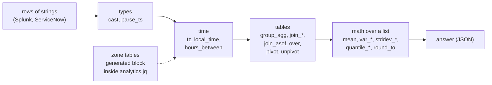

# analytics.jq: tables and statistics for jq

`analytics.jq` is a jq module of 66 functions that let a jq program answer the questions people usually send to SQL, pandas or a graph library: hold several named tables at once, join them by key, condition and time, group and aggregate, percentiles, running and lagged values over ordered partitions, time series read as state machines, roll-ups over trees, reachability in graphs, measures evaluated at several levels of a report, and local time in a named time zone. Each function states its rule in a comment beside it (how it treats nulls, ties, order and rounding), and each rule is pinned by a test whose expected answer DuckDB computes. Its time-zone tables, generated from the IANA time-zone database, are a block inside the same file.

It exists because plain jq leaves those rules to whoever writes the program. In one analysis of service requests, four shared jq helpers each decided a number without saying how: one dropped unresolved tickets, one used a different percentile rule, one hardcoded a single year's daylight-saving switch, one rounded before comparing with a threshold and miscounted by one. This library is one place where those rules are written down, tested against DuckDB, and the same for every analysis that loads it.

**What it is for.** JSON or YAML as it arrives, often nested and with every value a string, and everyday analytic work on it short of fitting a model. It also reshapes a result into what the next tool reads. Past about 200,000 rows, or when the same data answers many questions, hand the heavy step to a columnar engine such as DuckDB: see [Costs and limits](#costs-and-limits).

## What it reads and what it produces

**Input: a table, which in jq is an array of objects, one object per row.** Values arrive the way Splunk and ServiceNow hand them over: every field a string, an empty string for a missing timestamp, timestamps as UTC wall-clock text without a zone. The examples in this file use four made-up service requests of that shape:

<!-- example: sample_rows -->
```json
[
  {"number": "REQ0001", "opened_at": "2026-08-12 13:30:00", "resolved_at": "2026-08-12 16:00:00", "group": "access"},
  {"number": "REQ0002", "opened_at": "2026-08-14 23:10:00", "resolved_at": "2026-08-15 10:40:00", "group": "access"},
  {"number": "REQ0003", "opened_at": "2026-08-17 15:00:00", "resolved_at": "", "group": "devices"},
  {"number": "REQ0004", "opened_at": "2026-11-02 14:00:00", "resolved_at": "2026-11-02 15:00:00", "group": "access"}
]
```
<!-- /example -->

**Output: plain JSON**, usually an object of named answers or a smaller table. A question this file traces from start to end is: *for resolved requests, how long did they take, split by whether they were opened during weekday office hours (Monday to Friday, 08:00 to 16:59) in Detroit?* For the four rows above the answer is:

<!-- example: trace_answer -->
```json
[
  {"in_hours": true, "n": 2, "median": 1},
  {"in_hours": false, "n": 1, "median": 11.5}
]
```
<!-- /example -->

**Checking that by hand.** REQ0003 is unresolved, so three rows count. REQ0001 opened at 13:30 UTC on Wednesday 12 August 2026, which is 09:30 in Detroit (UTC−4 in summer): inside office hours; it took 2.5 h. REQ0002 opened at 23:10 UTC on Friday, 19:10 Detroit time: outside; it took 11.5 h. REQ0004 opened at 14:00 UTC on Monday 2 November 2026, after the 1 November switch to winter time, so 09:00 Detroit time (UTC−5): inside; it took 1 h. Inside: two rows, 2.5 h and 1 h; the nearest-rank median of two values is the value at rank ⌈2 × 0.5⌉ = 1, which is 1 h. Outside: one row, 11.5 h.

## Shapes: what the functions take

Every function takes rows, an array of objects. What differs is which fields a row must carry: that is the function's shape. Fields are always read through expressions (`tree_paths(.emp_id; .manager_id)`), never fixed names.

| Shape | One row is | Example row | Functions |
|---|---|---|---|
| table | one record | `{"id": "REQ1", "site": "North", "hours": "4.5"}` | math over a list, types and time, grouping and windows, joins |
| several tables | not a row: one object whose fields are tables | `{"dhcp": [...], "firewall": [...]}` | `split_by` makes it; `keep`, `shape` |
| intervals | one span of one key, from a start to an end | `{"ip": "10.0.0.5", "mac": "m1", "start": 1731900000, "end": 1731943200}` | `join_overlap`; made by `state_blocks`, `sessions` |
| tree | one node, pointing at its parent | `{"id": "ops", "parent": "ceo"}` | `tree_paths`, `tree_rollup` |
| graph | one edge | `{"from": "web01", "to": "db01"}` | `reachable`, `components` |
| star | a fact table plus dimension tables | fact `{"site_id": "s1", "amount": 40}`, dimension `{"id": "s1", "region": "east"}` | `lookup`; `rollup`, `measure`, `calc`, `share` |

An event log is not a shape: its rows are a table, and the question decides whether it becomes intervals, a tree, a graph or a star. Nested documents, objects keyed by id and YAML are sources that have to become rows first. [docs/design/05-shapes.md](docs/design/05-shapes.md) defines each shape and source, draws the conversions between them, and traces one nested export through three shapes.

## How the parts fit



A program normally moves left to right: turn strings into numbers and instants, derive local times and durations, reshape the table (group, join, window), and reduce lists of numbers to statistics. Each stage is ordinary jq, so stages are joined with `|` and intermediate tables are named with `as $name`, as Power Query names its `let` steps.

## Loading it

The library is one file, `analytics.jq`, in a directory `<dir>` below. Its time-zone tables are a generated block inside it, so nothing else needs to sit beside it.

| where | how |
|---|---|
| jq command line | `jq -L <dir> 'include "analytics"; …' input.json` |
| any jq, no `-L` | `jq 'include "analytics" {search: "<dir>"}; …'` |
| with a namespace | `jq 'import "analytics" as a {search: "<dir>"}; … a::mean'` |
| Python `jq` package | `jq.compile('include "analytics" {search: "<dir>"}; ' + program).input_value(rows).first()`; the package has no `-L` and an empty default search list, so the path goes in the program |
| Python package `jq_analytics` | `jq_analytics.include()` returns the `include` line with this package's directory filled in |

Tested on jq 1.7.1 (Apple's build), jq 1.8.2, gojq 0.12.20, jaq 3.1.2 and the `jq` Python package 1.13.0, which builds jq 1.8.2: all pass the same 54 test cases (`tests/run_tests.py`). The library uses no builtin that is missing from any of them, and it parenthesises `reduce … as` inside function arguments, which jq 1.7.1's grammar requires.

## Rules that hold everywhere

These are the rules a reader can rely on without reading each function; a function that differs says so in its own entry.

1. **Nulls.** Aggregates skip nulls, as SQL does, and return null when nothing is left. `count_nonnull` counts non-null values; `length` still counts everything.
2. **Keys.** Join keys that are null never match. Group keys that are null form one group of their own, as in SQL `GROUP BY`. Keys are compared by their JSON text, so `1` and `"1"` are different keys.
3. **Order.** Group output comes in order of first appearance on every engine (jq's `group_by` sorts by key instead; gojq keeps object keys sorted, so the library records each group's first position rather than relying on an object's order). Join output follows the left table, then the right table's order among matches. Sorting is stable: ties keep input order.
4. **Errors are loud.** A timestamp that does not parse, a value that is not a number where a number is asked for, or an unknown time zone raises an error naming the value. Nothing is silently dropped or turned into null except `""`, which means missing.
5. **No hidden state.** No function reads the process time zone (`TZ`), the locale or the clock.

## Tracing the question

The program that answers the office-hours question, one stage per line:

```jq
tz("America/Detroit") as $det
| map(.opened = (.opened_at | parse_ts) | .resolved = (.resolved_at | parse_ts)
      | .hours = hours_between(.opened; .resolved))
| map(select(.resolved != null) | (.opened | local_time($det)) as $o
      | .in_hours = ($o.weekday >= 1 and $o.weekday <= 5 and $o.hour >= 8 and $o.hour <= 16))
| group_agg({in_hours}; map(.hours) | {n: length, median: quantile_disc(0.5)})
```

Stage by stage on the four sample rows:

**1. Strings to instants and a duration.** `parse_ts` turns `"2026-08-12 13:30:00"` into seconds since 1970 (UTC); `""` becomes null; `hours_between` is null when either end is null, and exact (not rounded).

<!-- example: trace_parse -->
```jq
map(.opened = (.opened_at | parse_ts) | .resolved = (.resolved_at | parse_ts) | .hours = hours_between(.opened; .resolved)) | map({number, opened, resolved, hours})
```

```json
[
  {"number": "REQ0001", "opened": 1786541400, "resolved": 1786550400, "hours": 2.5},
  {"number": "REQ0002", "opened": 1786749000, "resolved": 1786790400, "hours": 11.5},
  {"number": "REQ0003", "opened": 1786978800, "resolved": null, "hours": null},
  {"number": "REQ0004", "opened": 1793628000, "resolved": 1793631600, "hours": 1}
]
```
<!-- /example -->

**2. Local clock in Detroit.** `tz("America/Detroit")` loads the zone's transition table once; `local_time` gives the wall clock at each instant. REQ0004 is after the 1 November switch, so its offset is −18000 s (UTC−5) where the others have −14400 s (UTC−4).

<!-- example: trace_local -->
```jq
tz("America/Detroit") as $det | map(.opened_at | parse_ts | local_time($det) | {date, weekday, hour, minute, offset_s})
```

```json
[
  {"date": "2026-08-12", "weekday": 3, "hour": 9, "minute": 30, "offset_s": -14400},
  {"date": "2026-08-14", "weekday": 5, "hour": 19, "minute": 10, "offset_s": -14400},
  {"date": "2026-08-17", "weekday": 1, "hour": 11, "minute": 0, "offset_s": -14400},
  {"date": "2026-11-02", "weekday": 1, "hour": 9, "minute": 0, "offset_s": -18000}
]
```
<!-- /example -->

**3. Office-hours flag**, from the local weekday (0 = Sunday) and hour, on resolved rows only:

<!-- example: trace_flag -->
```jq
tz("America/Detroit") as $det | map(.opened = (.opened_at | parse_ts) | .resolved = (.resolved_at | parse_ts) | .hours = hours_between(.opened; .resolved)) | map(select(.resolved != null) | (.opened | local_time($det)) as $o | .in_hours = ($o.weekday >= 1 and $o.weekday <= 5 and $o.hour >= 8 and $o.hour <= 16)) | map({number, hours, in_hours})
```

```json
[
  {"number": "REQ0001", "hours": 2.5, "in_hours": true},
  {"number": "REQ0002", "hours": 11.5, "in_hours": false},
  {"number": "REQ0004", "hours": 1, "in_hours": true}
]
```
<!-- /example -->

**4. Group and aggregate.** `group_agg` takes a key expression and an aggregate expression; the aggregate sees each group's rows as an array:

<!-- example: trace_answer_code -->
```jq
tz("America/Detroit") as $det | map(.opened = (.opened_at | parse_ts) | .resolved = (.resolved_at | parse_ts) | .hours = hours_between(.opened; .resolved)) | map(select(.resolved != null) | (.opened | local_time($det)) as $o | .in_hours = ($o.weekday >= 1 and $o.weekday <= 5 and $o.hour >= 8 and $o.hour <= 16)) | group_agg({in_hours}; map(.hours) | {n: length, median: quantile_disc(0.5)})
```

```json
[
  {"in_hours": true, "n": 2, "median": 1},
  {"in_hours": false, "n": 1, "median": 11.5}
]
```
<!-- /example -->

## Reference

Each entry gives the signature, what goes in and comes out, the rule, why the function exists (what plain jq does instead, and which DuckDB or Power Query function it matches), and a worked example. The sections follow the section headings in `analytics.jq`, where each `def` carries the same rule as a comment.

### Math over a list of numbers

The input is an array of numbers that may contain nulls.

**`nonnull`, `count_nonnull`, `sum_nonnull`, `mean`**. `nonnull` drops nulls; the others count, sum and average what is left, returning null when nothing is. Why: plain `add / length` divides by a count that includes the nulls `add` skipped. Matches DuckDB `count(x)`, `sum(x)`, `avg(x)` and Power Query `List.NonNullCount`, `List.Sum`, `List.Average`.

<!-- example: null_rule -->
```jq
[1, null, 3] | {plain_add_over_length: (add / length), mean: mean, count_nonnull: count_nonnull, length: length, sum_nonnull: sum_nonnull, mean_of_nulls: ([null, null] | mean)}
```

```json
{
  "plain_add_over_length": 1.3333333333333333,
  "mean": 2,
  "count_nonnull": 2,
  "length": 3,
  "sum_nonnull": 4,
  "mean_of_nulls": null
}
```
<!-- /example -->

**`min_nonnull`, `max_nonnull`, `min_by_nonnull(f)`, `max_by_nonnull(f)`**. The least and greatest non-null value, and the row whose `f` is least or greatest with null `f` left out; null when nothing is left. Why: jq's own `min` and `max` sort null below every number, so `[null, 1, 3] | min` is null. Matches DuckDB `min(x)`, `max(x)`, `arg_min(row, x)`, `arg_max(row, x)`. Ties: the first row for `min_by_nonnull`, the last for `max_by_nonnull`, as jq's `min_by` and `max_by`.

<!-- example: min_max -->
```jq
[null, 3, 1] | {plain_min: min, min_nonnull: min_nonnull, max_nonnull: max_nonnull, nothing: ([null] | min_nonnull), first_lowest: ([{id: 1, x: null}, {id: 2, x: 5}, {id: 3, x: 2}] | min_by_nonnull(.x) | .id)}
```

```json
{"plain_min": null, "min_nonnull": 1, "max_nonnull": 3, "nothing": null, "first_lowest": 3}
```
<!-- /example -->

**`var_samp`, `var_pop`, `stddev_samp`, `stddev_pop`**. Variance and standard deviation, sample (divide by n − 1; null below two values) or population (divide by n; null when empty), computed in two passes (mean first, then squared deviations). Matches DuckDB's functions of the same names; Power Query's `List.StandardDeviation` is the sample one.

<!-- example: variance -->
```jq
[2, 4, 4, 4, 5, 5, 7, 9] | {var_samp: var_samp, var_pop: var_pop, stddev_samp: stddev_samp, stddev_pop: stddev_pop, one_value_var_samp: ([3] | var_samp)}
```

```json
{
  "var_samp": 4.571428571428571,
  "var_pop": 4,
  "stddev_samp": 2.138089935299395,
  "stddev_pop": 2,
  "one_value_var_samp": null
}
```
<!-- /example -->

**`quantile_disc($p)`, `quantile_cont($p)`, `median`, `quantiles_disc($ps)`, `quantiles_cont($ps)`**. Quantiles of the non-null values for p between 0 and 1. `quantile_disc` returns an element of the data: the value at rank ⌈n·p⌉ of the sorted values, at least rank 1 (nearest rank). `quantile_cont` interpolates linearly at position (n − 1)·p between neighbours. `median` is `quantile_cont(0.5)`. The list forms take several p at once and return null, not a list of nulls, when there are no values. Why two: they differ on small groups, and an analysis must say which it used. Matches DuckDB `quantile_disc`, `quantile_cont`, `median`; Power Query `List.Percentile` with `PercentileMode.SqlDisc` and `ExcelInc`.

<!-- example: quantiles -->
```jq
[40, 10, null, 30, 20] | {disc: quantiles_disc([0.1, 0.25, 0.5, 0.9]), cont: quantiles_cont([0.1, 0.25, 0.5, 0.9]), median: median, none: ([null] | quantiles_disc([0.5]))}
```

```json
{"disc": [10, 10, 20, 40], "cont": [13, 17.5, 25, 37], "median": 25, "none": null}
```
<!-- /example -->

**`round_to($d)`**. Rounds to $d decimal places, halves away from zero, on the stored double; null stays null. Round only for display, after comparisons: rounding hours before testing `<= 1` is what miscounted by one in the earlier analysis. It agreed with DuckDB's `round` on all ten test values, including 1.005 → 1.0 and 2.675 → 2.68.

<!-- example: round -->
```jq
[1.005, 2.675, 0.125, -0.5, 1.5, null] | map(round_to(2)), map(round_to(0))
```

```json
[1, 2.68, 0.13, -0.5, 1.5, null]
[1, 3, 0, -1, 2, null]
```
<!-- /example -->

### Types

**`parse_ts`**. A timestamp string to UTC epoch seconds, fractions kept. Accepts `YYYY-MM-DD HH:MM:SS` or with `T`, an optional fraction, and an optional `Z` or `±HH:MM` / `±HHMM` offset. No offset means UTC, which is how ServiceNow and Splunk store wall-clock strings. `null` and `""` give null; anything else that does not match is an error. Why: jq's `fromdateiso8601` rejects fractions and offsets, and `strptime("%z")` parses an offset but ignores it. Matches DuckDB `ts::TIMESTAMPTZ` with `TimeZone = 'UTC'`.

<!-- example: parse_ts -->
```jq
["2026-08-12 13:05:00", "2026-08-12T13:05:00Z", "2026-08-12T09:05:00-04:00", "2026-08-12T18:35:00+0530", "2026-08-12 13:05:00.250", "", null] | map(parse_ts | if . == null then null else {epoch: ., utc: (floor | todate)} end)
```

```json
[{"epoch": 1786539900, "utc": "2026-08-12T13:05:00Z"}, {"epoch": 1786539900, "utc": "2026-08-12T13:05:00Z"}, {"epoch": 1786539900, "utc": "2026-08-12T13:05:00Z"}, {"epoch": 1786539900, "utc": "2026-08-12T13:05:00Z"}, {"epoch": 1786539900.25, "utc": "2026-08-12T13:05:00Z"}, null, null]
```
<!-- /example -->

**`cast($schema)`**. Converts named columns of every row: `$schema` maps a column to `"number"`, `"timestamp"` (via `parse_ts`), `"string"` or `"boolean"`. `""` and null become null; a value that does not convert is an error naming the column and value, as in Power Query's `Table.TransformColumnTypes`. A number must look like a JSON number, because jq 1.7.1's `tonumber` accepts `" 12"` and jq 1.8's rejects it.

<!-- example: cast -->
```jq
[{n: "12.5", t: "2026-08-12 13:05:00", b: "true"}, {n: "", t: "", b: "false"}, {n: "1e3", t: null, b: null}] | cast({n: "number", t: "timestamp", b: "boolean"})
```

```json
[
  {"n": 12.5, "t": 1786539900, "b": true},
  {"n": null, "t": null, "b": false},
  {"n": 1000.0, "t": null, "b": null}
]
```
<!-- /example -->

<!-- example: cast_error -->
```jq
[{n: " 12"}] | try cast({n: "number"}) catch .
```

```json
"cast: n = \" 12\" is not a number"
```
<!-- /example -->

### Time zones and calendar

**`tz($name)`, `tz_offset($tz)`, `local_time($tz)`**. `tz` returns one zone's transition table from the library's generated zone block; `tz_offset` gives the UTC offset in seconds at an instant; `local_time` gives the wall clock as `{date, year, month, day, hour, minute, second, weekday (0 = Sunday), offset_s, local_epoch}`. `$tz` is a zone name or the table `tz` returned. Zones included: UTC, America/Detroit, New_York, Chicago, Denver, Los_Angeles, Europe/London, from 1970 to 2100, generated by `gen_tzdata.py` from the `tzdata` package 2026.6; add a zone by adding it to `ZONES` there and regenerating. Why: plain jq's `localtime` and `strflocaltime` use the process's `TZ` setting, which inside a Splunk search command is the whole search process's, and their `%Z` label is wrong next to a switch. Matches DuckDB `ts AT TIME ZONE 'America/Detroit'`; Power Query has fixed offsets only. **Cost:** `tz_rules` is a 27 KB literal that jq rebuilds on every call, so passing a name costs 0.78 ms per call and passing `tz(...)` bound once costs 0.024 ms: write `tz("America/Detroit") as $det` once and call `local_time($det)`.

<!-- example: local_time -->
```jq
tz("America/Detroit") as $det | ["2026-03-08 06:59:59", "2026-03-08 07:00:00", "2026-11-01 05:59:59", "2026-11-01 06:00:00"] | map(parse_ts | local_time($det) | {date, hour, minute, weekday, offset_s})
```

```json
[
  {"date": "2026-03-08", "hour": 1, "minute": 59, "weekday": 0, "offset_s": -18000},
  {"date": "2026-03-08", "hour": 3, "minute": 0, "weekday": 0, "offset_s": -14400},
  {"date": "2026-11-01", "hour": 1, "minute": 59, "weekday": 0, "offset_s": -14400},
  {"date": "2026-11-01", "hour": 1, "minute": 0, "weekday": 0, "offset_s": -18000}
]
```
<!-- /example -->

**`hours_between(a; b)`**. `(b − a) / 3600` for two epoch expressions; null when either is null; not rounded. Matches DuckDB `date_diff('second', a, b) / 3600.0`.

### Grouping

**`group_agg(keyf; aggf)`**. Groups rows by the value of `keyf` and applies `aggf` to each group's array of rows; `aggf` must return an object. A key that is an object (`{g}` or `{g: .x, h: .y}`) is merged into the output row; any other key goes in a field `key`. Output rows come in order of first appearance; a null key forms one group. Why: `group_by` sorts groups by key and leaves the aggregation to hand-written code. Matches DuckDB `GROUP BY` and Power Query `Table.Group` with `GroupKind.Global`.

<!-- example: group_agg -->
```jq
[{g: "a", x: 1}, {g: "b", x: 5}, {g: null, x: 7}, {g: "a", x: null}, {g: "a", x: 3}] | group_agg({g}; map(.x) | {rows: length, n: count_nonnull, mean: mean})
```

```json
[
  {"g": "a", "rows": 3, "n": 2, "mean": 2},
  {"g": "b", "rows": 1, "n": 1, "mean": 5},
  {"g": null, "rows": 1, "n": 1, "mean": 7}
]
```
<!-- /example -->

### Several tables at once

Name each table with `as $name` and refer to it by that name in any later step, as SPL2 names its searches and Python names its variables. No other structure is needed.

**`split_by(tagf)`, `keep($names)`, `shape`.** Some steps make several tables at once; they return one object whose fields are the tables, such as `{dhcp: [...], firewall: [...]}`, and the next steps take `.dhcp` and `.firewall` out of it. `split_by` turns one stream of rows into such an object, one table per value of `tagf` (the value as a string names the table). This is how several tables reach a Splunk search command: a search appends them into one stream with a field saying which table each row belongs to. `keep` drops every table not named. `shape` gives each table's row count and sorted field names, for checking a step's output. From the jq command line a second table arrives with `--slurpfile`, from Python with `args=`; see Loading it.

<!-- example: several_tables -->
```jq
[{t: "100", ip_address: "10.1.1.55", user: "bsmith", src_ip: "", event_type: "dhcp"}, {t: "300", ip_address: "10.1.1.55", user: "jdoe", src_ip: "", event_type: "dhcp"}, {t: "10", ip_address: "10.1.1.99", user: "olduser", src_ip: "", event_type: "dhcp"}, {t: "400", ip_address: "", user: "", src_ip: "10.1.1.55", event_type: "firewall"}, {t: "1000", ip_address: "", user: "", src_ip: "10.1.1.99", event_type: "firewall"}] | split_by(.event_type) as $by_type | ($by_type.dhcp | map({ip: .ip_address, user, lease_t: (.t | tonumber)})) as $leases | ($by_type.firewall | map({ip: .src_ip, t: (.t | tonumber)})) as $hits | {split: ($by_type | shape | map_values(.rows)), answer: ($hits | join_asof($leases; .ip; .ip; .t; .lease_t; 300) | map({t, ip, user}))}
```

```json
{
  "split": {"dhcp": 3, "firewall": 2},
  "answer": [{"t": 400, "ip": "10.1.1.55", "user": "jdoe"}, {"t": 1000, "ip": "10.1.1.99", "user": null}]
}
```
<!-- /example -->

### Joins

Every join is four choices, and each is an argument:

| Choice | What you write | Cost |
|---|---|---|
| Key: the equality part | an expression per side; an array for a composite key (`[.site, .ip]`); a cleaned value for keys equal only after cleaning | left rows plus right rows: the right table is indexed once |
| Condition: the rest | a filter over the pair, `.l` (left row) and `.r` (right row): a range, an inequality | checked only for pairs that share a key; with `true` for both keys, every pair is checked |
| Kind | `"inner"`, `"left"`, `"full"`, `"semi"`, `"anti"` | none |
| Shape | flat (`join_on`: one row per match) or nested (`join_nest`: matches as an array) | nested never multiplies rows |

The input is the left table and `$right` the right table. Rules for all joins: a null key never matches; duplicate keys multiply rows in a flat join; output follows the left table's order, then the right table's order among matches. A flat match is the left row merged with the right row: a field in both with the same value is kept once, and with different values it is an error naming the field, so rename one side first. jq's own `JOIN` builtins are a left join only, fail on numeric keys without `tostring`, and keep only the last of duplicate right keys.

**`join_on($right; lkey; rkey; cond; $kind)`.** The general flat join. Matches DuckDB `JOIN … ON key equality AND condition` in each kind, and Power Query `Table.Join` with a `JoinKind`.

<!-- example: join_on -->
```jq
[{id: 1, region: "east", amount: 5}, {id: 2, region: "east", amount: 60}, {id: 3, region: "west", amount: 5}] as $orders | [{region: "east", lo: 0, hi: 10, band: "small"}, {region: "east", lo: 10, hi: 100, band: "medium"}, {region: "east", lo: 50, hi: 100, band: "upper"}] as $bands | $orders | join_on($bands; .region; .region; .l.amount >= .r.lo and .l.amount < .r.hi; "left") | map({id, amount, band})
```

```json
[
  {"id": 1, "amount": 5, "band": "small"},
  {"id": 2, "amount": 60, "band": "medium"},
  {"id": 2, "amount": 60, "band": "upper"},
  {"id": 3, "amount": 5, "band": null}
]
```
<!-- /example -->

**`join_inner`, `join_left`, `join_full`, `join_semi`, `join_anti` `($right; lkey; rkey)`.** Equality joins: `join_on` with no condition. Inner: matched pairs only. Left: every left row, alone when unmatched. Full: left join, then right rows that matched nothing. Semi: left rows with at least one match, once each. Anti: left rows with no match, including those with a null key.

<!-- example: joins -->
```jq
[{id: 1, k: "a"}, {id: 2, k: "b"}, {id: 3, k: "z"}, {id: 4, k: null}] as $l | [{rk: "a", rv: "A1"}, {rk: "b", rv: "B1"}, {rk: "b", rv: "B2"}, {rk: "y", rv: "Y1"}, {rk: null, rv: "N1"}] as $r | {inner: ($l | join_inner($r; .k; .rk) | map([.id, .rv])), left: ($l | join_left($r; .k; .rk) | map([.id, .rv])), full: ($l | join_full($r; .k; .rk) | map([.id, .rv])), semi: ($l | join_semi($r; .k; .rk) | map(.id)), anti: ($l | join_anti($r; .k; .rk) | map(.id))}
```

```json
{
  "inner": [[1, "A1"], [2, "B1"], [2, "B2"]],
  "left": [[1, "A1"], [2, "B1"], [2, "B2"], [3, null], [4, null]],
  "full": [[1, "A1"], [2, "B1"], [2, "B2"], [3, null], [4, null], [null, "Y1"], [null, "N1"]],
  "semi": [1, 2],
  "anti": [3, 4]
}
```
<!-- /example -->

**`join_nest($right; lkey; rkey; cond; $as)`.** Every left row once, with field `$as` holding the array of its matching right rows (empty when none). Use it when a flat join would multiply rows, or when the nested document is the result wanted. Power Query's `Table.NestedJoin`; SQL needs a join plus `list()` and `GROUP BY`.

<!-- example: join_nest -->
```jq
[{id: 1, region: "east", amount: 5}, {id: 2, region: "east", amount: 60}, {id: 3, region: "west", amount: 5}] as $orders | [{region: "east", lo: 0, hi: 10, band: "small"}, {region: "east", lo: 10, hi: 100, band: "medium"}, {region: "east", lo: 50, hi: 100, band: "upper"}] as $bands | $orders | join_nest($bands; .region; .region; .l.amount >= .r.lo and .l.amount < .r.hi; "bands") | map({id, bands: (.bands | map(.band))})
```

```json
[
  {"id": 1, "bands": ["small"]},
  {"id": 2, "bands": ["medium", "upper"]},
  {"id": 3, "bands": []}
]
```
<!-- /example -->

**`lookup($dim; lkey; dkey; $as)`.** Attaches exactly one record of a dimension table under `$as`, null when there is none. A key that appears twice in the dimension is an error, so a lookup can never silently multiply rows. Chain lookups for a star of dimensions.

<!-- example: lookup -->
```jq
[{id: 1, gid: "g1"}, {id: 2, gid: "g9"}, {id: 3, gid: null}] | lookup([{gid: "g1", name: "Access"}, {gid: "g2", name: "Devices"}]; .gid; .gid; "group")
```

```json
[
  {"id": 1, "gid": "g1", "group": {"gid": "g1", "name": "Access"}},
  {"id": 2, "gid": "g9", "group": null},
  {"id": 3, "gid": null, "group": null}
]
```
<!-- /example -->

**`join_asof($right; lkey; rkey; ltime; rtime)` and `join_asof(…; $max_age)`.** For each left row, the right row with the same key whose `rtime` is the latest at or before the left row's `ltime`; the left row alone when there is none. With `$max_age`, a match older than that is rejected. On ties in `rtime`, the first such right row in input order (DuckDB 2.0.0 gave the same on the test; pandas takes the last; SQL leaves it open). Matches DuckDB `ASOF LEFT JOIN … ON l.k = r.k AND l.t >= r.t` and pandas `merge_asof(direction="backward", tolerance=…)`; Power Query has no as-of join. **Cost:** it binary-searches each key's sorted times, then steps back through a run of equal times, so many identical timestamps under one key slow it down (as they slow DuckDB's).

<!-- example: join_asof -->
```jq
[{q: 100, k: "a", qt: 2}, {q: 101, k: "a", qt: 10}, {q: 102, k: "a", qt: 10}, {q: 103, k: "a", qt: 14}] as $quotes | [{id: 1, k: "a", t: 1}, {id: 2, k: "a", t: 10}, {id: 3, k: "a", t: 12}, {id: 4, k: "a", t: 30}, {id: 5, k: "b", t: 30}] | {latest_at_or_before: (join_asof($quotes; .k; .k; .t; .qt) | map({id, q})), no_older_than_3: (join_asof($quotes; .k; .k; .t; .qt; 3) | map({id, q}))}
```

```json
{
  "latest_at_or_before": [{"id": 1, "q": null}, {"id": 2, "q": 101}, {"id": 3, "q": 101}, {"id": 4, "q": 103}, {"id": 5, "q": null}],
  "no_older_than_3": [{"id": 1, "q": null}, {"id": 2, "q": 101}, {"id": 3, "q": 101}, {"id": 4, "q": null}, {"id": 5, "q": null}]
}
```
<!-- /example -->

**`join_overlap($right; lkey; rkey; lstart; lend; rstart; rend)`.** Pairs with the same key whose intervals overlap, each interval closed at its start and open at its end, so intervals that only touch do not overlap. Rename the right side's start and end first, since the merged row holds both.

<!-- example: join_overlap -->
```jq
[{shift: 1, host: "a", start: 0, end: 10}, {shift: 2, host: "a", start: 10, end: 20}] | join_overlap([{outage: "x", host: "a", ostart: 8, oend: 12}, {outage: "y", host: "a", ostart: 20, oend: 25}]; .host; .host; .start; .end; .ostart; .oend) | map({shift, outage})
```

```json
[
  {"shift": 1, "outage": "x"},
  {"shift": 2, "outage": "x"}
]
```
<!-- /example -->

### Windows

**`over(part; ord; $col; wf)`**, with the window functions `row_number`, `rank_by(f)`, `lag(f; $k)`, `lead(f; $k)`, `running_sum(f)`, `moving_mean(f; $n)`. `over` splits the rows into partitions by `part`, sorts each by `ord` (stable), hands each sorted partition to `wf`, and writes the i-th value `wf` returns into field `$col` of the i-th row; rows come back in input order. The window functions take a sorted partition and return one value per row. `rank_by` gives tied values the same rank, with gaps (SQL `RANK`). `running_sum` skips nulls and is null until the first non-null. `moving_mean(f; $n)` averages the current and $n − 1 previous rows. Frames are ROWS frames, each row on its own; SQL's default RANGE frame gives tied rows the same running total. Matches DuckDB `… OVER (PARTITION BY … ORDER BY … ROWS …)`; Power Query has no window functions.

<!-- example: windows -->
```jq
[{i: 1, g: "a", t: 3, v: 5}, {i: 2, g: "a", t: 1, v: 2}, {i: 3, g: "a", t: 3, v: 7}, {i: 4, g: "a", t: 2, v: null}, {i: 5, g: "b", t: 1, v: 4}] | over(.g; .t; "rn"; row_number) | over(.g; .t; "rank"; rank_by(.t)) | over(.g; .t; "prev_v"; lag(.v; 1)) | over(.g; .t; "running"; running_sum(.v)) | over(.g; .t; "mean2"; moving_mean(.v; 2)) | map({i, g, t, v, rn, rank, prev_v, running, mean2})
```

```json
[
  {"i": 1, "g": "a", "t": 3, "v": 5, "rn": 3, "rank": 3, "prev_v": null, "running": 7, "mean2": 5},
  {"i": 2, "g": "a", "t": 1, "v": 2, "rn": 1, "rank": 1, "prev_v": null, "running": 2, "mean2": 2},
  {"i": 3, "g": "a", "t": 3, "v": 7, "rn": 4, "rank": 3, "prev_v": 5, "running": 14, "mean2": 6},
  {"i": 4, "g": "a", "t": 2, "v": null, "rn": 2, "rank": 2, "prev_v": 2, "running": 2, "mean2": 2},
  {"i": 5, "g": "b", "t": 1, "v": 4, "rn": 1, "rank": 1, "prev_v": null, "running": 4, "mean2": 4}
]
```
<!-- /example -->

### Reshape

**`unpivot($keep; $name; $value)`**. Every field not listed in `$keep` becomes its own row `{kept fields…, $name: field, $value: value}`; nulls are kept. Matches DuckDB `UNPIVOT INCLUDE NULLS` and Power Query `Table.UnpivotOtherColumns` (whose example drops nulls).

**`pivot($cols; rowkey; colf; valf; agg)`**. One output row per `rowkey` (an object), one column per name in `$cols`, holding `agg` applied to the `valf` values of the rows whose `colf` is that name; null where none; values of `colf` not in `$cols` are dropped. The column list is required, as Power Query's `pivotValues` is, so the output shape never depends on the data.

<!-- example: reshape -->
```jq
[{id: 1, a: 10, b: null}, {id: 2, a: 11, b: 21}] | unpivot(["id"]; "col"; "val") as $long | {long: $long, wide_again: ($long | pivot(["a", "b", "c"]; {id}; .col; .val; add))}
```

```json
{
  "long": [{"id": 1, "col": "a", "val": 10}, {"id": 1, "col": "b", "val": null}, {"id": 2, "col": "a", "val": 11}, {"id": 2, "col": "b", "val": 21}],
  "wide_again": [{"id": 1, "a": 10, "b": null, "c": null}, {"id": 2, "a": 11, "b": 21, "c": null}]
}
```
<!-- /example -->

### State machines over time

Events of one entity, ordered by time, are read as a machine that is in one state at a time. The entity expression works as `group_agg`'s key does: an object key's fields are merged into each output row.

**`state_blocks(entity; time; state)`.** Per entity, events sorted by time, consecutive events with the same state merged into one block: `{state, start, end, duration, events}`. `start` is the time of the block's first event, `end` the start of the next block (null for the entity's last, still-open block), `duration` their difference. A repeated state does not restart the clock: a change of assignee while a ticket stays Open belongs to the same Open block. This is the case SPL's `streamstats` splits into two rows.

<!-- example: state_blocks -->
```jq
[{ticket: "T1", t: 0, status: "New"}, {ticket: "T1", t: 600, status: "Open"}, {ticket: "T1", t: 4200, status: "Open"}, {ticket: "T1", t: 6000, status: "InReview"}, {ticket: "T1", t: 9600, status: "Closed"}] | state_blocks({ticket}; .t; .status)
```

```json
[
  {"ticket": "T1", "state": "New", "start": 0, "end": 600, "duration": 600, "events": 1},
  {"ticket": "T1", "state": "Open", "start": 600, "end": 6000, "duration": 5400, "events": 2},
  {"ticket": "T1", "state": "InReview", "start": 6000, "end": 9600, "duration": 3600, "events": 1},
  {"ticket": "T1", "state": "Closed", "start": 9600, "end": null, "duration": null, "events": 1}
]
```
<!-- /example -->

**`transitions(entity; time; state)`.** One row per change of state: `{from, to, at}`. Counting them by `{from, to}` with `group_agg` gives a transition matrix.

**`sessions(entity; time; $gap)`.** A new session starts when the gap since the entity's previous event is greater than `$gap`: `{session, start, end, events}`.

**`runs(f)`.** Run-length encoding of an array in its given order: consecutive items with the same `f` value become `{value, start, n}`. A streak is a long run.

<!-- example: state_others -->
```jq
[{ticket: "T1", t: 0, status: "New"}, {ticket: "T1", t: 600, status: "Open"}, {ticket: "T1", t: 4200, status: "Open"}, {ticket: "T1", t: 6000, status: "InReview"}, {ticket: "T1", t: 9600, status: "Closed"}] | {transitions: transitions({ticket}; .t; .status), sessions: sessions({ticket}; .t; 3000), runs: (map(.status) | runs(.))}
```

```json
{
  "transitions": [{"ticket": "T1", "from": "New", "to": "Open", "at": 600}, {"ticket": "T1", "from": "Open", "to": "InReview", "at": 6000}, {"ticket": "T1", "from": "InReview", "to": "Closed", "at": 9600}],
  "sessions": [{"ticket": "T1", "session": 1, "start": 0, "end": 600, "events": 2}, {"ticket": "T1", "session": 2, "start": 4200, "end": 6000, "events": 2}, {"ticket": "T1", "session": 3, "start": 9600, "end": 9600, "events": 1}],
  "runs": [{"value": "New", "start": 0, "n": 1}, {"value": "Open", "start": 1, "n": 2}, {"value": "InReview", "start": 3, "n": 1}, {"value": "Closed", "start": 4, "n": 1}]
}
```
<!-- /example -->

### Hierarchies

A tree is a table of nodes, each naming its parent; a root's parent is null or `""`.

**`tree_paths(id; parent)`.** Adds `ancestry` (the ids from the root down to the node) and `depth` (0 for a root). A parent that is not a node, or a cycle, is an error.

**`tree_rollup(id; parent; value)`.** `tree_paths` plus `subtree`: the node's own value plus the values of all its descendants at any depth. SPL sums one level per pass and silently undercounts deeper trees; SQL needs a recursive query.

<!-- example: tree_rollup -->
```jq
[{id: 1, parent: null, name: "CEO", cost: 100}, {id: 2, parent: 1, name: "Engineering", cost: 50}, {id: 3, parent: 1, name: "Sales", cost: 40}, {id: 4, parent: 2, name: "Backend", cost: 30}, {id: 5, parent: 2, name: "Frontend", cost: 20}, {id: 6, parent: 4, name: "Platform", cost: 10}] | tree_rollup(.id; .parent; .cost) | map({name, depth, ancestry, subtree})
```

```json
[
  {"name": "CEO", "depth": 0, "ancestry": [1], "subtree": 250},
  {"name": "Engineering", "depth": 1, "ancestry": [1, 2], "subtree": 110},
  {"name": "Sales", "depth": 1, "ancestry": [1, 3], "subtree": 40},
  {"name": "Backend", "depth": 2, "ancestry": [1, 2, 4], "subtree": 40},
  {"name": "Frontend", "depth": 2, "ancestry": [1, 2, 5], "subtree": 20},
  {"name": "Platform", "depth": 3, "ancestry": [1, 2, 4, 6], "subtree": 10}
]
```
<!-- /example -->

### Graphs

A graph is a table of edges; two expressions give each edge's ends.

**`reachable(from; to; $start)`.** Every node reached from `$start` along directed edges at any number of hops, nearest first, each once; the start itself is not listed. Cycles are safe. This is "what is downstream of this node" (blast radius).

**`components(a; b)`.** Connected groups, edges read both ways: one row per node, `{node, component}`, the component named by its smallest node. This is "which records are the same entity" when edges are pairwise matches (entity resolution).

<!-- example: graphs -->
```jq
[{a: 1, b: 2}, {a: 2, b: 3}, {a: 3, b: 1}, {a: 4, b: 5}] | {reachable_from_1: reachable(.a; .b; 1), components: components(.a; .b)}
```

```json
{
  "reachable_from_1": [2, 3],
  "components": [{"node": 1, "component": 1}, {"node": 2, "component": 1}, {"node": 3, "component": 1}, {"node": 4, "component": 4}, {"node": 5, "component": 4}]
}
```
<!-- /example -->

### Measures in a context

A report asks one measure at several levels at once, and each cell also needs numbers from outside its own rows: its share of the parent, the same measure in the previous period, a running total. DAX calls this a measure evaluated in a filter context, changed with `CALCULATE`. Here it is three plain jq ideas.

- **A measure** is any jq function over an array of rows, such as `def revenue: map(.amount) | add;`. It knows nothing about levels.
- **A context** says which rows a cell covers. Inside a cell the input is an object: `.at` holds the filters, `.rows` the rows that match, `.all` every row, `.level` the level's field names, `.members` each level field's sorted distinct values.
- **A report** (`rollup`, `rollup_levels`) runs its cell expression once per group at every level, with that context as input.

Every level must already be a field on the row. Compute it first (`map(. + {month: .opened_at[0:7]})`) or bring it from another table with `lookup`.

**`rollup($dims; cell)`.** One output row per group at every level of the hierarchy: all of `$dims`, then one fewer from the right, down to the grand total, as SQL's `GROUP BY ROLLUP`. Each row holds the level's fields, a `level` name (`"region/product"`, or `"all"`) and the fields of `cell`. Rows come level by level, sorted by the level's values. Nothing is added up from finer cells: every level is computed from rows, so a median or a ratio is right at the total.

**`measure(f)`.** Inside a cell: `f` on the cell's own rows.

**`calc(f; change)`.** Inside a cell: `f` on the rows of a changed context. **`share(f; change)`** is `measure(f)` divided by `calc(f; change)`, null when that is null or 0.

<!-- example: context_rollup -->
```jq
def revenue: map(.amount) | add; [{region: "east", product: "A", month: "2026-01", amount: 30}, {region: "east", product: "A", month: "2026-02", amount: 50}, {region: "east", product: "B", month: "2026-01", amount: 20}, {region: "west", product: "A", month: "2026-02", amount: 60}, {region: "west", product: "B", month: "2026-01", amount: 40}] | rollup(["region", "product"]; {revenue: measure(revenue), share_of_region: share(revenue; without("product")), share_of_all: share(revenue; keep_only([]))})
```

```json
[
  {"region": "east", "product": "A", "level": "region/product", "revenue": 80, "share_of_region": 0.8, "share_of_all": 0.4},
  {"region": "east", "product": "B", "level": "region/product", "revenue": 20, "share_of_region": 0.2, "share_of_all": 0.1},
  {"region": "west", "product": "A", "level": "region/product", "revenue": 60, "share_of_region": 0.6, "share_of_all": 0.3},
  {"region": "west", "product": "B", "level": "region/product", "revenue": 40, "share_of_region": 0.4, "share_of_all": 0.2},
  {"region": "east", "level": "region", "revenue": 100, "share_of_region": 1, "share_of_all": 0.5},
  {"region": "west", "level": "region", "revenue": 100, "share_of_region": 1, "share_of_all": 0.5},
  {"level": "all", "revenue": 200, "share_of_region": 1, "share_of_all": 1}
]
```
<!-- /example -->

The changes, each taking a context and returning one; pipe them to combine:

| change | effect | DAX |
|---|---|---|
| `without($dim)` | remove one filter | `ALL(column)`, `REMOVEFILTERS` |
| `keep_only($dims)` | remove every filter except these; `keep_only([])` is the grand total | `ALLEXCEPT` |
| `with_filter($at)` | add or replace filters; a value is equality, `{from, to}` a closed range | a filter argument of `CALCULATE` |
| `shift($dim; $k)` | move to the k-th neighbouring value of that field present in the data; -1 is the previous one | none: not `PREVIOUSMONTH`, which follows a calendar |
| `to_date($dim)` | everything up to and including this value, other filters kept | a running total; `DATESYTD` only when every period has rows |

**Calendar time is not in this library.** `shift` and `to_date` follow the values present in the data, sorted as values: a month with no rows is skipped, and month names sort alphabetically. For previous-period, year-to-date, months with no rows and DAX's blank rules, write the measures in DAX and compile them with [dax-sql](https://github.com/djouallah/dax-sql) to one DuckDB query; the result runs in DuckDB from Python, the shell or a Splunk search command.

<!-- example: context_time -->
```jq
def revenue: map(.amount) | add; [{region: "east", product: "A", month: "2026-01", amount: 30}, {region: "east", product: "A", month: "2026-02", amount: 50}, {region: "east", product: "B", month: "2026-01", amount: 20}, {region: "west", product: "A", month: "2026-02", amount: 60}, {region: "west", product: "B", month: "2026-01", amount: 40}] | rollup(["month"]; {revenue: measure(revenue), prior: calc(revenue; shift("month"; -1)), to_date: calc(revenue; to_date("month")), east_only: calc(revenue; with_filter({region: "east"}))})
```

```json
[
  {"month": "2026-01", "level": "month", "revenue": 90, "prior": null, "to_date": 90, "east_only": 50},
  {"month": "2026-02", "level": "month", "revenue": 110, "prior": 90, "to_date": 200, "east_only": 50},
  {"level": "all", "revenue": 200, "prior": null, "to_date": 200, "east_only": 100}
]
```
<!-- /example -->

Rules:

- **`shift` moves to the previous value that has rows anywhere in the table**, not the previous calendar period. If March has no rows at all, April's previous month is February. A cell with no filter on that field (a total row), or no such neighbour, has no context: `calc` returns null without running the measure.
- **A measure on no rows returns what its definition says.** `length` gives 0, `map(.amount) | add` gives null. This happens when the neighbour exists in the table but not for this cell's other filters.
- **A row missing a level's field forms its own group** with null for that field. A range filter never matches a null.
- **No input rows give no output rows**, not even a total row.
- **A snapshot measure reads `.all`.** Open backlog at the end of a period is not a function of the rows opened in it: `(.rows | map(.day) | max) as $d | .all | map(select(.day <= $d and (.resolved_day == null or .resolved_day > $d))) | length`.

**`rollup_levels($levels; cell)`.** The same with hand-picked levels, as SQL's `GROUPING SETS`: `$levels` is a list of field lists and `[]` is the grand total.

<!-- example: context_levels -->
```jq
def revenue: map(.amount) | add; [{region: "east", product: "A", month: "2026-01", amount: 30}, {region: "east", product: "A", month: "2026-02", amount: 50}, {region: "east", product: "B", month: "2026-01", amount: 20}, {region: "west", product: "A", month: "2026-02", amount: 60}, {region: "west", product: "B", month: "2026-01", amount: 40}] | rollup_levels([["region"], ["product"], []]; {revenue: measure(revenue), rows: measure(length)})
```

```json
[
  {"region": "east", "level": "region", "revenue": 100, "rows": 3},
  {"region": "west", "level": "region", "revenue": 100, "rows": 2},
  {"product": "A", "level": "product", "revenue": 140, "rows": 3},
  {"product": "B", "level": "product", "revenue": 60, "rows": 2},
  {"level": "all", "revenue": 200, "rows": 5}
]
```
<!-- /example -->

What a cell sees, with a cell that prints its own context:

<!-- example: context_cell -->
```jq
def revenue: map(.amount) | add; [{region: "east", product: "A", month: "2026-01", amount: 30}, {region: "east", product: "A", month: "2026-02", amount: 50}, {region: "east", product: "B", month: "2026-01", amount: 20}, {region: "west", product: "A", month: "2026-02", amount: 60}, {region: "west", product: "B", month: "2026-01", amount: 40}] | rollup(["region"]; {context_at: .at, context_level: .level, rows_here: (.rows | length), rows_in_all: (.all | length), months_known: .members})
```

```json
[
  {"region": "east", "level": "region", "context_at": {"region": "east"}, "context_level": ["region"], "rows_here": 3, "rows_in_all": 5, "months_known": {"region": ["east", "west"]}},
  {"region": "west", "level": "region", "context_at": {"region": "west"}, "context_level": ["region"], "rows_here": 2, "rows_in_all": 5, "months_known": {"region": ["east", "west"]}},
  {"level": "all", "context_at": {}, "context_level": [], "rows_here": 5, "rows_in_all": 5, "months_known": {"region": ["east", "west"]}}
]
```
<!-- /example -->

## Using it well

Measured on a table of 3,796 service requests and copies of it up to 379,600 rows.

- **For large inputs, feed one record per line and filter while reading.** `jq -n '[inputs | select(...)] | ...'` held 4.8 MB where the same count over one big array held 651 MB. Once jq has parsed a big array, dropping fields does not help: keeping one field first saved no time and used 20% more memory, because the original rows stay in memory.
- **Inside a Splunk search, shrink in SPL before the command.** `| where` and `| fields` cost nothing in jq; handing over three fields instead of ten took 0.13 s against 0.33 s for 37,960 rows.
- **Join with the join functions, never by scanning.** `$right[] | select(.k == $l.k)` per left row took 4.98 s for 3,796 rows; `join_inner` took 0.06 s, because the right table is indexed once.
- **Group with `group_agg` or the builtin `group_by`; never append rows to a group inside a `reduce`.** The append grows with the square of the group's size: 40 times the time for 10 times the rows.
- **Carrying several tables in one object costs nothing extra.** Holding a table inside an object and adding three small tables beside it cost the same time and memory as the bare table.
- **In a report, make every field a `calc` changes into a level.** A changed context that is one of the report's levels is read from an index built once; any other filter scans every row once per cell. At 379,600 rows and 77 cells, share of total took 3.1 s on jq 1.8.2 and a filter on a field outside the levels took 75 s. Add the field to `rollup_levels` if you need it.
- **Look a zone up once**: `tz("America/Detroit") as $det`, then `local_time($det)`.
- **Compare first, round last**, and never rely on the order of an object's keys (gojq sorts them).

### Splitting large input

A caller that partitions the input and runs each part separately gets the same answer only when the split respects the function:

| The function's answer | Safe split | Combine by |
|---|---|---|
| a sum or count over rows (`sum_nonnull`, `count_nonnull`, `group_agg` with sums and counts) | anywhere | adding the parts |
| reads only its own group's rows (`median`, `quantile_cont`, `group_agg` with any aggregate, `over` windows, `pivot`) | by the group key | concatenating |
| orders one entity's rows in time (`state_blocks`, `transitions`, `sessions`, `runs`, `join_asof`) | by the entity key, each part in time order | concatenating |
| reads two tables (`join_*`, `lookup`, `join_overlap`) | both tables by the join key | concatenating |
| walks a tree or graph (`tree_paths`, `tree_rollup`, `reachable`, `components`) | by connected component, when the components are known in advance; otherwise do not split | concatenating |
| totals at several levels (`rollup`, `calc`, `share`) | do not split: a subtotal reads rows of every part | |

A mean is not a sum: split it with its group's rows, or carry the sum and the count and divide at the end. The library does not run the parts; that is the caller's job.

## Costs and limits

- **Speed.** jq interprets every step and holds the whole input in memory. At 379,600 rows the office-hours question takes 25.8 s on jq 1.8.2 and 7.1 s on gojq, with 1.6 to 2.2 GB of memory; grouping, joining and window functions take 1.4 to 5.5 s. Each grows in step with the rows. gojq and jaq run the library unchanged and fastest.
- **Where to hand off.** At 200,000 made-up service requests of ten fields, seven of the library's questions took 7.8 to 20.0 s each in the Python `jq` 1.13.0 package, with 0.7 to 1.0 GB of memory; the same at 500,000 rows took 20 to 54 s. DuckDB 2.0.0 answered six of them in 0.12 to 0.17 s at 200,000 rows, reading the JSON file included, on 14 cores. It took 149 s on the seventh, an as-of join, where the library took 15 s. All answers were equal. Measured 2026-11-18 on an Apple Silicon Mac with `tools/bench_rows.py 200000`. So past about 200,000 rows, grouping, windows and plain joins belong in DuckDB when it is available; the line is a judgement about waiting time, not a limit.
- **As-of join with identical timestamps.** Many right rows with the same key and time slow `join_asof`: on copies where every timestamp repeated 100 times it took 24 to 47 s and grew 20 to 29 times for 10 times the rows.
- **Streaming.** Every table function needs its whole table. Counts and sums can stream over NDJSON with plain `reduce inputs`; quantiles cannot.
- **Time zones.** Only the seven zones in the generated zone block, 1970 to 2100.
- **Windows.** ROWS frames only; no RANGE or GROUPS frames.
- **Measures in a context.** At 379,600 rows a daily report with share of total, prior day or to date takes 3.1 to 5.0 s on jq 1.8.2 and 1.5 to 2.6 s on gojq, about 1.3 to 2 times plain `group_by`, in step with the rows. A filter outside the report's levels costs a scan per cell (75 s on jq 1.8.2 for 77 cells). Not measured with thousands of cells.
- **Graphs.** `tree_rollup`, `reachable` and `components` are tested for correctness, not yet measured on large graphs.
- **Not included yet.** Relationships between tables in the DAX sense (join or `lookup` first), funnels and cohorts, interval merging and concurrency, shortest path and topological order, fuzzy matching, approximate quantiles, mode, histograms, correlation, fill-down, top-n per group, date truncation to week or month.

## Files and tests

| file | role |
|---|---|
| `src/jq_analytics/analytics.jq` | the library, one file; its time-zone tables are a generated block between the `tzdata` markers |
| `tools/gen_tzdata.py` | rewrites the zone block: `uv run --no-project --with tzdata==2026.6 python -I tools/gen_tzdata.py src/jq_analytics/analytics.jq` |
| `src/jq_analytics/__init__.py` | the directory of `analytics.jq`, for Python callers |
| `tests/cases.json`, `tests/fixtures/*.json` | the test cases: edge-case fixtures, questions over 600 made-up service requests, and ports of three worked examples |
| `tests/sql/*.sql` | the answer key: one DuckDB query per case that has one |
| `tests/expected/ported_examples.json` | the answers the three ported examples must give, recorded from their original Python versions |
| `tests/make_incidents.py` | writes `tests/fixtures/made_up_incidents.json` from a fixed seed |
| `tests/run_tests.py` | runs every case on each jq engine and the Python `jq` package and compares with DuckDB |
| `tools/reference_examples.py` | runs every example in this README and writes its output here |

All tests, from the repository root:

```bash
uv run --no-project --python 3.13 --with jq==1.13.0 --with duckdb==2.0.0 python -I tests/run_tests.py /usr/bin/jq /opt/homebrew/bin/jq /opt/homebrew/bin/gojq /opt/homebrew/bin/jaq
```

With no engine named it uses `jq`, `gojq` and `jaq` from the `PATH`. The Python package always runs too.

## License

MIT. See `LICENSE`.
