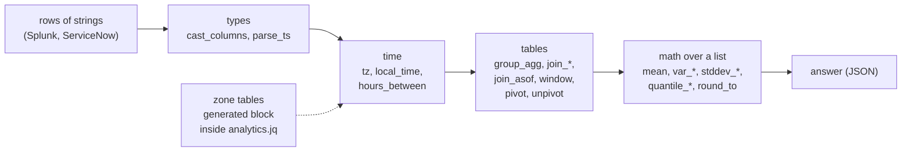

# analytics.jq: tables and statistics for jq

`analytics.jq` is a jq module of 101 functions that let a jq program answer the questions people usually send to SQL, pandas or a graph library: hold several named tables at once, join them by key, condition and time, group and aggregate, percentiles, running and lagged values over ordered partitions, time series read as state machines, roll-ups over trees, reachability, shortest paths and dependency order in graphs, validity intervals built from events, a calendar table, funnels and retention, column profiles and table diffs, measures evaluated at several levels of a report, and local time in a named time zone. Each function states its rule in a comment beside it (how it treats nulls, ties, order and rounding), and each rule is pinned by a test whose expected answer DuckDB computes. Its time-zone tables, generated from the IANA time-zone database, are a block inside the same file.

It exists because plain jq leaves those rules to whoever writes the program. In one analysis of service requests, four shared jq helpers each decided a number without saying how: one dropped unresolved tickets, one used a different percentile rule, one hardcoded a single year's daylight-saving switch, one rounded before comparing with a threshold and miscounted by one. This library is one place where those rules are written down, tested against DuckDB, and the same for every analysis that loads it.

**What it is for.** JSON or YAML as it arrives, often nested and with every value a string, and everyday analytic work on it short of fitting a model. It also reshapes a result into what the next tool reads. Past about 200,000 rows, or when the same data answers many questions, hand the heavy step to a columnar engine such as DuckDB: see [Costs and limits](#costs-and-limits).

## What it reads and what it produces

**Input: a table, which in jq is an array of objects, one object per row.** Values arrive the way Splunk and ServiceNow hand them over: every field a string, an empty string for a missing timestamp, timestamps as UTC wall-clock text without a zone. The examples in this file use four made-up service requests of that shape:

<!-- example: sample_rows -->
```json
[
  {"number": "REQ0001", "opened_at": "2026-08-12 13:30:00", "resolved_at": "2026-08-12 16:00:00", "group": "access"},
  {"number": "REQ0002", "opened_at": "2026-08-14 23:10:00", "resolved_at": "2026-08-15 10:40:00", "group": "access"},
  {"number": "REQ0003", "opened_at": "2026-08-17 15:00:00", "resolved_at": "", "group": "devices"},
  {"number": "REQ0004", "opened_at": "2026-11-02 14:00:00", "resolved_at": "2026-11-02 15:00:00", "group": "access"}
]
```
<!-- /example -->

**Output: plain JSON**, usually an object of named answers or a smaller table. A question this file traces from start to end is: *for resolved requests, how long did they take, split by whether they were opened during weekday office hours (Monday to Friday, 08:00 to 16:59) in Detroit?* For the four rows above the answer is:

<!-- example: trace_answer -->
```json
[
  {"in_hours": true, "n": 2, "median": 1},
  {"in_hours": false, "n": 1, "median": 11.5}
]
```
<!-- /example -->

**Checking that by hand.** REQ0003 is unresolved, so three rows count. REQ0001 opened at 13:30 UTC on Wednesday 12 August 2026, which is 09:30 in Detroit (UTC−4 in summer): inside office hours; it took 2.5 h. REQ0002 opened at 23:10 UTC on Friday, 19:10 Detroit time: outside; it took 11.5 h. REQ0004 opened at 14:00 UTC on Monday 2 November 2026, after the 1 November switch to winter time, so 09:00 Detroit time (UTC−5): inside; it took 1 h. Inside: two rows, 2.5 h and 1 h; the nearest-rank median of two values is the value at rank ⌈2 × 0.5⌉ = 1, which is 1 h. Outside: one row, 11.5 h.

## Shapes: what the functions take

Every function takes rows, an array of objects. What differs is which fields a row must carry: that is the function's shape. Fields are always read through expressions (`tree_paths(.emp_id; .manager_id)`), never fixed names.

| Shape | One row is | Example row | Functions |
|---|---|---|---|
| table | one record | `{"id": "REQ1", "site": "North", "hours": "4.5"}` | math over a list, types and time, grouping and windows, joins |
| several tables | not a row: one object whose fields are tables | `{"dhcp": [...], "firewall": [...]}` | `split_by` makes it; `keep_tables`, `shape` |
| intervals | one span of one key, from a start to an end | `{"ip": "10.0.0.5", "mac": "m1", "start": 1731900000, "end": 1731943200}` | `join_within`, `join_overlap`, `merge_intervals`, `concurrency`; made by `intervals_from_events`, `state_blocks`, `sessions` |
| tree | one node, pointing at its parent | `{"id": "ops", "parent": "ceo"}` | `tree_paths`, `tree_rollup`; `nodes_from_nested` makes it |
| graph | one edge | `{"from": "web01", "to": "db01"}` | `reachable`, `hops`, `shortest_path`, `topo_order`, `components`; `node_link` exports it |
| star | a fact table plus dimension tables | fact `{"site_id": "s1", "amount": 40}`, dimension `{"id": "s1", "region": "east"}` | `lookup`; `rollup`, `measure`, `measure_with`, `share_of` |

An event log is not a shape: its rows are a table, and the question decides whether it becomes intervals, a tree, a graph or a star. Nested documents, objects keyed by id and YAML are sources that have to become rows first: see [Shapes in and out](#shapes-in-and-out). [docs/design/05-shapes.md](docs/design/05-shapes.md) defines each shape and source, draws the conversions between them, and traces one nested export through three shapes.

## How the parts fit



A program normally moves left to right: turn strings into numbers and instants, derive local times and durations, reshape the table (group, join, window), and reduce lists of numbers to statistics. Each stage is ordinary jq, so stages are joined with `|` and intermediate tables are named with `as $name`, as Power Query names its `let` steps.

## Loading it

The library is one file, `analytics.jq`, in a directory `<dir>` below. Its time-zone tables are a generated block inside it, so nothing else needs to sit beside it.

| where | how |
|---|---|
| jq command line | `jq -L <dir> 'include "analytics"; …' input.json` |
| any jq, no `-L` | `jq 'include "analytics" {search: "<dir>"}; …'` |
| with a namespace | `jq 'import "analytics" as a {search: "<dir>"}; … a::mean'` |
| Python `jq` package | `jq.compile('include "analytics" {search: "<dir>"}; ' + program).input_value(rows).first()`; the package has no `-L` and an empty default search list, so the path goes in the program |
| Python package `jq_analytics` | `jq_analytics.include()` returns the `include` line with this package's directory filled in |

Tested on jq 1.7.1 (Apple's build), jq 1.8.2, gojq 0.12.20, jaq 3.1.2 and the `jq` Python package 1.13.0, which builds jq 1.8.2: all pass the same 182 test cases (`tests/run_tests.py`). The library uses no builtin that is missing from any of them, and it parenthesises `reduce … as` inside function arguments, which jq 1.7.1's grammar requires.

## Names

How to tell whose function a name is, and how to keep the library's names apart from your own.

| A name that | is | Example |
|---|---|---|
| starts with `_` | an internal helper of this library; it may change without notice | `_groups` |
| has an entry in the Reference below | a public function of this library | `group_agg` |
| is neither | jq's own built-in | `map_values`, `group_by`, `to_entries` |

Public names carry no library prefix. A prefix marks a family (`join_*`, `tz_*`, `tree_*`), and a suffix marks a variant of one function (`*_nonnull`, `quantile_cont` and `quantile_disc`). No public name equals a built-in of any tested engine; `tests/check_names.py` fails the run if one ever does.

To keep the names apart from your own, load the library under a namespace: `import "analytics" as a;` and then call `a::mean`, `a::group_agg(...)`. A `mean` of your own and `a::mean` then live side by side, on all five engines. With the plain `include`, a function you define afterwards under a library name changes only your own code: the library goes on calling its own.

Seven names changed in 0.10.0, because the old ones did not say what they act on. The old names are gone.

| Before 0.10.0 | Now | What it does |
|---|---|---|
| `cast` | `cast_columns` | turn the named columns into numbers, instants, strings or booleans |
| `keep` | `keep_tables` | from a set of tables, keep the named ones |
| `over` | `window` | run a window function over partitions of a table |
| `calc` | `measure_with` | a measure in a changed context |
| `share` | `share_of` | a measure here divided by the same measure in a changed context |
| `without` | `without_filter` | context change: remove one filter |
| `keep_only` | `only_filters` | context change: keep only the named filters |

## Rules that hold everywhere

These are the rules a reader can rely on without reading each function; a function that differs says so in its own entry.

1. **Nulls.** Aggregates skip nulls, as SQL does, and return null when nothing is left. `count_nonnull` counts non-null values; `length` still counts everything.
2. **Keys.** Join keys that are null never match. Group keys that are null form one group of their own, as in SQL `GROUP BY`. Keys are compared by their JSON text, so `1` and `"1"` are different keys.
3. **Order.** Group output comes in order of first appearance on every engine (jq's `group_by` sorts by key instead; gojq keeps object keys sorted, so the library records each group's first position rather than relying on an object's order). Join output follows the left table, then the right table's order among matches. Sorting is stable: ties keep input order.
4. **Errors are loud.** A timestamp that does not parse or names a date that does not exist, a value that is not a number where a number is asked for, an unknown time zone, an event with no time, an interval with no start, a key or id that appears twice where one is expected: each raises an error naming the function and the value. Nothing is silently dropped, replaced or turned into null except `""`, which means missing.
5. **No hidden state.** No function reads the process time zone (`TZ`), the locale or the clock.
6. **One value in.** jq runs a filter once for each value it receives; a filter never sees "the stream". A function here expects the whole table as that one value: an array of rows. `$rows | group_agg(...)` is right. `$rows[] | group_agg(...)` hands over one row at a time and is wrong. A file with one JSON object per line is many values: collect it first, with `jq --slurp` or `[inputs]`. Inside `map(...)`, or inside the second argument of `group_agg`, the value is one row or one group again. `docs/primer.md` explains this model, and the other things people most often stumble on in jq, from a survey of the questions they ask.

The functions whose input is not a table:

| The one input value is | Functions |
|---|---|
| a table: an array of rows | every function not listed below |
| a list of values: an array of numbers, strings or nulls | `mean`, `median`, `quantile_disc`, `quantile_cont`, `quantiles_disc`, `quantiles_cont`, `var_samp`, `var_pop`, `stddev_samp`, `stddev_pop`, `sum_nonnull`, `count_nonnull`, `min_nonnull`, `max_nonnull`, `nonnull`, `mode`, `value_counts`, `histogram` |
| one sorted partition, inside `window` | `row_number`, `rank_by`, `lag`, `lead`, `running_sum`, `moving_mean` |
| a single value | `parse_ts` (a string), `round_to` (a number), `tz_offset` and `local_time` (epoch seconds) |
| anything: the function reads only its arguments | `hours_between`, `similarity`, `tz`, `calendar`, `bin_edges`, `tzdata_version` |
| an object whose fields are tables | `keep_tables`, `shape` (`split_by` makes that object) |
| an object keyed by id | `rows_from_map` |
| a nested tree: one root object or an array of roots | `nodes_from_nested` |
| a measure context, inside a cell of `rollup` or `rollup_levels` | `measure`, `measure_with`, `share_of`, `without_filter`, `only_filters`, `with_filter`, `shift`, `on_calendar`, `to_date` |

What happens when the rule is broken. Since 0.14.0 every function whose input is a table, a list or an object of tables checks that it got one, and stops with a message that names itself and says what to write instead; a table passed as an argument (the right table of a join, `lookup`'s dimension) is checked the same way. Only the outer type is checked, not the items, so a table of plain values such as `map(.site) | group_agg({site: .}; {n: length})` still works.

```text
[{site: "N"}, {site: "S"}][] | group_agg({site}; {n: length})
  group_agg: the input is one object, not a table (an array of rows). Pass the whole table as one value: $rows | group_agg(...), not $rows[] | group_agg(...).
[{site: "N"}, {site: "S"}][] | count_nonnull
  count_nonnull: the input is one object, not a list of values. Make the list first, such as map(.site) | count_nonnull.
```

Before 0.14.0 most functions stopped with jq's own message (`Cannot index string with string "g"`), and `mode`, `value_counts` and `count_nonnull` gave a wrong answer about the one row's fields with no error. The functions that do not check are the window functions (`window` hands them a partition), the measure-context functions (`rollup` calls them), the single-value functions and those that read only their arguments.

## Tracing the question

The program that answers the office-hours question, one stage per line:

```jq
tz("America/Detroit") as $det
| map(.opened = (.opened_at | parse_ts) | .resolved = (.resolved_at | parse_ts)
      | .hours = hours_between(.opened; .resolved))
| map(select(.resolved != null) | (.opened | local_time($det)) as $o
      | .in_hours = ($o.weekday >= 1 and $o.weekday <= 5 and $o.hour >= 8 and $o.hour <= 16))
| group_agg({in_hours}; map(.hours) | {n: length, median: quantile_disc(0.5)})
```

Stage by stage on the four sample rows:

**1. Strings to instants and a duration.** `parse_ts` turns `"2026-08-12 13:30:00"` into seconds since 1970 (UTC); `""` becomes null; `hours_between` is null when either end is null, and exact (not rounded).

<!-- example: trace_parse -->
```jq
map(.opened = (.opened_at | parse_ts) | .resolved = (.resolved_at | parse_ts) | .hours = hours_between(.opened; .resolved)) | map({number, opened, resolved, hours})
```

```json
[
  {"number": "REQ0001", "opened": 1786541400, "resolved": 1786550400, "hours": 2.5},
  {"number": "REQ0002", "opened": 1786749000, "resolved": 1786790400, "hours": 11.5},
  {"number": "REQ0003", "opened": 1786978800, "resolved": null, "hours": null},
  {"number": "REQ0004", "opened": 1793628000, "resolved": 1793631600, "hours": 1}
]
```
<!-- /example -->

**2. Local clock in Detroit.** `tz("America/Detroit")` loads the zone's transition table once; `local_time` gives the wall clock at each instant. REQ0004 is after the 1 November switch, so its offset is −18000 s (UTC−5) where the others have −14400 s (UTC−4).

<!-- example: trace_local -->
```jq
tz("America/Detroit") as $det | map(.opened_at | parse_ts | local_time($det) | {date, weekday, hour, minute, offset_s})
```

```json
[
  {"date": "2026-08-12", "weekday": 3, "hour": 9, "minute": 30, "offset_s": -14400},
  {"date": "2026-08-14", "weekday": 5, "hour": 19, "minute": 10, "offset_s": -14400},
  {"date": "2026-08-17", "weekday": 1, "hour": 11, "minute": 0, "offset_s": -14400},
  {"date": "2026-11-02", "weekday": 1, "hour": 9, "minute": 0, "offset_s": -18000}
]
```
<!-- /example -->

**3. Office-hours flag**, from the local weekday (0 = Sunday) and hour, on resolved rows only:

<!-- example: trace_flag -->
```jq
tz("America/Detroit") as $det | map(.opened = (.opened_at | parse_ts) | .resolved = (.resolved_at | parse_ts) | .hours = hours_between(.opened; .resolved)) | map(select(.resolved != null) | (.opened | local_time($det)) as $o | .in_hours = ($o.weekday >= 1 and $o.weekday <= 5 and $o.hour >= 8 and $o.hour <= 16)) | map({number, hours, in_hours})
```

```json
[
  {"number": "REQ0001", "hours": 2.5, "in_hours": true},
  {"number": "REQ0002", "hours": 11.5, "in_hours": false},
  {"number": "REQ0004", "hours": 1, "in_hours": true}
]
```
<!-- /example -->

**4. Group and aggregate.** `group_agg` takes a key expression and an aggregate expression; the aggregate sees each group's rows as an array:

<!-- example: trace_answer_code -->
```jq
tz("America/Detroit") as $det | map(.opened = (.opened_at | parse_ts) | .resolved = (.resolved_at | parse_ts) | .hours = hours_between(.opened; .resolved)) | map(select(.resolved != null) | (.opened | local_time($det)) as $o | .in_hours = ($o.weekday >= 1 and $o.weekday <= 5 and $o.hour >= 8 and $o.hour <= 16)) | group_agg({in_hours}; map(.hours) | {n: length, median: quantile_disc(0.5)})
```

```json
[
  {"in_hours": true, "n": 2, "median": 1},
  {"in_hours": false, "n": 1, "median": 11.5}
]
```
<!-- /example -->

## Reference

Each entry gives the signature, what goes in and comes out, the rule, why the function exists (what plain jq does instead, and which DuckDB or Power Query function it matches), and a worked example. The sections follow the section headings in `analytics.jq`, where each `def` carries the same rule as a comment.

### Math over a list of numbers

The input is an array of numbers that may contain nulls.

**`nonnull`, `count_nonnull`, `sum_nonnull`, `mean`**. `nonnull` drops nulls; the others count, sum and average what is left, returning null when nothing is. Why: plain `add / length` divides by a count that includes the nulls `add` skipped. Matches DuckDB `count(x)`, `sum(x)`, `avg(x)` and Power Query `List.NonNullCount`, `List.Sum`, `List.Average`.

<!-- example: null_rule -->
```jq
[1, null, 3] | {plain_add_over_length: (add / length), mean: mean, count_nonnull: count_nonnull, length: length, sum_nonnull: sum_nonnull, mean_of_nulls: ([null, null] | mean)}
```

```json
{
  "plain_add_over_length": 1.3333333333333333,
  "mean": 2,
  "count_nonnull": 2,
  "length": 3,
  "sum_nonnull": 4,
  "mean_of_nulls": null
}
```
<!-- /example -->

**`min_nonnull`, `max_nonnull`, `min_by_nonnull(f)`, `max_by_nonnull(f)`**. The least and greatest non-null value, and the row whose `f` is least or greatest with null `f` left out; null when nothing is left. Why: jq's own `min` and `max` sort null below every number, so `[null, 1, 3] | min` is null. Matches DuckDB `min(x)`, `max(x)`, `arg_min(row, x)`, `arg_max(row, x)`. Ties: the first row for `min_by_nonnull`, the last for `max_by_nonnull`, as jq's `min_by` and `max_by`.

<!-- example: min_max -->
```jq
[null, 3, 1] | {plain_min: min, min_nonnull: min_nonnull, max_nonnull: max_nonnull, nothing: ([null] | min_nonnull), first_lowest: ([{id: 1, x: null}, {id: 2, x: 5}, {id: 3, x: 2}] | min_by_nonnull(.x) | .id)}
```

```json
{"plain_min": null, "min_nonnull": 1, "max_nonnull": 3, "nothing": null, "first_lowest": 3}
```
<!-- /example -->

**`var_samp`, `var_pop`, `stddev_samp`, `stddev_pop`**. Variance and standard deviation, sample (divide by n − 1; null below two values) or population (divide by n; null when empty), computed in two passes (mean first, then squared deviations). Matches DuckDB's functions of the same names; Power Query's `List.StandardDeviation` is the sample one.

<!-- example: variance -->
```jq
[2, 4, 4, 4, 5, 5, 7, 9] | {var_samp: var_samp, var_pop: var_pop, stddev_samp: stddev_samp, stddev_pop: stddev_pop, one_value_var_samp: ([3] | var_samp)}
```

```json
{
  "var_samp": 4.571428571428571,
  "var_pop": 4,
  "stddev_samp": 2.138089935299395,
  "stddev_pop": 2,
  "one_value_var_samp": null
}
```
<!-- /example -->

**`quantile_disc($p)`, `quantile_cont($p)`, `median`, `quantiles_disc($ps)`, `quantiles_cont($ps)`**. Quantiles of the non-null values for p between 0 and 1. `quantile_disc` returns an element of the data: the value at rank ⌈n·p⌉ of the sorted values, at least rank 1 (nearest rank). `quantile_cont` interpolates linearly at position (n − 1)·p between neighbours. `median` is `quantile_cont(0.5)`. The list forms take several p at once and return null, not a list of nulls, when there are no values. Why two: they differ on small groups, and an analysis must say which it used. Matches DuckDB `quantile_disc`, `quantile_cont`, `median`; Power Query `List.Percentile` with `PercentileMode.SqlDisc` and `ExcelInc`.

<!-- example: quantiles -->
```jq
[40, 10, null, 30, 20] | {disc: quantiles_disc([0.1, 0.25, 0.5, 0.9]), cont: quantiles_cont([0.1, 0.25, 0.5, 0.9]), median: median, none: ([null] | quantiles_disc([0.5]))}
```

```json
{"disc": [10, 10, 20, 40], "cont": [13, 17.5, 25, 37], "median": 25, "none": null}
```
<!-- /example -->

**`round_to($d)`**. Rounds to $d decimal places, halves away from zero, on the stored double; null stays null. Round only for display, after comparisons: rounding hours before testing `<= 1` is what miscounted by one in the earlier analysis. It agreed with DuckDB's `round` on all ten test values, including 1.005 → 1.0 and 2.675 → 2.68.

<!-- example: round -->
```jq
[1.005, 2.675, 0.125, -0.5, 1.5, null] | map(round_to(2)), map(round_to(0))
```

```json
[1, 2.68, 0.13, -0.5, 1.5, null]
[1, 3, 0, -1, 2, null]
```
<!-- /example -->

### Distributions, profiles and diffs

The first questions asked of a table: which values are common, how a number is spread, whether two numbers move together, what each column holds, and what changed since the last export.

**`mode`.** Over a list: the most frequent non-null value; among equally frequent values the smallest in jq's sort order; null when there is none. **`value_counts`.** One row per distinct non-null value, `{value, count, share}`, most frequent first, ties by value; `share_of` is of the non-null values.

**`bin_edges($lo; $hi; $n)`** gives the `$n + 1` edges of `$n` equal bins. **`histogram($edges)`**, over a list of numbers, gives one row per bin, `{from, to, count}`: a bin holds `from <= v < to`, and the last bin also holds `v == to`, as numpy's histogram does. Nulls are skipped. A value outside the edges is an error, never a dropped value.

**`corr(x; y)`.** Pearson's correlation over the rows where both are non-null; null with fewer than two such rows or when either side does not vary. Matches SQL `corr`.

<!-- example: distributions -->
```jq
[{x: 16, y: 1, label: "a"}, {x: 32, y: 2, label: "b"}, {x: 64, y: 5, label: "b"}, {x: 64, y: 4, label: null}, {x: 8, y: 1, label: "c"}] | {mode: (map(.label) | mode), counts: (map(.label) | value_counts), histogram: (map(.x) | histogram(bin_edges(0; 64; 4))), corr: (corr(.x; .y) | round_to(4))}
```

```json
{
  "mode": "b",
  "counts": [{"value": "b", "count": 2, "share": 0.5}, {"value": "a", "count": 1, "share": 0.25}, {"value": "c", "count": 1, "share": 0.25}],
  "histogram": [{"from": 0, "to": 16, "count": 1}, {"from": 16, "to": 32, "count": 1}, {"from": 32, "to": 48, "count": 1}, {"from": 48, "to": 64, "count": 2}],
  "corr": 0.9715
}
```
<!-- /example -->

The two values of 64 fall in the last bin because it includes its upper edge.

**`profile`.** One row per column of a table, columns in name order: `rows`, `present` (rows that have the field), `nulls` (null or absent), `empty` (the value `""`), `distinct` (non-null values), `types` (jq type name to count), and `min` and `max` when the non-null values are all numbers or all strings. It shows what the null rule would otherwise hide: an empty string is not a null, and a column that mixes numbers and strings has no minimum.

<!-- example: profile -->
```jq
[{host: "web01", site: "North", ram: 32, os: "linux"}, {host: "db01", site: "South", ram: 64, os: "linux"}, {host: "new01", site: "", ram: 16, os: null}] | profile
```

```json
[
  {"column": "host", "rows": 3, "present": 3, "nulls": 0, "empty": 0, "distinct": 3, "types": {"string": 3}, "min": "db01", "max": "web01"},
  {"column": "os", "rows": 3, "present": 3, "nulls": 1, "empty": 0, "distinct": 1, "types": {"null": 1, "string": 2}, "min": "linux", "max": "linux"},
  {"column": "ram", "rows": 3, "present": 3, "nulls": 0, "empty": 0, "distinct": 3, "types": {"number": 3}, "min": 16, "max": 64},
  {"column": "site", "rows": 3, "present": 3, "nulls": 0, "empty": 1, "distinct": 3, "types": {"string": 3}, "min": "", "max": "South"}
]
```
<!-- /example -->

**`diff_tables($old; key)`.** What changed between two versions of a table that share a key; the input is the new table. One row per key that was added, removed or changed, sorted by key: `{key, change, fields, old, new}`; `fields` names the fields whose values differ, and unchanged rows are left out. A key that appears twice in either table, or a null key, is an error. Matches a SQL `FULL JOIN` on the key with `IS DISTINCT FROM` per field.

<!-- example: diff_tables -->
```jq
[{host: "web01", site: "North", ram: 16, os: "linux"}, {host: "db01", site: "South", ram: 64, os: "linux"}, {host: "old01", site: "North", ram: 8, os: ""}] as $yesterday | [{host: "web01", site: "North", ram: 32, os: "linux"}, {host: "db01", site: "South", ram: 64, os: "linux"}, {host: "new01", site: "", ram: 16, os: null}] | diff_tables($yesterday; .host) | map({key, change, fields, was: (.old.ram // null), now: (.new.ram // null)})
```

```json
[
  {"key": "new01", "change": "added", "fields": [], "was": null, "now": 16},
  {"key": "old01", "change": "removed", "fields": [], "was": 8, "now": null},
  {"key": "web01", "change": "changed", "fields": ["ram"], "was": 16, "now": 32}
]
```
<!-- /example -->

**`diff_docs($old)`.** What changed between two versions of a document of any shape; the input is the new one. One row per path that differs, `{path, change, old, new}`, change `added`, `removed` or `changed`, sorted by path; a path is the list `getpath` takes. Arrays compare by position, so for lists of records matched by a key use `diff_tables`.

<!-- example: diff_docs -->
```jq
{host: "web01", tags: ["disk", "p2"], owner: {team: "ops"}} | diff_docs({host: "web01", tags: ["disk"], owner: {team: "net", lead: "kim"}})
```

```json
[
  {"path": ["owner", "lead"], "change": "removed", "old": "kim", "new": null},
  {"path": ["owner", "team"], "change": "changed", "old": "net", "new": "ops"},
  {"path": ["tags", 1], "change": "added", "old": null, "new": "p2"}
]
```
<!-- /example -->

### Types

**`parse_ts`**. A timestamp string to UTC epoch seconds, fractions kept. Accepts `YYYY-MM-DD HH:MM:SS` or with `T`, an optional fraction, and an optional `Z` or `±HH:MM` / `±HHMM` offset. No offset means UTC, which is how ServiceNow and Splunk store wall-clock strings. `null` and `""` give null; anything else that does not match is an error. Why: jq's `fromdateiso8601` rejects fractions and offsets, and `strptime("%z")` parses an offset but ignores it. Matches DuckDB `ts::TIMESTAMPTZ` with `TimeZone = 'UTC'`. A date or time that does not exist, such as 30 February, is an error on every engine: the parsed moment is printed back and compared with the input, because some engines would otherwise carry the extra days into the next month.

<!-- example: parse_ts -->
```jq
["2026-08-12 13:05:00", "2026-08-12T13:05:00Z", "2026-08-12T09:05:00-04:00", "2026-08-12T18:35:00+0530", "2026-08-12 13:05:00.250", "", null] | map(parse_ts | if . == null then null else {epoch: ., utc: (floor | todate)} end)
```

```json
[{"epoch": 1786539900, "utc": "2026-08-12T13:05:00Z"}, {"epoch": 1786539900, "utc": "2026-08-12T13:05:00Z"}, {"epoch": 1786539900, "utc": "2026-08-12T13:05:00Z"}, {"epoch": 1786539900, "utc": "2026-08-12T13:05:00Z"}, {"epoch": 1786539900.25, "utc": "2026-08-12T13:05:00Z"}, null, null]
```
<!-- /example -->

**`cast_columns($schema)`**. Converts named columns of every row: `$schema` maps a column to `"number"`, `"timestamp"` (via `parse_ts`), `"string"` or `"boolean"`. `""` and null become null; a value that does not convert is an error naming the column and value, as in Power Query's `Table.TransformColumnTypes`. A number must look like a JSON number, because jq 1.7.1's `tonumber` accepts `" 12"` and jq 1.8's rejects it. A schema column that a row lacks is added to it as null, so every row comes out with the same columns.

<!-- example: cast -->
```jq
[{n: "12.5", t: "2026-08-12 13:05:00", b: "true"}, {n: "", t: "", b: "false"}, {n: "1e3", t: null, b: null}] | cast_columns({n: "number", t: "timestamp", b: "boolean"})
```

```json
[
  {"n": 12.5, "t": 1786539900, "b": true},
  {"n": null, "t": null, "b": false},
  {"n": 1000.0, "t": null, "b": null}
]
```
<!-- /example -->

<!-- example: cast_error -->
```jq
[{n: " 12"}] | try cast_columns({n: "number"}) catch .
```

```json
"cast_columns: n = \" 12\" is not a number"
```
<!-- /example -->

### Time zones and calendar

**`tz($name)`, `tz_offset($tz)`, `local_time($tz)`**. `tz` returns one zone's transition table from the library's generated zone block; `tz_offset` gives the UTC offset in seconds at an instant; `local_time` gives the wall clock as `{date, year, month, day, hour, minute, second, weekday (0 = Sunday), offset_s, local_epoch}`. `$tz` is a zone name or the table `tz` returned. Zones included: UTC, America/Detroit, New_York, Chicago, Denver, Los_Angeles, Europe/London, from 1970 to 2100, generated by `gen_tzdata.py` from the `tzdata` package 2026.6; add a zone by adding it to `ZONES` there and regenerating. Why: plain jq's `localtime` and `strflocaltime` use the process's `TZ` setting, which inside a Splunk search command is the whole search process's, and their `%Z` label is wrong next to a switch. Matches DuckDB `ts AT TIME ZONE 'America/Detroit'`; Power Query has fixed offsets only. **Cost:** `tz_rules` is a 27 KB literal that jq rebuilds on every call, so passing a name costs 0.78 ms per call and passing `tz(...)` bound once costs 0.024 ms: write `tz("America/Detroit") as $det` once and call `local_time($det)`.

<!-- example: local_time -->
```jq
tz("America/Detroit") as $det | ["2026-03-08 06:59:59", "2026-03-08 07:00:00", "2026-11-01 05:59:59", "2026-11-01 06:00:00"] | map(parse_ts | local_time($det) | {date, hour, minute, weekday, offset_s})
```

```json
[
  {"date": "2026-03-08", "hour": 1, "minute": 59, "weekday": 0, "offset_s": -18000},
  {"date": "2026-03-08", "hour": 3, "minute": 0, "weekday": 0, "offset_s": -14400},
  {"date": "2026-11-01", "hour": 1, "minute": 59, "weekday": 0, "offset_s": -14400},
  {"date": "2026-11-01", "hour": 1, "minute": 0, "weekday": 0, "offset_s": -18000}
]
```
<!-- /example -->

**`format_local($tz; $fmt)`.** An epoch as local text in zone `$tz` with `strftime` directives, the zone's offset applied, daylight saving included; `%z` is written as `+HHMM` and `%Z` as the zone name, from the zone tables rather than the machine. Matches DuckDB `strftime(timezone($tz, to_timestamp(e)), $fmt)`. jq's own `strftime` writes UTC and `localtime` uses the machine's zone.

<!-- example: format_local -->
```jq
[1772946000, 1772949600, 1772953200] | map(format_local("America/Detroit"; "%Y-%m-%d %H:%M %z"))
```

```json
["2026-03-08 00:00 -0500", "2026-03-08 01:00 -0500", "2026-03-08 03:00 -0400"]
```
<!-- /example -->

**`hours_between(a; b)`**. `(b − a) / 3600` for two epoch expressions; null when either is null; not rounded. Matches DuckDB `date_diff('second', a, b) / 3600.0`.

**`calendar($from; $to; $zone)`, `calendar($from; $to)`.** One row per day from `$from` to `$to` inclusive, both `"YYYY-MM-DD"`; it ignores its input, so call it with `jq -n` or bind it with `as`. Each row: `date`, `year`, `quarter`, `month`, `day`, `weekday` (0 = Sunday), `day_of_year`, `iso_year` and `iso_week` (weeks start Monday, week 1 holds the year's first Thursday, so a day near New Year can belong to the neighbouring ISO year), `us_week` (weeks start Sunday, week 1 holds 1 January: a spreadsheet's `WEEKNUM(d, 1)`), `year_month` (`"2026-03"`), `year_quarter` (`"2026-Q1"`), `iso_year_week` (`"2026-W09"`), and `start` and `end`, the epoch seconds of local midnight in `$zone` (a name or `tz($name)`; UTC in the two-argument form). Not a date, an impossible date, `$from` after `$to`, or an unknown zone is an error. Matches DuckDB `year`, `quarter`, `dayofweek`, `dayofyear`, `isoyear`, `weekofyear` and `AT TIME ZONE` for every day of 2026 and around three New Years. No fiscal years, no holidays.

<!-- example: calendar_new_year -->
```jq
calendar("2020-12-31"; "2021-01-04") | map({date, weekday, iso_year_week, us_week, year_quarter})
```

```json
[
  {"date": "2020-12-31", "weekday": 4, "iso_year_week": "2020-W53", "us_week": 53, "year_quarter": "2020-Q4"},
  {"date": "2021-01-01", "weekday": 5, "iso_year_week": "2020-W53", "us_week": 1, "year_quarter": "2021-Q1"},
  {"date": "2021-01-02", "weekday": 6, "iso_year_week": "2020-W53", "us_week": 1, "year_quarter": "2021-Q1"},
  {"date": "2021-01-03", "weekday": 0, "iso_year_week": "2020-W53", "us_week": 2, "year_quarter": "2021-Q1"},
  {"date": "2021-01-04", "weekday": 1, "iso_year_week": "2021-W01", "us_week": 2, "year_quarter": "2021-Q1"}
]
```
<!-- /example -->

Thursday 31 December 2020 is in ISO week 53 and US week 53; Friday 1 January 2021 is still ISO week 53 of 2020, and US week 1 of 2021.

A day is an interval, `[start, end)`, so [`join_within`](#intervals) puts an event in its local day, and a day with a clock change is 23 or 25 hours long:

<!-- example: calendar_days -->
```jq
calendar("2026-03-07"; "2026-03-09"; "America/Detroit") as $days | {hours: ($days | map({date, hours: ((.end - .start) / 3600)})), events_by_day: ([{id: 1, at: "2026-03-08 04:30:00"}, {id: 2, at: "2026-03-08 05:30:00"}, {id: 3, at: "2026-03-09 03:59:59"}] | map(.t = (.at | parse_ts) | .zone = "x") | join_within($days | map({zone: "x", date, start, end}); .zone; .zone; .t; .start; .end) | map({id, at, date}))}
```

```json
{
  "hours": [{"date": "2026-03-07", "hours": 24}, {"date": "2026-03-08", "hours": 23}, {"date": "2026-03-09", "hours": 24}],
  "events_by_day": [{"id": 1, "at": "2026-03-08 04:30:00", "date": "2026-03-07"}, {"id": 2, "at": "2026-03-08 05:30:00", "date": "2026-03-08"}, {"id": 3, "at": "2026-03-09 03:59:59", "date": "2026-03-08"}]
}
```
<!-- /example -->

Event 2, at 05:30 UTC on 8 March, is 00:30 in Detroit on the 8th; event 1, an hour earlier, is still the 7th there. The 8th is 23 hours long.

### Grouping

**`group_agg(keyf; aggf)`**. Groups rows by the value of `keyf` and applies `aggf` to each group's array of rows; `aggf` must return an object. A key that is an object (`{g}` or `{g: .x, h: .y}`) is merged into the output row; any other key goes in a field `key`. Output rows come in order of first appearance; a null key forms one group. Why: `group_by` sorts groups by key and leaves the aggregation to hand-written code. Matches DuckDB `GROUP BY` and Power Query `Table.Group` with `GroupKind.Global`.

<!-- example: group_agg -->
```jq
[{g: "a", x: 1}, {g: "b", x: 5}, {g: null, x: 7}, {g: "a", x: null}, {g: "a", x: 3}] | group_agg({g}; map(.x) | {rows: length, n: count_nonnull, mean: mean})
```

```json
[
  {"g": "a", "rows": 3, "n": 2, "mean": 2},
  {"g": "b", "rows": 1, "n": 1, "mean": 5},
  {"g": null, "rows": 1, "n": 1, "mean": 7}
]
```
<!-- /example -->

### Several tables at once

Name each table with `as $name` and refer to it by that name in any later step, as SPL2 names its searches and Python names its variables. No other structure is needed.

**`split_by(tagf)`, `keep_tables($names)`, `shape`.** Some steps make several tables at once; they return one object whose fields are the tables, such as `{dhcp: [...], firewall: [...]}`, and the next steps take `.dhcp` and `.firewall` out of it. `split_by` turns one stream of rows into such an object, one table per value of `tagf` (the value as a string names the table). This is how several tables reach a Splunk search command: a search appends them into one stream with a field saying which table each row belongs to. `keep_tables` drops every table not named. `shape` gives each table's row count and sorted field names, for checking a step's output. From the jq command line a second table arrives with `--slurpfile`, from Python with `args=`; see Loading it. Two different tags that give the same table name as text, such as the number 1 and the string `"1"`, are an error.

<!-- example: several_tables -->
```jq
[{t: "100", ip_address: "10.1.1.55", user: "bsmith", src_ip: "", event_type: "dhcp"}, {t: "300", ip_address: "10.1.1.55", user: "jdoe", src_ip: "", event_type: "dhcp"}, {t: "10", ip_address: "10.1.1.99", user: "olduser", src_ip: "", event_type: "dhcp"}, {t: "400", ip_address: "", user: "", src_ip: "10.1.1.55", event_type: "firewall"}, {t: "1000", ip_address: "", user: "", src_ip: "10.1.1.99", event_type: "firewall"}] | split_by(.event_type) as $by_type | ($by_type.dhcp | map({ip: .ip_address, user, lease_t: (.t | tonumber)})) as $leases | ($by_type.firewall | map({ip: .src_ip, t: (.t | tonumber)})) as $hits | {split: ($by_type | shape | map_values(.rows)), answer: (($leases | intervals_from_events(.ip; .user; .lease_t; "hold"; 600)) as $held | $hits | join_within($held; .ip; .resource; .t; .start; .end) | map({t, ip, user: .holder}))}
```

```json
{
  "split": {"dhcp": 3, "firewall": 2},
  "answer": [{"t": 400, "ip": "10.1.1.55", "user": "jdoe"}, {"t": 1000, "ip": "10.1.1.99", "user": null}]
}
```
<!-- /example -->

### Joins

Every join is four choices, and each is an argument:

| Choice | What you write | Cost |
|---|---|---|
| Key: the equality part | an expression per side; an array for a composite key (`[.site, .ip]`); a cleaned value for keys equal only after cleaning | left rows plus right rows: the right table is indexed once |
| Condition: the rest | a filter over the pair, `.l` (left row) and `.r` (right row): a range, an inequality | checked only for pairs that share a key; with `true` for both keys, every pair is checked |
| Kind | `"inner"`, `"left"`, `"full"`, `"semi"`, `"anti"` | none |
| Shape | flat (`join_on`: one row per match) or nested (`join_nest`: matches as an array) | nested never multiplies rows |

The input is the left table and `$right` the right table. Rules for all joins: a null key never matches; duplicate keys multiply rows in a flat join; output follows the left table's order, then the right table's order among matches. A flat match is the left row with the right row's fields added. A field name that both tables have is kept twice, the left one under its name and the right one with the suffix `_right` (`site` and `site_right`), in every output row whether or not the values agree; this is the rule of Polars. A field that both keys read directly (`.host` and `.host`, or the same field of two object or array keys) appears once. A suffixed name that already exists is an error. jq's own `JOIN` builtins are a left join only, fail on numeric keys without `tostring`, and keep only the last of duplicate right keys.

**`join_on($right; lkey; rkey; cond; $kind)`**, **`join_on($right; lkey; rkey; cond; $kind; $suffix)`.** The general flat join. `$suffix` replaces `"_right"`; `null` asks for the strict rule, where a shared field with equal values is kept once and with different values is an error naming the field. Matches DuckDB `JOIN … ON key equality AND condition` in each kind, and Power Query `Table.Join` with a `JoinKind`.

<!-- example: join_on -->
```jq
[{id: 1, region: "east", amount: 5}, {id: 2, region: "east", amount: 60}, {id: 3, region: "west", amount: 5}] as $orders | [{region: "east", lo: 0, hi: 10, band: "small"}, {region: "east", lo: 10, hi: 100, band: "medium"}, {region: "east", lo: 50, hi: 100, band: "upper"}] as $bands | $orders | join_on($bands; .region; .region; .l.amount >= .r.lo and .l.amount < .r.hi; "left") | map({id, amount, band})
```

```json
[
  {"id": 1, "amount": 5, "band": "small"},
  {"id": 2, "amount": 60, "band": "medium"},
  {"id": 2, "amount": 60, "band": "upper"},
  {"id": 3, "amount": 5, "band": null}
]
```
<!-- /example -->

A field name on both sides: both tables have `site`, the key `host` appears once, and the unmatched request has no `site_right`.

<!-- example: join_shared_field -->
```jq
[{host: "web01", site: "N", owner: "ann"}, {host: "db01", site: "S", owner: "bo"}] as $hosts | [{id: 1, host: "web01", site: "N"}, {id: 2, host: "db01", site: "N"}, {id: 3, host: "zz09", site: "S"}] | {joined: join_left($hosts; .host; .host), sites_differ: (join_inner($hosts; .host; .host) | map(select(.site != .site_right) | .id))}
```

```json
{
  "joined": [{"id": 1, "host": "web01", "site": "N", "site_right": "N", "owner": "ann"}, {"id": 2, "host": "db01", "site": "N", "site_right": "S", "owner": "bo"}, {"id": 3, "host": "zz09", "site": "S"}],
  "sites_differ": [2]
}
```
<!-- /example -->

**`join_inner`, `join_left`, `join_full`, `join_semi`, `join_anti` `($right; lkey; rkey)`.** Equality joins: `join_on` with no condition. Inner: matched pairs only. Left: every left row, alone when unmatched. Full: left join, then right rows that matched nothing. Semi: left rows with at least one match, once each. Anti: left rows with no match, including those with a null key.

<!-- example: joins -->
```jq
[{id: 1, k: "a"}, {id: 2, k: "b"}, {id: 3, k: "z"}, {id: 4, k: null}] as $l | [{rk: "a", rv: "A1"}, {rk: "b", rv: "B1"}, {rk: "b", rv: "B2"}, {rk: "y", rv: "Y1"}, {rk: null, rv: "N1"}] as $r | {inner: ($l | join_inner($r; .k; .rk) | map([.id, .rv])), left: ($l | join_left($r; .k; .rk) | map([.id, .rv])), full: ($l | join_full($r; .k; .rk) | map([.id, .rv])), semi: ($l | join_semi($r; .k; .rk) | map(.id)), anti: ($l | join_anti($r; .k; .rk) | map(.id))}
```

```json
{
  "inner": [[1, "A1"], [2, "B1"], [2, "B2"]],
  "left": [[1, "A1"], [2, "B1"], [2, "B2"], [3, null], [4, null]],
  "full": [[1, "A1"], [2, "B1"], [2, "B2"], [3, null], [4, null], [null, "Y1"], [null, "N1"]],
  "semi": [1, 2],
  "anti": [3, 4]
}
```
<!-- /example -->

**`join_nest($right; lkey; rkey; cond; $as)`.** Every left row once, with field `$as` holding the array of its matching right rows (empty when none). Use it when a flat join would multiply rows, or when the nested document is the result wanted. Power Query's `Table.NestedJoin`; SQL needs a join plus `list()` and `GROUP BY`.

<!-- example: join_nest -->
```jq
[{id: 1, region: "east", amount: 5}, {id: 2, region: "east", amount: 60}, {id: 3, region: "west", amount: 5}] as $orders | [{region: "east", lo: 0, hi: 10, band: "small"}, {region: "east", lo: 10, hi: 100, band: "medium"}, {region: "east", lo: 50, hi: 100, band: "upper"}] as $bands | $orders | join_nest($bands; .region; .region; .l.amount >= .r.lo and .l.amount < .r.hi; "bands") | map({id, bands: (.bands | map(.band))})
```

```json
[
  {"id": 1, "bands": ["small"]},
  {"id": 2, "bands": ["medium", "upper"]},
  {"id": 3, "bands": []}
]
```
<!-- /example -->

**`lookup($dim; lkey; dkey; $as)`.** Attaches exactly one record of a dimension table under `$as`, null when there is none. A key that appears twice in the dimension is an error, so a lookup can never silently multiply rows. Chain lookups for a star of dimensions.

<!-- example: lookup -->
```jq
[{id: 1, gid: "g1"}, {id: 2, gid: "g9"}, {id: 3, gid: null}] | lookup([{gid: "g1", name: "Access"}, {gid: "g2", name: "Devices"}]; .gid; .gid; "group")
```

```json
[
  {"id": 1, "gid": "g1", "group": {"gid": "g1", "name": "Access"}},
  {"id": 2, "gid": "g9", "group": null},
  {"id": 3, "gid": null, "group": null}
]
```
<!-- /example -->

**`join_asof($right; lkey; rkey; ltime; rtime)` and `join_asof(…; $max_age)`.** For each left row, the right row with the same key whose `rtime` is the latest at or before the left row's `ltime`; the left row alone when there is none. With `$max_age`, a match older than that is rejected. On ties in `rtime`, the first such right row in input order (DuckDB 2.0.0 gave the same on the test; pandas takes the last; SQL leaves it open). Matches DuckDB `ASOF LEFT JOIN … ON l.k = r.k AND l.t >= r.t` and pandas `merge_asof(direction="backward", tolerance=…)`; Power Query has no as-of join. Use it when a value stays true until the next one replaces it; for "who held this at T", where holding can end, use [`join_within`](#intervals). **Cost:** it binary-searches each key's sorted times, then steps back through a run of equal times, so many identical timestamps under one key slow it down (as they slow DuckDB's).

<!-- example: join_asof -->
```jq
[{q: 100, k: "a", qt: 2}, {q: 101, k: "a", qt: 10}, {q: 102, k: "a", qt: 10}, {q: 103, k: "a", qt: 14}] as $quotes | [{id: 1, k: "a", t: 1}, {id: 2, k: "a", t: 10}, {id: 3, k: "a", t: 12}, {id: 4, k: "a", t: 30}, {id: 5, k: "b", t: 30}] | {latest_at_or_before: (join_asof($quotes; .k; .k; .t; .qt) | map({id, q})), no_older_than_3: (join_asof($quotes; .k; .k; .t; .qt; 3) | map({id, q}))}
```

```json
{
  "latest_at_or_before": [{"id": 1, "q": null}, {"id": 2, "q": 101}, {"id": 3, "q": 101}, {"id": 4, "q": 103}, {"id": 5, "q": null}],
  "no_older_than_3": [{"id": 1, "q": null}, {"id": 2, "q": 101}, {"id": 3, "q": 101}, {"id": 4, "q": null}, {"id": 5, "q": null}]
}
```
<!-- /example -->

**`join_overlap($right; lkey; rkey; lstart; lend; rstart; rend)`.** Pairs with the same key whose intervals overlap, each interval closed at its start and open at its end, so intervals that only touch do not overlap. A null end means the interval is still open: it overlaps everything of its key that starts after its start. An interval with no start, or one that ends before it starts, is an error. A start or end field with the same name on both sides comes out twice, the right one with `_right`.

<!-- example: join_overlap -->
```jq
[{shift: 1, host: "a", start: 0, end: 10}, {shift: 2, host: "a", start: 10, end: 20}] | join_overlap([{outage: "x", host: "a", ostart: 8, oend: 12}, {outage: "y", host: "a", ostart: 20, oend: 25}]; .host; .host; .start; .end; .ostart; .oend) | map({shift, outage})
```

```json
[
  {"shift": 1, "outage": "x"},
  {"shift": 2, "outage": "x"}
]
```
<!-- /example -->

### Keys that almost match

Three answers, in the order to try them.

**1. Clean the key.** Most keys that should match differ by case, spacing or punctuation. A key is an expression, so clean it there, at no extra cost: `join_inner($r; (.name | ascii_downcase | gsub("[^a-z0-9]"; "")); (.dept | ascii_downcase | gsub("[^a-z0-9]"; "")))`.

**2. `similarity(a; b)` and `join_fuzzy($right; lblock; rblock; lstr; rstr; $min; $as)`, for small tables.** `similarity` is a number from 0 to 1: the Dice coefficient over the distinct character bigrams of two strings (twice the bigrams they share, divided by the bigrams of both); 1 for equal strings, null when either is null. It does no cleaning. `join_fuzzy` is a left outer join: each left row gets, in field `$as`, `{similarity, row}` for the most similar right row of its block when that similarity is at least `$min`, else null; the first in input order on ties. `lblock` and `rblock` give an exact key two rows must share to be compared at all, such as a site or a first letter. The join makes one comparison per pair of rows that share a block, about 30,000 a second in the Python `jq` package, so choose blocks that stay small: 2,000 rows against 2,000 in 20 blocks is 200,000 comparisons and took 4.6 s.

<!-- example: fuzzy -->
```jq
[{name: "Radiology North", site: "N"}, {name: "Pharmcy", site: "N"}, {name: "Billing", site: "S"}, {name: "Surgery", site: "S"}] | join_fuzzy([{dept: "radiology-north", site: "N"}, {dept: "pharmacy", site: "N"}, {dept: "Biling Office", site: "S"}]; .site; .site; (.name | ascii_downcase); (.dept | ascii_downcase); 0.5; "match") | map({name, matched: (.match.row.dept // null), similarity: (.match.similarity | if . == null then null else round_to(3) end)})
```

```json
[
  {"name": "Radiology North", "matched": "radiology-north", "similarity": 0.857},
  {"name": "Pharmcy", "matched": "pharmacy", "similarity": 0.769},
  {"name": "Billing", "matched": "Biling Office", "similarity": 0.556},
  {"name": "Surgery", "matched": null, "similarity": null}
]
```
<!-- /example -->

`Pharmcy` and `pharmacy` share five bigrams (`ar`, `cy`, `ha`, `ph`, `rm`) out of six and seven: 2 × 5 / 13 = 0.769. `Surgery` has nothing in its block above 0.5.

**3. A database, for edit distance or volume.** jq computes an edit distance about a thousand times slower than DuckDB (20,000 pairs: 22 s against 0.008 s, same answers), so this library does not offer one. Shape the two key columns out and compare there:

```sql
SELECT l.id, r.id, jaro_winkler_similarity(l.name, r.name) AS s
FROM l JOIN r ON l.site = r.site
WHERE levenshtein(l.name, r.name) <= 2;
```

### Intervals

Many questions about logs are about validity: who held this address at that moment, which session was this request part of, how many were open at once. The answer needs intervals, and logs give events. Intervals here are rows with a key, a start and an end, `[start, end)`: closed at the start, open at the end, a null end meaning still open.

**Which join when.**

| The question | Use | Why |
|---|---|---|
| the latest value at or before T: a price, a configuration version, a reading | `join_asof` | the value stays true until the next one replaces it |
| who or what held this at T: a lease, a session, a lock, a shift | `intervals_from_events`, then `join_within` | holding ends: by release, by expiry, by someone else taking over. An as-of join cannot see an ending |
| which spans overlap which: shifts and outages, bookings and maintenance | `join_overlap` | both sides are intervals |

**`intervals_from_events(resource; holder; time; kind; ttl)`.** Builds validity intervals from an event log. A resource (an address, a seat, a session id) has at most one holder at a time. For each event, `kind` gives `"open"` or `"hold"` (evidence that the holder has the resource: a grant, a renewal, a start, a keep-alive), `"release"`, or null to ignore it; `ttl` gives how many seconds a hold stays valid without another one, or null when holds do not expire. A hold opens an interval, or extends the open one when it comes from the same holder. Every interval ends in exactly one way, given in `ended_by`:

- `"released"`: a release from its holder, at that time;
- `"taken_over"`: a hold from another holder while it was still valid, at that time;
- `"lapsed"`: its time to live ran out before the next event on the resource;
- `"open"`: still open when the data ends. Its end is the last hold plus `ttl`, or null.

One row per interval: `{resource, holder, start, end, last, events, start_seen, ended_by}`. `last` is the time of its last hold, the last evidence. `start_seen` is true when its first event was `"open"`: a `"hold"` may be the renewal of something that began before the data does. Events at the same time apply in the order open, hold, release. A release from someone who does not hold the resource is ignored. Intervals of one resource never overlap. A kind other than the three, or a null time on an event with a kind, is an error naming the event.

<!-- example: intervals_build -->
```jq
[{res: "A", who: "m1", t: 0, kind: "hold", ttl: 100}, {res: "A", who: "m1", t: 60, kind: "hold", ttl: 100}, {res: "A", who: "m1", t: 120, kind: "release"}, {res: "A", who: "m2", t: 200, kind: "hold", ttl: 100}, {res: "A", who: "m3", t: 350, kind: "hold", ttl: 100}, {res: "A", who: "m4", t: 400, kind: "hold", ttl: 100}] | intervals_from_events(.res; .who; .t; .kind; .ttl)
```

```json
[
  {"resource": "A", "holder": "m1", "start": 0, "end": 120, "last": 60, "events": 2, "start_seen": false, "ended_by": "released"},
  {"resource": "A", "holder": "m2", "start": 200, "end": 300, "last": 200, "events": 1, "start_seen": false, "ended_by": "lapsed"},
  {"resource": "A", "holder": "m3", "start": 350, "end": 400, "last": 350, "events": 1, "start_seen": false, "ended_by": "taken_over"},
  {"resource": "A", "holder": "m4", "start": 400, "end": 500, "last": 400, "events": 1, "start_seen": false, "ended_by": "open"}
]
```
<!-- /example -->

Reading it: m1 holds from 0, renews at 60, and releases at 120. m2's hold at 200 is never renewed and lapses at 300. m3 arrives at 350 and is taken over by m4 at 400, while its own hold would have run to 450. m4 is still open when the data ends.

**`join_within($intervals; lkey; rkey; ltime; rstart; rend)`.** Left outer: each left row with the interval of the same key whose `[rstart, rend)` contains the left row's `ltime`; a null `rend` is still open. No such interval, or a null key or time on the left: the left row alone. When several intervals of a key contain the time, the one that started last. Merged like every flat join. Matches DuckDB `LEFT JOIN … ON key AND start <= t AND (end IS NULL OR t < end)`.

<!-- example: intervals_within -->
```jq
[{res: "A", who: "m1", t: 0, kind: "hold", ttl: 100}, {res: "A", who: "m1", t: 60, kind: "hold", ttl: 100}, {res: "A", who: "m1", t: 120, kind: "release"}, {res: "A", who: "m2", t: 200, kind: "hold", ttl: 100}, {res: "A", who: "m3", t: 350, kind: "hold", ttl: 100}, {res: "A", who: "m4", t: 400, kind: "hold", ttl: 100}] | intervals_from_events(.res; .who; .t; .kind; .ttl) as $iv | [{res: "A", t: 100}, {res: "A", t: 130}, {res: "A", t: 320}, {res: "A", t: 420}] | {within: (join_within($iv; .res; .resource; .t; .start; .end) | map({t, holder})), asof_no_limit: (join_asof($iv; .res; .resource; .t; .start) | map({t, holder}))}
```

```json
{
  "within": [{"t": 100, "holder": "m1"}, {"t": 130, "holder": null}, {"t": 320, "holder": null}, {"t": 420, "holder": "m4"}],
  "asof_no_limit": [{"t": 100, "holder": "m1"}, {"t": 130, "holder": "m1"}, {"t": 320, "holder": "m2"}, {"t": 420, "holder": "m4"}]
}
```
<!-- /example -->

The second answer is what an as-of join gives on the same intervals: it names m1 at 130, ten seconds after m1 released, and m2 at 320, after m2 lapsed.

**`merge_intervals(key; start; fin)`.** Per key, intervals that overlap or touch become one row `{key, start, end, merged}`; a null end is open-ended and absorbs everything of its key that starts after it. **`concurrency(start; fin)`.** How many intervals are open over time: one row `{t, open}` per moment the count changes; an interval counts from its start up to, not including, its end. (`end` is a jq keyword, so the parameter is `fin`.) An interval that ends before it starts is an error in both. An interval with no start is an error in `merge_intervals` and `concurrency`.

<!-- example: intervals_ops -->
```jq
[{k: "a", s: 0, e: 10}, {k: "a", s: 5, e: 12}, {k: "a", s: 12, e: 20}, {k: "a", s: 30, e: 31}] | {merged: merge_intervals(.k; .s; .e), open_over_time: concurrency(.s; .e), peak: (concurrency(.s; .e) | max_by(.open))}
```

```json
{
  "merged": [{"key": "a", "start": 0, "end": 20, "merged": 3}, {"key": "a", "start": 30, "end": 31, "merged": 1}],
  "open_over_time": [{"t": 0, "open": 1}, {"t": 5, "open": 2}, {"t": 10, "open": 1}, {"t": 20, "open": 0}, {"t": 30, "open": 1}, {"t": 31, "open": 0}],
  "peak": {"t": 5, "open": 2}
}
```
<!-- /example -->

#### Traced: which device and which user had this address?

Three made-up logs: address leases (a grant with a lease time, a release), network sessions (start, keep-alive, stop, each naming the device and the user), and three hits from address 10.0.0.5 that need a name.

Step 1 turns each log into intervals. Leases are keyed by address and held by a device; a session is its own resource, with no time to live, and gets its device and user back with `lookup`.

<!-- example: trace_leases -->
```jq
[{ip: "10.0.0.5", mac: "aa", t: 1000, msg: "ACK", lease: 3600}, {ip: "10.0.0.5", mac: "aa", t: 2800, msg: "ACK", lease: 3600}, {ip: "10.0.0.5", mac: "aa", t: 5000, msg: "RELEASE"}, {ip: "10.0.0.5", mac: "bb", t: 9000, msg: "ACK", lease: 3600}] as $dhcp | [{sid: "s1", mac: "aa", user: "avery", t: 1010, status: "Start"}, {sid: "s1", mac: "aa", user: "avery", t: 2810, status: "Interim"}, {sid: "s1", mac: "aa", user: "avery", t: 4990, status: "Stop"}, {sid: "s2", mac: "bb", user: "bo", t: 9020, status: "Interim"}] as $radius | [{hit: 1, src: "10.0.0.5", t: 3000}, {hit: 2, src: "10.0.0.5", t: 7000}, {hit: 3, src: "10.0.0.5", t: 9500}] as $hits | ($dhcp | intervals_from_events(.ip; .mac; .t; (if .msg == "ACK" then "hold" else "release" end); .lease)) as $leases | ($radius | intervals_from_events(.sid; .sid; .t; (if .status == "Start" then "open" elif .status == "Stop" then "release" else "hold" end); null) | lookup($radius | map({sid, mac, user}) | unique; .resource; .sid; "who") | map({mac: .who.mac, user: .who.user, s_start: .start, s_end: .end})) as $sessions | {leases: ($leases | map({resource, holder, start, end, ended_by})), sessions: $sessions}
```

```json
{
  "leases": [{"resource": "10.0.0.5", "holder": "aa", "start": 1000, "end": 5000, "ended_by": "released"}, {"resource": "10.0.0.5", "holder": "bb", "start": 9000, "end": 12600, "ended_by": "open"}],
  "sessions": [{"mac": "aa", "user": "avery", "s_start": 1010, "s_end": 4990}, {"mac": "bb", "user": "bo", "s_start": 9020, "s_end": null}]
}
```
<!-- /example -->

Step 2 chains two `join_within`: the address and time give the lease, so the device; the device and time give the session, so the user.

<!-- example: trace_who -->
```jq
[{ip: "10.0.0.5", mac: "aa", t: 1000, msg: "ACK", lease: 3600}, {ip: "10.0.0.5", mac: "aa", t: 2800, msg: "ACK", lease: 3600}, {ip: "10.0.0.5", mac: "aa", t: 5000, msg: "RELEASE"}, {ip: "10.0.0.5", mac: "bb", t: 9000, msg: "ACK", lease: 3600}] as $dhcp | [{sid: "s1", mac: "aa", user: "avery", t: 1010, status: "Start"}, {sid: "s1", mac: "aa", user: "avery", t: 2810, status: "Interim"}, {sid: "s1", mac: "aa", user: "avery", t: 4990, status: "Stop"}, {sid: "s2", mac: "bb", user: "bo", t: 9020, status: "Interim"}] as $radius | [{hit: 1, src: "10.0.0.5", t: 3000}, {hit: 2, src: "10.0.0.5", t: 7000}, {hit: 3, src: "10.0.0.5", t: 9500}] as $hits | ($dhcp | intervals_from_events(.ip; .mac; .t; (if .msg == "ACK" then "hold" else "release" end); .lease)) as $leases | ($radius | intervals_from_events(.sid; .sid; .t; (if .status == "Start" then "open" elif .status == "Stop" then "release" else "hold" end); null) | lookup($radius | map({sid, mac, user}) | unique; .resource; .sid; "who") | map({mac: .who.mac, user: .who.user, s_start: .start, s_end: .end})) as $sessions | $hits | join_within($leases; .src; .resource; .t; .start; .end) | map({hit, t, mac: .holder}) | join_within($sessions; .mac; .mac; .t; .s_start; .s_end) | map({hit, t, mac, user})
```

```json
[
  {"hit": 1, "t": 3000, "mac": "aa", "user": "avery"},
  {"hit": 2, "t": 7000, "mac": null, "user": null},
  {"hit": 3, "t": 9500, "mac": "bb", "user": "bo"}
]
```
<!-- /example -->

Checking by hand. Hit 1 at 3000: device aa has held the address since 1000 and renewed at 2800, and avery's session runs 1010 to 4990. Hit 2 at 7000: aa released at 5000 and bb's grant comes at 9000, so nobody held it. Hit 3 at 9500: bb, whose session has been seen since 9020 with no start in the data and no stop.

### Windows

**`window(part; ord; $col; wf)`**, with the window functions `row_number`, `rank_by(f)`, `lag(f; $k)`, `lead(f; $k)`, `running_sum(f)`, `moving_mean(f; $n)`. `window` splits the rows into partitions by `part`, sorts each by `ord` (stable), hands each sorted partition to `wf`, and writes the i-th value `wf` returns into field `$col` of the i-th row; rows come back in input order. The window functions take a sorted partition and return one value per row. `rank_by` gives tied values the same rank, with gaps (SQL `RANK`). `running_sum` skips nulls and is null until the first non-null. `moving_mean(f; $n)` averages the current and $n − 1 previous rows. Frames are ROWS frames, each row on its own; SQL's default RANGE frame gives tied rows the same running total. Matches DuckDB `… OVER (PARTITION BY … ORDER BY … ROWS …)`; Power Query has no window functions.

<!-- example: windows -->
```jq
[{i: 1, g: "a", t: 3, v: 5}, {i: 2, g: "a", t: 1, v: 2}, {i: 3, g: "a", t: 3, v: 7}, {i: 4, g: "a", t: 2, v: null}, {i: 5, g: "b", t: 1, v: 4}] | window(.g; .t; "rn"; row_number) | window(.g; .t; "rank"; rank_by(.t)) | window(.g; .t; "prev_v"; lag(.v; 1)) | window(.g; .t; "running"; running_sum(.v)) | window(.g; .t; "mean2"; moving_mean(.v; 2)) | map({i, g, t, v, rn, rank, prev_v, running, mean2})
```

```json
[
  {"i": 1, "g": "a", "t": 3, "v": 5, "rn": 3, "rank": 3, "prev_v": null, "running": 7, "mean2": 5},
  {"i": 2, "g": "a", "t": 1, "v": 2, "rn": 1, "rank": 1, "prev_v": null, "running": 2, "mean2": 2},
  {"i": 3, "g": "a", "t": 3, "v": 7, "rn": 4, "rank": 3, "prev_v": 5, "running": 14, "mean2": 6},
  {"i": 4, "g": "a", "t": 2, "v": null, "rn": 2, "rank": 2, "prev_v": 2, "running": 2, "mean2": 2},
  {"i": 5, "g": "b", "t": 1, "v": 4, "rn": 1, "rank": 1, "prev_v": null, "running": 4, "mean2": 4}
]
```
<!-- /example -->

### Reshape

**`unpivot($keep; $name; $value)`**. Every field not listed in `$keep` becomes its own row `{kept fields…, $name: field, $value: value}`; nulls are kept. Matches DuckDB `UNPIVOT INCLUDE NULLS` and Power Query `Table.UnpivotOtherColumns` (whose example drops nulls).

**`pivot($cols; rowkey; colf; valf; agg)`**. One output row per `rowkey` (an object), one column per name in `$cols`, holding `agg` applied to the `valf` values of the rows whose `colf` is that name; null where none; values of `colf` not in `$cols` are dropped. The column list is required, as Power Query's `pivotValues` is, so the output shape never depends on the data.

**`rename_fields($names)`**. `$names` is an object of old name to new name, `{site_right: "site_cmdb"}`. Each listed field gets its new name in every row and keeps its value and its place; a row without the field is left as it is, and no null field is added. All names change at once, so `{a: "b", b: "a"}` swaps two fields. A new name that is already another field of a row is an error. It is SQL's `AS` and the `rename` of pandas, Polars and Splunk; its usual place is after a join, where `site_right` gets the name that says what it is.

**`prefix_fields($prefix)`**. Every field name of every row with `$prefix` in front. Put on one table before a join, it gives every output field the name of the table it came from, as Power Query's merge does; the key of that table is then written with the prefix (`.reg_host`).

<!-- example: reshape -->
```jq
[{id: 1, a: 10, b: null}, {id: 2, a: 11, b: 21}] | unpivot(["id"]; "col"; "val") as $long | {long: $long, wide_again: ($long | pivot(["a", "b", "c"]; {id}; .col; .val; add))}
```

```json
{
  "long": [{"id": 1, "col": "a", "val": 10}, {"id": 1, "col": "b", "val": null}, {"id": 2, "col": "a", "val": 11}, {"id": 2, "col": "b", "val": 21}],
  "wide_again": [{"id": 1, "a": 10, "b": null, "c": null}, {"id": 2, "a": 11, "b": 21, "c": null}]
}
```
<!-- /example -->

<!-- example: rename -->
```jq
[{host: "db01", owner: "ann"}, {host: "web01", owner: "cy"}] as $hosts | [{host: "db01", owner: "bo", team: "dba"}] as $registry | {renamed_after: ($hosts | join_left($registry; .host; .host) | rename_fields({owner_right: "registry_owner"})), prefixed_before: ($hosts | join_left($registry | prefix_fields("reg_"); .host; .reg_host))}
```

```json
{
  "renamed_after": [{"host": "db01", "owner": "ann", "registry_owner": "bo", "team": "dba"}, {"host": "web01", "owner": "cy"}],
  "prefixed_before": [{"host": "db01", "owner": "ann", "reg_host": "db01", "reg_owner": "bo", "reg_team": "dba"}, {"host": "web01", "owner": "cy"}]
}
```
<!-- /example -->

### Shapes in and out

Converters between the forms data arrives in and the [shapes](#shapes-what-the-functions-take) the functions take, and from those shapes to what the next tool reads. A converter changes form, never values, and refuses input that is not its source.

**`unnest(f; $as)`**, **`unnest_outer(f; $as)`.** One row per element of the array at `f`, the element in field `$as`; elements in array order, rows in input order. `unnest` drops a row whose array is empty or null, as SQL `UNNEST` does; `unnest_outer` keeps it once with `$as` null, as `LEFT JOIN LATERAL` does. A value that is neither an array nor null is an error naming the row's position.

**`flatten_fields($sep)`.** Nested objects become columns named by their path joined with `$sep`. Arrays stay as values, for `unnest` to take; an empty object stays `{}`. Two paths that flatten to the same name are an error. (jq's own `flatten` flattens arrays; this flattens the objects inside each row.)

<!-- example: shapes_nested -->
```jq
[{id: "REQ1", user: {name: "Avery", dept: {code: "RAD"}}, tags: ["vpn", "laptop"]}, {id: "REQ2", user: {name: "Bo", dept: {code: "LAB"}}, tags: []}] | flatten_fields(".") | {inner: (unnest(.tags; "tag") | map(del(.tags))), outer: (unnest_outer(.tags; "tag") | map({id, tag}))}
```

```json
{
  "inner": [{"id": "REQ1", "user.name": "Avery", "user.dept.code": "RAD", "tag": "vpn"}, {"id": "REQ1", "user.name": "Avery", "user.dept.code": "RAD", "tag": "laptop"}],
  "outer": [{"id": "REQ1", "tag": "vpn"}, {"id": "REQ1", "tag": "laptop"}, {"id": "REQ2", "tag": null}]
}
```
<!-- /example -->

**`nodes_from_nested(id; children)`.** A nested tree, each node holding its children in an array, becomes node rows with `parent` (null for a root), in depth-first order, ready for `tree_paths` and `tree_rollup`. The input is one root or an array of roots.

**`nested_from_nodes(id; parent; $as)`.** The reverse: node rows become nested roots, each node's children in field `$as`. A missing parent or a cycle is the same error `tree_paths` gives. Converting a nested tree to nodes and back gives the original.

<!-- example: shapes_tree -->
```jq
{id: "ceo", children: [{id: "ops", children: [{id: "desk"}]}, {id: "fin"}]} | nodes_from_nested(.id; .children) as $nodes | {nodes: $nodes, depths: ($nodes | tree_paths(.id; .parent) | map({id, depth})), nested_again: ($nodes | nested_from_nodes(.id; .parent; "children") | .[0].children | map(.id))}
```

```json
{
  "nodes": [{"id": "ceo", "parent": null}, {"id": "ops", "parent": "ceo"}, {"id": "desk", "parent": "ops"}, {"id": "fin", "parent": "ceo"}],
  "depths": [{"id": "ceo", "depth": 0}, {"id": "ops", "depth": 1}, {"id": "desk", "depth": 2}, {"id": "fin", "depth": 1}],
  "nested_again": ["ops", "fin"]
}
```
<!-- /example -->

**`rows_from_map($as)`.** An object keyed by id becomes rows, the key in field `$as`, sorted by key (gojq does not keep an object's key order, so sorted is the only order every engine agrees on). A value that is not an object becomes `{($as): key, value: v}`. A value that already has a field named `$as` is an error, since it would replace the key.

**`to_map(key)`.** The reverse: rows become an object keyed by `key` as a string. A duplicate key is an error; jq's own `INDEX(key)` keeps the last row silently.

<!-- example: shapes_map -->
```jq
{web01: {site: "North"}, db01: {site: "South"}} | rows_from_map("host") as $rows | {rows: $rows, map_again: ($rows | to_map(.host) | keys)}
```

```json
{
  "rows": [{"host": "db01", "site": "South"}, {"host": "web01", "site": "North"}],
  "map_again": ["db01", "web01"]
}
```
<!-- /example -->

**`fill_grid($keys; $time; $step; $fill)`.** Every combination of the `$keys` fields' values (in first appearance) at every time from the earliest to the latest in steps of `$step` seconds; a missing combination gets a row with the key fields, the time and `$fill`. Times are epoch seconds and must sit on the grid, else an error. Without the filled rows, `lag` or `moving_mean` steps over an empty period as if it were the next one. A row with a null time is an error.

<!-- example: shapes_grid -->
```jq
[{site: "North", hour: 0, requests: 3}, {site: "North", hour: 7200, requests: 1}, {site: "South", hour: 3600, requests: 2}] | fill_grid(["site"]; "hour"; 3600; {requests: 0})
```

```json
[
  {"site": "North", "hour": 0, "requests": 3},
  {"site": "North", "hour": 3600, "requests": 0},
  {"site": "North", "hour": 7200, "requests": 1},
  {"site": "South", "hour": 0, "requests": 0},
  {"site": "South", "hour": 3600, "requests": 2},
  {"site": "South", "hour": 7200, "requests": 0}
]
```
<!-- /example -->

**`node_link(from; to)`.** Edge rows become `{nodes: [{id}], links: [row + {source, target}]}`, the form networkx, d3 and Cytoscape read; nodes in order of first appearance.

**`to_csv($cols)`, `to_tsv($cols)`, `to_table($cols)`.** A header line, then one line per row, columns in the order of `$cols`, or with `null` every field name of the table, sorted: a stream of strings, so run jq with `-r`. A null is an empty cell; a nested value is written as its JSON text. `to_csv` quotes as `@csv` does, `to_tsv` escapes tabs and line breaks as `@tsv` does, `to_table` pads columns for a terminal.

<!-- example: shapes_out -->
```jq
[{from: "web01", to: "db01", port: 5432}, {from: "web01", to: "cache01", port: 6379}] | node_link(.from; .to), ([{id: "REQ1", site: "South, annex", hours: null}] | to_csv(["id", "site", "hours"]))
```

```json
{
  "nodes": [{"id": "web01"}, {"id": "db01"}, {"id": "cache01"}],
  "links": [{"from": "web01", "to": "db01", "port": 5432, "source": "web01", "target": "db01"}, {"from": "web01", "to": "cache01", "port": 6379, "source": "web01", "target": "cache01"}]
}
"\"id\",\"site\",\"hours\""
"\"REQ1\",\"South, annex\","
```
<!-- /example -->

<!-- example: text_out -->
```jq
[{id: 1, host: "web01", tags: ["disk", "p2"]}, {id: 2, host: "db01", note: "said \"restart\""}] | [to_csv(null)], [to_table(["id", "host", "note"])]
```

```json
["\"host\",\"id\",\"note\",\"tags\"", "\"web01\",1,,\"[\"\"disk\"\",\"\"p2\"\"]\"", "\"db01\",2,\"said \"\"restart\"\"\","]
["id  host   note", "1   web01", "2   db01   said \"restart\""]
```
<!-- /example -->

**`from_csv`, `rows_from_arrays`.** `from_csv` reads the text of a CSV file, read whole with `jq -Rs`, into rows by RFC 4180: the first record names the fields; quoted fields may hold commas, line breaks and doubled quotes; CRLF or LF line ends; blank lines skipped. Every value stays a string: give the columns their types with `cast_columns`. Equal to DuckDB `read_csv(..., all_varchar = true)` on the test file. It reads one character at a time, about 5 s a megabyte in jq 1.7; for larger files use DuckDB. `rows_from_arrays` turns `[header, row, ...]` into rows; a short row's missing cells are null, a longer row is an error.

<!-- example: csv_in -->
```jq
"id,host,opened_at\r\n1,\"web01, annex\",2026-03-08 06:30:00\r\n2,db01,\r\n" | from_csv | cast_columns({id: "number", opened_at: "timestamp"})
```

```json
[
  {"id": 1, "host": "web01, annex", "opened_at": 1772951400},
  {"id": 2, "host": "db01", "opened_at": null}
]
```
<!-- /example -->

**`flatten_paths($sep)`, `unflatten_fields($sep)`.** `flatten_paths` is `flatten_fields` with arrays flattened too, each item named by its position (`tags.0`); `unflatten_fields` rebuilds the nesting from such names, a part made only of digits becoming an array position. Flattening then unflattening gives the rows back.

**`drop_empty`.** Any document without null, `""`, `[]` or `{}` at any depth, as fields and array items; a container left empty goes too. `false` and `0` stay. For nulls alone, jq's own `del(.. | nulls)`.

<!-- example: flatten_drop -->
```jq
[{id: 1, tags: ["disk", "p2"], owner: {team: "ops"}}] | flatten_paths(".") | ., unflatten_fields("."), ({host: "web01", tags: ["", null, "p2"], owner: {team: ""}, ok: false} | drop_empty)
```

```json
[
  {"id": 1, "tags.0": "disk", "tags.1": "p2", "owner.team": "ops"}
]
[
  {"id": 1, "tags": ["disk", "p2"], "owner": {"team": "ops"}}
]
{"host": "web01", "tags": ["p2"], "ok": false}
```
<!-- /example -->

**YAML.** jq reads JSON only. Convert first with `yq -o=json file.yaml | jq …`, or use gojq, which reads YAML itself: `gojq --yaml-input -L <dir> 'include "analytics"; rows_from_map("host")' hosts.yaml`.

### State machines over time

Events of one entity, ordered by time, are read as a machine that is in one state at a time. The entity expression works as `group_agg`'s key does: an object key's fields are merged into each output row.

**`state_blocks(entity; time; state)`.** Per entity, events sorted by time, consecutive events with the same state merged into one block: `{state, start, end, duration, events}`. `start` is the time of the block's first event, `end` the start of the next block (null for the entity's last, still-open block), `duration` their difference. A repeated state does not restart the clock: a change of assignee while a ticket stays Open belongs to the same Open block. This is the case SPL's `streamstats` splits into two rows. An event with a null time is an error, here and in `transitions` and `sessions`.

<!-- example: state_blocks -->
```jq
[{ticket: "T1", t: 0, status: "New"}, {ticket: "T1", t: 600, status: "Open"}, {ticket: "T1", t: 4200, status: "Open"}, {ticket: "T1", t: 6000, status: "InReview"}, {ticket: "T1", t: 9600, status: "Closed"}] | state_blocks({ticket}; .t; .status)
```

```json
[
  {"ticket": "T1", "state": "New", "start": 0, "end": 600, "duration": 600, "events": 1},
  {"ticket": "T1", "state": "Open", "start": 600, "end": 6000, "duration": 5400, "events": 2},
  {"ticket": "T1", "state": "InReview", "start": 6000, "end": 9600, "duration": 3600, "events": 1},
  {"ticket": "T1", "state": "Closed", "start": 9600, "end": null, "duration": null, "events": 1}
]
```
<!-- /example -->

**`transitions(entity; time; state)`.** One row per change of state: `{from, to, at}`. Counting them by `{from, to}` with `group_agg` gives a transition matrix.

**`sessions(entity; time; $gap)`.** A new session starts when the gap since the entity's previous event is greater than `$gap`: `{session, start, end, events}`.

**`runs(f)`.** Run-length encoding of an array in its given order: consecutive items with the same `f` value become `{value, start, n}`. A streak is a long run.

<!-- example: state_others -->
```jq
[{ticket: "T1", t: 0, status: "New"}, {ticket: "T1", t: 600, status: "Open"}, {ticket: "T1", t: 4200, status: "Open"}, {ticket: "T1", t: 6000, status: "InReview"}, {ticket: "T1", t: 9600, status: "Closed"}] | {transitions: transitions({ticket}; .t; .status), sessions: sessions({ticket}; .t; 3000), runs: (map(.status) | runs(.))}
```

```json
{
  "transitions": [{"ticket": "T1", "from": "New", "to": "Open", "at": 600}, {"ticket": "T1", "from": "Open", "to": "InReview", "at": 6000}, {"ticket": "T1", "from": "InReview", "to": "Closed", "at": 9600}],
  "sessions": [{"ticket": "T1", "session": 1, "start": 0, "end": 600, "events": 2}, {"ticket": "T1", "session": 2, "start": 4200, "end": 6000, "events": 2}, {"ticket": "T1", "session": 3, "start": 9600, "end": 9600, "events": 1}],
  "runs": [{"value": "New", "start": 0, "n": 1}, {"value": "Open", "start": 1, "n": 2}, {"value": "InReview", "start": 3, "n": 1}, {"value": "Closed", "start": 4, "n": 1}]
}
```
<!-- /example -->

### Funnels, cohorts and retention

Two questions asked of any event table that names an entity: how far entities get through an ordered series of steps, and how many of those first seen in a period come back later.

**`funnel_steps(entity; time; step; $steps; $within)`.** How far each entity gets through the steps listed in `$steps`. An entity reaches step n when it has events for steps 1 to n in time order; a later step at the same time as the one before counts. With `$within` (seconds; null for no limit) every step must happen within that long of the entity's first step, and the entity is credited with the deepest chain any of its first-step events can start, so an early first step that times out does not hide a later one that completes. One row per entity that reaches step 1: its key, `depth` and `times`. Events of steps not listed are ignored. An empty list, a step listed twice, or a null time on a listed step is an error.

**`funnel(entity; time; step; $steps; $within)`.** One row per step: `{step, entities, from_previous, from_first}`, the number of entities that reached it and that number divided by the previous step's and the first step's (null where the divisor is zero or there is no previous step). Checked against a DuckDB query that states the rule as existence of events in order within the limit.

<!-- example: funnel -->
```jq
[{u: "u1", t: 0, step: "view"}, {u: "u1", t: 100, step: "cart"}, {u: "u1", t: 200, step: "pay"}, {u: "u2", t: 0, step: "view"}, {u: "u2", t: 50, step: "pay"}, {u: "u2", t: 60, step: "cart"}, {u: "u3", t: 0, step: "view"}, {u: "u3", t: 5000, step: "cart"}, {u: "u4", t: 0, step: "view"}, {u: "u4", t: 4000, step: "view"}, {u: "u4", t: 4100, step: "cart"}, {u: "u4", t: 4200, step: "pay"}, {u: "u5", t: 10, step: "cart"}] | {per_entity: funnel_steps(.u; .t; .step; ["view", "cart", "pay"]; 3600), per_step: (funnel(.u; .t; .step; ["view", "cart", "pay"]; 3600) | map(.from_previous |= (if . == null then null else round_to(4) end)))}
```

```json
{
  "per_entity": [{"key": "u1", "depth": 3, "times": [0, 100, 200]}, {"key": "u2", "depth": 2, "times": [0, 60]}, {"key": "u3", "depth": 1, "times": [0]}, {"key": "u4", "depth": 3, "times": [4000, 4100, 4200]}],
  "per_step": [{"step": "view", "entities": 4, "from_previous": null, "from_first": 1}, {"step": "cart", "entities": 3, "from_previous": 0.75, "from_first": 0.75}, {"step": "pay", "entities": 2, "from_previous": 0.6667, "from_first": 0.5}]
}
```
<!-- /example -->

Reading it: u2 paid before adding to the cart, so its pay does not count after the cart at 60. u3's cart is outside the hour. u4's first view times out, and its second view at 4000 completes the funnel. u5 never viewed and is not in the funnel. Four viewed, three reached the cart, two paid.

**`cohorts(entity; period; $periods)`.** One row per entity: its key and `cohort`, the earliest period in which it has an event. `$periods` is every period in order, usually from [`calendar`](#time-zones-and-calendar): `calendar(…) | map(.year_month) | unique`. A period not in the list is an error.

**`retention(entity; period; $periods)`.** Of the entities first seen in a period, how many have at least one event in each later one. One row per cohort and period from the cohort's own to the last in `$periods`: `{cohort, period, offset, entities, cohort_size, rate}`. The table is complete: a period in which nobody of the cohort is active has a row with 0, and a period with no events at all still counts as a period.

<!-- example: retention -->
```jq
[{u: "a", m: "2026-01"}, {u: "a", m: "2026-02"}, {u: "a", m: "2026-03"}, {u: "b", m: "2026-01"}, {u: "b", m: "2026-03"}, {u: "c", m: "2026-02"}] | ["2026-01", "2026-02", "2026-03"] as $months | {cohorts: cohorts(.u; .m; $months), retention: retention(.u; .m; $months)}
```

```json
{
  "cohorts": [{"key": "a", "cohort": "2026-01"}, {"key": "b", "cohort": "2026-01"}, {"key": "c", "cohort": "2026-02"}],
  "retention": [{"cohort": "2026-01", "period": "2026-01", "offset": 0, "entities": 2, "cohort_size": 2, "rate": 1}, {"cohort": "2026-01", "period": "2026-02", "offset": 1, "entities": 1, "cohort_size": 2, "rate": 0.5}, {"cohort": "2026-01", "period": "2026-03", "offset": 2, "entities": 2, "cohort_size": 2, "rate": 1}, {"cohort": "2026-02", "period": "2026-02", "offset": 0, "entities": 1, "cohort_size": 1, "rate": 1}, {"cohort": "2026-02", "period": "2026-03", "offset": 1, "entities": 0, "cohort_size": 1, "rate": 0}]
}
```
<!-- /example -->

Checking by hand: a and b are first seen in January, c in February. Of the January cohort, only a is active in February (1 of 2) and both in March. Nobody of the February cohort is active in March.

### Hierarchies

A tree is a table of nodes, each naming its parent; a root's parent is null or `""`.

**`tree_paths(id; parent)`.** Adds `ancestry` (the ids from the root down to the node) and `depth` (0 for a root). A parent that is not a node, or a cycle, is an error. An id that appears on two rows is an error.

**`tree_rollup(id; parent; value)`.** `tree_paths` plus `subtree`: the node's own value plus the values of all its descendants at any depth. SPL sums one level per pass and silently undercounts deeper trees; SQL needs a recursive query.

<!-- example: tree_rollup -->
```jq
[{id: 1, parent: null, name: "CEO", cost: 100}, {id: 2, parent: 1, name: "Engineering", cost: 50}, {id: 3, parent: 1, name: "Sales", cost: 40}, {id: 4, parent: 2, name: "Backend", cost: 30}, {id: 5, parent: 2, name: "Frontend", cost: 20}, {id: 6, parent: 4, name: "Platform", cost: 10}] | tree_rollup(.id; .parent; .cost) | map({name, depth, ancestry, subtree})
```

```json
[
  {"name": "CEO", "depth": 0, "ancestry": [1], "subtree": 250},
  {"name": "Engineering", "depth": 1, "ancestry": [1, 2], "subtree": 110},
  {"name": "Sales", "depth": 1, "ancestry": [1, 3], "subtree": 40},
  {"name": "Backend", "depth": 2, "ancestry": [1, 2, 4], "subtree": 40},
  {"name": "Frontend", "depth": 2, "ancestry": [1, 2, 5], "subtree": 20},
  {"name": "Platform", "depth": 3, "ancestry": [1, 2, 4, 6], "subtree": 10}
]
```
<!-- /example -->

### Graphs

A graph is a table of edges; two expressions give each edge's ends.

**`reachable(from; to; $start)`.** Every node reached from `$start` along directed edges at any number of hops, nearest first, each once; the start itself is not listed. Cycles are safe. This is "what is downstream of this node" (blast radius).

**`components(a; b)`.** Connected groups, edges read both ways: one row per node, `{node, component}`, the component named by its smallest node. This is "which records are the same entity" when edges are pairwise matches (entity resolution).

<!-- example: graphs -->
```jq
[{a: 1, b: 2}, {a: 2, b: 3}, {a: 3, b: 1}, {a: 4, b: 5}] | {reachable_from_1: reachable(.a; .b; 1), components: components(.a; .b)}
```

```json
{
  "reachable_from_1": [2, 3],
  "components": [{"node": 1, "component": 1}, {"node": 2, "component": 1}, {"node": 3, "component": 1}, {"node": 4, "component": 4}, {"node": 5, "component": 4}]
}
```
<!-- /example -->

**`hops(from; to; $start)`.** One row per node that can be reached from `$start`, the start itself at 0: `{node, hops}`, the number of edges on the shortest route; nearest first.

**`shortest_path(from; to; $start; $goal)`** and **`shortest_path(from; to; weight; $start; $goal)`.** The route with the fewest edges, or with the lowest total weight when a weight expression is given: `{path, cost}`, the nodes from start to goal and the number of edges or the total weight; null when there is no route; `{path: [$start], cost: 0}` when start and goal are the same. Among equally good routes it returns the one found first, following edges in input order. Weights must be numbers of 0 or more; anything else is an error. The weighted form settles the nearest open node by scanning them all, with no priority queue, so its time grows with the square of the nodes it has to settle before reaching the goal: a goal among the nearest hundred nodes takes well under a second at any size measured, while a goal that is the farthest of 2,500 nodes takes 3.3 s and the farthest of 10,000 takes 52 s.

**`topo_order(from; to)`.** A dependency order: one row per node, `{node, level}`, sorted by level then node. Level 0 is a node nothing points to; otherwise one more than the highest level among the nodes that point to it. Every edge goes from a lower level to a higher one, and the nodes of one level do not depend on each other, so they can run side by side. A cycle is an error naming a node on it.

<!-- example: graph_paths -->
```jq
[{from: "fetch", to: "compile", minutes: 1}, {from: "compile", to: "test", minutes: 1}, {from: "test", to: "package", minutes: 1}, {from: "fetch", to: "lint", minutes: 5}, {from: "lint", to: "package", minutes: 5}, {from: "docs", to: "package", minutes: 2}] | {order: topo_order(.from; .to), hops_from_fetch: hops(.from; .to; "fetch"), fewest_steps: shortest_path(.from; .to; "fetch"; "package"), fewest_minutes: shortest_path(.from; .to; .minutes; "fetch"; "package")}
```

```json
{
  "order": [{"node": "docs", "level": 0}, {"node": "fetch", "level": 0}, {"node": "compile", "level": 1}, {"node": "lint", "level": 1}, {"node": "test", "level": 2}, {"node": "package", "level": 3}],
  "hops_from_fetch": [{"node": "fetch", "hops": 0}, {"node": "compile", "hops": 1}, {"node": "lint", "hops": 1}, {"node": "test", "hops": 2}, {"node": "package", "hops": 2}],
  "fewest_steps": {"path": ["fetch", "lint", "package"], "cost": 2},
  "fewest_minutes": {"path": ["fetch", "compile", "test", "package"], "cost": 3}
}
```
<!-- /example -->

Reading it: `package` waits for `test` (level 2), `lint` (1) and `docs` (0), so it is level 3. The fewest steps from `fetch` to `package` go through `lint` (2 edges); the fewest minutes go through `compile` and `test` (3 minutes against 10).

### Measures in a context

A report asks one measure at several levels at once, and each cell also needs numbers from outside its own rows: its share of the parent, the same measure in the previous period, a running total. DAX calls this a measure evaluated in a filter context, changed with `CALCULATE`. Here it is three plain jq ideas.

- **A measure** is any jq function over an array of rows, such as `def revenue: map(.amount) | add;`. It knows nothing about levels.
- **A context** says which rows a cell covers. Inside a cell the input is an object: `.at` holds the filters, `.rows` the rows that match, `.all` every row, `.level` the level's field names, `.members` each level field's sorted distinct values.
- **A report** (`rollup`, `rollup_levels`) runs its cell expression once per group at every level, with that context as input.

Every level must already be a field on the row. Compute it first (`map(. + {month: .opened_at[0:7]})`) or bring it from another table with `lookup`.

**`rollup($dims; cell)`.** One output row per group at every level of the hierarchy: all of `$dims`, then one fewer from the right, down to the grand total, as SQL's `GROUP BY ROLLUP`. Each row holds the level's fields, a `level` name (`"region/product"`, or `"all"`) and the fields of `cell`. Rows come level by level, sorted by the level's values. Nothing is added up from finer cells: every level is computed from rows, so a median or a ratio is right at the total.

**`measure(f)`.** Inside a cell: `f` on the cell's own rows.

**`measure_with(f; change)`.** Inside a cell: `f` on the rows of a changed context. **`share_of(f; change)`** is `measure(f)` divided by `measure_with(f; change)`, null when that is null or 0.

<!-- example: context_rollup -->
```jq
def revenue: map(.amount) | add; [{region: "east", product: "A", month: "2026-01", amount: 30}, {region: "east", product: "A", month: "2026-02", amount: 50}, {region: "east", product: "B", month: "2026-01", amount: 20}, {region: "west", product: "A", month: "2026-02", amount: 60}, {region: "west", product: "B", month: "2026-01", amount: 40}] | rollup(["region", "product"]; {revenue: measure(revenue), share_of_region: share_of(revenue; without_filter("product")), share_of_all: share_of(revenue; only_filters([]))})
```

```json
[
  {"region": "east", "product": "A", "level": "region/product", "revenue": 80, "share_of_region": 0.8, "share_of_all": 0.4},
  {"region": "east", "product": "B", "level": "region/product", "revenue": 20, "share_of_region": 0.2, "share_of_all": 0.1},
  {"region": "west", "product": "A", "level": "region/product", "revenue": 60, "share_of_region": 0.6, "share_of_all": 0.3},
  {"region": "west", "product": "B", "level": "region/product", "revenue": 40, "share_of_region": 0.4, "share_of_all": 0.2},
  {"region": "east", "level": "region", "revenue": 100, "share_of_region": 1, "share_of_all": 0.5},
  {"region": "west", "level": "region", "revenue": 100, "share_of_region": 1, "share_of_all": 0.5},
  {"level": "all", "revenue": 200, "share_of_region": 1, "share_of_all": 1}
]
```
<!-- /example -->

The changes, each taking a context and returning one; pipe them to combine:

| change | effect | DAX |
|---|---|---|
| `without_filter($dim)` | remove one filter | `ALL(column)`, `REMOVEFILTERS` |
| `only_filters($dims)` | remove every filter except these; `only_filters([])` is the grand total | `ALLEXCEPT` |
| `with_filter($at)` | add or replace filters; a value is equality, `{from, to}` a closed range | a filter argument of `CALCULATE` |
| `shift($dim; $k)` | move to the k-th neighbouring value of that field present in the data; -1 is the previous one; an error when the field is not a level of the report and `on_calendar` was not used | none by itself; after `on_calendar`, `PREVIOUSMONTH` and `DATEADD` by whole periods |
| `to_date($dim)` | everything up to and including this value, other filters kept | a running total; `DATESYTD` only when every period has rows |
| `on_calendar($dim; $values)` | make `shift` and `to_date` on that field step through `$values`, every period in order, instead of through the values present in the data | a marked date table |

**Calendar time.** By themselves `shift` and `to_date` follow the values present in the data, sorted as values: a month with no rows is skipped, and month names sort alphabetically. Pipe `on_calendar($dim; $values)` before them to step through every period instead; take the list from `calendar`, for example `calendar("2025-12-01"; "2026-03-31") | map(.year_month) | unique`. The previous calendar month of a cell is then the previous month even when it has no rows, and the measure runs on no rows there. `to_date` compares values, so the list must sort the way it is ordered: `"2026-03"` does, `"Mar"` does not. A report still has rows only for periods that have data. For DAX's own time functions and blank rules, write the measure in DAX and compile it to SQL. The previous calendar month and the year to date computed this way equal DAX's `PREVIOUSMONTH` and `TOTALYTD` on the test fixture with an empty month (`tests/sql/on_calendar_dax.dax`, compiled to SQL by dax-sql 0.2.2). Two differences from DAX remain by design: `to_date` is a running total over the whole period list and does not start again in January, and a report has no row for a month without rows, where DAX returns one whenever some measure is not blank.

<!-- example: calendar_previous -->
```jq
def revenue: map(.amount) | add; [{region: "east", month: "2026-01", amount: 30}, {region: "east", month: "2026-03", amount: 40}] | (calendar("2025-12-01"; "2026-03-31") | map(.year_month) | unique) as $months | rollup(["month"]; {revenue: measure(revenue), previous_with_rows: measure_with(revenue; shift("month"; -1)), previous_month: measure_with(revenue; on_calendar("month"; $months) | shift("month"; -1))}) | map(select(.level == "month") | del(.level))
```

```json
[
  {"month": "2026-01", "revenue": 30, "previous_with_rows": null, "previous_month": null},
  {"month": "2026-03", "revenue": 40, "previous_with_rows": 30, "previous_month": null}
]
```
<!-- /example -->

March's `previous_with_rows` is January's 30, a two-month step reported as if it were one month; its `previous_month` is null, because February has no rows.


<!-- example: context_time -->
```jq
def revenue: map(.amount) | add; [{region: "east", product: "A", month: "2026-01", amount: 30}, {region: "east", product: "A", month: "2026-02", amount: 50}, {region: "east", product: "B", month: "2026-01", amount: 20}, {region: "west", product: "A", month: "2026-02", amount: 60}, {region: "west", product: "B", month: "2026-01", amount: 40}] | rollup(["month"]; {revenue: measure(revenue), prior: measure_with(revenue; shift("month"; -1)), to_date: measure_with(revenue; to_date("month")), east_only: measure_with(revenue; with_filter({region: "east"}))})
```

```json
[
  {"month": "2026-01", "level": "month", "revenue": 90, "prior": null, "to_date": 90, "east_only": 50},
  {"month": "2026-02", "level": "month", "revenue": 110, "prior": 90, "to_date": 200, "east_only": 50},
  {"level": "all", "revenue": 200, "prior": null, "to_date": 200, "east_only": 100}
]
```
<!-- /example -->

Rules:

- **`shift` moves to the previous value that has rows anywhere in the table**, not the previous calendar period. If March has no rows at all, April's previous month is February. A cell with no filter on that field (a total row), or no such neighbour, has no context: `measure_with` returns null without running the measure.
- **A measure on no rows returns what its definition says.** `length` gives 0, `map(.amount) | add` gives null. This happens when the neighbour exists in the table but not for this cell's other filters.
- **A row missing a level's field forms its own group** with null for that field. A range filter never matches a null.
- **No input rows give no output rows**, not even a total row.
- **A snapshot measure reads `.all`.** Open backlog at the end of a period is not a function of the rows opened in it: `(.rows | map(.day) | max) as $d | .all | map(select(.day <= $d and (.resolved_day == null or .resolved_day > $d))) | length`.

**`rollup_levels($levels; cell)`.** The same with hand-picked levels, as SQL's `GROUPING SETS`: `$levels` is a list of field lists and `[]` is the grand total.

<!-- example: context_levels -->
```jq
def revenue: map(.amount) | add; [{region: "east", product: "A", month: "2026-01", amount: 30}, {region: "east", product: "A", month: "2026-02", amount: 50}, {region: "east", product: "B", month: "2026-01", amount: 20}, {region: "west", product: "A", month: "2026-02", amount: 60}, {region: "west", product: "B", month: "2026-01", amount: 40}] | rollup_levels([["region"], ["product"], []]; {revenue: measure(revenue), rows: measure(length)})
```

```json
[
  {"region": "east", "level": "region", "revenue": 100, "rows": 3},
  {"region": "west", "level": "region", "revenue": 100, "rows": 2},
  {"product": "A", "level": "product", "revenue": 140, "rows": 3},
  {"product": "B", "level": "product", "revenue": 60, "rows": 2},
  {"level": "all", "revenue": 200, "rows": 5}
]
```
<!-- /example -->

What a cell sees, with a cell that prints its own context:

<!-- example: context_cell -->
```jq
def revenue: map(.amount) | add; [{region: "east", product: "A", month: "2026-01", amount: 30}, {region: "east", product: "A", month: "2026-02", amount: 50}, {region: "east", product: "B", month: "2026-01", amount: 20}, {region: "west", product: "A", month: "2026-02", amount: 60}, {region: "west", product: "B", month: "2026-01", amount: 40}] | rollup(["region"]; {context_at: .at, context_level: .level, rows_here: (.rows | length), rows_in_all: (.all | length), months_known: .members})
```

```json
[
  {"region": "east", "level": "region", "context_at": {"region": "east"}, "context_level": ["region"], "rows_here": 3, "rows_in_all": 5, "months_known": {"region": ["east", "west"]}},
  {"region": "west", "level": "region", "context_at": {"region": "west"}, "context_level": ["region"], "rows_here": 2, "rows_in_all": 5, "months_known": {"region": ["east", "west"]}},
  {"level": "all", "context_at": {}, "context_level": [], "rows_here": 5, "rows_in_all": 5, "months_known": {"region": ["east", "west"]}}
]
```
<!-- /example -->

## Using it well

Measured on a table of 3,796 service requests and copies of it up to 379,600 rows.

- **For large inputs, feed one record per line and filter while reading.** `jq -n '[inputs | select(...)] | ...'` held 4.8 MB where the same count over one big array held 651 MB. Once jq has parsed a big array, dropping fields does not help: keeping one field first saved no time and used 20% more memory, because the original rows stay in memory.
- **Inside a Splunk search, shrink in SPL before the command.** `| where` and `| fields` cost nothing in jq; handing over three fields instead of ten took 0.13 s against 0.33 s for 37,960 rows.
- **Join with the join functions, never by scanning.** `$right[] | select(.k == $l.k)` per left row took 4.98 s for 3,796 rows; `join_inner` took 0.06 s, because the right table is indexed once.
- **Group with `group_agg` or the builtin `group_by`; never append rows to a group inside a `reduce`.** The append grows with the square of the group's size: 40 times the time for 10 times the rows.
- **Carrying several tables in one object costs nothing extra.** Holding a table inside an object and adding three small tables beside it cost the same time and memory as the bare table.
- **In a report, make every field a `measure_with` changes into a level.** A changed context that is one of the report's levels is read from an index built once; any other filter scans every row once per cell. At 379,600 rows and 77 cells, share of total took 3.1 s on jq 1.8.2 and a filter on a field outside the levels took 75 s. Add the field to `rollup_levels` if you need it.
- **Look a zone up once**: `tz("America/Detroit") as $det`, then `local_time($det)`.
- **Compare first, round last**, and never rely on the order of an object's keys (gojq sorts them).

### Splitting large input

A caller that partitions the input and runs each part separately gets the same answer only when the split respects the function:

| The function's answer | Safe split | Combine by |
|---|---|---|
| a sum or count over rows (`sum_nonnull`, `count_nonnull`, `group_agg` with sums and counts, `histogram`, `value_counts` counts) | anywhere | adding the parts |
| compares two tables by key (`diff_tables`) | both tables by the key | concatenating |
| needs every value (`mode`, `corr`, `profile`) | do not split, or carry counts and sums per part and combine them yourself | |
| reads only its own group's rows (`median`, `quantile_cont`, `group_agg` with any aggregate, `window` windows, `pivot`) | by the group key | concatenating |
| follows one entity through its events (`funnel_steps`, `cohorts`) | by the entity key | concatenating |
| counts entities (`funnel`, `retention`) | by the entity key: run `funnel_steps` or `cohorts` on the parts, concatenate, then count once | counting after concatenating |
| orders one entity's rows in time (`state_blocks`, `transitions`, `sessions`, `runs`, `join_asof`, `intervals_from_events` by resource, `merge_intervals` by key) | by the entity key, each part in time order | concatenating |
| reads two tables (`join_*`, `lookup`, `join_overlap`, `join_within`; `join_fuzzy` by its blocking key) | both tables by the join key | concatenating |
| walks a tree or graph (`tree_paths`, `tree_rollup`, `reachable`, `components`) | by connected component, when the components are known in advance; otherwise do not split | concatenating |
| counts across every key (`concurrency`) | do not split: the count at a moment reads every interval | |
| totals at several levels (`rollup`, `measure_with`, `share_of`) | do not split: a subtotal reads rows of every part | |

A mean is not a sum: split it with its group's rows, or carry the sum and the count and divide at the end. The library does not run the parts; that is the caller's job.

## Costs and limits

- **Speed.** jq interprets every step and holds the whole input in memory. At 379,600 rows the office-hours question takes 25.8 s on jq 1.8.2 and 7.1 s on gojq, with 1.6 to 2.2 GB of memory; grouping, joining and window functions take 1.4 to 5.5 s. Each grows in step with the rows. gojq and jaq run the library unchanged and fastest.
- **Where to hand off.** At 200,000 made-up service requests of ten fields, seven of the library's questions took 7.8 to 20.0 s each in the Python `jq` 1.13.0 package, with 0.7 to 1.0 GB of memory; the same at 500,000 rows took 20 to 54 s. DuckDB 2.0.0 answered six of them in 0.12 to 0.17 s at 200,000 rows, reading the JSON file included, on 14 cores. It took 149 s on the seventh, an as-of join, where the library took 15 s. All answers were equal. Measured 2026-11-18 on an Apple Silicon Mac with `tools/bench_rows.py 200000`. So past about 200,000 rows, grouping, windows and plain joins belong in DuckDB when it is available; the line is a judgement about waiting time, not a limit.
- **As-of join with identical timestamps.** Many right rows with the same key and time slow `join_asof`: on copies where every timestamp repeated 100 times it took 24 to 47 s and grew 20 to 29 times for 10 times the rows.
- **Streaming.** Every table function needs its whole table. Counts and sums can stream over NDJSON with plain `reduce inputs`; quantiles cannot.
- **Time zones.** Only the seven zones in the generated zone block, 1970 to 2100.
- **Windows.** ROWS frames only; no RANGE or GROUPS frames.
- **Measures in a context.** At 379,600 rows a daily report with share of total, prior day or to date takes 3.1 to 5.0 s on jq 1.8.2 and 1.5 to 2.6 s on gojq, about 1.3 to 2 times plain `group_by`, in step with the rows. A filter outside the report's levels costs a scan per cell (75 s on jq 1.8.2 for 77 cells). Not measured with thousands of cells.
- **Intervals.** At 200,000 lease events over about 4,000 addresses in the Python `jq` package, parsing included: `intervals_from_events` 8.4 s (180,000 intervals), `join_within` 4.0 s for 50,000 lookups, `merge_intervals` 5.1 s, `concurrency` 4.7 s.
- **Funnels and retention.** At 200,000 events over about 25,000 entities in the Python `jq` package, parsing included: `funnel` 5.7 s, `retention` over 12 periods 3.0 s, `cohorts` 2.2 s.
- **Distributions, profiles, diffs.** At 200,000 rows of five fields in the Python `jq` package, parsing included: `mode` 1.5 s, `value_counts` 1.6 s, `histogram` 2.8 s, `corr` 2.0 s, `profile` 7.8 s, `diff_tables` 4.4 s.
- **Converters.** At 200,000 rows in the Python `jq` package, parsing included: `unnest` 2.1 s, `to_map` 0.9 s, `rows_from_map` 2.1 s, `to_csv` 0.8 s, `node_link` 2.6 s, `flatten_fields` 12.6 s (it walks every field of every row).
- **Trees and graphs.** Time grows in step with the input. In the Python `jq` package, parsing included, 200,000 edges or nodes take: `reachable` 6.9 s, `hops` 7.1 s, `components` 11.6 s, `topo_order` 8.1 s, `tree_paths` 7.7 s in a shallow tree and 20.1 s in one thousands of levels deep (its output, every node's full ancestry, is what grows). `tree_rollup` and `nested_from_nodes` call `tree_paths`. The weighted `shortest_path` scans for the nearest node at each step, so it slows with the square of the nodes it settles: with one node per four edges and the goal the farthest node, 10,000 edges take 3.3 s, 20,000 take 12.3 s and 40,000 take 51.5 s; a goal among the nearest hundred nodes takes 0.1 to 0.4 s at those sizes. Its costs equal a heap-based reference at each size (`tools/bench_weighted_path.py`).
- **Not included yet.** Relationships between tables in the DAX sense (join or `lookup` first), edit distance and phonetic matching (use a database), approximate quantiles, rank correlation, fill-down, top-n per group, fiscal calendars and holidays.

## Files and tests

| file | role |
|---|---|
| `src/jq_analytics/analytics.jq` | the library, one file; its time-zone tables are a generated block between the `tzdata` markers |
| `tools/gen_tzdata.py` | rewrites the zone block: `uv run --no-project --with tzdata==2026.6 python -I tools/gen_tzdata.py src/jq_analytics/analytics.jq` |
| `src/jq_analytics/__init__.py` | the directory of `analytics.jq`, for Python callers |
| `tests/cases.json`, `tests/fixtures/*.json` | the test cases: edge-case fixtures, questions over 600 made-up service requests, and ports of three worked examples |
| `tests/sql/*.sql` | the answer key: one DuckDB query per case that has one; `on_calendar_dax.sql` was compiled from the DAX beside it by dax-sql |
| `tests/expected/ported_examples.json` | the answers the three ported examples must give, recorded from their original Python versions |
| `tests/make_fuzzy.py` | writes the approximate-matching fixtures and their expected answers from its own Python implementation |
| `tests/make_incidents.py` | writes `tests/fixtures/made_up_incidents.json` from a fixed seed |
| `tests/run_tests.py` | runs every case on each jq engine and the Python `jq` package and compares with DuckDB |
| `tools/reference_examples.py` | runs every example in this README and writes its output here |
| `tools/bench_rows.py`, `tools/bench_converters.py`, `tools/bench_intervals.py`, `tools/bench_event_paths.py`, `tools/bench_graphs.py`, `tools/bench_profiles.py`, `tools/bench_fuzzy.py`, `tools/bench_weighted_path.py`, `tools/bench_hardening.py` | time the library's questions and its converters at a given number of rows |
| `tests/check_names.py` | fails when a public function has the name of an engine builtin; runs before the cases |
| `docs/design/10-conventions.md`, `docs/design/15-background.md` | the rules every function keeps, loading, costs, limits and engines; why the library exists, its purposes, how it ships and is checked, and the decisions that span families |
| `docs/readout/` | one page per family: its design first (what it is for, the rules it keeps, core jq, SQL and pandas beside it, the decisions that shaped it), then each definition: an example with its full result, the steps inside with each intermediate result, then the code with an explanation of each clause. Every output on the pages comes from a run on four engines. Generated by `tools/readout.py` from the library and the notes in `docs/readout/notes/`; a note whose code has changed stops the build |
| `skills/jq-analytics/` | a skill for AI agents that use the library: `SKILL.md` (when to use it, the rules a program must keep, which functions answer which question, a working method, worked cases, what the error messages mean), `references/functions.md` (generated: every public function with its comment), `evals/questions.json` (fifteen questions with known answers for trying the skill on an agent). `tools/skill_build.py` writes the reference and fails when the skill names a function that does not exist or shows an output the engines do not give |
| `docs/primer.md` | jq's model and the shell, built from the questions people ask; its examples are checked by `tools/check_primer.py` |
| `docs/research/questions-2026-11-19.md` | two surveys of what people ask about jq (all time, the last twelve months) and what the library does for each |
| `docs/tutorial-outline.md` | the chapters of a tutorial, each with its question, data, functions and hand check |
| `docs/design/`, `docs/specs/` | the shapes design, the feature matrix, and one spec per sprint |

All tests, from the repository root:

```bash
uv run --no-project --python 3.13 --with jq==1.13.0 --with duckdb==2.0.0 python -I tests/run_tests.py /usr/bin/jq /opt/homebrew/bin/jq /opt/homebrew/bin/gojq /opt/homebrew/bin/jaq
```

With no engine named it uses `jq`, `gojq` and `jaq` from the `PATH`. The Python package always runs too.

## License

MIT. See `LICENSE`.
