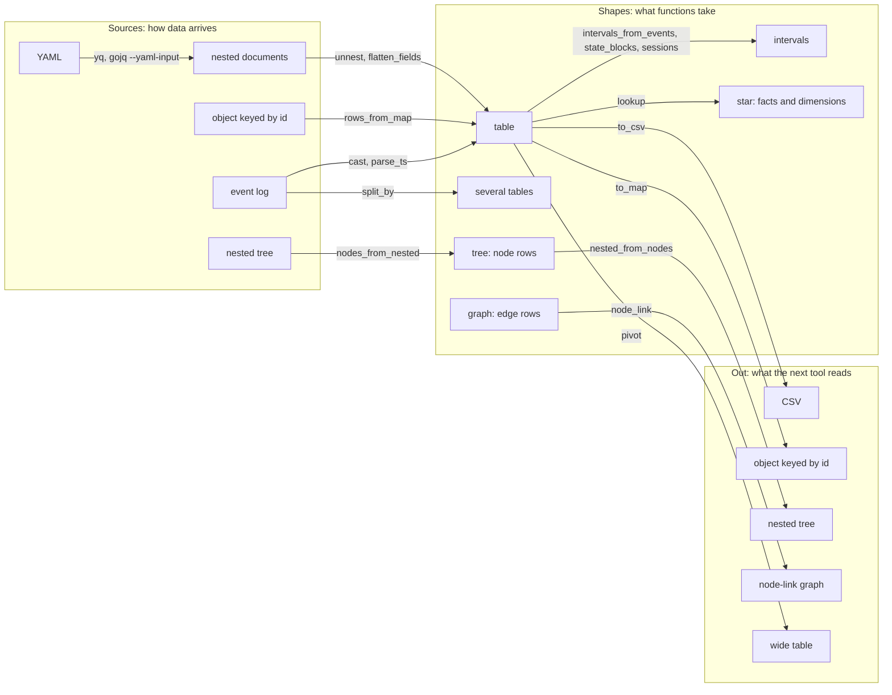

# Shapes: what the library takes, makes and hands on

The library takes JSON or YAML as it arrives and does everyday analytic work on it: joins, groups, statistics, time, state over time, trees, graphs and measures at several levels, short of fitting a model. It also reshapes data into what the next tool reads once the work outgrows jq.

Every function takes **rows**: an array of objects. What differs between functions is which fields a row must carry. That requirement is a function's **shape**. This document defines the shapes, the sources that are not shapes yet, and the conversions between them.

## The picture



## The shapes

| Shape | One row is | Example row | Families that take it |
|---|---|---|---|
| table | one record | `{"id": "REQ1", "site": "North", "hours": "4.5"}` | math over a list, types and time, grouping and windows, joins |
| several tables | not a row: one object whose fields are tables | `{"dhcp": [...], "firewall": [...]}` | `split_by` makes it; `keep`, `shape` |
| intervals | one span of one key, from a start to an end | `{"ip": "10.0.0.5", "mac": "m1", "start": 1731900000, "end": 1731943200}` | `join_within`, `join_overlap`, `merge_intervals`, `concurrency`; made by `intervals_from_events`, `state_blocks`, `sessions` |
| tree | one node, pointing at its parent | `{"id": "ops", "parent": "ceo"}` | `tree_paths`, `tree_rollup`, `nested_from_nodes` |
| graph | one edge | `{"from": "web01", "to": "db01"}` | `reachable`, `hops`, `shortest_path`, `topo_order`, `components`, `node_link` |
| star | a fact table plus dimension tables; the library builds a measure context from it | fact `{"day": "2026-03-02", "site_id": "s1", "amount": 40}`, dimension `{"id": "s1", "region": "east"}` | `lookup`; `rollup`, `measure`, `calc`, `share` and the context changes |

Three rules hold for every shape:

- **Fields are read through expressions, never fixed names.** `tree_paths(.emp_id; .manager_id)` works on any node rows, and a nested field can be read in place: `group_agg(.user.dept; length)`.
- **Values arrive as strings.** `cast` and `parse_ts` turn them into numbers and epoch seconds before anything else runs; `""` becomes null.
- **Nulls behave as in SQL.** Aggregates skip them, a null join key never matches, a null group key forms one group.

A calendar is both a dimension and a set of intervals: `calendar` gives one row per day with its year, quarter, month and weeks, to `lookup` by date as a dimension of a star, and each day's local `start` and `end`, so `join_within` places an event in its day.

When the shape of a table is not known yet, `profile` shows it: one row per column with what is present, missing, empty and of which type. `diff_tables` compares two versions of one table by key.

## Sources that are not shapes

A source is a form data arrives in. It has to become a shape before a function can use it.

| Source | Looks like | Becomes | Through |
|---|---|---|---|
| nested document | a row holding arrays and objects | a table: one row per array element, nested objects as columns | `unnest`, `flatten_fields` |
| object keyed by id | `{"web01": {...}, "db01": {...}}` | a table, sorted by key | `rows_from_map` |
| nested tree | each node holding a `children` array | tree: node rows | `nodes_from_nested` |
| YAML | any of the above, in YAML | JSON first | `yq -o=json`, or `gojq --yaml-input` |
| event log | rows with an entity, a time and what happened | see below | |

**An event log is a source, not a shape.** Its rows are already a table. What it becomes depends on the question:

| Question | The event log becomes | Through |
|---|---|---|
| how long was each ticket in each state? | intervals | `state_blocks` |
| which device held this address at 14:05? | intervals | `intervals_from_events`, then `join_within` |
| who reports to whom after these HR changes? | a tree | the latest row per person, then `tree_paths` |
| which hosts talked to which? | a graph | one edge row per pair, then `components` |
| how far do users get through view, cart, pay? | a table of one row per entity, then one per step | `funnel_steps`, `funnel` |
| of the users first seen in January, how many came back? | a table of one row per cohort and period | `cohorts`, `retention` |
| in what order can these steps run? | a graph | one edge row per "must come before", then `topo_order` |
| requests per site per month, with subtotals? | a star | `lookup` to attach dimensions, then `rollup` |

## One case through three shapes

A made-up export of service requests, as an API returns it:

```json
[{"id": "REQ1", "site": {"code": "N", "region": "east"}, "events": [
    {"at": "2026-03-02 09:00:00", "state": "open"},
    {"at": "2026-03-02 11:00:00", "state": "waiting"},
    {"at": "2026-03-02 15:00:00", "state": "open"},
    {"at": "2026-03-03 09:00:00", "state": "closed"}]},
 {"id": "REQ2", "site": {"code": "S", "region": "west"}, "events": [
    {"at": "2026-03-02 10:00:00", "state": "open"},
    {"at": "2026-03-02 12:00:00", "state": "closed"}]}]
```

The question: hours spent open, by region.

1. **Nested document to tables.** Two tables come out of the export: the requests, and one row per event (plain jq here; `flatten_fields` and `unnest` do the same on wider exports):

   ```jq
   map({id, region: .site.region}) as $requests
   | map(. as $r | .events[] | {id: $r.id, t: (.at | parse_ts), state})
   ```

   | id | t (shown as a time) | state |
   |---|---|---|
   | REQ1 | 03-02 09:00 | open |
   | REQ1 | 03-02 11:00 | waiting |
   | REQ1 | 03-02 15:00 | open |
   | REQ1 | 03-03 09:00 | closed |
   | REQ2 | 03-02 10:00 | open |
   | REQ2 | 03-02 12:00 | closed |

2. **Table to intervals.** `state_blocks(.id; .t; .state)`: one row per stay in a state, from its start to the next change. The last state of each request has no end yet.

   | key | state | start | end | duration (hours) |
   |---|---|---|---|---|
   | REQ1 | open | 03-02 09:00 | 03-02 11:00 | 2 |
   | REQ1 | waiting | 03-02 11:00 | 03-02 15:00 | 4 |
   | REQ1 | open | 03-02 15:00 | 03-03 09:00 | 18 |
   | REQ1 | closed | 03-03 09:00 | null | null |
   | REQ2 | open | 03-02 10:00 | 03-02 12:00 | 2 |
   | REQ2 | closed | 03-02 12:00 | null | null |

   REQ1 is open twice. A plain "time from first open to close" would give 24 hours and count the 4 hours of waiting.

3. **Intervals to a star, then a grouped table.** Keep the `open` rows, attach each request as a dimension with `lookup`, and group by its region:

   ```jq
   | map(select(.state == "open"))
   | lookup($requests; .key; .id; "req")
   | group_agg(.req.region; {open_hours: (map(.duration / 3600) | add)})
   ```

   ```json
   [{"key":"east","open_hours":20},{"key":"west","open_hours":2}]
   ```

   Hand check: east is 2 + 18, west is 2. The three steps joined with `|` are one program; it gives this answer on jq 1.7.1, jq 1.8.2, gojq and jaq.

## Splitting large input

A caller that partitions the input and runs each part separately gets the same answer only if the split respects the function. The rule per kind of function:

| The function's answer | Safe split | Combine by |
|---|---|---|
| a sum or count over rows (`sum_nonnull`, `count_nonnull`, `group_agg` with sums and counts) | anywhere | adding the parts |
| reads only its own group's rows (`median`, `quantile_cont`, `group_agg` with any aggregate, `over` windows, `pivot`) | by the group key | concatenating |
| orders one entity's rows in time (`state_blocks`, `transitions`, `sessions`, `runs`, `join_asof`, `intervals_from_events` by resource, `merge_intervals` by key) | by the entity key, each part in time order | concatenating |
| reads two tables (`join_*`, `lookup`, `join_overlap`) | both tables by the join key | concatenating |
| walks a tree or graph (`tree_paths`, `tree_rollup`, `reachable`, `components`) | by connected component; when components are not known in advance, do not split | concatenating |
| totals at several levels (`rollup`, `calc`, `share`) | do not split: a subtotal reads rows of every part | |

A mean is not a sum: split it as its group's rows, or carry the sum and the count and divide at the end.

## What stays out

- **Model fitting and machine learning.**
- **Heavy volume.** jq works on one value at a time on one core. Past a few hundred thousand rows, or when the same data answers many questions, shape the data out to a columnar engine such as DuckDB. The README carries the measured line.
- **Binary formats.** jq cannot write Parquet or Excel.

## Adding a shape or a converter

The tests a new one must pass, worked on the next shape in line:

1. **Is it rows?** A shape is rows with required fields, or one object holding tables. *Intervals:* rows with a key, a start and an end. Yes.
2. **Does a family take it as it is?** If no function reads it, it is a source, not a shape. *Intervals:* `join_within`, `join_overlap`, `merge_intervals` and `concurrency` read them. Yes.
3. **What makes it?** Name the conversion from a shape or source that exists. *Intervals:* `intervals_from_events`, `state_blocks` and `sessions` from an event table.
4. **What does it refuse?** State the error for input that is not the shape. *Intervals:* an end before its start is an error in `merge_intervals` and `concurrency`; `join_overlap` and `join_within` match nothing for such a row.
5. **How is it split?** Add its row to the split table. *Intervals:* by key.

A candidate that fails test 2 is added as a source with its converter, as the nested tree was.
