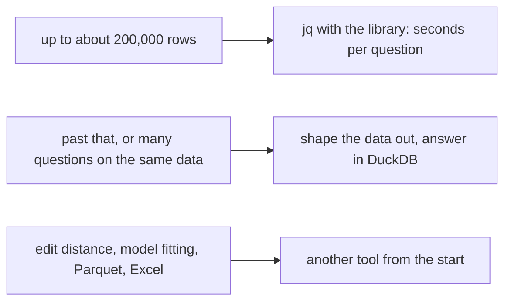

# Conventions: what holds in every family

The rules every function keeps, how to load the library, what costs time, how far it goes and when to hand the work to another tool. A family's own rules are in the design section of its read-out page (`docs/readout/`); where a family differs from what is written here, its page says so. Version 0.15.1. Every number is from a run on an Apple Silicon Mac, with the engine named.

## The rules

1. **One value in.** jq runs a filter once for each value it receives. A function here takes the whole table as that one value, an array of rows: `$rows | group_agg(...)` is right, `$rows[] | group_agg(...)` hands over one row at a time. A file with one JSON object per line is many values; collect it first with `--slurp` or `[inputs]`. Since 0.14.0 every function whose input is a table, a list of values or an object of tables checks that it got one and stops with a message naming itself (read-out page 00). Only the outer type is checked: a table of plain values is a table. The README lists the functions whose input is something else; `docs/primer.md` explains the model.
2. **Nulls.** Aggregates skip nulls, as SQL does, and return null when nothing is left. jq's own `length`, `min` and `max` do not skip them, which is why `count_nonnull`, `min_nonnull` and `max_nonnull` exist under their own names; there is no switch and no separate module.
3. **Keys.** A null join key never matches. A null group key forms one group, as in SQL. Keys are compared by their JSON text, so `1` and `"1"` are different keys.
4. **Order.** Groups come out in order of first appearance; join output follows the left table, then the right table among matches; sorting is stable; windows return rows in input order. This holds on every engine, gojq included, which sorts object keys. Where a result's order cannot be the same on every engine (the column list `to_csv(null)` infers, the keys `rows_from_map` reads), it is sorted.
5. **Errors are loud.** A timestamp that does not parse, a date that does not exist, a value that is not a number where one is asked for, an unknown zone, a repeated id in a tree, a key that would be overwritten: an error naming the function and the value. Only `""` is quietly read as missing.
6. **No hidden state.** No function reads the process time zone, the locale or the clock. `format_local` and `local_time` take the zone as an argument.
7. **Names never shadow jq.** No public name is a built-in of any tested engine; a test checks this before every run. Names starting with `_` are internal. Arguments without `$` are filters run on each row (`.site`, `{site}`); arguments with `$` are values.
8. **Beside core jq, not over it.** Where core jq answers a question well, the README says so instead of adding a function.

## Engines

jq 1.7.1, jq 1.8.2 (inside the Python `jq` 1.13.0 package), gojq 0.12.20 and jaq 3.1.2 pass the same 205 cases. The library works around these differences, so its functions answer the same everywhere; a hand-written program meets them directly:

| Difference | Engines |
|---|---|
| object key order is not kept | gojq sorts keys |
| `setpath` will not create an array from null or assign past an array's end | jaq |
| `reduce ... as $x` inside a function argument must be parenthesised | jq 1.7.1 |
| `.a = .b // "none"` gives `{"a":null}` | jq 1.7.1, gojq (jaq gives `{"a":"none"}`) |
| `IN` is undefined | jaq |
| `{a: 1} \| .[0]` is an error | jq, gojq (jaq gives null) |
| `strflocaltime` printed the wrong offset after the daylight-saving switch | jq 1.7.1 on macOS |
| `del(.. \| select(...))` leaves the containers it emptied | jq, gojq (jaq removes them) |

Spec 75 gathers these, and the ones reported in 2026 on the engines' trackers, into `docs/engines.md`.

## Loading it

The library is one file. Its time-zone tables are a generated block inside it.

| Where | How |
| --- | --- |
| jq command line | `jq -L <dir> 'include "analytics"; …' input.json` |
| any jq, no `-L` | `jq 'include "analytics" {search: "<dir>"}; …'` |
| with a namespace | `jq 'import "analytics" as a {search: "<dir>"}; … a::mean'` |
| Python `jq` package | the path goes in the program: `jq.compile('include "analytics" {search: "<dir>"}; ' + program)` |
| Python package `jq_analytics` | `jq_analytics.include()` returns that `include` line |

## Patterns that cost time

Measured on a table of 3,796 made-up service requests and copies of it up to 379,600 rows.

| Do | Instead of | Measured |
| --- | --- | --- |
| feed one record per line and filter while reading | parsing one big array, then filtering | 4.8 MB held against 651 MB |
| keep only the fields the question needs while reading, `[inputs \| {k, a}]` | `[inputs]`, `--slurp` or one big array, which all hold every row whole | 200,000 rows of ten fields (25 MB), one `group_agg`: 314 MB against 515 MB on jq 1.7.1, 295 against 569 on jaq, 432 against 580 on gojq; the same time |
| for a count or sum per key, fold while reading: `reduce inputs as $r ({}; .[$r.k] += 1)` | building the table first | the same 200,000 rows: 2 MB and 0.65 s on jq 1.7.1, 25 MB and 0.24 s on jaq, 14 MB and 2.7 s on gojq; against 515 to 630 MB and 0.6 to 1.7 s. Only for answers a fold can give: not a median, a join or a window |
| for a median or quantile per key, keep only that column while reading: `reduce inputs as $r ({}; .[$r.k] += [$r.a]) \| map_values(median)` | the whole table, then `group_agg` | the same 200,000 rows: 48 MB and 0.86 s against 514 MB and 1.74 s on jq 1.7.1; 35 MB and 0.35 s against 565 MB and 0.77 s on jaq |
| join a big stream to a small table: index the small one (`--slurpfile`), stream the big one through it | both as tables, then a join | the same 200,000 rows against 500 keys: 12 MB and 0.36 s against 413 MB and 0.71 s on jq 1.7.1; 28 MB and 0.28 s against 504 MB and 0.81 s on jaq |
| join with the join functions | scanning the right table per left row | 0.06 s against 4.98 s for 3,796 rows |
| group with `group_agg` or `group_by` | appending rows to a group inside a `reduce` | the append grows with the square of the group: 40 times the time for 10 times the rows |
| test membership with `join_semi` | `IN` against a list, which runs the list again for every row | 20,000 rows against 2,000 keys: 0.05 s against 4.7 s (jq 1.7.1) and 5.5 s (gojq); `IN` does not exist in jaq |
| make every field a `measure_with` changes into a level of the report | filtering on a field outside the levels | from an index, against a scan of every row for each cell |
| look a zone up once, `tz("…") as $z` | naming the zone on every row | the zone table is rebuilt on each mention |
| compare first, round last | rounding before a threshold test | a rounded value can land on the other side |
| DuckDB's `read_csv` past a few megabytes | `from_csv` | `from_csv` reads one character at a time: about 5 s a megabyte in jq 1.7.1, 2 s in jaq |

## How far it goes

| Size | What was measured | Result |
| --- | --- | --- |
| 200,000 rows of ten fields | seven of the library's questions, Python `jq` 1.13.0 package | 7.8 to 20 s each, 0.7 to 1.0 GB |
| the same | DuckDB 2.0.0 on 14 cores, reading the JSON included | 0.12 to 0.17 s on six of them; 149 s on the as-of join, where the library took 15 s |
| 500,000 rows | the same seven questions in jq | 20 to 54 s |
| 379,600 rows | grouping, joining, windows on jq 1.8.2 | 1.4 to 5.5 s; the office-hours question 25.8 s, and 7.1 s on gojq |

All answers were equal between jq and DuckDB. The line at about 200,000 rows is a judgement about waiting time, not a limit. gojq and jaq are the fastest engines; the Python package is the slowest way to run the library. Each family's own costs are on its read-out page and in the README.

## Splitting large input

A caller that splits the input and runs the parts separately gets the same answer only when the split respects the function. The library does not run the parts.

| The function's answer | Safe split | Combine by |
| --- | --- | --- |
| a sum or count over rows | anywhere | adding the parts |
| reads only its own group's rows (`median`, `group_agg`, `window`, `pivot`) | by the group key | concatenating |
| follows one entity through its events (`state_blocks`, `sessions`, `funnel_steps`, `intervals_from_events`) | by the entity key, each part in time order | concatenating |
| counts entities (`funnel`, `retention`) | by the entity key; count once after concatenating | counting after concatenating |
| reads two tables (joins, `lookup`, `join_within`) | both tables by the join key | concatenating |
| walks a tree or graph | by connected component, when known in advance | concatenating |
| needs every value, or every interval (`mode`, `corr`, `profile`, `concurrency`) | do not split | |
| totals at several levels (`rollup`, `measure_with`, `share_of`) | do not split: a subtotal reads rows of every part | |

A mean is not a sum: split it with its group's rows, or carry the sum and the count and divide at the end.

## Limits

- **Streaming.** Every table function needs its whole table. Counts and sums can stream over one record per line with plain `reduce inputs`; quantiles cannot.
- **Time zones.** Seven zones, 1970 to 2100.
- **Windows.** ROWS frames only.
- **As-of join with identical timestamps.** Many right rows with the same key and time slow it sharply.
- **Measures.** Not measured with thousands of cells.
- **Not included.** Relationships between tables in the DAX sense, edit distance and phonetic matching, approximate quantiles, rank correlation, fill-down, fiscal calendars and holidays.

## Handing off

When the work outgrows jq, the library's last job is to shape the data for the next tool: `flatten_fields` or `flatten_paths` and `to_csv` or `to_tsv` for a database or a spreadsheet, `to_table` for a person at a terminal, `to_map` for a lookup, `node_link` for a graph tool, the several-tables object for a flow's next step. jq cannot write Parquet or Excel; that stays with DuckDB or Python.
