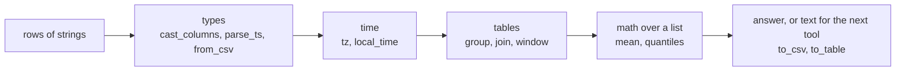
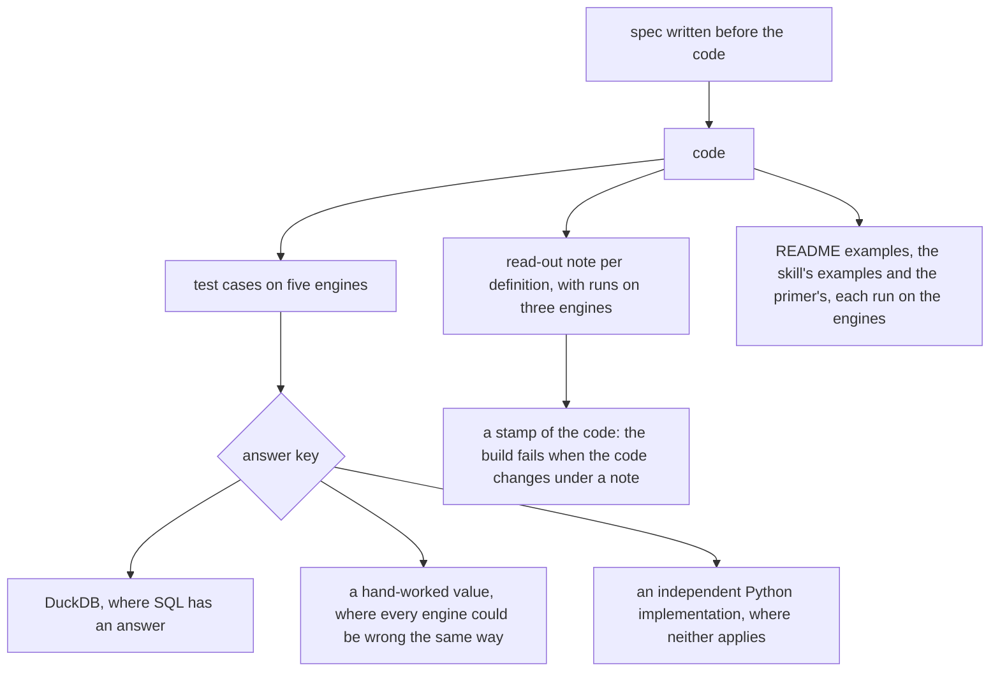

# Background: why the library exists, how it ships, how it is checked

The design decisions that span families, and the context they were made in. Each family's own decisions are in the design section of its read-out page; the shapes are in `05-shapes.md` and the rules every function keeps in `10-conventions.md`. Version 0.15.1.

## What it is for

A jq library for everyday analytic work on JSON and YAML as it arrives, nested and with every value a string: joins, grouping, statistics, time zones, state over time, trees, graphs and reports at several levels, and the reshaping that comes before and after them, short of fitting a model. It has four purposes:

1. **Learning.** Every definition has a read-out with an example, the result after each step and the code; `docs/primer.md` teaches jq's own model from the questions people ask.
2. **Practical answers to the questions people ask about jq** (`docs/research/questions-2026-11-19.md`): grouping, joins across files, dates and time zones, CSV in and out, what changed, as one named call each instead of a hand-written `reduce`.
3. **Glue between raw data and heavier analysis.** It turns nested replies and logs into typed tables and hands them on in the form the next tool reads, and says where it stops (about 200,000 rows; `10-conventions.md`).
4. **A tested vocabulary for code an AI writes.** The same functions run in jq and, through the Python package, in Python pipelines. An agent that calls a named, tested function writes code that varies less between runs, fails loudly, and reads at a glance; the agent skill in `skills/jq-analytics/` says which function answers which question.

## How the parts fit

A program normally moves left to right. Each stage is ordinary jq, joined with `|`.

## How it ships

- **Repository:** public, MIT. A tagged commit per released version; pushed history is never rewritten.
- **Layout:** `src/jq_analytics/analytics.jq` is the library, one file. `tests/` holds the cases, their fixtures and a DuckDB answer for each case that has one. `docs/design/` holds the numbered design documents and the feature matrix, `docs/specs/` one spec per sprint, `docs/readout/` the read-out (one page per family, its design first), `docs/primer.md` and `docs/research/` the teaching material, `tools/` the generators, checks and benchmarks, `skills/jq-analytics/` the skill for agents.
- **Python:** a small package, `jq_analytics`, that only knows where the file is; `jq_analytics.include()` returns the line that loads it.

| Version | Sprint | Added |
| --- | --- | --- |
| 0.1.0, 0.1.1 | before the sprints | math, types, time zones, grouping, joins, windows, reshape, state machines, trees, graphs, measures; one file |
| 0.1.2 | 05 | the shapes model as a design document; a test that no function has a builtin's name |
| 0.2.0 | 10 | ten converters between shapes |
| 0.3.0 | 15 | intervals from events, `join_within`, merging and concurrency |
| 0.4.0 | 20 | `calendar` and `on_calendar` |
| 0.5.0 | 25 | funnels, cohorts and retention |
| 0.6.0 | 30 | `hops`, `shortest_path`, `topo_order`; tree and graph functions rewritten for speed |
| 0.7.0 | 35 | `mode`, `value_counts`, `histogram`, `corr`, `profile`, `diff_tables` |
| 0.8.0 | 40 | `similarity`, `join_fuzzy` |
| 0.8.1 | 45 | the code read-out, a tutorial outline; no change to the library |
| 0.9.0 to 0.9.4 | 55 | the fifteen findings of the read-out fixed; then documentation and read-out only |
| 0.10.0, 0.10.1 | 57 | seven functions renamed, no change in behaviour |
| 0.11.0 | 58 | the skill for agents |
| 0.12.0 | 59 | a flat join keeps both values of a field name on both sides, the right one as `name_right` |
| 0.13.0 | 61 | `rename_fields`, `prefix_fields` |
| 0.13.1 | 62 | `join_overlap` reads a null end as still open |
| 0.14.0 | 60 | every table and list function checks its input |
| 0.15.0 | 65 | from the survey of common questions: `to_csv(null)`, `to_tsv`, `to_table`, `from_csv`, `rows_from_arrays`, `drop_empty`, `diff_docs`, `flatten_paths`, `unflatten_fields`, `format_local` |
| 0.15.1 | 67 | the primer, the surveys, the tutorial outline brought up to date |

## How it is checked

Engine agreement is not correctness: an early converter returned an empty table on all five engines, and a hand-checked answer caught it. Real data was used twice, privately, to check the interval builder against a reference built separately; the repository holds only made-up data.

## Prior art

No maintained jq library covers percentiles, windows or pivots, and jq's maintainers have declined statistics builtins. The parts exist apart:

| Tool | What it shares | Where it differs |
| --- | --- | --- |
| JSONiq (`jsoniq` 3.1.1) | a query language for JSON trees, with grouping and joins | every call needs Java and PySpark |
| Malloy | the closest measure model to DAX: `all()`, `exclude()`, and `nest:` for child tables | compiles to SQL; tables must be relational |
| `jsonl-algebra` 1.4.1 | joins, grouping and window functions over JSONL | equal-key joins only; no percentiles, pivot or measures |
| Awkward Array 2.15.0 | ragged nested data as a first-class type | no grouping, key joins or windows |
| DuckDB 2.0.0, Polars 2.1.0 | the relational part, as-of joins included, much faster at volume | nested data must become typed columns first; no measure layer |
| Power Query M | named rules for percentiles, grouping and joins | no windows, no named time zones |

## Decisions that span families

Decisions about one family are on its read-out page.

| Date | Decision |
| --- | --- |
| 2026-11-12 | DuckDB counts and groups; jq shapes a capture. Asked: could jq with a library be an analytics language of its own? |
| 2026-11-13 | Design a library worth shipping, generalised joins first; design first, review, refine. Measure on current engines: jq 1.8.2, gojq and jaq beside jq 1.7.1 |
| 2026-11-15 | Plain names through `include`; a namespace is jq's `import "analytics" as a` |
| 2026-11-17 | The library becomes its own small package, pinned by its users; public |
| 2026-11-18 | One file; null-skipping functions under their own names, no switch, no separate module |
| 2026-11-18 | The goal: JSON or YAML as it arrives, everyday analytics short of fitting a model, and reshaping for the next tool |
| 2026-11-18 | Shapes are designed before any new function; an event log is a source, not a shape; intervals are a shape |
| 2026-11-18 | Hand-off line at about 200,000 rows, provisional on further optimisation; a test against builtin clashes; converters in the one file |
| 2026-11-18 | Specs live in the public repository, written before the code, with made-up data only; push when a scan finds no private detail |
| 2026-11-18 | The code read-out comes before fixes: its fifteen findings were fixed only after the read-out was reviewed (0.9.0) |
| 2026-11-18 | Seven functions renamed because the old names did not say what they act on; no aliases and no library prefix |
| 2026-11-18 | The one-value assumption is stated, "explicit when the assumption is violated" (README rule 6, 0.9.2); the input check followed in 0.14.0 |
| 2026-11-19 | Learning is the first purpose; the four purposes above |
| 2026-11-19 | Two surveys of what people ask about jq decide what is added next; a function is added only where core jq has no answer or its answer has a trap |
| 2026-11-19 | API replies are sources in the shapes design (spec 70) |
| 2026-11-20 | Each family's design sits with its code on one read-out page; cross-cutting design stays in these numbered documents |

## Not decided

- The text of the public posts, which wait for the alpha (spec 90) and the author's approval of each.
- A native version, which waits on what the jq maintainers say.

Dropped from the earlier review page this replaces, with the reason: the working rule that an unanswered proposal counts as yes (how the project was run, not a design decision); the per-family decisions on joins, as-of ties, fuzzy matching, the measure layer and DAX (now on the joins, measures and approximate-matching pages); the version list's engine and case counts (current counts are in `10-conventions.md`).
