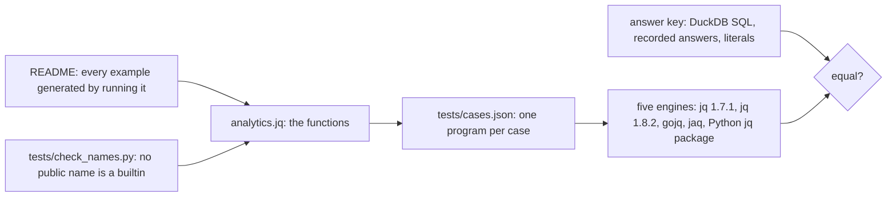

# Feature matrix

What the library does, family by family, and how far each part is carried: the functions in `analytics.jq`, the test cases, the answer key, and the README. Counts are as of version 0.9.4 and come from `tests/cases.json` and the library file.

Legend: ✅ done · 🟡 partial · ⏳ planned · — not involved. A case counts for a family when its program calls one of the family's functions, so one case can count for several.

## Shipped

| Feature | Shape it takes | Functions | Cases | With a DuckDB answer | README | Verified | Spec |
|---|---|---|---|---|---|---|---|
| math-over-a-list | a list of values | ✅ 18 | ✅ 13 | 13 | ✅ | five engines, 2026-11-18 | |
| types-and-time | table | ✅ 6 | ✅ 11 | 9 | ✅ | five engines, 2026-11-18 | |
| grouping-and-windows | table | ✅ 10 | ✅ 13 | 13 | ✅ | five engines, 2026-11-18 | |
| several-tables | several tables | ✅ 3 | ✅ 3 | 1 | ✅ | five engines, 2026-11-18 | |
| joins | two tables; intervals for `join_overlap` | ✅ 10 | ✅ 18 | 15 | ✅ | five engines, 2026-11-18 | |
| state-over-time | an event table, per entity | ✅ 4 | ✅ 5 | 4 | ✅ | five engines, 2026-11-18 | |
| trees-and-graphs | tree, graph | ✅ 4 | ✅ 5 | 2 | ✅ | five engines, 2026-11-18 | |
| measures-at-levels | star | ✅ 10 | ✅ 9 | 7 | ✅ | five engines, 2026-11-18 | |
| intervals-from-events | an event table, per resource | ✅ 1 | ✅ 6 | 0 | ✅ | five engines; equal to a reference on real lease and session logs, 2026-11-18 | [15](../specs/15-intervals/spec.md) |
| join-within | rows and intervals | ✅ 1 | ✅ 1 | 1 | ✅ | five engines, 2026-11-18 | [15](../specs/15-intervals/spec.md) |
| interval-merge, interval-concurrency | intervals | ✅ 2 | ✅ 5 | 2 | ✅ | five engines, 2026-11-18 | [15](../specs/15-intervals/spec.md) |
| calendar-table | none in; day rows out, each an interval and a dimension row | ✅ 1 | ✅ 7 | 2 | ✅ | five engines, 2026-11-18 | [20](../specs/20-calendar/spec.md) |
| calendar-periods | star, inside a cell | ✅ 1 | ✅ 3 | 1 | ✅ | five engines; equal to DAX's PREVIOUSMONTH and TOTALYTD compiled by dax-sql 0.2.2, 2026-11-18 | [20](../specs/20-calendar/spec.md), [45](../specs/45-read-out-and-teaching/spec.md) |
| funnel | an event table, per entity | ✅ 2 | ✅ 8 | 2 | ✅ | five engines, 2026-11-18 | [25](../specs/25-event-paths/spec.md) |
| cohort-retention | an event table, per entity, with a period list | ✅ 2 | ✅ 3 | 1 | ✅ | five engines, 2026-11-18 | [25](../specs/25-event-paths/spec.md) |
| graph-hops, shortest-path, dependency-order | graph | ✅ 3 | ✅ 8 | 2 | ✅ | five engines, 2026-11-18 | [30](../specs/30-graph-paths/spec.md) |
| tree-graph-speed | tree, graph | ✅ rewritten: `tree_paths`, `reachable`, `components` | ✅ earlier cases unchanged, plus a 3,000-level chain | | ✅ | measured to 200,000, 2026-11-18 | [30](../specs/30-graph-paths/spec.md) |
| distributions, correlation | a list of values; a table | ✅ 5 | ✅ 8 | 1 | ✅ | five engines, 2026-11-18 | [35](../specs/35-profiles/spec.md) |
| table-profile | table | ✅ 1 | ✅ 3 | 1 | ✅ | five engines, 2026-11-18 | [35](../specs/35-profiles/spec.md) |
| table-diff | two tables with a key | ✅ 1 | ✅ 4 | 1 | ✅ | five engines, 2026-11-18 | [35](../specs/35-profiles/spec.md) |
| string-similarity, fuzzy-join | two tables with a blocking key | ✅ 2 | ✅ 5 | 0 | ✅ | five engines; equal to an independent Python implementation, 2026-11-18 | [40](../specs/40-fuzzy-match/spec.md) |
| converters-in | sources to table or tree | ✅ 6 | ✅ 12 | 3 | ✅ | five engines, 2026-11-18 | [10](../specs/10-shape-converters/spec.md) |
| converters-out | shapes to map, nested tree, node-link, CSV | ✅ 4 | ✅ 7 | 0 | ✅ | five engines, 2026-11-18 | [10](../specs/10-shape-converters/spec.md) |
| shapes-model | | — | — | — | ✅ | document and README | [05](../specs/05-shapes-model/spec.md) |
| split-keys | | — | — | — | ✅ | reasoned per family, not tested by running partitions | [05](../specs/05-shapes-model/spec.md) |
| builtin-name-guard | | — | ✅ runs before the cases | — | — | planted clash caught, 2026-11-18 | [05](../specs/05-shapes-model/spec.md) |

> [!warning] Built, with a gap in the tests
> - Cases without a DuckDB answer are error cases, edge cases checked against literals, and three worked examples checked against recorded answers. The tree functions (`tree_paths`, `tree_rollup`) and most converters are among those: their answers are recorded or hand-worked, not computed by DuckDB.
> - `intervals_from_events` has no DuckDB answer: its cases are hand-worked, a generated log checks that intervals never overlap, and the comparison with real logs is recorded outside this repository.
> - The split table in the README is derived from what each function reads. No test yet runs a function on partitions and compares with the whole.

## Planned

Nothing further is specified. Edit distance was measured and left out on purpose (spec 40). Spec 55 fixed the fifteen findings of the code read-out; it added no feature.
