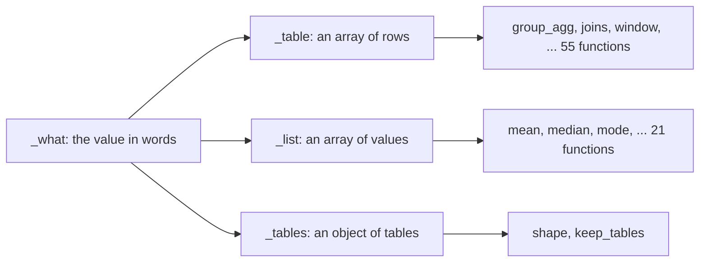

# Input checks

Generated from `src/jq_analytics/analytics.jq` and `docs/readout/notes/input-checks.md`. Do not edit.

## Design

### What it is for

Four internal definitions that every other page calls first. A function here takes its whole input as one value: a table is one array of rows, a list is one array of values (README, rule 6 "One value in"). The usual mistake is `$rows[] | f`, which runs `f` once per row. Before version 0.14.0 that gave jq's own message, which names neither the function nor the cause, or, for `mode`, `value_counts` and `count_nonnull`, a wrong answer with no error. Now the function stops and says what it was given and what to write instead.

The mistake and the right call, side by side:

```jq
[{site: "N"}, {site: null}, {site: "S"}] as $rows
| (try ($rows[] | count_nonnull) catch .),
  ($rows | map(.site) | count_nonnull)
```

```json
"count_nonnull: the input is one object, not a list of values. Make the list first, such as map(.site) | count_nonnull."
2
```



The shapes checked are the three a function can take as its whole input: a table (an array of rows), a list (an array of numbers, strings or nulls), and an object of tables (`{lease: [...], hit: [...]}`, which `split_by` makes). A check passes its input through unchanged, so a function reads `_table("group_agg"; "the input") | ...` and is otherwise as it was.

### The rules it keeps

- **Only the outer type is checked.** The rows of a table are not required to be objects, so `map(.site) | group_agg({site: .}; {n: length})`, a table of plain values, still works, and so does an edge list of pairs. Checking every item would also cost a pass over the rows; checking the outer type costs nothing measurable.
- **The message names the function and says what to write.** For the input: `<function>: the input is one object, not a table (an array of rows). Pass the whole table as one value: $rows | <function>(...), not $rows[] | <function>(...).` For an argument it names the argument: "the right table" of a join, "the dimension table" of `lookup`, "the intervals table" of `join_within`, "the old table" of `diff_tables`.
- **One message on every engine.** The message is built by the library with `error(...)`, so jq, gojq and jaq print the same text. The read-out build checks that.
- **What is not checked:** the window functions (`window` hands them one sorted partition, which is an array by construction), the measure-context functions (`rollup` calls them with a context it built), the single-value functions (`parse_ts`, `round_to`, `tz_offset`, `local_time`) and the functions that read only their arguments (`calendar`, `similarity`, `tz`).
- A function that calls another public function (`median` calls `quantile_cont`) checks once, under its own name, so the message names the function the user wrote.

### Beside core jq, SQL and pandas

Core jq has no check of this kind. A built-in given one row instead of a table fails with a message about whatever it tried next, and the message differs by engine:

```text
[{site:"N"},{site:"S"}][] | group_by(.site)
  jq 1.7.1   Cannot index string with string "site"
  gojq       expected an object but got: string ("N")
  jaq        cannot use {"site":"N"} as array
```

Worse, some built-ins accept an object where an array was meant and answer about its values: `map(f)` is `[.[] | f]`, and `.[]` on an object gives its values, so `{site: "N"} | map(select(. != null)) | length` is 1 on all three engines, a count of one row's fields. That is how `count_nonnull` used to give a wrong answer with no error.

SQL checks a query against the tables' schemas before it runs: DuckDB stops a `GROUP BY site` over a table without that column with `Binder Error: Referenced column "site" not found in FROM clause!`. pandas methods belong to the object they are called on, so a row taken with `df.iloc[0]` is a Series, and `row.groupby("site")` raises `KeyError: 'site'`. Neither can make the jq mistake of running a table function once per row, because neither streams rows into a function. The library adds, for jq, what the schema check gives SQL: the error happens at the function that was misused, names it, and shows the right call.

### Decisions

- **2026-11-18.** In his review of the grouping page the owner asked for the one-value-in assumption to be "explicit when the assumption is violated". The rule was first written down (0.9.2, README rule 6); the check waited for the end of his review.
- **2026-11-19, spec 60, version 0.14.0.** Done at the owner's word. Outer type only, after a measurement on 200,000 rows of ten fields: the array check took no measurable time (jq 1.8.2 0.32 s with and without it), while checking every item would add up to 0.3 s (jaq 0.20 s to 0.51 s). The six joins share one body, `_join`, which carries the name of the join the user called. The checks sit in their own section at the top of the file, so the read-out shows them as page 00 and every other page keeps its number.
- **2026-11-19, spec 65, version 0.15.0.** The new table functions (`to_tsv`, `to_table`, `rows_from_arrays`, `flatten_paths`, `unflatten_fields`) check their input the same way, which brings the table count to 55.

## The functions

In the order of the file:

| Function | Whose | What it is for |
|---|---|---|
| `_what` | Internal helper, not for callers | What a value is, in words, for the messages: "one object" for an object, since an object given where a table belongs is almost always one row; otherwise its type |
| `_table` | Internal helper, not for callers | The input, or an argument, must be a table |
| `_list`, `_tables` | Internal helpers, not for callers | `_list`: the input must be a list of values |

---

## _what

**Internal helper, not for callers** · `_what`

`_what/0`, lines 30 to 31:

```jq
# what a value is, in words, for the messages below
def _what: if type == "object" then "one object" elif type == "array" then "an array" else "a \(type)" end;
```

Built into jq: `type`.

What a value is, in words, for the messages: "one object" for an object, since an object given where a table belongs is almost always one row; otherwise its type.

### _what: the example

```jq
{site: "N"}, [1, 2], "N", 3, null | _what
```

```json
"one object"
"an array"
"a string"
"a number"
"a null"
```

---

## _table

**Internal helper, not for callers** · `_table($who; $arg)`

The input, or an argument, must be a table. `$who` is the function's name and `$arg` says which value is checked: `"the input"`, or for an argument a phrase such as `"the right table"`. A table passes through unchanged, so `_table(...) | rest` is the function as it was.

### _table: the example

The mistake, then the right call, on the same three rows:

```jq
[{site: "N", n: 1}, {site: "S", n: 2}, {site: "N", n: 3}] as $rows
| (try ($rows[] | group_agg({site}; {n: length})) catch .),
  ($rows | group_agg({site}; {n: length}))
```

```json
"group_agg: the input is one object, not a table (an array of rows). Pass the whole table as one value: $rows | group_agg(...), not $rows[] | group_agg(...)."
[{"site":"N","n":2},{"site":"S","n":1}]
```

The first line is the message, given once: the first row stops the run. The second is the answer.

A row passed where an argument table belongs:

```jq
[{host: "web01"}] | try join_left({host: "web01", site: "N"}; .host; .host) catch .
```

```json
"join_left: the right table is one object, not a table (an array of rows). Pass the whole table as an array."
```

### _table: the definition

`_table/2`, lines 33 to 37:

```jq
# the input, or the argument named by $arg, must be a table: an array of rows
def _table($who; $arg):
  if type == "array" then .
  elif $arg == "the input" then error("\($who): the input is \(_what), not a table (an array of rows). Pass the whole table as one value: $rows | \($who)(...), not $rows[] | \($who)(...).")
  else error("\($who): \($arg) is \(_what), not a table (an array of rows). Pass the whole table as an array.") end;
```

Built into jq: `error`, `type`. From this library: `_what`.

- `type == "array"`: a table of any rows passes, an empty one included.
- For the input, the message shows the call written both ways, with the function's own name.

---

## _list, _tables

**Internal helpers, not for callers** · `_list($who)`, `_tables($who)`

`_list`: the input must be a list of values. `_tables`: the input must be an object whose fields are tables, the shape `split_by` makes and `shape` and `keep_tables` read.

### _list and the others: the example

`count_nonnull` used to count a row's fields when given one row. Now it stops, and on the column it counts the rows:

```jq
[{site: "N"}, {site: null}, {site: "S"}] as $rows
| (try ($rows[] | count_nonnull) catch .),
  ($rows | map(.site) | count_nonnull)
```

```json
"count_nonnull: the input is one object, not a list of values. Make the list first, such as map(.site) | count_nonnull."
2
```

`shape` given one table instead of an object of tables:

```jq
try ([{site: "N"}] | shape) catch .
```

```json
"shape: the input is an array, not an object of tables (split_by makes one). For one table, use profile."
```

### _list and the others: the definition

`_list/1`, lines 39 to 42:

```jq
# the input must be a list of values: an array
def _list($who):
  if type == "array" then .
  else error("\($who): the input is \(_what), not a list of values. Make the list first, such as map(.site) | \($who).") end;
```

Built into jq: `error`, `type`. From this library: `_what`.

`_tables/1`, lines 44 to 47:

```jq
# the input must be an object whose fields are tables
def _tables($who):
  if type == "object" then .
  else error("\($who): the input is \(_what), not an object of tables (split_by makes one). For one table, use profile.") end;
```

Built into jq: `error`, `type`. From this library: `_what`.

The same pattern as `_table`, with a message that says how to make the right input: `map(.site)` for a list, `split_by` for an object of tables.
