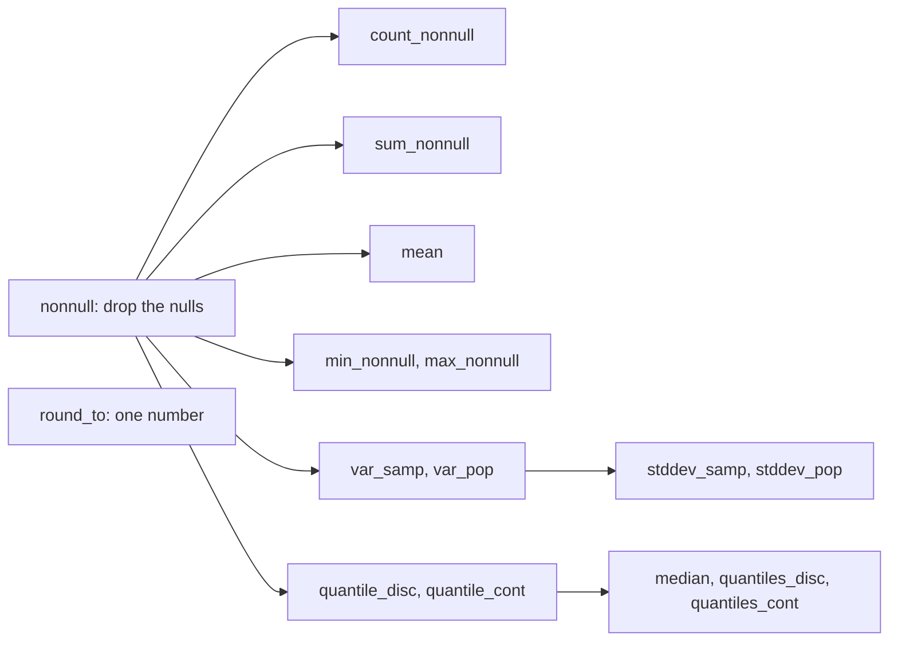

# Math: arrays of numbers

Generated from `src/jq_analytics/analytics.jq` and `docs/readout/notes/math.md`. Do not edit.

Eighteen definitions over a list of values, usually one column of a table (`map(.x)`). One rule runs through all of them: **nulls are skipped, and "no values" gives null**, as SQL aggregates do. jq's own `add`, `min` and `length` do not skip nulls, which is why these exist under their own names.



## nonnull, count_nonnull, sum_nonnull, mean

`nonnull/0`, line 28:

```jq
# the input array without nulls
def nonnull: map(select(. != null));
```

`count_nonnull/0`, line 31:

```jq
# number of non-null values
def count_nonnull: nonnull | length;
```

`sum_nonnull/0`, line 34:

```jq
# sum of non-null values; null when there are none (jq's add returns null for [] but counts nothing)
def sum_nonnull: nonnull | if length == 0 then null else add end;
```

`mean/0`, line 38:

```jq
# arithmetic mean of non-null values; null when none. Plain `add / length` divides by a count
# that includes nulls: [1, null, 3] gives 1.33 there and 2 here.
def mean: nonnull | if length == 0 then null else add / length end;
```

- `nonnull` is `map(select(. != null))`: the list without its nulls. Everything below starts with it.
- `count_nonnull` is its length. Plain `length` counts the nulls too.
- `sum_nonnull`: `if length == 0 then null else add end`. jq's `add` already skips a null among numbers and gives null for an empty list, so the result rarely differs from plain `add`; the definition is here so that the sum follows the same stated rule as the others, and reads as such in a query.
- `mean`: `add / length` after the nulls are gone, so the divisor is the number of values, not the number of rows.

```jq
[1, null, 3] | {plain: (add / length), mean: mean, length: length, count_nonnull: count_nonnull,
                sum_nonnull: sum_nonnull, of_nothing: ([null] | [mean, sum_nonnull, count_nonnull])}
```

```json
{
  "plain": 1.3333333333333333,
  "mean": 2,
  "length": 3,
  "count_nonnull": 2,
  "sum_nonnull": 4,
  "of_nothing": [null, null, 0]
}
```

The plain form divides 4 by 3 rows; `mean` divides it by 2 values.

## min_nonnull, max_nonnull, min_by_nonnull, max_by_nonnull

`min_nonnull/0`, line 42:

```jq
# least and greatest non-null value; null when none, as SQL's MIN and MAX. jq's own min and max do
# not skip nulls: null sorts below every number, so [null, 1, 3] | min is null there and 1 here.
def min_nonnull: nonnull | min;
```

`max_nonnull/0`, line 43:

```jq
def max_nonnull: nonnull | max;
```

`min_by_nonnull/1`, line 47:

```jq
# the row whose f is least (greatest), rows with a null f left out; null when none (SQL ARG_MIN,
# ARG_MAX). Ties: the first such row for min, the last for max, as jq's min_by and max_by.
def min_by_nonnull(f): map(select((f) != null)) | min_by(f);
```

`max_by_nonnull/1`, line 48:

```jq
def max_by_nonnull(f): map(select((f) != null)) | max_by(f);
```

- `min_nonnull` and `max_nonnull` are jq's `min` and `max` after `nonnull`. In jq's ordering null sorts below every number, so a plain `min` over a column with one null returns null.
- `min_by_nonnull(f)` and `max_by_nonnull(f)` take rows and return the whole row whose `f` is least or greatest, after dropping rows whose `f` is null. On a tie `min_by` returns the first such row and `max_by` the last; these inherit that.

```jq
[{id: 1, x: null}, {id: 2, x: 5}, {id: 3, x: 2}, {id: 4, x: 5}]
| {plain_min: (map(.x) | min), min_nonnull: (map(.x) | min_nonnull), max_nonnull: (map(.x) | max_nonnull),
   lowest_row: min_by_nonnull(.x).id, highest_row: max_by_nonnull(.x).id, none: ([{x: null}] | min_by_nonnull(.x))}
```

```json
{"plain_min":null,"min_nonnull":2,"max_nonnull":5,"lowest_row":3,"highest_row":4,"none":null}
```

Rows 2 and 4 tie for the highest `x`; the last of them, 4, is returned.

## var_samp, var_pop, stddev_samp, stddev_pop

`var_samp/0`, lines 52 to 53:

```jq
# variance and standard deviation: sample (divide by n - 1, null below 2 values) and population
# (divide by n, null when none). Two-pass: mean first, then squared deviations.
def var_samp: nonnull | length as $n
  | if $n < 2 then null else (add / $n) as $m | (map((. - $m) * (. - $m)) | add) / ($n - 1) end;
```

`var_pop/0`, lines 54 to 55:

```jq
def var_pop: nonnull | length as $n
  | if $n == 0 then null else (add / $n) as $m | (map((. - $m) * (. - $m)) | add) / $n end;
```

`stddev_samp/0`, line 56:

```jq
def stddev_samp: var_samp | if . == null then null else sqrt end;
```

`stddev_pop/0`, line 57:

```jq
def stddev_pop: var_pop | if . == null then null else sqrt end;
```

Two passes over the non-null values: the mean `$m`, then the sum of squared differences from it.

- `var_samp` divides by `$n - 1` and is null below two values (one value has no sample variance).
- `var_pop` divides by `$n` and is null only when there are no values.
- `(. - $m) * (. - $m)` rather than `pow(.; 2)`: a multiplication, with no call.
- `stddev_*` is `sqrt` of the variance, with null passed through, because `null | sqrt` is an error in jq.

Hand check on `[2, 4, 4, 4, 5, 5, 7, 9]`: the mean is 5; the squared differences are 9, 1, 1, 1, 0, 0, 4, 16, which sum to 32. Population variance 32 / 8 = 4, standard deviation 2; sample variance 32 / 7.

```jq
[2, 4, 4, 4, 5, 5, 7, 9] | {var_pop: var_pop, stddev_pop: stddev_pop, var_samp_times_7: (var_samp * 7 | round),
                            one_value: ([3] | [var_samp, var_pop]), none: ([] | [var_samp, var_pop, stddev_pop])}
```

```json
{"var_pop":4,"stddev_pop":2,"var_samp_times_7":32,"one_value":[null,0],"none":[null,null,null]}
```

## quantile_disc, quantile_cont, median, quantiles_disc, quantiles_cont

`quantile_disc/1`, lines 65 to 66:

```jq
# Quantiles over non-null values, p in [0, 1]; null when none.
# quantile_disc: nearest rank, an element of the data: the value at 1-based rank ceil(n * p) of the
#   sorted values, at least rank 1. DuckDB's quantile_disc gives the same (checked by the tests),
#   and so did the sibling slug's lib.jq pctl.
# quantile_cont: linear interpolation at h = (n - 1) * p between the neighbours of h, the rule of
#   DuckDB's quantile_cont and median, Excel PERCENTILE.INC and Power Query PercentileMode.ExcelInc.
def quantile_disc($p): nonnull | sort as $x | length as $n
  | if $n == 0 then null else $x[([(($n * $p) | ceil), 1] | max) - 1] end;
```

`quantile_cont/1`, lines 67 to 71:

```jq
def quantile_cont($p): nonnull | sort as $x | length as $n
  | if $n == 0 then null
    else (($n - 1) * $p) as $h | ($h | floor) as $lo
    | if $lo + 1 >= $n then $x[$lo] else $x[$lo] + ($h - $lo) * ($x[$lo + 1] - $x[$lo]) end
    end;
```

`median/0`, line 72:

```jq
def median: quantile_cont(0.5);
```

`quantiles_disc/1`, line 74:

```jq
# several quantiles at once, as DuckDB's list form: null (not a list of nulls) when no values
def quantiles_disc($ps): if count_nonnull == 0 then null else [$ps[] as $p | quantile_disc($p)] end;
```

`quantiles_cont/1`, line 75:

```jq
def quantiles_cont($ps): if count_nonnull == 0 then null else [$ps[] as $p | quantile_cont($p)] end;
```

Both sort the non-null values into `$x` with `$n` values and take `$p` from 0 to 1.

- **`quantile_disc`** returns a value that is in the data: the one at rank `ceil($n * $p)`, counting from 1, and at least rank 1 (so `$p = 0` gives the smallest). `[…, 1] | max` is that floor; the `- 1` turns the rank into a position.
- **`quantile_cont`** interpolates. `$h = ($n - 1) * $p` is a fractional position; `$lo` is the position below it. The result is `$x[$lo]` plus the fraction `$h - $lo` of the step to the next value. `if $lo + 1 >= $n` catches `$p = 1`, where there is no next value.
- `median` is `quantile_cont(0.5)`.
- The plural forms take a list of `$p` and return a list, or a single null when there are no values, which is what DuckDB's list form does.

Hand check on `[40, 10, null, 30, 20]`: sorted `[10, 20, 30, 40]`, `$n = 4`.

| `$p` | disc: rank `ceil(4p)` | disc value | cont: `$h = 3p` | cont value |
|---|---|---|---|---|
| 0.25 | 1 | 10 | 0.75 | 10 + 0.75 × 10 = 17.5 |
| 0.5 | 2 | 20 | 1.5 | 20 + 0.5 × 10 = 25 |
| 0.75 | 3 | 30 | 2.25 | 30 + 0.25 × 10 = 32.5 |
| 1 | 4 | 40 | 3 | 40 |

```jq
[40, 10, null, 30, 20] | {disc: quantiles_disc([0, 0.25, 0.5, 0.75, 1]), cont: quantiles_cont([0.25, 0.5, 0.75, 1]),
                          median: median, none: ([null] | [quantile_disc(0.5), quantiles_cont([0.5])])}
```

```json
{"disc":[10,10,20,30,40],"cont":[17.5,25,32.5,40],"median":25,"none":[null,null]}
```

**Review finding 2.** The comment above `quantile_disc` says the rule matches "the sibling slug's lib.jq pctl". That refers to a file outside this repository and means nothing to a reader here; the comment should lose that clause.

## round_to

`round_to/1`, line 79:

```jq
# round to $d decimal places, halves away from zero, on the binary double (so 1.005 becomes 1.0,
# because 1.005 is stored as 1.00499999...). Null stays null.
def round_to($d): if . == null then null else pow(10; $d) as $m | (. * $m | round) / $m end;
```

`pow(10; $d) as $m | (. * $m | round) / $m`: shift the decimal point right by `$d` places, round to a whole number, shift back. jq's `round` sends halves away from zero. Null stays null.

The rounding is of the number as stored. 1.005 cannot be stored exactly; the stored value is a little below it, so times 100 it is a little below 100.5 and rounds to 100.

```jq
[0.125, 2.5, -2.5, 1.005, null] | [map(round_to(2)), map(round_to(0))]
```

```json
[
  [0.13, 2.5, -2.5, 1, null],
  [0, 3, -3, 1, null]
]
```

jaq prints a rounded whole number with a decimal point (`3.0` where jq prints `3`); the values are equal.
