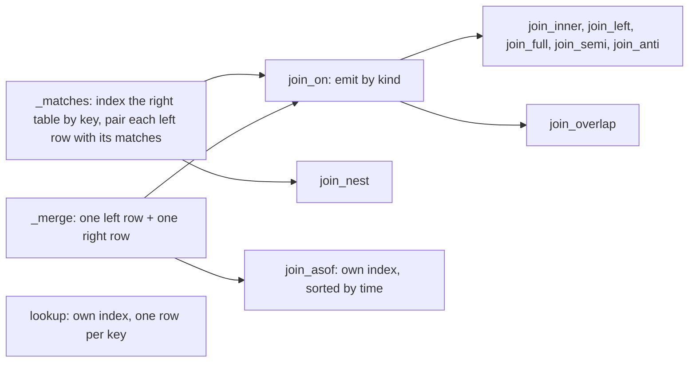

# Joins

Generated from `src/jq_analytics/analytics.jq` and `docs/readout/notes/joins.md`. Do not edit.

Thirteen definitions. Two helpers do the work: `_matches` pairs each left row with its right rows, and `_merge` joins one left row to one right row. `join_on` chooses what to emit from those pairs; everything else except `lookup` and `join_asof` is a one-line call of `join_on` or `_matches`.



Two idioms recur and are explained once here:

- **A key goes through `tojson` before it is used as an object key.** jq object keys are strings, so the number `1` and the string `"1"` would otherwise collide, and an array key (a composite key) could not be used at all. `tojson` gives `1`, `"1"` and `[1,"a"]` three different strings.
- **The right table is indexed once.** An object from key to rows is built before the left rows are walked, so the cost is left rows plus right rows, not their product.

## _merge

`_merge/2`, lines 217 to 221:

```jq
def _merge($l; $r):
  reduce ($r | to_entries[]) as $e ($l;
    if has($e.key) and .[$e.key] != $e.value
    then error("join: field \($e.key | tojson) differs between left (\(.[$e.key] | tojson)) and right (\($e.value | tojson)); rename one side first")
    else .[$e.key] = $e.value end);
```

Takes a left row `$l` and a right row `$r`; returns one object with the fields of both.

- `reduce ($r | to_entries[]) as $e ($l; …)` starts from the left row and adds the right row's fields one at a time.
- `if has($e.key) and .[$e.key] != $e.value then error(…)`: a field on both sides with different values stops the join and names the field and both values. A plain `$l + $r` would let the right value overwrite the left one without a word.
- `else .[$e.key] = $e.value`: a new field is added; a field with the same value on both sides is set to what it already is, which is how the join key ends up in the output once.

```jq
_merge({id: 1, k: "a"}; {k: "a", v: 9}),
(try _merge({id: 1, v: 2}; {v: 9}) catch .)
```

```json
{"id":1,"k":"a","v":9}
"join: field \"v\" differs between left (2) and right (9); rename one side first"
```

## _matches

`_matches/4`, lines 224 to 229:

```jq
# each left row with its matching right rows: [{l: row, m: [{key: right position, value: right row}]}]
def _matches($right; lkey; rkey; cond):
  ($right | to_entries | group_by(.value | rkey)
   | map(select((.[0].value | rkey) != null) | {key: (.[0].value | rkey | tojson), value: .}) | from_entries) as $ix
  | [.[] as $l | ($l | lkey) as $k
     | {l: $l, m: [(if $k == null then empty else $ix[$k | tojson][]? end)
                   | select(.value as $r | {l: $l, r: $r} | cond)]}];
```

Input: the left table. Returns one entry per left row, in left order: `{l: the row, m: [{key: position in the right table, value: right row}, …]}`. The position is kept because `join_on` needs it for a full join.

- `$right | to_entries` turns the right table into `{key: position, value: row}` pairs.
- `group_by(.value | rkey)` groups them by the right key. `group_by` sorts groups by key but keeps input order inside a group, on every engine, so a left row's matches come out in right-table order.
- `map(select((.[0].value | rkey) != null) | {key: (… | tojson), value: .}) | from_entries` drops the group whose key is null and turns the rest into the index `$ix`: key text to the group's pairs. Dropping the null group is half of "a null key never matches".
- `[.[] as $l | ($l | lkey) as $k | {l: $l, m: […]}]` walks the left rows. `if $k == null then empty` is the other half of the null rule. `$ix[$k | tojson][]?` looks the key up; the `?` makes a missing key give no matches instead of an error.
- `select(.value as $r | {l: $l, r: $r} | cond)` applies the caller's extra condition to the pair. It runs only on pairs that already share a key.

```jq
[{id: 1, k: "a"}, {id: 2, k: "z"}, {id: 3, k: null}]
| _matches([{k: "a", v: 1}, {k: null, v: 2}, {k: "a", v: 3}]; .k; .k; true)
```

```json
[
  {"l": {"id": 1, "k": "a"}, "m": [{"key": 0, "value": {"k": "a", "v": 1}}, {"key": 2, "value": {"k": "a", "v": 3}}]},
  {"l": {"id": 2, "k": "z"}, "m": []},
  {"l": {"id": 3, "k": null}, "m": []}
]
```

## join_on

`join_on/5`, lines 232 to 243:

```jq
# the general flat join
def join_on($right; lkey; rkey; cond; $kind):
  _matches($right; lkey; rkey; cond) as $rows
  | if $kind == "inner" then [$rows[] | .l as $l | .m[] | _merge($l; .value)]
    elif $kind == "left" then [$rows[] | .l as $l | if (.m | length) > 0 then .m[] | _merge($l; .value) else $l end]
    elif $kind == "semi" then [$rows[] | select((.m | length) > 0) | .l]
    elif $kind == "anti" then [$rows[] | select((.m | length) == 0) | .l]
    elif $kind == "full" then
      # right rows that matched no left row follow the left part, in right order
      ([$rows[].m[] | {key: (.key | tostring), value: true}] | from_entries) as $hit
      | [$rows[] | .l as $l | if (.m | length) > 0 then .m[] | _merge($l; .value) else $l end]
        + [$right | to_entries[] | select($hit[.key | tostring] | not) | .value]
    else error("join_on: unknown kind \($kind | tojson)") end;
```

The general flat join. Input: the left table. `$kind` chooses what to emit from the pairs `_matches` found:

| kind | emits |
|---|---|
| `inner` | for each left row, one merged row per match |
| `left` | the same, and the left row alone when it has no match |
| `semi` | the left row once when it has any match; no right fields |
| `anti` | the left row when it has no match |
| `full` | the `left` output, then the right rows no left row matched, in right order |

For `full`, `$hit` is an object whose keys are the positions of right rows that matched something (`.key | tostring`, since a position is a number). The unmatched right rows are then the entries whose position is not in `$hit`. Anything else as `$kind` is an error rather than an empty result.

```jq
[{id: 1, k: "a"}, {id: 2, k: "b"}, {id: 3, k: "z"}] as $l
| [{k: "a", v: "A"}, {k: "b", v: "B1"}, {k: "b", v: "B2"}, {k: "y", v: "Y"}] as $r
| ["inner", "left", "semi", "anti", "full"]
| map({key: ., value: (. as $kind | $l | join_on($r; .k; .k; true; $kind) | map([.id, .v]))}) | from_entries
```

```json
{
  "inner": [[1, "A"], [2, "B1"], [2, "B2"]],
  "left": [[1, "A"], [2, "B1"], [2, "B2"], [3, null]],
  "semi": [[1, null], [2, null]],
  "anti": [[3, null]],
  "full": [[1, "A"], [2, "B1"], [2, "B2"], [3, null], [null, "Y"]]
}
```

In `full`, the last row is `[null, "Y"]`: the unmatched right row has no `id`. The condition form, a left join of amounts to the bands that contain them:

```jq
[{id: 1, amount: 5}, {id: 2, amount: 60}, {id: 3, amount: 500}]
| join_on([{lo: 0, hi: 10, band: "small"}, {lo: 10, hi: 100, band: "medium"}];
          true; true; .l.amount >= .r.lo and .l.amount < .r.hi; "left")
| map({id, band})
```

```json
[
  {"id": 1, "band": "small"},
  {"id": 2, "band": "medium"},
  {"id": 3, "band": null}
]
```

With `true` for both keys every right row is in one group, so every pair is checked: this is the slow form, for small right tables.

## join_inner, join_left, join_full, join_semi, join_anti

`join_inner/3`, line 246:

```jq
# equality joins: shorthands for join_on with no condition
def join_inner($right; lkey; rkey): join_on($right; lkey; rkey; true; "inner");
```

`join_left/3`, line 247:

```jq
def join_left($right; lkey; rkey): join_on($right; lkey; rkey; true; "left");
```

`join_full/3`, line 248:

```jq
def join_full($right; lkey; rkey): join_on($right; lkey; rkey; true; "full");
```

`join_semi/3`, line 249:

```jq
def join_semi($right; lkey; rkey): join_on($right; lkey; rkey; true; "semi");
```

`join_anti/3`, line 250:

```jq
def join_anti($right; lkey; rkey): join_on($right; lkey; rkey; true; "anti");
```

Each is `join_on` with `true` for the condition and its kind fixed. They exist so the common case reads as one word.

```jq
[{id: 1, k: "a"}, {id: 2, k: "z"}] | join_left([{k: "a", v: 9}]; .k; .k)
```

```json
[
  {"id": 1, "k": "a", "v": 9},
  {"id": 2, "k": "z"}
]
```

## join_nest

`join_nest/5`, lines 254 to 255:

```jq
# nested join: every left row once, with field $as holding the array of its matching right rows
# (empty when none). Never multiplies rows. Power Query's Table.NestedJoin.
def join_nest($right; lkey; rkey; cond; $as):
  [_matches($right; lkey; rkey; cond)[] | .l + {($as): [.m[].value]}];
```

Every left row exactly once, with field `$as` holding the array of its matching right rows. `.l + {($as): [.m[].value]}` adds one field to the left row, so nothing is merged, no field can clash, and the row count never changes. Use it when the right side is "many" and you want to count or summarise the matches per left row.

```jq
[{id: 1, k: "a"}, {id: 2, k: "z"}]
| join_nest([{k: "a", v: 1}, {k: "a", v: 2}]; .k; .k; true; "hits")
```

```json
[
  {"id": 1, "k": "a", "hits": [{"k": "a", "v": 1}, {"k": "a", "v": 2}]},
  {"id": 2, "k": "z", "hits": []}
]
```

## lookup

`lookup/4`, lines 259 to 265:

```jq
# lookup: attach exactly one record of a dimension table under field $as (null when none).
# A key that appears twice in the dimension is an error, so a lookup can never multiply rows.
def lookup($dim; lkey; dkey; $as):
  ($dim | group_by(dkey)
   | map(select((.[0] | dkey) != null)
         | if length > 1 then error("lookup: key \(.[0] | dkey | tojson) appears more than once in the dimension")
           else {key: (.[0] | dkey | tojson), value: .[0]} end)
   | from_entries) as $ix
  | map(. as $l | ($l | lkey) as $k | $l + {($as): (if $k == null then null else $ix[$k | tojson] end)});
```

Attaches one row of a dimension table under field `$as`. It builds its own index because its rule differs from a join's: a key that appears twice in the dimension is an error.

- `$dim | group_by(dkey)` groups the dimension by key; `select((.[0] | dkey) != null)` drops null keys.
- `if length > 1 then error(…)`: two rows with one key stop the lookup, naming the key. The check runs when the index is built, so it fires even when no left row uses that key.
- `map(. as $l | … $l + {($as): …})`: every left row gets the field; a null or unknown key gives `null`.

```jq
[{id: 1, gid: "g1"}, {id: 2, gid: "g9"}, {id: 3, gid: null}]
| lookup([{gid: "g1", name: "Access"}, {gid: "g2", name: "Devices"}]; .gid; .gid; "group"),
  (try ([{gid: "g1"}] | lookup([{gid: "g1", n: 1}, {gid: "g1", n: 2}]; .gid; .gid; "g")) catch .)
```

```json
[{"id":1,"gid":"g1","group":{"gid":"g1","name":"Access"}},{"id":2,"gid":"g9","group":null},{"id":3,"gid":null,"group":null}]
"lookup: key \"g1\" appears more than once in the dimension"
```

## join_overlap

`join_overlap/7`, lines 269 to 270:

```jq
# interval overlap: pairs with the same key whose intervals overlap, each interval closed at its
# start and open at its end ([start, end)). Flat and inner; rename start and end on one side first.
def join_overlap($right; lkey; rkey; lstart; lend; rstart; rend):
  join_on($right; lkey; rkey; (.l | lstart) < (.r | rend) and (.r | rstart) < (.l | lend); "inner");
```

An inner `join_on` whose condition is the overlap test for half-open intervals: `l.start < r.end and r.start < l.end`. Two intervals that only touch (one ends where the other starts) do not overlap. The output is merged rows, so the two sides must not both call their fields `start` and `end` with different values; rename one side first, as in the run.

```jq
[{room: "A", who: "ann", s: 9, e: 11}, {room: "A", who: "bo", s: 11, e: 12}]
| join_overlap([{room: "A", what: "cleaning", cs: 10, ce: 11}]; .room; .room; .s; .e; .cs; .ce)
```

```json
[
  {"room": "A", "who": "ann", "s": 9, "e": 11, "what": "cleaning", "cs": 10, "ce": 11}
]
```

## join_asof

`join_asof/6`, lines 278 to 290:

```jq
# As-of join (left outer): for each left row, the right row with the same key whose rtime is the
# greatest rtime <= the left row's ltime (DuckDB's ASOF LEFT JOIN ... ON l.k = r.k AND l.t >= r.t).
# $max_age, when not null, rejects a match older than that: ltime - rtime must be <= $max_age.
# Ties on rtime: the first such right row in input order (DuckDB 2.0.0 gave the same on the test
# fixture; pandas merge_asof takes the last; SQL leaves it open). No match, or a null key or time
# on the left: the left row alone. Right rows with a null key or time are dropped.
def join_asof($right; lkey; rkey; ltime; rtime; $max_age):
  ([$right[] | select((rkey) != null and (rtime) != null)] | group_by(rkey)
   | map({key: (.[0] | rkey | tojson), value: (sort_by(rtime) | {rows: ., t: map(rtime)})}) | from_entries) as $ix
  | [.[] as $l | ($l | lkey) as $k | ($l | ltime) as $t
     | if $k == null or $t == null or $ix[$k | tojson] == null then $l
       else $ix[$k | tojson] as $g
       | ($g.t | bsearch($t)) as $i
       # bsearch gives some entry equal to $t, or the insertion point; take the last entry <= $t,
       # then step back to the first of its run of equal times
       | (if $i >= 0 then $i else -2 - $i end) as $last
       | (if $last < 0 then -1 else $last | until(. == 0 or $g.t[. - 1] != $g.t[$last]; . - 1) end) as $j
       | if $j < 0 or ($max_age != null and $t - $g.t[$j] > $max_age) then $l else _merge($l; $g.rows[$j]) end
       end];
```

`join_asof/5`, line 291:

```jq
def join_asof($right; lkey; rkey; ltime; rtime): join_asof($right; lkey; rkey; ltime; rtime; null);
```

For each left row, the right row with the same key and the latest time at or before the left row's time. Left outer: a left row with no such right row comes back alone.

- **The index.** Right rows with a null key or time are dropped, the rest grouped by key; each group is sorted by time and stored as `{rows, t}` where `t` is the array of times alone. Keeping `t` lets `bsearch` run on plain numbers.
- **`($g.t | bsearch($t)) as $i`.** `bsearch` returns the position of an entry equal to `$t` when there is one, and otherwise `-1 - (the position where $t would be inserted)`.
- **`(if $i >= 0 then $i else -2 - $i end) as $last`.** Found: that position. Not found: the insertion point is `-1 - $i`, and the entry before it, `-2 - $i`, is the last one below `$t`; it is `-1` when `$t` is before every entry.
- **`until(. == 0 or $g.t[. - 1] != $g.t[$last]; . - 1)`.** When several right rows have that same time, step back to the first of them. `sort_by` is stable, so that is the first in input order, which is the stated tie rule.
- **The last line.** No entry (`$j < 0`), or an entry older than `$max_age`, gives the left row alone; otherwise the two rows are merged with `_merge`, so a clashing field is an error here too.

The five-parameter form passes `null` for `$max_age`.

```jq
[{q: 100, k: "a", qt: 2}, {q: 101, k: "a", qt: 10}, {q: 102, k: "a", qt: 10}, {q: 103, k: "a", qt: 14}] as $quotes
| [{id: 1, k: "a", t: 1}, {id: 2, k: "a", t: 10}, {id: 3, k: "a", t: 12}, {id: 4, k: "a", t: 30}, {id: 5, k: "b", t: 30}]
| {latest: (join_asof($quotes; .k; .k; .t; .qt) | map([.id, .q])),
   within_3: (join_asof($quotes; .k; .k; .t; .qt; 3) | map([.id, .q]))}
```

```json
{
  "latest": [[1, null], [2, 101], [3, 101], [4, 103], [5, null]],
  "within_3": [[1, null], [2, 101], [3, 101], [4, null], [5, null]]
}
```

Row 1 is before every quote. Rows 2 and 3 get quote 101, the first of the two at time 10. Row 4 gets 103 with no age limit and nothing within 3. Row 5's key has no quotes.

"Latest value at or before T" is the right question for prices and settings. It is the wrong one for "who held this at T", where the value may have ended before T: use `intervals_from_events` and `join_within`.
