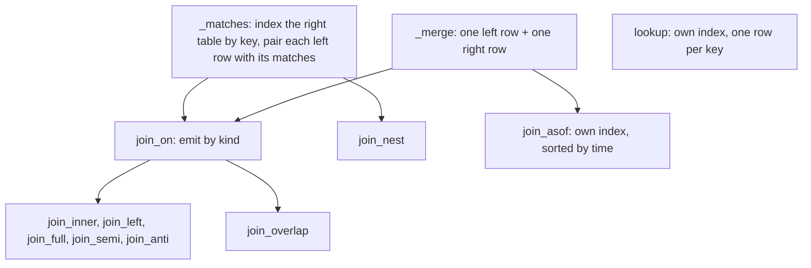

# Joins

Generated from `src/jq_analytics/analytics.jq` and `docs/readout/notes/joins.md`. Do not edit.

Thirteen definitions. Two helpers do the work: `_matches` pairs each left row with its right rows, and `_merge` joins one left row to one right row. `join_on` chooses what to emit from those pairs. Everything else except `lookup` and `join_asof` is a one-line call of `join_on` or `_matches`.



Most of this page uses two small tables. The left table is four requests, each naming the host it reached. The right table is five host records.

Requests, the left table:

| id | host |
|---|---|
| 1 | web01 |
| 2 | db01 |
| 3 | zz09 |
| 4 | null |

Hosts, the right table:

| host | site |
|---|---|
| web01 | N |
| db01 | S |
| db01 | N |
| app07 | S |
| null | S |

`db01` is in the right table twice, `zz09` is not in it, `app07` is used by no request, and each table has one row with no host.

In every join the left table is the input (it comes before the `|`) and the right table is the first argument. The arguments are separated by `;`, because in jq a comma means "emit both values". The runs name the right table once with `as $hosts`, which binds a name and passes nothing on, so the next `|` starts from the left table.

Two idioms recur in the code and are explained once here:

- **A key goes through `tojson` before it is used as an object key.** jq object keys are strings, so the number `1` and the string `"1"` would otherwise collide, and an array key (a composite key) could not be used at all. `tojson` gives `1`, `"1"` and `[1,"a"]` three different strings.
- **The right table is indexed once.** An object from key to rows is built before the left rows are walked, so the cost is left rows plus right rows, not their product.

## _merge

One left row and one right row made into one output row. A flat join calls it for every matching pair. It differs from jq's `$l + $r` in one way: a field that both rows have with different values is an error, not a silent overwrite.

### The example

Request 2 and the first `db01` host record. Both have a `host` field, with the same value.

```jq
_merge({id: 2, host: "db01"}; {host: "db01", site: "S"})
```

```json
{"id":2,"host":"db01","site":"S"}
```

One row with the fields of both. `host` appears once.

### What happens inside, on the example

Step 1, `$r | to_entries`: the right row as a list of field and value pairs.

```jq
{host: "db01", site: "S"} | to_entries
```

```json
[
  {"key": "host", "value": "db01"},
  {"key": "site", "value": "S"}
]
```

Step 2: `reduce` starts from the left row and handles one pair at a time. The run below uses `foreach`, which does the same and also prints the row after each pair:

```jq
foreach ({host: "db01", site: "S"} | to_entries[]) as $e ({id: 2, host: "db01"}; .[$e.key] = $e.value)
```

```json
{"id":2,"host":"db01"}
{"id":2,"host":"db01","site":"S"}
```

Two values, one per pair. After `host` the row is unchanged, because the field is set to the value it already has. After `site` the row has its new field.

### What is refused

A field on both sides with different values stops the join. The message names the field and both values:

```jq
try _merge({id: 2, host: "db01", site: "N"}; {host: "db01", site: "S"}) catch .
```

```json
"join: field \"site\" differs between left (\"N\") and right (\"S\"); rename one side first"
```

The remedy is in the message: rename the field on one side before the join.

### The definition

`_merge/2`, lines 217 to 221:

```jq
def _merge($l; $r):
  reduce ($r | to_entries[]) as $e ($l;
    if has($e.key) and .[$e.key] != $e.value
    then error("join: field \($e.key | tojson) differs between left (\(.[$e.key] | tojson)) and right (\($e.value | tojson)); rename one side first")
    else .[$e.key] = $e.value end);
```

- `reduce ($r | to_entries[]) as $e ($l; ...)`: steps 1 and 2. `$l` and `$r` have a `$`, so they are values: the two rows themselves.
- `if has($e.key) and .[$e.key] != $e.value then error(...)`: the row built so far already has this field, with another value.
- `else .[$e.key] = $e.value`: a new field is added. A field with the same value on both sides is set to what it already is, which is how the join key ends up in the output once.

## _matches

The pairing step that every join here shares, except `lookup` and `join_asof`. For each left row it finds the right rows with the same key. It merges nothing and drops nothing; `join_on` and `join_nest` decide what to do with the pairs.

### The example

The two tables from the top of the page, matched on `host`.

```jq
[{host: "web01", site: "N"}, {host: "db01", site: "S"}, {host: "db01", site: "N"}, {host: "app07", site: "S"}, {host: null, site: "S"}] as $hosts
| [{id: 1, host: "web01"}, {id: 2, host: "db01"}, {id: 3, host: "zz09"}, {id: 4, host: null}]
| _matches($hosts; .host; .host; true)
```

```json
[
  {"l": {"id": 1, "host": "web01"}, "m": [{"key": 0, "value": {"host": "web01", "site": "N"}}]},
  {"l": {"id": 2, "host": "db01"}, "m": [{"key": 1, "value": {"host": "db01", "site": "S"}}, {"key": 2, "value": {"host": "db01", "site": "N"}}]},
  {"l": {"id": 3, "host": "zz09"}, "m": []},
  {"l": {"id": 4, "host": null}, "m": []}
]
```

One entry per left row, in left order. `l` is the left row. `m` is the list of its matches, each as `{key, value}`, where `value` is the right row and `key` is that row's position in the right table (0 for the first row). Request 1 has one match, request 2 has two, and request 3 has none. Request 4 has a null host and matches nothing, not even the right row whose host is also null.

### Reading the call

`_matches($hosts; .host; .host; true)` has four arguments.

| Argument | In the example | Runs on | Meaning |
|---|---|---|---|
| `$right` | `$hosts` | nothing: it is a value | the right table |
| `lkey` | `.host` | one left row | that row's key |
| `rkey` | `.host` | one right row | that row's key |
| `cond` | `true` | one pair `{l: left row, r: right row}` | an extra test on a pair that already shares a key |

In the definition `$right` has a `$` and the other three do not. A `$name` parameter is a value, computed once before the call. A bare parameter is a filter: a piece of program that the function runs later, on an input it chooses.

### What happens inside, on the example

Step 1, `$right | to_entries`: every right row with its position as `key`.

```jq
[{host: "web01", site: "N"}, {host: "db01", site: "S"}, {host: "db01", site: "N"}, {host: "app07", site: "S"}, {host: null, site: "S"}]
| to_entries
```

```json
[
  {"key": 0, "value": {"host": "web01", "site": "N"}},
  {"key": 1, "value": {"host": "db01", "site": "S"}},
  {"key": 2, "value": {"host": "db01", "site": "N"}},
  {"key": 3, "value": {"host": "app07", "site": "S"}},
  {"key": 4, "value": {"host": null, "site": "S"}}
]
```

Step 2, `group_by(.value | .host)`: the pairs grouped by the right key. `group_by` sorts the groups by key, so the null group comes first, and inside a group it keeps input order: in the `db01` group position 1 is before position 2.

```jq
[{host: "web01", site: "N"}, {host: "db01", site: "S"}, {host: "db01", site: "N"}, {host: "app07", site: "S"}, {host: null, site: "S"}]
| to_entries | group_by(.value | .host)
```

```json
[
  [{"key": 4, "value": {"host": null, "site": "S"}}],
  [{"key": 3, "value": {"host": "app07", "site": "S"}}],
  [{"key": 1, "value": {"host": "db01", "site": "S"}}, {"key": 2, "value": {"host": "db01", "site": "N"}}],
  [{"key": 0, "value": {"host": "web01", "site": "N"}}]
]
```

Step 3, `map(select(...) | {key: ..., value: .}) | from_entries`: the null group is dropped, and the rest become one object, the index `$ix`. Its keys are the host names through `tojson`, which is why they carry their own quotes.

```jq
[{host: "web01", site: "N"}, {host: "db01", site: "S"}, {host: "db01", site: "N"}, {host: "app07", site: "S"}, {host: null, site: "S"}]
| to_entries | group_by(.value | .host)
| map(select((.[0].value | .host) != null) | {key: (.[0].value | .host | tojson), value: .}) | from_entries
```

```json
{
  "\"app07\"": [{"key": 3, "value": {"host": "app07", "site": "S"}}],
  "\"db01\"": [{"key": 1, "value": {"host": "db01", "site": "S"}}, {"key": 2, "value": {"host": "db01", "site": "N"}}],
  "\"web01\"": [{"key": 0, "value": {"host": "web01", "site": "N"}}]
}
```

Step 4: the left rows are walked in order. For each, `($l | lkey) as $k` is its key, and `$ix[$k | tojson][]?` looks the key up. For request 2:

```jq
{"\"db01\"": [{key: 1, value: {host: "db01", site: "S"}}, {key: 2, value: {host: "db01", site: "N"}}]} as $ix
| {id: 2, host: "db01"} | .host as $k | [$ix[$k | tojson][]?]
```

```json
[
  {"key": 1, "value": {"host": "db01", "site": "S"}},
  {"key": 2, "value": {"host": "db01", "site": "N"}}
]
```

A key that is not in the index, such as `zz09`, gives no values: the `?` after `[]` turns "cannot iterate over null" into nothing. A null key is not looked up at all.

Step 5, `select(.value as $r | {l: $l, r: $r} | cond)`: each match found is kept only when `cond` is true for the pair. With `true` every match is kept. The entries `{l, m}` are collected into the array shown at the top.

### The definition

`_matches/4`, lines 223 to 229:

```jq
# each left row with its matching right rows: [{l: row, m: [{key: right position, value: right row}]}]
def _matches($right; lkey; rkey; cond):
  ($right | to_entries | group_by(.value | rkey)
   | map(select((.[0].value | rkey) != null) | {key: (.[0].value | rkey | tojson), value: .}) | from_entries) as $ix
  | [.[] as $l | ($l | lkey) as $k
     | {l: $l, m: [(if $k == null then empty else $ix[$k | tojson][]? end)
                   | select(.value as $r | {l: $l, r: $r} | cond)]}];
```

- The first two lines build `$ix`: steps 1 to 3. Dropping the null group is half of the rule "a null key never matches".
- `[.[] as $l | ($l | lkey) as $k | {l: $l, m: [...]}]`: step 4, one entry per left row.
- `if $k == null then empty`: the other half of the null rule.
- `$ix[$k | tojson][]?`: the lookup. The matches come out in right-table order, because step 2 kept that order inside each group, on every engine.
- `select(...)`: step 5. `cond` runs only on pairs that already share a key.

## join_on

The general flat join: one output row per matching pair, with the fields of both rows. It is SQL's `FROM l JOIN r ON l.k = r.k AND cond`, with the kind of join as an argument.

### The example

A left join of the requests to the hosts.

```jq
[{host: "web01", site: "N"}, {host: "db01", site: "S"}, {host: "db01", site: "N"}, {host: "app07", site: "S"}, {host: null, site: "S"}] as $hosts
| [{id: 1, host: "web01"}, {id: 2, host: "db01"}, {id: 3, host: "zz09"}, {id: 4, host: null}]
| join_on($hosts; .host; .host; true; "left")
```

```json
[
  {"id": 1, "host": "web01", "site": "N"},
  {"id": 2, "host": "db01", "site": "S"},
  {"id": 2, "host": "db01", "site": "N"},
  {"id": 3, "host": "zz09"},
  {"id": 4, "host": null}
]
```

Five rows from four requests. Request 1 has its site. Request 2 appears twice, once per `db01` record: a duplicate key on the right multiplies rows. Requests 3 and 4 have no match and come back as they were, with no `site` field.

### Reading the call

The first four arguments are those of `_matches` above. The fifth, `$kind`, is a value, one of five strings:

| kind | emits |
|---|---|
| `"inner"` | for each left row, one merged row per match |
| `"left"` | the same, and the left row alone when it has no match |
| `"semi"` | the left row once when it has any match; no right fields |
| `"anti"` | the left row when it has no match |
| `"full"` | the `left` output, then the right rows no left row matched, in right order |

### The other four kinds

The same call with `"inner"`, `"semi"` and `"anti"`. Each kind's result is one array, printed on its own line.

```jq
[{host: "web01", site: "N"}, {host: "db01", site: "S"}, {host: "db01", site: "N"}, {host: "app07", site: "S"}, {host: null, site: "S"}] as $hosts
| [{id: 1, host: "web01"}, {id: 2, host: "db01"}, {id: 3, host: "zz09"}, {id: 4, host: null}]
| join_on($hosts; .host; .host; true; "inner"),
  join_on($hosts; .host; .host; true; "semi"),
  join_on($hosts; .host; .host; true; "anti")
```

```json
[{"id":1,"host":"web01","site":"N"},{"id":2,"host":"db01","site":"S"},{"id":2,"host":"db01","site":"N"}]
[{"id":1,"host":"web01"},{"id":2,"host":"db01"}]
[{"id":3,"host":"zz09"},{"id":4,"host":null}]
```

`inner` is the left join without requests 3 and 4. `semi` has request 2 once, although it has two matches, and no `site`. `anti` is the two requests that `inner` left out.

`"full"`:

```jq
[{host: "web01", site: "N"}, {host: "db01", site: "S"}, {host: "db01", site: "N"}, {host: "app07", site: "S"}, {host: null, site: "S"}] as $hosts
| [{id: 1, host: "web01"}, {id: 2, host: "db01"}, {id: 3, host: "zz09"}, {id: 4, host: null}]
| join_on($hosts; .host; .host; true; "full")
```

```json
[
  {"id": 1, "host": "web01", "site": "N"},
  {"id": 2, "host": "db01", "site": "S"},
  {"id": 2, "host": "db01", "site": "N"},
  {"id": 3, "host": "zz09"},
  {"id": 4, "host": null},
  {"host": "app07", "site": "S"},
  {"host": null, "site": "S"}
]
```

The first five rows are the left join. The last two are the right rows that no request matched: `app07`, and the record with a null host. They have no `id`.

### What happens inside, on the example

Step 1, `_matches($right; lkey; rkey; cond) as $rows`: the array of `{l, m}` entries shown under `_matches` above.

Step 2: one expression per kind turns `$rows` into output rows. For `"left"`, on the entries of requests 2 and 3:

```jq
[{l: {id: 2, host: "db01"}, m: [{key: 1, value: {host: "db01", site: "S"}}, {key: 2, value: {host: "db01", site: "N"}}]},
 {l: {id: 3, host: "zz09"}, m: []}] as $rows
| [$rows[] | .l as $l | if (.m | length) > 0 then .m[] | _merge($l; .value) else $l end]
```

```json
[
  {"id": 2, "host": "db01", "site": "S"},
  {"id": 2, "host": "db01", "site": "N"},
  {"id": 3, "host": "zz09"}
]
```

An entry with matches gives one merged row per match. An entry with none gives its left row.

Step 3, for `"full"` only. `$hit` is an object whose keys are the positions of the right rows that matched something:

```jq
[{l: {id: 1, host: "web01"}, m: [{key: 0, value: {host: "web01", site: "N"}}]},
 {l: {id: 2, host: "db01"}, m: [{key: 1, value: {host: "db01", site: "S"}}, {key: 2, value: {host: "db01", site: "N"}}]},
 {l: {id: 3, host: "zz09"}, m: []}, {l: {id: 4, host: null}, m: []}] as $rows
| [$rows[].m[] | {key: (.key | tostring), value: true}] | from_entries
```

```json
{"0":true,"1":true,"2":true}
```

Positions 0, 1 and 2 matched. The right rows at the other positions, 3 and 4, are appended after the left part:

```jq
[{host: "web01", site: "N"}, {host: "db01", site: "S"}, {host: "db01", site: "N"}, {host: "app07", site: "S"}, {host: null, site: "S"}] as $right
| {"0": true, "1": true, "2": true} as $hit
| [$right | to_entries[] | select($hit[.key | tostring] | not) | .value]
```

```json
[
  {"host": "app07", "site": "S"},
  {"host": null, "site": "S"}
]
```

### A condition, and a join with no key

`cond` is a filter over the pair `{l: left row, r: right row}`. With `true` for both keys every right row shares the one key `true`, so every pair is checked. A left join of three amounts to the bands that contain them:

```jq
[{id: 1, amount: 5}, {id: 2, amount: 60}, {id: 3, amount: 500}]
| join_on([{lo: 0, hi: 10, band: "small"}, {lo: 10, hi: 100, band: "medium"}];
          true; true; .l.amount >= .r.lo and .l.amount < .r.hi; "left")
```

```json
[
  {"id": 1, "amount": 5, "lo": 0, "hi": 10, "band": "small"},
  {"id": 2, "amount": 60, "lo": 10, "hi": 100, "band": "medium"},
  {"id": 3, "amount": 500}
]
```

Amount 500 is in no band and comes back alone. This form checks left rows times right rows pairs, so it is for small right tables.

### What is refused

A kind that is not one of the five is an error, not an empty result. A field that both tables have with different values is the `_merge` error.

```jq
(try ([{id: 1, host: "web01"}] | join_on([{host: "web01"}]; .host; .host; true; "outer")) catch .),
(try ([{id: 1, host: "web01", site: "S"}] | join_on([{host: "web01", site: "N"}]; .host; .host; true; "inner")) catch .)
```

```json
"join_on: unknown kind \"outer\""
"join: field \"site\" differs between left (\"S\") and right (\"N\"); rename one side first"
```

### The definition

`join_on/5`, lines 231 to 243:

```jq
# the general flat join
def join_on($right; lkey; rkey; cond; $kind):
  _matches($right; lkey; rkey; cond) as $rows
  | if $kind == "inner" then [$rows[] | .l as $l | .m[] | _merge($l; .value)]
    elif $kind == "left" then [$rows[] | .l as $l | if (.m | length) > 0 then .m[] | _merge($l; .value) else $l end]
    elif $kind == "semi" then [$rows[] | select((.m | length) > 0) | .l]
    elif $kind == "anti" then [$rows[] | select((.m | length) == 0) | .l]
    elif $kind == "full" then
      # right rows that matched no left row follow the left part, in right order
      ([$rows[].m[] | {key: (.key | tostring), value: true}] | from_entries) as $hit
      | [$rows[] | .l as $l | if (.m | length) > 0 then .m[] | _merge($l; .value) else $l end]
        + [$right | to_entries[] | select($hit[.key | tostring] | not) | .value]
    else error("join_on: unknown kind \($kind | tojson)") end;
```

- `_matches(...) as $rows`: step 1.
- `"inner"`: `.m[] | _merge($l; .value)` gives one row per match and nothing for an entry with no matches.
- `"left"`: step 2.
- `"semi"` and `"anti"`: `select` on whether `m` is empty; the left row `.l` is emitted as it is, once.
- `"full"`: `$hit` is step 3. The position goes through `tostring` because object keys are strings. The left part is the same expression as `"left"`, and the unmatched right rows follow it.
- The last `else`: the unknown-kind error.

## join_inner, join_left, join_full, join_semi, join_anti

The five kinds of equality join under their own names. Each is `join_on` with `true` for the condition and its kind fixed, so the common case reads as one word and has three arguments.

### The example

Which requests reached a known host, and which did not:

```jq
[{host: "web01", site: "N"}, {host: "db01", site: "S"}, {host: "db01", site: "N"}, {host: "app07", site: "S"}, {host: null, site: "S"}] as $hosts
| [{id: 1, host: "web01"}, {id: 2, host: "db01"}, {id: 3, host: "zz09"}, {id: 4, host: null}]
| join_semi($hosts; .host; .host), join_anti($hosts; .host; .host)
```

```json
[{"id":1,"host":"web01"},{"id":2,"host":"db01"}]
[{"id":3,"host":"zz09"},{"id":4,"host":null}]
```

Two arrays. They are the `"semi"` and `"anti"` results shown under `join_on`.

A key can be made of several fields by writing an array. Here a request matches a host record only when both host and site agree:

```jq
[{id: 1, host: "db01", site: "N"}, {id: 2, host: "db01", site: "W"}]
| join_inner([{host: "db01", site: "S", rack: 4}, {host: "db01", site: "N", rack: 7}]; [.host, .site]; [.host, .site])
```

```json
[
  {"id": 1, "host": "db01", "site": "N", "rack": 7}
]
```

Request 1 matches the second record. Request 2 matches neither.

### The definition

`join_inner/3`, lines 245 to 246:

```jq
# equality joins: shorthands for join_on with no condition
def join_inner($right; lkey; rkey): join_on($right; lkey; rkey; true; "inner");
```

`join_left/3`, line 247:

```jq
def join_left($right; lkey; rkey): join_on($right; lkey; rkey; true; "left");
```

`join_full/3`, line 248:

```jq
def join_full($right; lkey; rkey): join_on($right; lkey; rkey; true; "full");
```

`join_semi/3`, line 249:

```jq
def join_semi($right; lkey; rkey): join_on($right; lkey; rkey; true; "semi");
```

`join_anti/3`, line 250:

```jq
def join_anti($right; lkey; rkey): join_on($right; lkey; rkey; true; "anti");
```

Each line passes its three arguments through to `join_on` and adds `true` and the kind.

## join_nest

Every left row exactly once, with one new field holding the array of its matching right rows. It never multiplies rows and never clashes on a field name. It is Power Query's `Table.NestedJoin`. Use it when the right side is "many" and the next step counts or summarises the matches per left row.

### The example

```jq
[{host: "web01", site: "N"}, {host: "db01", site: "S"}, {host: "db01", site: "N"}, {host: "app07", site: "S"}, {host: null, site: "S"}] as $hosts
| [{id: 1, host: "web01"}, {id: 2, host: "db01"}, {id: 3, host: "zz09"}, {id: 4, host: null}]
| join_nest($hosts; .host; .host; true; "records")
```

```json
[
  {"id": 1, "host": "web01", "records": [{"host": "web01", "site": "N"}]},
  {"id": 2, "host": "db01", "records": [{"host": "db01", "site": "S"}, {"host": "db01", "site": "N"}]},
  {"id": 3, "host": "zz09", "records": []},
  {"id": 4, "host": null, "records": []}
]
```

Four requests in, four rows out. Request 2 holds both `db01` records in its `records` field. Requests 3 and 4 hold an empty array.

### Reading the call

The first four arguments are those of `_matches`. The fifth, `$as`, is a value: the name of the new field.

### What happens inside, on the example

Step 1: `_matches`, as shown in its own section. Step 2, on the entry of request 2: `[.m[].value]` takes the right rows out of the matches, and `.l + {...}` adds them to the left row under the name in `$as`.

```jq
{l: {id: 2, host: "db01"}, m: [{key: 1, value: {host: "db01", site: "S"}}, {key: 2, value: {host: "db01", site: "N"}}]}
| [.m[].value], (.l + {("records"): [.m[].value]})
```

```json
[{"host":"db01","site":"S"},{"host":"db01","site":"N"}]
{"id":2,"host":"db01","records":[{"host":"db01","site":"S"},{"host":"db01","site":"N"}]}
```

### The definition

`join_nest/5`, lines 252 to 255:

```jq
# nested join: every left row once, with field $as holding the array of its matching right rows
# (empty when none). Never multiplies rows. Power Query's Table.NestedJoin.
def join_nest($right; lkey; rkey; cond; $as):
  [_matches($right; lkey; rkey; cond)[] | .l + {($as): [.m[].value]}];
```

- `[_matches(...)[] | ...]`: one output row per entry, so one per left row.
- `.l + {($as): [.m[].value]}`: step 2. The parentheses in `{($as): ...}` make the field name come from the variable. A left row that already has a field of that name gets it replaced.

## lookup

Attaches the one matching row of a second table under a new field. It is a spreadsheet's `VLOOKUP` or `XLOOKUP`, or SQL's left join to a table with a unique key. The second table is called the dimension: one row per key, such as one row per site.

### The example

Three requests with a site code, and a dimension of two sites.

```jq
[{id: 1, site: "N"}, {id: 2, site: "W"}, {id: 3, site: null}]
| lookup([{site: "N", name: "North", staff: 12}, {site: "S", name: "South", staff: 7}]; .site; .site; "info")
```

```json
[
  {"id": 1, "site": "N", "info": {"site": "N", "name": "North", "staff": 12}},
  {"id": 2, "site": "W", "info": null},
  {"id": 3, "site": null, "info": null}
]
```

Every request comes back once with an `info` field. Request 1 has the row of site N. Site W is not in the dimension and request 3 has no site, so both get null.

### Reading the call

| Argument | In the example | Runs on | Meaning |
|---|---|---|---|
| `$dim` | the two site rows | nothing: it is a value | the dimension table |
| `lkey` | `.site` | one left row | that row's key |
| `dkey` | `.site` | one dimension row | that row's key |
| `$as` | `"info"` | nothing: it is a value | the name of the new field |

### What happens inside, on the example

Step 1, `$dim | group_by(dkey)`: the dimension grouped by key. With a unique key every group has one row.

```jq
[{site: "N", name: "North", staff: 12}, {site: "S", name: "South", staff: 7}] | group_by(.site)
```

```json
[
  [{"site": "N", "name": "North", "staff": 12}],
  [{"site": "S", "name": "South", "staff": 7}]
]
```

Step 2: each group becomes an entry from the key, through `tojson`, to the group's one row, and `from_entries` builds the index `$ix`.

```jq
[{site: "N", name: "North", staff: 12}, {site: "S", name: "South", staff: 7}] | group_by(.site)
| map({key: (.[0] | .site | tojson), value: .[0]}) | from_entries
```

```json
{"\"N\"":{"site":"N","name":"North","staff":12},"\"S\"":{"site":"S","name":"South","staff":7}}
```

Step 3: each left row gets the field. For request 1, the key through `tojson`, then the index entry under it:

```jq
{"\"N\"": {site: "N", name: "North", staff: 12}} as $ix
| {id: 1, site: "N"} | .site as $k | ($k | tojson), ({id: 1, site: "N"} + {("info"): $ix[$k | tojson]})
```

```json
"\"N\""
{"id":1,"site":"N","info":{"site":"N","name":"North","staff":12}}
```

### What is refused

A key that appears twice in the dimension is an error naming the key, so a lookup can never multiply rows. The check runs while the index is built, so it fires even when no left row uses that key.

```jq
try ([{id: 1, site: "N"}] | lookup([{site: "N", name: "North"}, {site: "S", name: "South"}, {site: "S", name: "Sud"}]; .site; .site; "info")) catch .
```

```json
"lookup: key \"S\" appears more than once in the dimension"
```

### The definition

`lookup/4`, lines 257 to 265:

```jq
# lookup: attach exactly one record of a dimension table under field $as (null when none).
# A key that appears twice in the dimension is an error, so a lookup can never multiply rows.
def lookup($dim; lkey; dkey; $as):
  ($dim | group_by(dkey)
   | map(select((.[0] | dkey) != null)
         | if length > 1 then error("lookup: key \(.[0] | dkey | tojson) appears more than once in the dimension")
           else {key: (.[0] | dkey | tojson), value: .[0]} end)
   | from_entries) as $ix
  | map(. as $l | ($l | lkey) as $k | $l + {($as): (if $k == null then null else $ix[$k | tojson] end)});
```

- `$dim | group_by(dkey)`: step 1.
- `select((.[0] | dkey) != null)`: dimension rows with a null key are left out of the index.
- `if length > 1 then error(...)`: the duplicate-key error.
- `else {key: ..., value: .[0]} end ... | from_entries`: step 2.
- `map(. as $l | ($l | lkey) as $k | $l + {($as): ...})`: step 3. A null key gives null without a lookup, and a key that is not in `$ix` gives null because that is what a missing object key reads as.

## join_overlap

Pairs with the same key whose time intervals overlap. It is SQL's `JOIN ... ON l.k = r.k AND l.start < r.end AND r.start < l.end`. Each interval is closed at its start and open at its end, written `[start, end)`.

### The example

Two jobs on host `web01`, and one maintenance window on the same host from 10 to 11.

| job | host | s | e |
|---|---|---|---|
| backup | web01 | 9 | 11 |
| report | web01 | 11 | 12 |

```jq
[{job: "backup", host: "web01", s: 9, e: 11}, {job: "report", host: "web01", s: 11, e: 12}]
| join_overlap([{host: "web01", window: "patching", ws: 10, we: 11}]; .host; .host; .s; .e; .ws; .we)
```

```json
[
  {"job": "backup", "host": "web01", "s": 9, "e": 11, "window": "patching", "ws": 10, "we": 11}
]
```

One row: the backup job ran during the window. The report job starts at 11, the moment the window ends, and two intervals that only touch do not overlap.

### Reading the call

| Argument | In the example | Runs on | Meaning |
|---|---|---|---|
| `$right` | the one window | nothing: it is a value | the right table |
| `lkey`, `rkey` | `.host`, `.host` | one left row, one right row | the keys that must be equal |
| `lstart`, `lend` | `.s`, `.e` | one left row | the left interval |
| `rstart`, `rend` | `.ws`, `.we` | one right row | the right interval |

The output is merged rows. If both tables called their fields `start` and `end`, the merge would refuse the differing values, so the two sides use different names, as here.

### What happens inside, on the example

It is one call of `join_on` with kind `"inner"` and the overlap test as the condition. The test on each of the two pairs, as `{l, r}`:

```jq
{host: "web01", window: "patching", ws: 10, we: 11} as $w
| ({l: {job: "backup", s: 9, e: 11}, r: $w}, {l: {job: "report", s: 11, e: 12}, r: $w})
| {job: .l.job, l_starts_before_r_ends: ((.l | .s) < (.r | .we)), r_starts_before_l_ends: ((.r | .ws) < (.l | .e))}
```

```json
{"job":"backup","l_starts_before_r_ends":true,"r_starts_before_l_ends":true}
{"job":"report","l_starts_before_r_ends":false,"r_starts_before_l_ends":true}
```

Two values, one per pair. Both halves are true for the backup job. For the report job the first half is false: it starts at 11, which is not before the window's end at 11.

### The definition

`join_overlap/7`, lines 267 to 270:

```jq
# interval overlap: pairs with the same key whose intervals overlap, each interval closed at its
# start and open at its end ([start, end)). Flat and inner; rename start and end on one side first.
def join_overlap($right; lkey; rkey; lstart; lend; rstart; rend):
  join_on($right; lkey; rkey; (.l | lstart) < (.r | rend) and (.r | rstart) < (.l | lend); "inner");
```

- `(.l | lstart) < (.r | rend) and (.r | rstart) < (.l | lend)`: each interval starts before the other ends. The `<` and not `<=` is what makes the end open.
- The condition is checked only for pairs with the same key, so the cost follows the number of same-key pairs.

## join_asof

For each left row, the right row with the same key and the latest time at or before the left row's time. It is DuckDB's `ASOF LEFT JOIN` and pandas' `merge_asof`. It answers "which value was in force when this happened", for a table of changes such as prices or settings.

### The example

The rate limit of host `web01` was set four times; two of the changes carry the same time, 10.

| host | at | limit |
|---|---|---|
| web01 | 2 | 100 |
| web01 | 10 | 101 |
| web01 | 10 | 102 |
| web01 | 14 | 103 |

Five requests, each with its time `t`:

```jq
[{host: "web01", at: 2, limit: 100}, {host: "web01", at: 10, limit: 101}, {host: "web01", at: 10, limit: 102}, {host: "web01", at: 14, limit: 103}] as $limits
| [{id: 1, host: "web01", t: 1}, {id: 2, host: "web01", t: 10}, {id: 3, host: "web01", t: 12}, {id: 4, host: "web01", t: 30}, {id: 5, host: "db01", t: 30}]
| join_asof($limits; .host; .host; .t; .at)
```

```json
[
  {"id": 1, "host": "web01", "t": 1},
  {"id": 2, "host": "web01", "t": 10, "at": 10, "limit": 101},
  {"id": 3, "host": "web01", "t": 12, "at": 10, "limit": 101},
  {"id": 4, "host": "web01", "t": 30, "at": 14, "limit": 103},
  {"id": 5, "host": "db01", "t": 30}
]
```

Request 1 is before every change and comes back alone. Requests 2 and 3 get limit 101: the latest change at or before 10 and 12 is at time 10, and of the two changes at that time the first in input order is taken. Request 4 gets the last change. Request 5's host has no changes.

The six-argument form adds a maximum age. With 3, a match older than 3 time units is rejected:

```jq
[{host: "web01", at: 2, limit: 100}, {host: "web01", at: 10, limit: 101}, {host: "web01", at: 10, limit: 102}, {host: "web01", at: 14, limit: 103}] as $limits
| [{id: 1, host: "web01", t: 1}, {id: 2, host: "web01", t: 10}, {id: 3, host: "web01", t: 12}, {id: 4, host: "web01", t: 30}, {id: 5, host: "db01", t: 30}]
| join_asof($limits; .host; .host; .t; .at; 3)
```

```json
[
  {"id": 1, "host": "web01", "t": 1},
  {"id": 2, "host": "web01", "t": 10, "at": 10, "limit": 101},
  {"id": 3, "host": "web01", "t": 12, "at": 10, "limit": 101},
  {"id": 4, "host": "web01", "t": 30},
  {"id": 5, "host": "db01", "t": 30}
]
```

Request 4 now comes back alone: its match is 30 - 14 = 16 old. Requests 2 and 3 keep theirs, 0 and 2 old.

### Reading the call

| Argument | In the example | Runs on | Meaning |
|---|---|---|---|
| `$right` | `$limits` | nothing: it is a value | the table of changes |
| `lkey`, `rkey` | `.host`, `.host` | one left row, one right row | the keys that must be equal |
| `ltime` | `.t` | one left row | the moment to look up |
| `rtime` | `.at` | one right row | the moment the change took effect |
| `$max_age` | 3, or absent | nothing: it is a value | the greatest allowed `ltime - rtime`; null for no limit |

### What happens inside, on the example

Step 1, the index `$ix`: the right rows grouped by key, each group sorted by time and stored as `{rows, t}`, where `t` is the list of times alone.

```jq
[{host: "web01", at: 2, limit: 100}, {host: "web01", at: 10, limit: 101}, {host: "web01", at: 10, limit: 102}, {host: "web01", at: 14, limit: 103}]
| group_by(.host) | map({key: (.[0] | .host | tojson), value: (sort_by(.at) | {rows: ., t: map(.at)})}) | from_entries
```

```json
{
  "\"web01\"": {"rows": [{"host": "web01", "at": 2, "limit": 100}, {"host": "web01", "at": 10, "limit": 101}, {"host": "web01", "at": 10, "limit": 102}, {"host": "web01", "at": 14, "limit": 103}], "t": [2, 10, 10, 14]}
}
```

Step 2, for request 3 (`$t` is 12), `($g.t | bsearch($t)) as $i`: a binary search in the times. 12 is not among them, so `bsearch` returns `-1 - p`, where `p` is the position at which 12 would be inserted:

```jq
[2, 10, 10, 14] | bsearch(12)
```

```json
-4
```

Step 3, `(if $i >= 0 then $i else -2 - $i end) as $last`: the insertion position is `-1 - (-4) = 3`, and the entry before it, `-2 - (-4) = 2`, is the last time at or below 12. For request 1 (`$t` is 1) the same arithmetic gives -1, which means no entry:

```jq
[2, 10, 10, 14] | (bsearch(12) | -2 - .), (bsearch(1) | -2 - .)
```

```json
2
-1
```

Step 4, `until(. == 0 or $g.t[. - 1] != $g.t[$last]; . - 1)`: from position 2, step back while the entry before has the same time. Position 1 also holds time 10 and position 0 does not, so the walk stops at 1. This step is also why request 2 gets the same answer on every engine: for a time that is in the list twice, `bsearch` returns position 1 on some engines and 2 on others, and the walk ends at 1 from either.

```jq
[2, 10, 10, 14] as $t | (1, 2) | . as $last | until(. == 0 or $t[. - 1] != $t[$last]; . - 1)
```

```json
1
1
```

Step 5: `$j` is 1, so the right row is `rows[1]`, the change to limit 101, and `_merge` joins it to the request.

```jq
_merge({id: 3, host: "web01", t: 12}; {host: "web01", at: 10, limit: 101})
```

```json
{"id":3,"host":"web01","t":12,"at":10,"limit":101}
```

### Edge cases

A left row with a null key or a null time comes back alone. Right rows with a null key or a null time are dropped before the index is built.

```jq
[{id: 1, host: "web01", t: null}, {id: 2, host: null, t: 5}, {id: 3, host: "web01", t: 5}]
| join_asof([{host: "web01", at: null, limit: 1}, {host: null, at: 1, limit: 2}, {host: "web01", at: 3, limit: 3}]; .host; .host; .t; .at)
```

```json
[
  {"id": 1, "host": "web01", "t": null},
  {"id": 2, "host": null, "t": 5},
  {"id": 3, "host": "web01", "t": 5, "at": 3, "limit": 3}
]
```

### What it is not for

"Latest value at or before T" is the right question for prices and settings. It is the wrong one for "who held this at T", where the value may have ended before T. For that, use `intervals_from_events` and `join_within` on the intervals page.

### The definition

`join_asof/6`, lines 272 to 290:

```jq
# As-of join (left outer): for each left row, the right row with the same key whose rtime is the
# greatest rtime <= the left row's ltime (DuckDB's ASOF LEFT JOIN ... ON l.k = r.k AND l.t >= r.t).
# $max_age, when not null, rejects a match older than that: ltime - rtime must be <= $max_age.
# Ties on rtime: the first such right row in input order (DuckDB 2.0.0 gave the same on the test
# fixture; pandas merge_asof takes the last; SQL leaves it open). No match, or a null key or time
# on the left: the left row alone. Right rows with a null key or time are dropped.
def join_asof($right; lkey; rkey; ltime; rtime; $max_age):
  ([$right[] | select((rkey) != null and (rtime) != null)] | group_by(rkey)
   | map({key: (.[0] | rkey | tojson), value: (sort_by(rtime) | {rows: ., t: map(rtime)})}) | from_entries) as $ix
  | [.[] as $l | ($l | lkey) as $k | ($l | ltime) as $t
     | if $k == null or $t == null or $ix[$k | tojson] == null then $l
       else $ix[$k | tojson] as $g
       | ($g.t | bsearch($t)) as $i
       # bsearch gives some entry equal to $t, or the insertion point; take the last entry <= $t,
       # then step back to the first of its run of equal times
       | (if $i >= 0 then $i else -2 - $i end) as $last
       | (if $last < 0 then -1 else $last | until(. == 0 or $g.t[. - 1] != $g.t[$last]; . - 1) end) as $j
       | if $j < 0 or ($max_age != null and $t - $g.t[$j] > $max_age) then $l else _merge($l; $g.rows[$j]) end
       end];
```

`join_asof/5`, line 291:

```jq
def join_asof($right; lkey; rkey; ltime; rtime): join_asof($right; lkey; rkey; ltime; rtime; null);
```

- The first two lines build `$ix`: step 1. Keeping `t` beside `rows` lets `bsearch` run on plain numbers. `sort_by` is stable, so rows with the same time stay in input order.
- `if $k == null or $t == null or $ix[$k | tojson] == null then $l`: no key, no time, or no changes for this key.
- `($g.t | bsearch($t)) as $i` and the `$last` line: steps 2 and 3.
- The `$j` line: step 4, or -1 when `$last` is -1.
- `if $j < 0 or ($max_age != null and $t - $g.t[$j] > $max_age) then $l else _merge(...)`: no entry, or one that is too old, gives the left row alone. Otherwise step 5; a clashing field is the `_merge` error here too.
- The five-argument form calls the six-argument form with `null` for `$max_age`.
