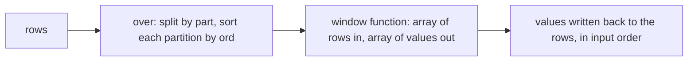

# Windows

Generated from `src/jq_analytics/analytics.jq` and `docs/readout/notes/windows.md`. Do not edit.

Seven definitions. `over` does what SQL's `OVER (PARTITION BY … ORDER BY …)` does; the other six compute one value per row of a sorted partition and are passed to `over` as its last argument.



## over

`over/4`, lines 286 to 291:

```jq
# Window over partitions: split rows by part (first appearance), sort each partition by ord
# (stable: ties keep input order), call wf on the sorted partition (an array of rows), which must
# return an array of the same length, and write its i-th value into field $col of the i-th row.
# Rows come back in input order. Frames are ROWS frames (each row by itself), not SQL's default
# RANGE frame, which gives tied rows the same running value.
def over(part; ord; $col; wf):
  . as $rows
  | [to_entries | map({i: .key, r: .value}) | group_by(.r | part)[]
     | sort_by(.r | ord) | (map(.r) | wf) as $v | to_entries[] | {i: .value.i, v: $v[.key]}]
  | sort_by(.i) | map(.v) as $vals
  | [$rows | to_entries[] | .value + {($col): $vals[.key]}];
```

- `to_entries | map({i: .key, r: .value})` tags every row with its input position `i`.
- `group_by(.r | part)[]` takes one partition at a time; `sort_by(.r | ord)` orders it (stable, so ties keep input order).
- `(map(.r) | wf) as $v` calls the window function on the partition's rows and gets one value per row.
- `to_entries[] | {i: .value.i, v: $v[.key]}` pairs each value with the input position of its row.
- After all partitions: `sort_by(.i) | map(.v)` is the list of values in input order, and the last line adds field `$col` to each original row.

The rows come back in the order they went in, whatever the partitions and their order were.

```jq
[{day: 2, site: "N", x: 5}, {day: 1, site: "N", x: 3}, {day: 1, site: "S", x: 9}, {day: 3, site: "N", x: null}]
| over(.site; .day; "n"; row_number) | over(.site; .day; "sum"; running_sum(.x)) | over(.site; .day; "prev"; lag(.x; 1))
```

```json
[
  {"day": 2, "site": "N", "x": 5, "n": 2, "sum": 8, "prev": 3},
  {"day": 1, "site": "N", "x": 3, "n": 1, "sum": 3, "prev": null},
  {"day": 1, "site": "S", "x": 9, "n": 1, "sum": 9, "prev": null},
  {"day": 3, "site": "N", "x": null, "n": 3, "sum": 8, "prev": 5}
]
```

The first row is day 2 of site N: second in its partition, running sum 3 + 5, previous value 3.

## row_number

`row_number/0`, line 294:

```jq
# window value functions: input is one sorted partition (array of rows)
def row_number: [range(1; length + 1)];
```

`[range(1; length + 1)]`: 1, 2, 3, … for the partition's rows.

```jq
["a", "b", "c"] | row_number
```

```json
[1,2,3]
```

## rank_by

`rank_by/1`, lines 296 to 297:

```jq
# rank with gaps (SQL RANK) by f over the partition's order: tied f values share a rank
def rank_by(f): . as $a | [range(length) as $i | ($a[$i] | f) as $v
  | ([$a[:$i][] | select((f) != $v)] | length) + 1];
```

SQL's `RANK`: tied values share a rank and the next rank skips. For row `$i`, the rank is one more than the number of earlier rows whose `f` differs from this row's. That is right when the partition is sorted by `f`, which is the caller's job (`over(…; .x; …; rank_by(.x))`).

```jq
[{x: 10}, {x: 20}, {x: 20}, {x: 30}] | rank_by(.x)
```

```json
[1,2,2,4]
```

**Review finding 7.** `rank_by` looks back over all earlier rows for every row, so its time grows with the square of the partition: one partition of 2,000 rows took 0.75 s, 4,000 took 2.7 s and 8,000 took 11.4 s (jq 1.8.2). A single pass that remembers the previous value and its rank would be linear.

## lag, lead

`lag/2`, line 298:

```jq
def lag(f; $k): . as $a | [range(length) as $i | if $i - $k >= 0 then ($a[$i - $k] | f) else null end];
```

`lead/2`, line 299:

```jq
def lead(f; $k): . as $a | length as $n | [range($n) as $i | if $i + $k < $n then ($a[$i + $k] | f) else null end];
```

The value of `f` on the row `$k` places before (`lag`) or after (`lead`) the current one, or null when there is no such row. Both index into the partition `$a` by position.

```jq
[{x: 1}, {x: 2}, {x: 3}] | {lag: lag(.x; 1), lead: lead(.x; 2)}
```

```json
{"lag":[null,1,2],"lead":[3,null,null]}
```

## running_sum

`running_sum/1`, line 301:

```jq
# running sum of f, ROWS frame from the partition start: nulls skipped; null until the first non-null
def running_sum(f): [foreach .[] as $r (null; ($r | f) as $v | if $v == null then . else (. // 0) + $v end; .)];
```

`foreach .[] as $r (null; …; .)` carries the sum and emits it after every row. A null value leaves the sum as it is; `(. // 0) + $v` starts the sum at the first non-null value, so the result is null until then, not 0.

```jq
[{x: null}, {x: 2}, {x: null}, {x: 5}] | running_sum(.x)
```

```json
[null,2,2,7]
```

## moving_mean

`moving_mean/2`, line 303:

```jq
# moving mean of f over the current row and the $n - 1 rows before it (fewer at the start); nulls skipped
def moving_mean(f; $n): . as $a | [range(length) as $i | [$a[([$i - $n + 1, 0] | max):($i + 1)][] | f] | mean];
```

For row `$i`, the mean of `f` over rows `max($i - $n + 1, 0)` to `$i`: the current row and up to `$n - 1` before it. `mean` is the library's own, so nulls in the window are skipped. Each row slices its own window, so the cost is rows times `$n`.

```jq
[{x: 2}, {x: 4}, {x: null}, {x: 8}] | moving_mean(.x; 2)
```

```json
[2,3,4,8]
```

The windows are [2], [2, 4], [4, null] and [null, 8].
