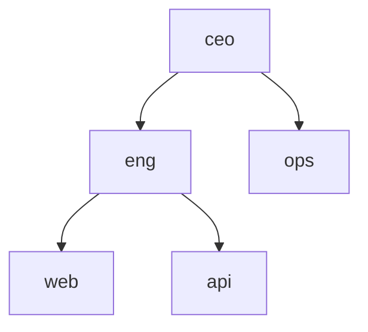

# Hierarchies

Generated from `src/jq_analytics/analytics.jq` and `docs/readout/notes/hierarchies.md`. Do not edit.

## Design

### What it is for

Two definitions for trees: "what is the chain of managers above this team, and how deep is it", and "how many people, or how much cost, sit under each node, at any depth". A tree here is a table of nodes, each naming its parent; a root's parent is null or `""`. An organisation chart, a folder tree and a bill of materials all have this form. The output is the same table with fields added: `ancestry` and `depth` from `tree_paths`, and `subtree` as well from `tree_rollup`.

Both examples use one tree of five teams:



With head counts ceo 1, eng 2, ops 3, web 4 and api missing, the totals by hand are eng 2 + 4 + 0 = 6 and ceo 1 + 6 + 3 = 10:

```jq
[{id: "ceo", boss: null, n: 1}, {id: "eng", boss: "ceo", n: 2}, {id: "ops", boss: "ceo", n: 3},
 {id: "web", boss: "eng", n: 4}, {id: "api", boss: "eng", n: null}]
| tree_rollup(.id; .boss; .n) | map({id, ancestry, subtree})
```

```json
[
  {"id": "ceo", "ancestry": ["ceo"], "subtree": 10},
  {"id": "eng", "ancestry": ["ceo", "eng"], "subtree": 6},
  {"id": "ops", "ancestry": ["ceo", "ops"], "subtree": 3},
  {"id": "web", "ancestry": ["ceo", "eng", "web"], "subtree": 4},
  {"id": "api", "ancestry": ["ceo", "eng", "api"], "subtree": 0}
]
```

A tree that arrives nested (each node holding its children) becomes this table with `nodes_from_nested`, and goes back with `nested_from_nodes` (page 65).

### The rules it keeps

- **Ancestry reads from the root down**, ending with the node itself; a root's depth is 0.
- **A null value counts as 0** in a rollup, so a node with no value still has a subtree.
- **Every level is summed**, not only the children: a rollup is over the node and all its descendants at any depth.
- **Order:** the rows come back in input order; the input need not be in top-down order.
- **Ids are compared by their JSON text**, so the number `1` and the string `"1"` are two nodes.
- **Refuses** a cycle, a parent id that is not a node, and an id on two rows, each with an error naming the id. `tree_rollup` and `nested_from_nodes` call `tree_paths` and refuse the same. An input that is not a table is refused too (page 00).
- **Cost:** each ancestry is built once, and a walk up stops at the first ancestor already done, so the work follows the size of the output, which is nodes times average depth. Measured in the Python jq package, parsing included: 7 to 8 s at 200,000 nodes for a shallow tree, 20.1 s at 200,000 nodes in a tree thousands of levels deep, where the output itself (every node's full ancestry) is that large.

### Beside core jq, SQL and pandas

The core-jq idiom is a lookup from id to parent and `recurse` up it:

```jq
(map({(.id): .boss}) | add) as $par | map(.id as $i | {id: $i, ancestry: ([$i | recurse($par[.] // empty)] | reverse)})
```

On the five teams it gives the same ancestries on jq 1.7.1, gojq and jaq. It differs on bad input and on size. A parent that is not a node becomes a silent extra root: `[{id: "a", boss: "zz"}]` gives the ancestry `["zz", "a"]` on all three. A cycle never ends. Ids become object keys, so `1` and `"1"` collide. And every node walks its whole ancestry again, which is what made the library's first version take 16 s on 4,000 nodes dozens of levels deep.

SQL needs a recursive query: `WITH RECURSIVE r(id, cur, path) AS (SELECT id, boss, [id] FROM t UNION ALL SELECT r.id, t.boss, list_prepend(t.id, r.path) FROM r JOIN t ON r.cur = t.id) SELECT id, path FROM r WHERE cur IS NULL` gives the same five ancestries on DuckDB. A rollup is that query joined back and summed. A cycle makes the recursion run on unless the query guards against it, and a dangling parent drops the node from the result instead of raising an error. DAX has `PATH` for the ancestry. pandas has no tree operation in its DataFrame API; it is written as repeated self-merges, one per level.

A one-level sum, which is what a single self-join or a single grouping pass by parent gives, undercounts any tree deeper than two levels; `tree_rollup` sums every level.

### Decisions

- **0.6.0 (2026-11-18, spec 30).** `tree_paths` rewritten so that each ancestry is built once: a walk up stops at the first ancestor already done. Before, it walked every node's whole ancestry, and a tree of 4,000 nodes dozens of levels deep took 16 s; 40,000 now take 1.9 s.
- **0.9.0 (2026-11-18, spec 55).** An id on two rows is an error (review finding 11); before, both rows of the id got the ancestry of one of them.

## The functions

In the order of the file:

| Function | Whose | What it is for |
|---|---|---|
| `tree_paths` | Public function | Adds to every node its `ancestry`, the ids from its root down to itself, and its `depth`, 0 for a root |
| `tree_rollup` | Public function | Adds to every node the total of a value over the node and everything below it |

---

## tree_paths

**Public function** · `tree_paths(id; parent)`

Adds to every node its `ancestry`, the ids from its root down to itself, and its `depth`, 0 for a root. It does what a recursive query (`WITH RECURSIVE`) does in SQL, and what `PATH` does in DAX.

### tree_paths: the example

The five teams as rows, each naming its parent in `boss`. The rows are not in top-down order: `web` comes before its parent `eng`.

| id | boss |
|---|---|
| web | eng |
| ceo | null |
| eng | ceo |
| ops | ceo |
| api | eng |

```jq
[{id: "web", boss: "eng"}, {id: "ceo", boss: null}, {id: "eng", boss: "ceo"}, {id: "ops", boss: "ceo"}, {id: "api", boss: "eng"}]
| tree_paths(.id; .boss)
```

```json
[
  {"id": "web", "boss": "eng", "ancestry": ["ceo", "eng", "web"], "depth": 2},
  {"id": "ceo", "boss": null, "ancestry": ["ceo"], "depth": 0},
  {"id": "eng", "boss": "ceo", "ancestry": ["ceo", "eng"], "depth": 1},
  {"id": "ops", "boss": "ceo", "ancestry": ["ceo", "ops"], "depth": 1},
  {"id": "api", "boss": "eng", "ancestry": ["ceo", "eng", "api"], "depth": 2}
]
```

The same five rows in the same order, each with two new fields. `web` is two levels below the root, and its ancestry reads from the top: `ceo`, `eng`, `web`. The root's ancestry is itself alone.

### tree_paths: reading the call

Both arguments are filters, each run on one node: `id` gives the node's own id and `parent` gives its parent's id. `;` separates them.

### tree_paths: what happens inside, on the example

Step 1, the first `reduce`: `$par`, a lookup from each id to its parent. The key is the id through `tojson`, so a number and a string can never share a key. The parent is wrapped in an array, so that "this id is a node whose parent is null" (`[null]`) differs from "this id is not a node" (a missing key, which reads as null).

```jq
[{id: "web", boss: "eng"}, {id: "ceo", boss: null}, {id: "eng", boss: "ceo"}, {id: "ops", boss: "ceo"}, {id: "api", boss: "eng"}]
| reduce .[] as $n ({}; ($n | .id | tojson) as $k | .[$k] = [($n | .boss)])
```

```json
{"\"web\"":["eng"],"\"ceo\"":[null],"\"eng\"":["ceo"],"\"ops\"":["ceo"],"\"api\"":["eng"]}
```

Step 2, the second `reduce`, goes through the nodes in input order and builds `.m`, a lookup from id to ancestry. A node that is already in `.m` is skipped. For any other node there are two moves: walk up, then fill down.

**Walk up**, for the first node, `web`. `.chain` starts as the node itself. The `until` loop appends the parent and moves to it, and stops at a root or at an ancestor that `.m` already holds. Nothing is in `.m` yet, so the walk goes to the root:

```jq
{"\"web\"": ["eng"], "\"ceo\"": [null], "\"eng\"": ["ceo"]} as $par
| {chain: ["web"], cur: "web"}
| until($par[.cur | tojson][0] == null; $par[.cur | tojson][0] as $p | .chain += [$p] | .cur = $p)
```

```json
{"chain":["web","eng","ceo"],"cur":"ceo"}
```

**Fill down.** The chain is read in reverse, top first. `.a` starts empty, because the walk stopped at a root. Each id is appended to `.a`, and the result is stored as that id's ancestry. The run shows `.m` after each of the three ids:

```jq
foreach (["web", "eng", "ceo"] | reverse)[] as $c ({a: [], m: {}}; .a += [$c] | .m[$c | tojson] = .a; .m)
```

```json
{"\"ceo\"":["ceo"]}
{"\"ceo\"":["ceo"],"\"eng\"":["ceo","eng"]}
{"\"ceo\"":["ceo"],"\"eng\"":["ceo","eng"],"\"web\"":["ceo","eng","web"]}
```

One walk has filled in three nodes. The next two input rows, `ceo` and `eng`, are already in `.m` and are skipped.

For `api`, the last row, the walk stops before its first step: its parent `eng` is already in `.m`. The chain is `api` alone, `.a` starts as the ancestry of `eng`, and one id is appended:

```jq
{"\"eng\"": ["ceo", "eng"]} as $m | $m["eng" | tojson] + ["api"]
```

```json
["ceo","eng","api"]
```

Because a walk stops at the first ancestor already done, every node is walked over once, and the cost follows the size of the output.

Step 3, the last line: each row gets its ancestry from the lookup, and `depth` is the ancestry's length minus one.

### tree_paths: what is refused

Three kinds of input stop with an error: a cycle, a parent id that is not a node, and an id on two rows. With one id on two rows the lookup of step 1 would hold only one of the two parents.

```jq
([{id: "a", boss: "b"}, {id: "b", boss: "a"}] | try tree_paths(.id; .boss) catch .),
([{id: "a", boss: "zz"}] | try tree_paths(.id; .boss) catch .),
([{id: 1, boss: null}, {id: 1, boss: 2}, {id: 2, boss: null}] | try tree_paths(.id; .boss) catch .)
```

```json
"tree_paths: cycle through \"a\""
"tree_paths: parent \"zz\" is not a node"
"tree_paths: id 1 appears twice"
```

`tree_rollup` below calls `tree_paths` and so refuses the same input.

### tree_paths: the definition

`tree_paths/2`, lines 508 to 529:

```jq
# tree_paths: adds to every node `ancestry` (the ids from its root down to itself) and `depth`
# (0 for a root). A parent id that is not a node, a cycle, or an id on two rows is an error.
# Each node's ancestry is built once: a walk up stops at the first ancestor already done and the
# ancestries are then filled in from there down, so the cost follows the size of the output, not
# the square of the depth.
def tree_paths(id; parent): _table("tree_paths"; "the input") |
  (reduce .[] as $n ({}; ($n | id | tojson) as $k
     | if has($k) then error("tree_paths: id \($k) appears twice") else .[$k] = [($n | parent)] end)) as $par
  | (reduce .[] as $n ({m: {}};
       ($n | id) as $i
       | if .m[$i | tojson] != null then .
         else .chain = [$i] | .on = {($i | tojson): true} | .cur = $i
           | until($par[.cur | tojson][0] as $p | $p == null or $p == "" or .m[$p | tojson] != null;
               $par[.cur | tojson][0] as $p
               | if $par[$p | tojson] == null then error("tree_paths: parent \($p | tojson) is not a node")
                 elif .on[$p | tojson] then error("tree_paths: cycle through \($p | tojson)")
                 else .chain += [$p] | .on[$p | tojson] = true | .cur = $p end)
           | $par[.cur | tojson][0] as $top
           | .a = (if $top == null or $top == "" then [] else .m[$top | tojson] end)
           | reduce (.chain | reverse)[] as $c (.; .a += [$c] | .m[$c | tojson] = .a)
         end) | .m) as $anc
  | map(. + ($anc[id | tojson] | {ancestry: ., depth: (length - 1)}));
```

Built into jq: `error`, `has`, `length`, `map`, `reverse`, `tojson`, `until`. From this library: `_table`.

- The first `reduce`: step 1. `if has($k) then error(...)` is the check for an id on two rows.
- `if .m[$i | tojson] != null then .`: a node already done is skipped.
- `.chain = [$i] | .on = {...} | .cur = $i`: the start of a walk. `.on` holds the same ids as `.chain`, as an object, so the cycle test is one lookup.
- The `until` condition: stop when the parent `$p` is null or `""` (a root), or when `.m` already has `$p`.
- The `until` body: a parent that is not a key of `$par` is the "not a node" error, and a parent already in `.on` is the cycle error. Otherwise the walk moves up one node.
- `$top` and `.a`: where the walk stopped. `.a` starts as `[]` under a root and as the stored ancestry of `$top` otherwise.
- `reduce (.chain | reverse)[] as $c (.; .a += [$c] | .m[$c | tojson] = .a)`: the fill down.
- `| .m) as $anc`: only the lookup is kept; the last line is step 3.

---

## tree_rollup

**Public function** · `tree_rollup(id; parent; value)`

Adds to every node the total of a value over the node and everything below it. It answers "how many people work under each manager", or "what does each assembly cost with all its parts".

### tree_rollup: the example

The same five teams, each with its own head count `n`. One is missing.

| id | boss | n |
|---|---|---|
| ceo | null | 1 |
| eng | ceo | 2 |
| ops | ceo | 3 |
| web | eng | 4 |
| api | eng | null |

```jq
[{id: "ceo", boss: null, n: 1}, {id: "eng", boss: "ceo", n: 2}, {id: "ops", boss: "ceo", n: 3},
 {id: "web", boss: "eng", n: 4}, {id: "api", boss: "eng", n: null}]
| tree_rollup(.id; .boss; .n)
```

```json
[
  {"id": "ceo", "boss": null, "n": 1, "ancestry": ["ceo"], "depth": 0, "subtree": 10},
  {"id": "eng", "boss": "ceo", "n": 2, "ancestry": ["ceo", "eng"], "depth": 1, "subtree": 6},
  {"id": "ops", "boss": "ceo", "n": 3, "ancestry": ["ceo", "ops"], "depth": 1, "subtree": 3},
  {"id": "web", "boss": "eng", "n": 4, "ancestry": ["ceo", "eng", "web"], "depth": 2, "subtree": 4},
  {"id": "api", "boss": "eng", "n": null, "ancestry": ["ceo", "eng", "api"], "depth": 2, "subtree": 0}
]
```

Each row has the fields that `tree_paths` adds, and `subtree`. Hand check: `eng` is its own 2, plus 4 for `web` and 0 for `api`, which is 6. `ceo` is 1 + 6 + 3 = 10. A leaf's subtree is its own value, and the null counts as 0.

### tree_rollup: reading the call

The first two arguments are those of `tree_paths`. The third, `value`, is a filter run on one node: the number to add up.

### tree_rollup: what happens inside, on the example

Step 1, `tree_paths(id; parent) as $t`: the rows with their ancestries, as in the section above.

Step 2, the double `reduce`: `$sum`, a lookup from id to total. Each node's value is added to every id on its ancestry, itself included. The run uses `foreach` to show the lookup after each node, with each node reduced to its ancestry and value:

```jq
foreach ({a: ["ceo"], v: 1}, {a: ["ceo", "eng"], v: 2}, {a: ["ceo", "ops"], v: 3}, {a: ["ceo", "eng", "web"], v: 4}, {a: ["ceo", "eng", "api"], v: null}) as $n
  ({}; reduce $n.a[] as $a (.; .[$a] += ($n.v // 0)))
```

```json
{"ceo":1}
{"ceo":3,"eng":2}
{"ceo":6,"eng":2,"ops":3}
{"ceo":10,"eng":6,"ops":3,"web":4}
{"ceo":10,"eng":6,"ops":3,"web":4,"api":0}
```

Five values, one per node. `ceo` grows with every node, because it is on every ancestry. The fourth line is where `web` adds its 4 to `ceo`, `eng` and itself. The last node adds 0 three times and creates the entry for `api`. `+=` on a key that is not there yet starts from null, and null plus a number is the number.

Step 3, the last line: each row gets its own entry of `$sum` as `subtree`.

### tree_rollup: the definition

`tree_rollup/3`, lines 531 to 537:

```jq
# tree_rollup: tree_paths, plus `subtree`: the node's own value plus the values of all its
# descendants, at any depth. A null value counts as 0.
def tree_rollup(id; parent; value): _table("tree_rollup"; "the input") |
  tree_paths(id; parent) as $t
  | (reduce $t[] as $n ({}; ($n | value) as $v
       | reduce $n.ancestry[] as $a (.; .[$a | tojson] += ($v // 0)))) as $sum
  | $t | map(. + {subtree: $sum[id | tojson]});
```

Built into jq: `map`, `tojson`. From this library: `_table`, `tree_paths`.

- `tree_paths(id; parent) as $t`: step 1, with its errors.
- `reduce $t[] as $n ({}; ($n | value) as $v | reduce $n.ancestry[] as $a (.; .[$a | tojson] += ($v // 0)))`: step 2. `$v // 0` counts a null value as 0. The keys go through `tojson`, as in `tree_paths`.
- `$t | map(. + {subtree: $sum[id | tojson]})`: step 3.
- The cost is the total length of all ancestries: nodes times average depth.
