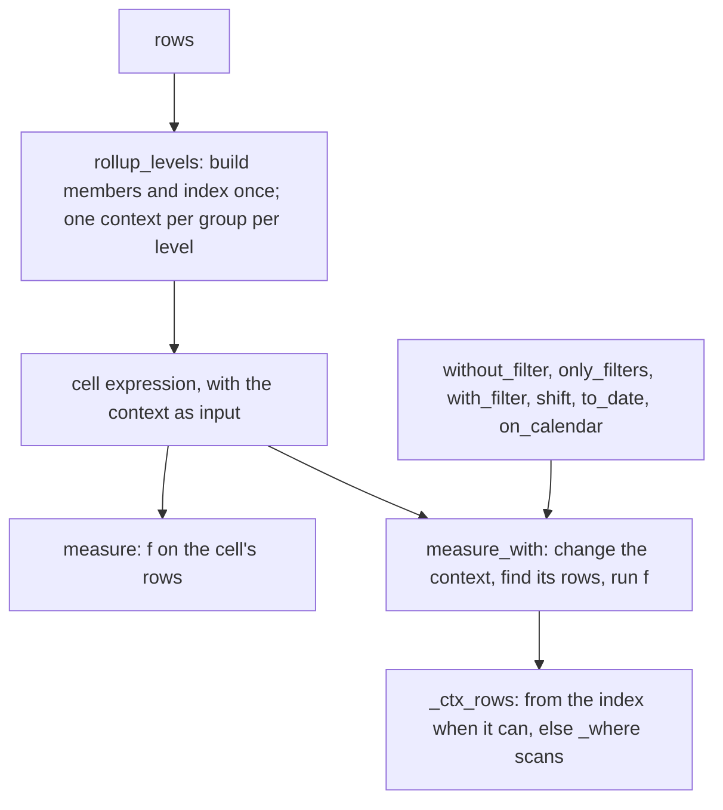

# Measures in a context

Generated from `src/jq_analytics/analytics.jq` and `docs/readout/notes/measures-in-a-context.md`. Do not edit.

## Design

### What it is for

Thirteen definitions that let a report compute one measure at several levels and compare a cell with a different slice of the data: its share of a total, the previous period, a running total. `group_agg` answers one question at one level; a report asks the same measure at several levels at once, and asks each cell to look outside its own rows. In SQL that is `GROUP BY ROLLUP` plus window functions or self-joins; in DAX it is `CALCULATE` changing the filter context. This is the part of the library modelled on DAX's `CALCULATE`.

Three words carry it:

- A **measure** is any jq expression over an array of rows, such as `map(.rev) | sum_nonnull`.
- A **context** is the object a cell is evaluated in: which filters it stands for (`at`), the rows that match them (`rows`), every row (`all`), and two lookups built once per report: each level field's values (`members`) and the rows grouped by each level's fields (`index`).
- A **context change** takes a context and returns another: remove a filter, add one, move to a neighbouring value.



| Change | Does | DAX |
|---|---|---|
| `without_filter($dim)` | removes one filter | `REMOVEFILTERS`, `ALL` on one column |
| `only_filters($dims)` | keeps the listed filters, drops the rest; `[]` is the grand total | `ALLEXCEPT` |
| `with_filter($at)` | adds or replaces filters: a value, or a `{from, to}` range | a filter argument of `CALCULATE` |
| `shift($dim; $k)` | moves to the value `$k` places along; -1 is the previous one | `PREVIOUSMONTH`, `DATEADD`, after `on_calendar` |
| `to_date($dim)` | everything up to and including this value | a running total; `DATESYTD` when the year is another filter |
| `on_calendar($dim; $values)` | makes `shift` and `to_date` step through `$values` instead of the values present in the data | a marked date table |

All runs below use five made-up sales rows unless they say otherwise:

| region | month | rev |
|---|---|---|
| E | 2026-01 | 10 |
| E | 2026-01 | 20 |
| E | 2026-03 | 10 |
| W | 2026-01 | 30 |
| W | 2026-03 | 30 |

There are no February rows; that matters for `shift`. Each run builds the table from triples with `map({region: .[0], month: .[1], rev: .[2]})`.

**One report, traced.** Revenue by region and month with region subtotals and a grand total; each cell's share of its region; the running total. By hand: E is 30 in January and 10 in March, 40 in all; W is 30 and 30, 60 in all; the total is 100. E in January is 30 of E's 40, a share of 0.75. E's running total is 30 after January and 40 after March.

```jq
def rev: map(.rev) | sum_nonnull;
[["E", "2026-01", 10], ["E", "2026-01", 20], ["E", "2026-03", 10], ["W", "2026-01", 30], ["W", "2026-03", 30]]
| map({region: .[0], month: .[1], rev: .[2]})
| rollup(["region", "month"];
    {rev: measure(rev), of_region: share_of(rev; without_filter("month")), to_date: measure_with(rev; to_date("month"))})
```

```json
[
  {"region": "E", "month": "2026-01", "level": "region/month", "rev": 30, "of_region": 0.75, "to_date": 30},
  {"region": "E", "month": "2026-03", "level": "region/month", "rev": 10, "of_region": 0.25, "to_date": 40},
  {"region": "W", "month": "2026-01", "level": "region/month", "rev": 30, "of_region": 0.5, "to_date": 30},
  {"region": "W", "month": "2026-03", "level": "region/month", "rev": 30, "of_region": 0.5, "to_date": 60},
  {"region": "E", "level": "region", "rev": 40, "of_region": 1, "to_date": 40},
  {"region": "W", "level": "region", "rev": 60, "of_region": 1, "to_date": 60},
  {"level": "all", "rev": 100, "of_region": 1, "to_date": 100}
]
```

What happens for the cell E, January:

1. `rollup` built the context `{at: {region: "E", month: "2026-01"}, rows: [the two E January rows], ...}`.
2. `measure(rev)` runs `rev` on those two rows: 30.
3. `share_of(rev; without_filter("month"))` removes the month filter. The context is now `{region: "E"}`, which is one of the report's own levels, so its rows are read from the index with no scan: the three E rows, 40. The share is 30 / 40.
4. `to_date("month")` turns the month filter into "up to 2026-01"; with E still filtered, that is the same two rows: 30.

Three jq reminders for this family. A `;` separates arguments. A `$name` parameter is a value, and a parameter without the `$` is a filter that the function runs later on an input it chooses. Inside a `cell` argument, `.` is the context, not a row.

### The rules it keeps

- **Every level is a field on the row.** Put computed levels there first (`map(. + {month: .opened_at[0:7]})`), or bring a dimension's fields onto the fact rows with `lookup` (page 30).
- **Every level is computed from rows.** Nothing is added up from finer cells, so a median or a ratio is right at the subtotal and the total: the median of all five rows is 20, which cannot be derived from the regions' medians of 10 and 30.
- **Output shape:** one flat row per cell, with a `level` field (`"region/month"`, `"region"`, `"all"`); a subtotal row has no field for the levels it sums over. Rows come level by level, each level's groups sorted by its values.
- **A cell whose context has no rows is not emitted.** A changed context with no rows runs the measure on an empty array (so `sum_nonnull` gives null).
- **A move with nowhere to go has no context.** A `shift` past either end, or from a row with no filter on that field (a subtotal), marks the context void: `measure_with` and `share_of` return null without running the measure.
- **`to_date` on a row with no filter on that field leaves the context unchanged**, so a subtotal shows its total. `to_date` compares values, so the period list must sort the way it is ordered: `2026-03` does, `Mar` does not.
- **"Previous" means the previous value that has rows**, unless `on_calendar` supplies the periods. For March above, `shift("month"; -1)` is January; with a calendar it is February, which has no rows.
- **Refuses** a `shift` on a field that is not a level of the report and has no `on_calendar` list: `shift: "month" is not a level of this report; add it to a level or use on_calendar`, the same on every engine. And an input that is not a table (page 00).
- **Cost:** a changed context that is one of the report's own levels is read from an index built once. Any other filter scans every row once per cell. At 379,600 rows and 77 cells, a share of the total took 3.1 s on jq 1.8.2 from the index; a filter on a field outside the levels scans all rows for each of the 77 cells. So make every field a `measure_with` changes into a level of the report.

### Beside core jq, SQL and pandas

Core jq has no report at several levels. The nearest idiom is one `group_by` per level, concatenated, with each share or previous value computed by a second pass that looks the parent group up by hand; every new comparison is a new pass.

SQL computes every level from rows too: `GROUP BY ROLLUP(region, month)` with `median(rev)` gives E 10, W 30 and the total 20 on DuckDB. Two things differ. A subtotal row carries NULL in the summed-over columns, which cannot be told from a real NULL without `GROUPING()`; the library leaves the field out and names the level. And comparisons are separate constructs: the share of the region is `r / sum(r) OVER (PARTITION BY region)`, the running total `sum(r) OVER (PARTITION BY region ORDER BY month)`, the previous month `lag(r) OVER (...)`, each over a grouped subquery, and `lag` steps to the previous row, not the previous calendar month. On the five rows those window queries give the same 0.75, 30, 40 and previous value 30 as the report above.

pandas: `pivot_table(index="region", columns="month", values="rev", aggfunc="median", margins=True)` also computes its "All" margins from rows (E 10, W 30, all 20). Shares and previous periods are `groupby(...).transform("sum")` and `shift()` on a sorted frame, written per comparison.

DAX is the model. The query below was compiled to DuckDB SQL by dax-sql 0.2.2 and run on a fixture with an empty month; for every region and month that has sales, its revenue, previous month and year to date equal `on_calendar`'s, and the compiled SQL is stored as the answer of test case `on_calendar_dax`:

```text
EVALUATE SUMMARIZECOLUMNS(
    Sales[Region], 'Date'[Month],
    "revenue", [Revenue],
    "prior", CALCULATE([Revenue], PREVIOUSMONTH('Date'[Date])),
    "to_date", TOTALYTD([Revenue], 'Date'[Date]))
```

Two differences remain, both by design:

- DAX returns a row for a month without sales whenever some measure is not blank (the empty month shows the previous month's revenue). The jq report has one row per group that has rows; left-join the report to the period list if the empty periods are wanted.
- `TOTALYTD` starts again each January; `to_date` runs over the whole period list. The fixture's sales lie within one year, so the test does not exercise this difference.

The jq layer covers the common changes of context. It does not have DAX's time-intelligence functions as such, its blank rules, relationships between tables, or iterators over related tables. For a model that already exists in DAX, or a measure that leans on those, write it in DAX, compile it to SQL with dax-sql, and run it in DuckDB.

Malloy's measure forms map onto this layer with no new function (Malloy's side taken from its documentation, not run here): `all(revenue)` is `measure_with(revenue; only_filters([]))`, and `exclude(revenue, region)` is `measure_with(revenue; without_filter("region"))`.

### Decisions

- **2026-11-15.** The measure layer: levels are fields on the row; `shift` moves to the previous value that has rows; `rollup` plus hand-picked levels (`rollup_levels`, SQL's grouping sets), no cube of every combination.
- **2026-11-17.** The jq layer stays at subtotals and shares; DAX's own rules go through dax-sql.
- **0.4.0 (2026-11-18, spec 20).** `on_calendar` added with the calendar table, so that "the previous month" can be a month with no rows. It is one assignment: `shift` and `to_date` already read the context's member list, and it replaces that list.
- **0.9.0 (2026-11-18, spec 55).** `shift` on a field that is not a level of the report, with no `on_calendar`, had no member list to step through: jq and gojq gave a null cell, jaq stopped with `cannot index null` (review finding 12). It is now one error on every engine, naming the field and saying what to do.
- **0.10.0 (2026-11-18, spec 57).** Four names changed because they did not say what they act on: `calc` to `measure_with`, `share` to `share_of`, `without` to `without_filter`, `keep_only` to `only_filters`. No aliases.

## The functions

In the order of the file:

| Function | Whose | What it is for |
|---|---|---|
| `_where` | Internal helper, not for callers | The rows that match a filter object, found by testing every row |
| `_ctx_rows` | Internal helper, not for callers | Input: a context |
| `rollup_levels` | Public function | A report at several levels: one output row per group at each level listed |
| `rollup` | Public function | The levels of a hierarchy: all the fields, then one fewer from the right, down to the grand total |
| `measure`, `measure_with`, `share_of` | Public functions | The three functions a cell is written with |
| `without_filter`, `only_filters`, `with_filter` | Public functions | Three context changes that edit `.at`, the filter object, and nothing else |
| `shift` | Public function | A context change that moves the filter on `$dim` to a neighbouring value: `shift("month"; -1)` is the previous month, `shift("month"; 1)` the next |
| `on_calendar` | Public function | Makes `shift` and `to_date` on `$dim` step through a list of periods the caller gives, in place of the values present in the data |
| `to_date` | Public function | A context change that turns the filter on `$dim` into "everything up to and including this value", with the other filters kept |

---

## _where

**Internal helper, not for callers** · `_where($at)`

The rows that match a filter object, found by testing every row. It is SQL's `WHERE` with the conditions joined by `AND`. A filter `{field: value}` is equality; `{field: {from, to}}` is a closed range.

### _where: the example

Four rows, one with no `rev`:

| r | rev |
|---|---|
| E | 10 |
| E | 20 |
| W | 30 |
| E | null |

Three filters: region E and rev at least 15; rev at most 20; no filter.

```jq
[{r: "E", rev: 10}, {r: "E", rev: 20}, {r: "W", rev: 30}, {r: "E", rev: null}]
| _where({r: "E", rev: {from: 15}}), _where({rev: {to: 20}}), _where({})
```

```json
[{"r":"E","rev":20}]
[{"r":"E","rev":10},{"r":"E","rev":20}]
[{"r":"E","rev":10},{"r":"E","rev":20},{"r":"W","rev":30},{"r":"E","rev":null}]
```

Three values, one per call. The first keeps the one E row with rev 15 or more. The second keeps 10 and 20 and drops the null: a null never satisfies a range. The third has nothing to test, so every row passes.

### _where: the definition

`_where/1`, lines 658 to 664:

```jq
# rows matching $at by scan. {field: value} is equality; {field: {from, to}} is a closed range that
# a null never satisfies. Used when a changed context is not one of the report's own levels.
def _where($at): map(select(. as $r | $at | to_entries | all(
  .key as $k | .value as $v | $r[$k] as $x
  | if ($v | type) == "object"
    then $x != null and ($v.from == null or $x >= $v.from) and ($v.to == null or $x <= $v.to)
    else $x == $v end)));
```

Built into jq: `all`, `map`, `select`, `to_entries`, `type`.

- `map(select(...))` keeps the rows for which the test is true. `. as $r` names the row, because the next step changes the input to the filter object.
- `$at | to_entries | all(...)` turns `{r: "E", rev: {from: 15}}` into one `{key, value}` pair per filter and requires the test to hold for every pair. With no pairs, `all` is true.
- `$r[$k] as $x` is the row's value for the filter's field.
- `if ($v | type) == "object"`: a filter value that is an object is a range. The row's value must not be null, must be at or above `from` and at or below `to`. A bound that is missing or null is no bound.
- `else $x == $v`: any other filter value is compared for equality. `{rev: null}` therefore matches rows whose rev is null.

---

## _ctx_rows

**Internal helper, not for callers** · `_ctx_rows`

Input: a context. Output: the rows that its filters (`.at`) stand for. `measure_with` calls it after a context change, when `.rows` no longer matches `.at`. It reads the rows from the report's index when it can and scans with `_where` when it cannot.

### _ctx_rows: the example

A context exists only inside a report, so the example is a report with two levels, region with month and region alone. This is the context of its first cell, with `all` (the five rows) and `index` (shown under `rollup_levels`) left out:

```jq
[["E", "2026-01", 10], ["E", "2026-01", 20], ["E", "2026-03", 10], ["W", "2026-01", 30], ["W", "2026-03", 30]]
| map({region: .[0], month: .[1], rev: .[2]})
| rollup_levels([["region", "month"], ["region"]]; {context: {at, level, rows, members}}) | .[0].context
```

```json
{
  "at": {"region": "E", "month": "2026-01"},
  "level": ["region", "month"],
  "rows": [{"region": "E", "month": "2026-01", "rev": 10}, {"region": "E", "month": "2026-01", "rev": 20}],
  "members": {"month": ["2026-01", "2026-03"], "region": ["E", "W"]}
}
```

Now three changed contexts per cell, each passed to `_ctx_rows`. To keep the output short, each list shows the `rev` of the rows found.

```jq
[["E", "2026-01", 10], ["E", "2026-01", 20], ["E", "2026-03", 10], ["W", "2026-01", 30], ["W", "2026-03", 30]]
| map({region: .[0], month: .[1], rev: .[2]})
| rollup_levels([["region", "month"], ["region"]];
    {no_month: (without_filter("month") | _ctx_rows | map(.rev)),
     up_to_here: (to_date("month") | _ctx_rows | map(.rev)),
     rev_20_up: (with_filter({rev: {from: 20}}) | _ctx_rows | map(.rev))})
```

```json
[
  {"region": "E", "month": "2026-01", "level": "region/month", "no_month": [10, 20, 10], "up_to_here": [10, 20], "rev_20_up": [20]},
  {"region": "E", "month": "2026-03", "level": "region/month", "no_month": [10, 20, 10], "up_to_here": [10, 20, 10], "rev_20_up": []},
  {"region": "W", "month": "2026-01", "level": "region/month", "no_month": [30, 30], "up_to_here": [30], "rev_20_up": [30]},
  {"region": "W", "month": "2026-03", "level": "region/month", "no_month": [30, 30], "up_to_here": [30, 30], "rev_20_up": [30]},
  {"region": "E", "level": "region", "no_month": [10, 20, 10], "up_to_here": [10, 20, 10], "rev_20_up": [20]},
  {"region": "W", "level": "region", "no_month": [30, 30], "up_to_here": [30, 30], "rev_20_up": [30, 30]}
]
```

Read the second row, E in March. Without the month filter it stands for E's three rows (10, 20, 10). Up to and including March is the same three rows. Adding "rev at least 20" to E in March leaves nothing, because that cell's one row has rev 10.

### _ctx_rows: what happens inside, on the example

`_ctx_rows` first works out three things about the context: the filter's fields in sorted order (`$ks`), which of them are ranges (`$ranges`), and whether the report's index has an entry for exactly that set of fields. The run shows them for the three changed contexts of the E in March cell. `look` is defined in the run to print them.

```jq
def look: {at, ks: (.at | keys), ranges: (.at | to_entries | map(select(.value | type == "object") | .key)), in_index: ((.at | keys | tojson) as $k | .index | has($k))};
[["E", "2026-01", 10], ["E", "2026-01", 20], ["E", "2026-03", 10], ["W", "2026-01", 30], ["W", "2026-03", 30]]
| map({region: .[0], month: .[1], rev: .[2]})
| rollup_levels([["region", "month"], ["region"]];
    {no_month: (without_filter("month") | look), up_to_here: (to_date("month") | look), rev_20_up: (with_filter({rev: {from: 20}}) | look)})
| .[1] | .no_month, .up_to_here, .rev_20_up
```

```json
{"at":{"region":"E"},"ks":["region"],"ranges":[],"in_index":true}
{"at":{"region":"E","month":{"to":"2026-03"}},"ks":["month","region"],"ranges":["month"],"in_index":true}
{"at":{"region":"E","month":"2026-03","rev":{"from":20}},"ks":["month","region","rev"],"ranges":["rev"],"in_index":false}
```

Three values, and each takes a different path:

| Changed context | In the index | Ranges | Path |
|---|---|---|---|
| region E | yes: region is a level | none | one lookup of the group for E |
| region E, month up to 2026-03 | yes: region with month is a level | one, on month | the month's values in the range, 2026-01 and 2026-03, in order; the groups for E in each, joined end to end |
| region E, month 2026-03, rev from 20 | no: no level has these three fields | one | scan all five rows with `_where` |

### _ctx_rows: the definition

`_ctx_rows/0`, lines 666 to 680:

```jq
# the rows of the context given as input. A context whose fields are one of the report's levels is
# read from the index (no scan); one range on such a level is the union of that level's groups in
# the range, in order of the field's values. Anything else scans every row.
def _ctx_rows:
  . as $c
  | ($c.at | keys) as $ks
  | ($c.at | to_entries | map(select(.value | type == "object") | .key)) as $ranges
  | $c.index[$ks | tojson] as $ix
  | if $ix == null or ($ranges | length) > 1 then $c.all | _where($c.at)
    elif ($ranges | length) == 0 then $ix[[$c.at[$ks[]]] | tojson] // []
    else $ranges[0] as $d | $c.at[$d] as $v
      | [$c.members[$d][]
         | select(. != null and ($v.from == null or . >= $v.from) and ($v.to == null or . <= $v.to))
         | . as $m | $ix[[($c.at + {($d): $m})[$ks[]]] | tojson][]?]
    end;
```

Built into jq: `keys`, `length`, `map`, `select`, `to_entries`, `tojson`, `type`. From this library: `_where`.

- `$c.index[$ks | tojson]` is the index entry for the filter's set of fields, or null when no level of the report has exactly those fields.
- `if $ix == null or ($ranges | length) > 1`: no entry, or more than one range, scans every row.
- `elif ($ranges | length) == 0`: all filters are plain values. `[$c.at[$ks[]]]` is the values in the order of `$ks`, and its JSON text is the group's key. `// []` gives no rows for a combination that has none.
- `else`: one range, on field `$d`. `$c.members[$d]` lists the field's values in order. Each value inside the range is put in place of the range (`$c.at + {($d): $m}`), looked up, and its rows emitted. `[]?` skips a value with no group. A running total uses this path.
- The index makes a changed context cheap in the common case. A filter on a field that is not a level scans every row once per cell, so the cost grows with rows times cells.

---

## rollup_levels

**Public function** · `rollup_levels($levels; cell)`

A report at several levels: one output row per group at each level listed. It is SQL's `GROUP BY GROUPING SETS`. Every level is computed from the rows, so a median or a ratio is right at a total.

### rollup_levels: the example

Three levels: by region, by month, and the grand total (`[]`). The cell asks for the row count, the revenue and the median revenue.

```jq
[["E", "2026-01", 10], ["E", "2026-01", 20], ["E", "2026-03", 10], ["W", "2026-01", 30], ["W", "2026-03", 30]]
| map({region: .[0], month: .[1], rev: .[2]})
| rollup_levels([["region"], ["month"], []];
    {rows: measure(length), rev: measure(map(.rev) | sum_nonnull), median: measure(map(.rev) | median)})
```

```json
[
  {"region": "E", "level": "region", "rows": 3, "rev": 40, "median": 10},
  {"region": "W", "level": "region", "rows": 2, "rev": 60, "median": 30},
  {"month": "2026-01", "level": "month", "rows": 3, "rev": 60, "median": 20},
  {"month": "2026-03", "level": "month", "rows": 2, "rev": 40, "median": 20},
  {"level": "all", "rows": 5, "rev": 100, "median": 20}
]
```

Five rows: two regions, two months, one total. Each carries the level's fields, a `level` name and the cell's fields. Hand check: E has rows 10, 20 and 10, so rev 40 and median 10. The total's median is the middle of 10, 10, 20, 30, 30, which is 20. It cannot be worked out from the regions' medians, 10 and 30.

A row that lacks a level's field forms its own group, with null as the value. No input rows give no output rows:

```jq
([{region: "E", rev: 10}, {rev: 5}] | rollup_levels([["region"]]; {rows: measure(length)})),
([] | rollup_levels([["region"], []]; {rows: measure(length)}))
```

```json
[{"region":null,"level":"region","rows":1},{"region":"E","level":"region","rows":1}]
[]
```

### rollup_levels: reading the call

| Argument | In the example | Runs on | Meaning |
|---|---|---|---|
| `$levels` | `[["region"], ["month"], []]` | nothing: a value | the list of levels; each level is a list of field names |
| `cell` | `{rows: measure(length), ...}` | one context: one group at one level | an object of result columns |

### rollup_levels: what happens inside, on the example

Step 1, `$members`: for every field named in any level, its distinct values over all rows, sorted. `shift` and `to_date` step through these lists.

```jq
[["E", "2026-01", 10], ["E", "2026-01", 20], ["E", "2026-03", 10], ["W", "2026-01", 30], ["W", "2026-03", 30]]
| map({region: .[0], month: .[1], rev: .[2]})
| . as $all | reduce ([["region"], ["month"], []] | add // [] | unique)[] as $d ({}; .[$d] = ($all | map(.[$d]) | unique))
```

```json
{"month":["2026-01","2026-03"],"region":["E","W"]}
```

Step 2, `$index`: for each level's set of fields, and for the empty set, the rows grouped by those fields. The outer key is the field list as JSON text; the inner key is the group's values as JSON text. The run reads it from a context.

```jq
[["E", "2026-01", 10], ["E", "2026-01", 20], ["E", "2026-03", 10], ["W", "2026-01", 30], ["W", "2026-03", 30]]
| map({region: .[0], month: .[1], rev: .[2]})
| rollup_levels([["region"], ["month"], []]; {index}) | .[0].index
```

```json
{
  "[\"region\"]": {"[\"E\"]": [{"region": "E", "month": "2026-01", "rev": 10}, {"region": "E", "month": "2026-01", "rev": 20}, {"region": "E", "month": "2026-03", "rev": 10}], "[\"W\"]": [{"region": "W", "month": "2026-01", "rev": 30}, {"region": "W", "month": "2026-03", "rev": 30}]},
  "[\"month\"]": {"[\"2026-01\"]": [{"region": "E", "month": "2026-01", "rev": 10}, {"region": "E", "month": "2026-01", "rev": 20}, {"region": "W", "month": "2026-01", "rev": 30}], "[\"2026-03\"]": [{"region": "E", "month": "2026-03", "rev": 10}, {"region": "W", "month": "2026-03", "rev": 30}]},
  "[]": {"[]": [{"region": "E", "month": "2026-01", "rev": 10}, {"region": "E", "month": "2026-01", "rev": 20}, {"region": "E", "month": "2026-03", "rev": 10}, {"region": "W", "month": "2026-01", "rev": 30}, {"region": "W", "month": "2026-03", "rev": 30}]}
}
```

Step 3: for each level in the order listed, each index group becomes a context, the groups sorted by the level's values. The run prints the `at`, `level` and `rows` of the five contexts. The other three parts, `all`, `members` and `index`, are the same in every context.

```jq
[["E", "2026-01", 10], ["E", "2026-01", 20], ["E", "2026-03", 10], ["W", "2026-01", 30], ["W", "2026-03", 30]]
| map({region: .[0], month: .[1], rev: .[2]})
| rollup_levels([["region"], ["month"], []]; {context: {at, level, rows}}) | map(.context)
```

```json
[
  {"at": {"region": "E"}, "level": ["region"], "rows": [{"region": "E", "month": "2026-01", "rev": 10}, {"region": "E", "month": "2026-01", "rev": 20}, {"region": "E", "month": "2026-03", "rev": 10}]},
  {"at": {"region": "W"}, "level": ["region"], "rows": [{"region": "W", "month": "2026-01", "rev": 30}, {"region": "W", "month": "2026-03", "rev": 30}]},
  {"at": {"month": "2026-01"}, "level": ["month"], "rows": [{"region": "E", "month": "2026-01", "rev": 10}, {"region": "E", "month": "2026-01", "rev": 20}, {"region": "W", "month": "2026-01", "rev": 30}]},
  {"at": {"month": "2026-03"}, "level": ["month"], "rows": [{"region": "E", "month": "2026-03", "rev": 10}, {"region": "W", "month": "2026-03", "rev": 30}]},
  {"at": {}, "level": [], "rows": [{"region": "E", "month": "2026-01", "rev": 10}, {"region": "E", "month": "2026-01", "rev": 20}, {"region": "E", "month": "2026-03", "rev": 10}, {"region": "W", "month": "2026-01", "rev": 30}, {"region": "W", "month": "2026-03", "rev": 30}]}
]
```

Step 4: `cell` runs with each context as its input, and the output row is `.at`, then the level name, then what `cell` returned. For the first context that is `{"region":"E"}`, `{"level":"region"}` and `{"rows":3,"rev":40,"median":10}`, merged into the first row of the result at the top.

### rollup_levels: the definition

`rollup_levels/2`, lines 682 to 702:

```jq
# rollup_levels: one output row per group at each listed level. $levels is a list of field lists,
# for example [["region", "product"], ["region"], []]; [] is the grand total. Each output row is the
# level's fields, a level name ("region/product", or "all") and the fields of cell. Rows come level
# by level in the order listed, sorted by the level's values within a level. Nothing is added up
# from finer cells: every level is computed from rows, so a median or a ratio is right at the total.
# A row missing a level's field forms its own group (null). No input rows give no output rows.
def rollup_levels($levels; cell): _table("rollup_levels"; "the input") |
  . as $all
  | (reduce ($levels | add // [] | unique)[] as $d ({}; .[$d] = ($all | map(.[$d]) | unique))) as $members
  | (reduce ($levels + [[]])[] as $lvl ({};
       ((reduce $lvl[] as $d ({}; .[$d] = 1)) | keys) as $ks
       | if has($ks | tojson) then .
         else .[$ks | tojson] = ($all | group_by([.[$ks[]]]) | map({key: ([.[0][$ks[]]] | tojson), value: .}) | from_entries)
         end)) as $index
  | [$levels[] as $lvl
     | ((reduce $lvl[] as $d ({}; .[$d] = 1)) | keys) as $ks
     | [$index[$ks | tojson][] | . as $rows
        | {at: (reduce $lvl[] as $d ({}; .[$d] = $rows[0][$d])), rows: $rows}]
     | sort_by([.at[$lvl[]]])[]
     | {all: $all, members: $members, index: $index, at: .at, rows: .rows, level: $lvl}
     | .at + {level: (if $lvl == [] then "all" else ($lvl | join("/")) end)} + cell];
```

Built into jq: `add`, `from_entries`, `group_by`, `has`, `join`, `keys`, `map`, `sort_by`, `tojson`, `unique`. From this library: `_table`.

- `$levels | add // [] | unique` is every field named in any level, once.
- `(reduce $lvl[] as $d ({}; .[$d] = 1)) | keys` is the level's fields sorted and without repeats, so `["region", "month"]` and `["month", "region"]` share one index entry. `if has(...) then .` skips a set already built. `$levels + [[]]` makes sure the empty set is there, which `only_filters([])` needs.
- `group_by([.[$ks[]]])` groups the rows by the level's values; a row missing a field has null there.
- `sort_by([.at[$lvl[]]])` orders a level's groups by its values, in the order the caller listed the fields.
- `.at + {level: ...} + cell`: a cell field named like a level field, or named `level`, would overwrite it.

---

## rollup

**Public function** · `rollup($dims; cell)`

The levels of a hierarchy: all the fields, then one fewer from the right, down to the grand total. It is SQL's `GROUP BY ROLLUP(region, month)`.

### rollup: the example

```jq
[["E", "2026-01", 10], ["E", "2026-01", 20], ["E", "2026-03", 10], ["W", "2026-01", 30], ["W", "2026-03", 30]]
| map({region: .[0], month: .[1], rev: .[2]})
| rollup(["region", "month"]; {rev: measure(map(.rev) | sum_nonnull)})
```

```json
[
  {"region": "E", "month": "2026-01", "level": "region/month", "rev": 30},
  {"region": "E", "month": "2026-03", "level": "region/month", "rev": 10},
  {"region": "W", "month": "2026-01", "level": "region/month", "rev": 30},
  {"region": "W", "month": "2026-03", "level": "region/month", "rev": 30},
  {"region": "E", "level": "region", "rev": 40},
  {"region": "W", "level": "region", "rev": 60},
  {"level": "all", "rev": 100}
]
```

Four rows for region with month, two subtotals for the regions, one grand total. Hand check: E's months are 30 and 10, its subtotal is 40; the two subtotals 40 and 60 make the total 100.

### rollup: what happens inside, on the example

The one step before `rollup_levels` is the list of levels:

```jq
["region", "month"] as $dims | [range($dims | length; -1; -1) as $n | $dims[0:$n]]
```

```json
[
  ["region", "month"],
  ["region"],
  []
]
```

### rollup: the definition

`rollup/2`, lines 704 to 706:

```jq
# rollup: the hierarchy of $dims: every field, then one fewer from the right, down to the grand
# total (SQL's GROUP BY ROLLUP). rollup(["region", "month"]; ...) gives region/month, region, all.
def rollup($dims; cell): _table("rollup"; "the input") | rollup_levels([range($dims | length; -1; -1) as $n | $dims[0:$n]]; cell);
```

Built into jq: `length`, `range`. From this library: `_table`, `rollup_levels`.

`range($dims | length; -1; -1)` counts down from the number of fields to 0, here 2, 1, 0. `$dims[0:$n]` is the first `$n` fields. The list goes to `rollup_levels` with the same `cell`.

---

## measure, measure_with, share_of

**Public functions** · `measure(f)`, `measure_with(f; change)`, `share_of(f; change)`

The three functions a cell is written with. `measure(f)` runs measure `f` on the cell's own rows. `measure_with(f; change)` runs it on the rows of a changed context, which is DAX's `CALCULATE`. `share_of(f; change)` divides the first by the second.

### measure and the others: the example

At the region with month level: the cell's revenue, its region's revenue, its share of the region, and its share of everything.

```jq
[["E", "2026-01", 10], ["E", "2026-01", 20], ["E", "2026-03", 10], ["W", "2026-01", 30], ["W", "2026-03", 30]]
| map({region: .[0], month: .[1], rev: .[2]})
| rollup_levels([["region", "month"]];
    {rev: measure(map(.rev) | sum_nonnull),
     region_rev: measure_with(map(.rev) | sum_nonnull; without_filter("month")),
     of_region: share_of(map(.rev) | sum_nonnull; without_filter("month")),
     of_all: share_of(map(.rev) | sum_nonnull; only_filters([]))})
```

```json
[
  {"region": "E", "month": "2026-01", "level": "region/month", "rev": 30, "region_rev": 40, "of_region": 0.75, "of_all": 0.3},
  {"region": "E", "month": "2026-03", "level": "region/month", "rev": 10, "region_rev": 40, "of_region": 0.25, "of_all": 0.1},
  {"region": "W", "month": "2026-01", "level": "region/month", "rev": 30, "region_rev": 60, "of_region": 0.5, "of_all": 0.3},
  {"region": "W", "month": "2026-03", "level": "region/month", "rev": 30, "region_rev": 60, "of_region": 0.5, "of_all": 0.3}
]
```

Hand check on the first row: E in January is 10 + 20 = 30. E in all months is 40, so the share is 30 / 40 = 0.75. Everything is 100, so the share of all is 0.3.

### measure and the others: reading the call

| Argument | In the example | Runs on | Meaning |
|---|---|---|---|
| `f` | `map(.rev)` then `sum_nonnull` | an array of rows: the cell's, or the changed context's | the measure |
| `change` | `without_filter("month")`, `only_filters([])` | the cell's context | returns the context to measure in; several changes can be piped |

### measure and the others: what happens inside, on the example

For `measure_with(map(.rev) | sum_nonnull; without_filter("month"))` in the first cell, E in January. Step 1, the change: the context's `at` loses its month.

```jq
[["E", "2026-01", 10], ["E", "2026-01", 20], ["E", "2026-03", 10], ["W", "2026-01", 30], ["W", "2026-03", 30]]
| map({region: .[0], month: .[1], rev: .[2]})
| rollup_levels([["region", "month"]]; {before: .at, after: (without_filter("month") | .at)}) | .[0] | .before, .after
```

```json
{"region":"E","month":"2026-01"}
{"region":"E"}
```

Step 2, `_ctx_rows` finds the rows of the changed context, and step 3 runs the measure on them. The run prints both for the same cell.

```jq
[["E", "2026-01", 10], ["E", "2026-01", 20], ["E", "2026-03", 10], ["W", "2026-01", 30], ["W", "2026-03", 30]]
| map({region: .[0], month: .[1], rev: .[2]})
| rollup_levels([["region", "month"]]; {found: (without_filter("month") | _ctx_rows), measured: (without_filter("month") | _ctx_rows | map(.rev) | sum_nonnull)})
| .[0] | .found, .measured
```

```json
[{"region":"E","month":"2026-01","rev":10},{"region":"E","month":"2026-01","rev":20},{"region":"E","month":"2026-03","rev":10}]
40
```

`share_of` then divides the cell's own 30 by this 40.

A change can leave no context: `shift` past the first value marks the context `void`. `measure_with` then returns null without running `f`, and `share_of` returns null. At the region level there is no month to move from:

```jq
[["E", "2026-01", 10], ["E", "2026-01", 20], ["E", "2026-03", 10], ["W", "2026-01", 30], ["W", "2026-03", 30]]
| map({region: .[0], month: .[1], rev: .[2]})
| rollup_levels([["region"]]; {prev: measure_with(length; shift("month"; -1)), vs_prev: share_of(length; shift("month"; -1))})
```

```json
[
  {"region": "E", "level": "region", "prev": null, "vs_prev": null},
  {"region": "W", "level": "region", "prev": null, "vs_prev": null}
]
```

### measure and the others: the definition

`measure/1`, lines 708 to 709:

```jq
# inside a cell: measure f on the cell's own rows
def measure(f): .rows | f;
```

`measure_with/2`, lines 711 to 714:

```jq
# inside a cell: measure f on the rows of a changed context (DAX's CALCULATE). change is one or
# more of without_filter, only_filters, with_filter, shift, to_date, piped. A shift past the first or last
# value has no context, and measure_with returns null without running f.
def measure_with(f; change): (change) as $c | if $c.void then null else ($c | _ctx_rows | f) end;
```

From this library: `_ctx_rows`.

`share_of/2`, lines 716 to 718:

```jq
# inside a cell: measure f here divided by f in the changed context; null when that is null or 0
def share_of(f; change): measure(f) as $a | measure_with(f; change) as $b
  | if $a == null or $b == null or $b == 0 then null else $a / $b end;
```

From this library: `measure`, `measure_with`.

- `measure(f)` is `.rows | f`.
- `measure_with`: `(change) as $c` runs the change on the cell's context. `if $c.void then null` is the no-context case. Otherwise `$c | _ctx_rows | f`.
- `share_of`: `measure(f) as $a | measure_with(f; change) as $b` binds both numbers without changing the input. The result is null when either is null or the divisor is 0, and `$a / $b` otherwise.

---

## without_filter, only_filters, with_filter

**Public functions** · `without_filter($dim)`, `only_filters($dims)`, `with_filter($at)`

Three context changes that edit `.at`, the filter object, and nothing else. `without_filter` removes one filter (DAX's `ALL` or `REMOVEFILTERS` on one column), `only_filters` drops all but the listed ones (`ALLEXCEPT`), `with_filter` adds or replaces filters.

### without_filter and the others: the example

A context is an object, so the changes can be tried on a hand-made one that has only `at`. Four calls on a cell for region E in January:

```jq
{at: {region: "E", month: "2026-01"}}
| without_filter("month"), only_filters(["month"]), only_filters([]), with_filter({month: "2026-03", rev: {from: 20}})
```

```json
{"at":{"region":"E"}}
{"at":{"month":"2026-01"}}
{"at":{}}
{"at":{"region":"E","month":"2026-03","rev":{"from":20}}}
```

Four contexts. `without_filter("month")` leaves the region. `only_filters(["month"])` leaves the month. `only_filters([])` leaves no filter, which is the grand total. `with_filter` replaces the month and adds a range on `rev`.

### without_filter and the others: the definition

`without_filter/1`, lines 720 to 723:

```jq
# context changes. Each takes a context and returns one.
# remove one filter (ALL, REMOVEFILTERS). Written as .at |= del(...), not del(.at[$dim]): gojq's del
# copies the whole context, every row included, which cost 0.03 s per cell at 37,960 rows.
def without_filter($dim): .at |= del(.[$dim]);
```

Built into jq: `del`.

`only_filters/1`, line 724:

```jq
def only_filters($dims): .at |= with_entries(select(.key as $k | $dims | any(. == $k)));   # ALLEXCEPT
```

Built into jq: `any`, `select`, `with_entries`.

`with_filter/1`, line 725:

```jq
def with_filter($at): .at += $at;                     # add or replace filters; a value or {from, to}
```

- `without_filter`: `.at |= del(.[$dim])` deletes one key of `.at`. It is written with `|=` and not as `del(.at[$dim])` because on gojq the second form copies the whole context, every row included, on each call.
- `only_filters`: `with_entries(select(...))` keeps the entries of `.at` whose key is in `$dims`.
- `with_filter`: `.at += $at` merges the new filters in; a field already filtered takes the new value.

---

## shift

**Public function** · `shift($dim; $k)`

A context change that moves the filter on `$dim` to a neighbouring value: `shift("month"; -1)` is the previous month, `shift("month"; 1)` the next. It is how a cell reads the previous period.

### shift: the example

A hand-made context for E in March, in a report whose months are January and March. Three calls: one back, one forward, and one back for a cell with no month filter.

```jq
{at: {region: "E", month: "2026-03"}, members: {month: ["2026-01", "2026-03"]}}
| shift("month"; -1), shift("month"; 1), (.at = {region: "E"} | shift("month"; -1))
```

```json
{"at":{"region":"E","month":"2026-01"},"members":{"month":["2026-01","2026-03"]}}
{"at":{"region":"E","month":"2026-03"},"members":{"month":["2026-01","2026-03"]},"void":true}
{"at":{"region":"E"},"members":{"month":["2026-01","2026-03"]},"void":true}
```

The first moves to January. That is the previous month that has rows; February is skipped because it is not in `members`. The second would step past the last value, and the third has no month to move from: both come back marked `void`, which makes `measure_with` return null.

In a report, the previous month's revenue beside the cell's own:

```jq
[["E", "2026-01", 10], ["E", "2026-01", 20], ["E", "2026-03", 10], ["W", "2026-01", 30], ["W", "2026-03", 30]]
| map({region: .[0], month: .[1], rev: .[2]})
| rollup_levels([["region", "month"]]; {rev: measure(map(.rev) | sum_nonnull), prev: measure_with(map(.rev) | sum_nonnull; shift("month"; -1))})
```

```json
[
  {"region": "E", "month": "2026-01", "level": "region/month", "rev": 30, "prev": null},
  {"region": "E", "month": "2026-03", "level": "region/month", "rev": 10, "prev": 30},
  {"region": "W", "month": "2026-01", "level": "region/month", "rev": 30, "prev": null},
  {"region": "W", "month": "2026-03", "level": "region/month", "rev": 30, "prev": 30}
]
```

A field with a filter but no member list is refused. Here the report's only level is region, and the cell adds a month filter before shifting:

```jq
[["E", "2026-01", 10], ["E", "2026-03", 10]] | map({region: .[0], month: .[1], rev: .[2]})
| try rollup_levels([["region"]]; {prev: measure_with(length; with_filter({month: "2026-03"}) | shift("month"; -1))}) catch .
```

```json
"shift: \"month\" is not a level of this report; add it to a level or use on_calendar"
```

### shift: the definition

`shift/2`, lines 732 to 744:

```jq
# move to the $k-th neighbouring value of $dim (-1 is the previous one). Neighbours are the field's
# distinct values over all rows, sorted, so "previous" is the previous value that has rows anywhere,
# not the previous calendar period. No filter on $dim (a total row) or no such neighbour: no context.
# A field that is not a level of the report has no list of values to step through: an error.
def shift($dim; $k):
  .at[$dim] as $v
  | if (.at | has($dim) | not) or $v == null or ($v | type) == "object" then .void = true
    elif .members[$dim] == null
    then error("shift: \($dim | tojson) is not a level of this report; add it to a level or use on_calendar")
    else (.members[$dim] | index($v)) as $i
    | if $i == null or $i + $k < 0 or $i + $k >= (.members[$dim] | length) then .void = true
      else .at[$dim] = .members[$dim][$i + $k] end
    end;
```

Built into jq: `error`, `has`, `index`, `length`, `not`, `tojson`, `type`.

- `.at[$dim] as $v` is the current value of the filter.
- First branch: no filter on `$dim` (a total row), a null value, or a range. There is nothing to move from, so `.void = true`.
- Second branch: `.members[$dim] == null` means the field is not a level of the report and `on_calendar` has not supplied a list. That is the error above.
- `index($v)` is the position of the current value in the member list. Not found, or a move past either end: void.
- Otherwise `.at[$dim]` takes the value `$k` places along.
- The member list is the values present in the data, sorted as values, unless `on_calendar` replaced it. So "previous" means the previous value that has rows anywhere in the table, and month names such as "Mar" would sort alphabetically.

---

## on_calendar

**Public function** · `on_calendar($dim; $values)`

Makes `shift` and `to_date` on `$dim` step through a list of periods the caller gives, in place of the values present in the data. With it, the previous month of March is February even when February has no rows.

### on_calendar: the example

The same hand-made context as under `shift`, with and without a calendar of three months:

```jq
{at: {region: "E", month: "2026-03"}, members: {month: ["2026-01", "2026-03"]}}
| ["2026-01", "2026-02", "2026-03"] as $months
| (shift("month"; -1) | .at), (on_calendar("month"; $months) | shift("month"; -1) | .at)
```

```json
{"region":"E","month":"2026-01"}
{"region":"E","month":"2026-02"}
```

In a report, both kinds of "previous month" side by side:

```jq
[["E", "2026-01", 10], ["E", "2026-01", 20], ["E", "2026-03", 10], ["W", "2026-01", 30], ["W", "2026-03", 30]]
| map({region: .[0], month: .[1], rev: .[2]})
| ["2026-01", "2026-02", "2026-03"] as $months
| rollup_levels([["region", "month"], ["region"]];
    {rev: measure(map(.rev) | sum_nonnull),
     prev_with_rows: measure_with(map(.rev) | sum_nonnull; shift("month"; -1)),
     prev_calendar: measure_with(map(.rev) | sum_nonnull; on_calendar("month"; $months) | shift("month"; -1))})
```

```json
[
  {"region": "E", "month": "2026-01", "level": "region/month", "rev": 30, "prev_with_rows": null, "prev_calendar": null},
  {"region": "E", "month": "2026-03", "level": "region/month", "rev": 10, "prev_with_rows": 30, "prev_calendar": null},
  {"region": "W", "month": "2026-01", "level": "region/month", "rev": 30, "prev_with_rows": null, "prev_calendar": null},
  {"region": "W", "month": "2026-03", "level": "region/month", "rev": 30, "prev_with_rows": 30, "prev_calendar": null},
  {"region": "E", "level": "region", "rev": 40, "prev_with_rows": null, "prev_calendar": null},
  {"region": "W", "level": "region", "rev": 60, "prev_with_rows": null, "prev_calendar": null}
]
```

For E in March, the previous month that has rows is January (30). The previous calendar month is February; it has no rows, so the measure runs on an empty list and `sum_nonnull` gives null. January has no previous value either way. At the region level there is no month to move from, so both are null.

### on_calendar: the definition

`on_calendar/2`, lines 746 to 752:

```jq
# on_calendar: make shift and to_date on $dim step through $values, in the order given, instead of
# through the values present in the data: measure_with(revenue; on_calendar("month"; $months) | shift("month"; -1))
# is the previous calendar month even when it has no rows (the measure then runs on no rows).
# $values is every period in order, for example calendar(...) | map(.year_month) | unique. A cell
# whose own value is not in $values has no context after a shift. to_date compares values, so the
# list has to sort the way it is ordered: "2026-03" does, "Mar" does not.
def on_calendar($dim; $values): .members[$dim] = $values;
```

One assignment: the member list of `$dim` becomes `$values`. `shift` and `to_date` read that list, so nothing else changes. `$values` is every period in order, for example `calendar(...) | map(.year_month) | unique`. A cell whose own value is not in the list has no context after a shift. `to_date` compares values, so the list has to sort the way it is ordered: "2026-03" does, "Mar" does not.

---

## to_date

**Public function** · `to_date($dim)`

A context change that turns the filter on `$dim` into "everything up to and including this value", with the other filters kept. It gives a running total; with the year as another filter it is DAX's `DATESYTD`.

### to_date: the example

Three hand-made contexts: a month filter, no month filter, and a null month.

```jq
({at: {region: "E", month: "2026-03"}} | to_date("month")),
({at: {region: "E"}} | to_date("month")),
({at: {region: "E", month: null}} | to_date("month"))
```

```json
{"at":{"region":"E","month":{"to":"2026-03"}}}
{"at":{"region":"E"}}
{"at":{"region":"E","month":null},"void":true}
```

The first becomes the range `{to: "2026-03"}`, which `_where` and `_ctx_rows` read as "at or below". The second is unchanged, so a total row shows the total. The third is void.

In a report:

```jq
[["E", "2026-01", 10], ["E", "2026-01", 20], ["E", "2026-03", 10], ["W", "2026-01", 30], ["W", "2026-03", 30]]
| map({region: .[0], month: .[1], rev: .[2]})
| rollup(["region", "month"]; {rev: measure(map(.rev) | sum_nonnull), to_date: measure_with(map(.rev) | sum_nonnull; to_date("month"))})
```

```json
[
  {"region": "E", "month": "2026-01", "level": "region/month", "rev": 30, "to_date": 30},
  {"region": "E", "month": "2026-03", "level": "region/month", "rev": 10, "to_date": 40},
  {"region": "W", "month": "2026-01", "level": "region/month", "rev": 30, "to_date": 30},
  {"region": "W", "month": "2026-03", "level": "region/month", "rev": 30, "to_date": 60},
  {"region": "E", "level": "region", "rev": 40, "to_date": 40},
  {"region": "W", "level": "region", "rev": 60, "to_date": 60},
  {"level": "all", "rev": 100, "to_date": 100}
]
```

Hand check: E's running total is 30 after January and 30 + 10 = 40 after March. At the region and total levels, `to_date` equals `rev`.

### to_date: the definition

`to_date/1`, lines 754 to 759:

```jq
# everything up to and including this value of $dim, other filters kept (a running total, DATESYTD
# when the year is another filter). No filter on $dim: unchanged.
def to_date($dim):
  if (.at | has($dim) | not) then .
  elif .at[$dim] == null then .void = true
  else .at[$dim] = {to: .at[$dim]} end;
```

Built into jq: `has`, `not`.

- `if (.at | has($dim) | not) then .`: no filter on the field, nothing to do.
- `elif .at[$dim] == null then .void = true`: a null value has no "up to".
- `else .at[$dim] = {to: .at[$dim]}`: the value becomes the upper bound of a range with no lower bound.
