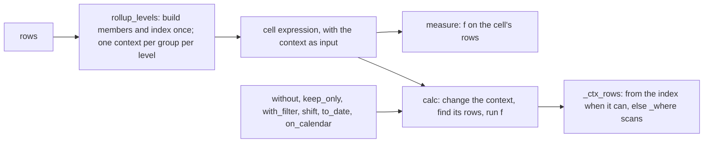

# Measures in a context

Generated from `src/jq_analytics/analytics.jq` and `docs/readout/notes/measures-in-a-context.md`. Do not edit.

Thirteen definitions that let a report compute one measure at several levels and compare a cell with a different slice of the data: its share of a total, the previous period, a running total. This is the part of the library modelled on DAX's `CALCULATE`.

Three words carry it:

- A **measure** is any jq expression over an array of rows, such as `map(.rev) | sum_nonnull`.
- A **context** is the object a cell is evaluated in: which filters it stands for (`at`), the rows that match them (`rows`), every row (`all`), and two lookups built once per report (`members`, `index`).
- A **context change** takes a context and returns another: remove a filter, add one, move to a neighbouring value.



All runs below use five made-up sales rows:

```text
region  month     rev
E       2026-01   10
E       2026-01   20
E       2026-03   10
W       2026-01   30
W       2026-03   30
```

There are no February rows; that matters for `shift`.

## _where

`_where/1`, lines 527 to 531:

```jq
# rows matching $at by scan. {field: value} is equality; {field: {from, to}} is a closed range that
# a null never satisfies. Used when a changed context is not one of the report's own levels.
def _where($at): map(select(. as $r | $at | to_entries | all(
  .key as $k | .value as $v | $r[$k] as $x
  | if ($v | type) == "object"
    then $x != null and ($v.from == null or $x >= $v.from) and ($v.to == null or $x <= $v.to)
    else $x == $v end)));
```

Rows matching a filter object, by scanning. `$at | to_entries | all(…)` requires every filter to hold for the row. A plain value is equality. An object `{from, to}` is a closed range: the row's value must not be null and must lie at or above `from` and at or below `to`, where a missing bound is no bound.

```jq
[{r: "E", rev: 10}, {r: "E", rev: 20}, {r: "W", rev: 30}, {r: "E", rev: null}]
| _where({r: "E", rev: {from: 15}}), (_where({rev: {to: 20}}) | length)
```

```json
[{"r":"E","rev":20}]
2
```

## _ctx_rows

`_ctx_rows/0`, lines 536 to 547:

```jq
# the rows of the context given as input. A context whose fields are one of the report's levels is
# read from the index (no scan); one range on such a level is the union of that level's groups in
# the range, in order of the field's values. Anything else scans every row.
def _ctx_rows:
  . as $c
  | ($c.at | keys) as $ks
  | ($c.at | to_entries | map(select(.value | type == "object") | .key)) as $ranges
  | $c.index[$ks | tojson] as $ix
  | if $ix == null or ($ranges | length) > 1 then $c.all | _where($c.at)
    elif ($ranges | length) == 0 then $ix[[$c.at[$ks[]]] | tojson] // []
    else $ranges[0] as $d | $c.at[$d] as $v
      | [$c.members[$d][]
         | select(. != null and ($v.from == null or . >= $v.from) and ($v.to == null or . <= $v.to))
         | . as $m | $ix[[($c.at + {($d): $m})[$ks[]]] | tojson][]?]
    end;
```

Input: a context. Output: the rows it stands for. Three paths:

- `$ks` is the sorted list of the filter's fields, and `$c.index[$ks | tojson]` is the report's index for exactly that set of fields, if the report has a level with those fields.
- **No such index, or more than one range filter:** scan all rows with `_where`.
- **An index and no range:** one lookup, `$ix[[values in key order] | tojson]`, or no rows.
- **An index and one range** on field `$d`: take that field's member values that fall in the range, in order, and concatenate the index groups for each. This is what a running total uses.

The index is why changing a context is cheap in the common case: `without("month")` at a region and month cell leaves a filter on region alone, and the region level's groups are already there. A filter on a field that is not a level scans every row, once per cell.

```jq
[["E", "2026-01", 10], ["E", "2026-01", 20], ["E", "2026-03", 10], ["W", "2026-01", 30], ["W", "2026-03", 30]]
| map({region: .[0], month: .[1], rev: .[2]})
| rollup_levels([["region", "month"], ["region"]];
    {from_index: (without("month") | _ctx_rows | length),
     by_scan: (with_filter({rev: {from: 20}}) | _ctx_rows | length)})
```

```json
[
  {"region": "E", "month": "2026-01", "level": "region/month", "from_index": 3, "by_scan": 1},
  {"region": "E", "month": "2026-03", "level": "region/month", "from_index": 3, "by_scan": 0},
  {"region": "W", "month": "2026-01", "level": "region/month", "from_index": 2, "by_scan": 1},
  {"region": "W", "month": "2026-03", "level": "region/month", "from_index": 2, "by_scan": 1},
  {"region": "E", "level": "region", "from_index": 3, "by_scan": 1},
  {"region": "W", "level": "region", "from_index": 2, "by_scan": 2}
]
```

At `E / 2026-01`, removing the month leaves the three E rows; adding "rev at least 20" leaves one of that cell's two rows.

## rollup_levels

`rollup_levels/2`, lines 555 to 569:

```jq
# rollup_levels: one output row per group at each listed level. $levels is a list of field lists,
# for example [["region", "product"], ["region"], []]; [] is the grand total. Each output row is the
# level's fields, a level name ("region/product", or "all") and the fields of cell. Rows come level
# by level in the order listed, sorted by the level's values within a level. Nothing is added up
# from finer cells: every level is computed from rows, so a median or a ratio is right at the total.
# A row missing a level's field forms its own group (null). No input rows give no output rows.
def rollup_levels($levels; cell):
  . as $all
  | (reduce ($levels | add // [] | unique)[] as $d ({}; .[$d] = ($all | map(.[$d]) | unique))) as $members
  | (reduce ($levels + [[]])[] as $lvl ({};
       ((reduce $lvl[] as $d ({}; .[$d] = 1)) | keys) as $ks
       | if has($ks | tojson) then .
         else .[$ks | tojson] = ($all | group_by([.[$ks[]]]) | map({key: ([.[0][$ks[]]] | tojson), value: .}) | from_entries)
         end)) as $index
  | [$levels[] as $lvl
     | ((reduce $lvl[] as $d ({}; .[$d] = 1)) | keys) as $ks
     | [$index[$ks | tojson][] | . as $rows
        | {at: (reduce $lvl[] as $d ({}; .[$d] = $rows[0][$d])), rows: $rows}]
     | sort_by([.at[$lvl[]]])[]
     | {all: $all, members: $members, index: $index, at: .at, rows: .rows, level: $lvl}
     | .at + {level: (if $lvl == [] then "all" else ($lvl | join("/")) end)} + cell];
```

One output row per group at each listed level.

- **`$members`**: for every field named in any level, its sorted distinct values over all rows. `shift` and `to_date` step through these.
- **`$index`**: for every level's set of fields (and the empty set), the rows grouped by those fields, keyed by the values as JSON text. `(reduce $lvl[] as $d ({}; .[$d] = 1)) | keys` is the level's fields sorted and without repeats, so `["region", "month"]` and `["month", "region"]` share one index. `if has(…) then .` skips a set already built.
- **Per level**: each index group becomes a context `{at, rows}`; `sort_by([.at[$lvl[]]])` orders the groups by the level's values in the order the caller listed the fields.
- **Per group**: the full context is assembled and `cell` runs with it as input. The output row is the filter fields, a `level` name (`"region/month"`, or `"all"` for the empty level) and whatever `cell` returned.

Every level is computed from rows. Nothing is added up from finer cells, so a median or a ratio is right at the total.

```jq
[["E", "2026-01", 10], ["E", "2026-01", 20], ["E", "2026-03", 10], ["W", "2026-01", 30], ["W", "2026-03", 30]]
| map({region: .[0], month: .[1], rev: .[2]})
| rollup_levels([["region"], ["month"], []]; {rows: measure(length), rev: measure(map(.rev) | sum_nonnull), median: measure(map(.rev) | median)})
```

```json
[
  {"region": "E", "level": "region", "rows": 3, "rev": 40, "median": 10},
  {"region": "W", "level": "region", "rows": 2, "rev": 60, "median": 30},
  {"month": "2026-01", "level": "month", "rows": 3, "rev": 60, "median": 20},
  {"month": "2026-03", "level": "month", "rows": 2, "rev": 40, "median": 20},
  {"level": "all", "rows": 5, "rev": 100, "median": 20}
]
```

The median of all five rows is 20; it is not derivable from the regions' medians (10 and 30).

## rollup

`rollup/2`, line 573:

```jq
# rollup: the hierarchy of $dims: every field, then one fewer from the right, down to the grand
# total (SQL's GROUP BY ROLLUP). rollup(["region", "month"]; ...) gives region/month, region, all.
def rollup($dims; cell): rollup_levels([range($dims | length; -1; -1) as $n | $dims[0:$n]]; cell);
```

The levels of a hierarchy: all the fields, then one fewer from the right, down to none. `range($dims | length; -1; -1) as $n | $dims[0:$n]` produces `["region", "month"]`, `["region"]`, `[]`.

```jq
[["E", "2026-01", 10], ["E", "2026-01", 20], ["E", "2026-03", 10], ["W", "2026-01", 30], ["W", "2026-03", 30]]
| map({region: .[0], month: .[1], rev: .[2]})
| rollup(["region", "month"]; {rev: measure(map(.rev) | sum_nonnull)}) | map([.level, .region, .month, .rev])
```

```json
[
  ["region/month", "E", "2026-01", 30],
  ["region/month", "E", "2026-03", 10],
  ["region/month", "W", "2026-01", 30],
  ["region/month", "W", "2026-03", 30],
  ["region", "E", null, 40],
  ["region", "W", null, 60],
  ["all", null, null, 100]
]
```

## measure, calc, share

`measure/1`, line 576:

```jq
# inside a cell: measure f on the cell's own rows
def measure(f): .rows | f;
```

`calc/2`, line 581:

```jq
# inside a cell: measure f on the rows of a changed context (DAX's CALCULATE). change is one or
# more of without, keep_only, with_filter, shift, to_date, piped. A shift past the first or last
# value has no context, and calc returns null without running f.
def calc(f; change): (change) as $c | if $c.void then null else ($c | _ctx_rows | f) end;
```

`share/2`, lines 584 to 585:

```jq
# inside a cell: measure f here divided by f in the changed context; null when that is null or 0
def share(f; change): measure(f) as $a | calc(f; change) as $b
  | if $a == null or $b == null or $b == 0 then null else $a / $b end;
```

- `measure(f)` is `.rows | f`: the measure on the cell's own rows.
- `calc(f; change)` applies the change to the context, and unless the change left no context (`.void`), finds the changed context's rows with `_ctx_rows` and runs `f` on them. A void context gives null without running `f`.
- `share(f; change)` is the measure here divided by the measure there, null when either is null or the divisor is 0.

```jq
[["E", "2026-01", 10], ["E", "2026-01", 20], ["E", "2026-03", 10], ["W", "2026-01", 30], ["W", "2026-03", 30]]
| map({region: .[0], month: .[1], rev: .[2]})
| rollup_levels([["region", "month"]];
    {rev: measure(map(.rev) | sum_nonnull),
     region_rev: calc(map(.rev) | sum_nonnull; without("month")),
     of_region: share(map(.rev) | sum_nonnull; without("month")),
     of_all: share(map(.rev) | sum_nonnull; keep_only([]))})
| map(del(.level))
```

```json
[
  {"region": "E", "month": "2026-01", "rev": 30, "region_rev": 40, "of_region": 0.75, "of_all": 0.3},
  {"region": "E", "month": "2026-03", "rev": 10, "region_rev": 40, "of_region": 0.25, "of_all": 0.1},
  {"region": "W", "month": "2026-01", "rev": 30, "region_rev": 60, "of_region": 0.5, "of_all": 0.3},
  {"region": "W", "month": "2026-03", "rev": 30, "region_rev": 60, "of_region": 0.5, "of_all": 0.3}
]
```

Hand check: E in January is 30 of E's 40 (0.75) and of the 100 in all (0.3).

## without, keep_only, with_filter

`without/1`, line 590:

```jq
# context changes. Each takes a context and returns one.
# remove one filter (ALL, REMOVEFILTERS). Written as .at |= del(...), not del(.at[$dim]): gojq's del
# copies the whole context, every row included, which cost 0.03 s per cell at 37,960 rows.
def without($dim): .at |= del(.[$dim]);
```

`keep_only/1`, line 591:

```jq
def keep_only($dims): .at |= with_entries(select(.key as $k | $dims | any(. == $k)));   # ALLEXCEPT
```

`with_filter/1`, line 592:

```jq
def with_filter($at): .at += $at;                     # add or replace filters; a value or {from, to}
```

Each edits `.at`, the filter object, and nothing else.

- `without($dim)` deletes one filter. It is written `.at |= del(.[$dim])` because on gojq `del(.at[$dim])` copied the whole context, rows included, on every call.
- `keep_only($dims)` keeps the listed filters and drops the rest; `keep_only([])` is the grand total.
- `with_filter($at)` adds or replaces filters: a value, or a `{from, to}` range.

```jq
{at: {region: "E", month: "2026-01"}} | [without("month"), keep_only(["month"]), with_filter({month: "2026-03", rev: {from: 20}})] | map(.at)
```

```json
[
  {"region": "E"},
  {"month": "2026-01"},
  {"region": "E", "month": "2026-03", "rev": {"from": 20}}
]
```

## shift

`shift/2`, lines 602 to 608:

```jq
# move to the $k-th neighbouring value of $dim (-1 is the previous one). Neighbours are the field's
# distinct values over all rows, sorted, so "previous" is the previous value that has rows anywhere,
# not the previous calendar period. No filter on $dim (a total row) or no such neighbour: no context.
def shift($dim; $k):
  .at[$dim] as $v
  | if (.at | has($dim) | not) or $v == null or ($v | type) == "object" then .void = true
    else (.members[$dim] | index($v)) as $i
    | if $i == null or $i + $k < 0 or $i + $k >= (.members[$dim] | length) then .void = true
      else .at[$dim] = .members[$dim][$i + $k] end
    end;
```

Moves the filter on `$dim` to the value `$k` places along in `.members[$dim]`.

- No filter on `$dim` (a total row), a null value, or a range: `.void = true`, since there is nothing to move from.
- `index($v)` finds the current value's position in the members. Not found, or the move would step off either end: void.
- Otherwise the filter takes the neighbouring value.

Members are the values present in the data unless `on_calendar` replaced them.

**Review finding 12.** When `$dim` has no member list (it is not a field of any level of the report, and `on_calendar` was not used), `.members[$dim]` is null. jq 1.8.2 and gojq then return no context, and the cell quietly shows null; jaq stops with `cannot index null`. The engines disagree, and neither says what is wrong. Proposed: an error naming the field and saying it is not a level of the report.

## on_calendar

`on_calendar/2`, line 616:

```jq
# on_calendar: make shift and to_date on $dim step through $values, in the order given, instead of
# through the values present in the data: calc(revenue; on_calendar("month"; $months) | shift("month"; -1))
# is the previous calendar month even when it has no rows (the measure then runs on no rows).
# $values is every period in order, for example calendar(...) | map(.year_month) | unique. A cell
# whose own value is not in $values has no context after a shift. to_date compares values, so the
# list has to sort the way it is ordered: "2026-03" does, "Mar" does not.
def on_calendar($dim; $values): .members[$dim] = $values;
```

One assignment: the member list of `$dim` becomes `$values`. `shift` and `to_date` read that list, so nothing else has to change for them to step through calendar periods, including ones with no rows.

```jq
[["E", "2026-01", 10], ["E", "2026-01", 20], ["E", "2026-03", 10], ["W", "2026-01", 30], ["W", "2026-03", 30]]
| map({region: .[0], month: .[1], rev: .[2]})
| ["2026-01", "2026-02", "2026-03"] as $months
| rollup_levels([["region", "month"], ["region"]];
    {rev: measure(map(.rev) | sum_nonnull),
     prev_with_rows: calc(map(.rev) | sum_nonnull; shift("month"; -1)),
     prev_calendar: calc(map(.rev) | sum_nonnull; on_calendar("month"; $months) | shift("month"; -1))})
| map(del(.level))
```

```json
[
  {"region": "E", "month": "2026-01", "rev": 30, "prev_with_rows": null, "prev_calendar": null},
  {"region": "E", "month": "2026-03", "rev": 10, "prev_with_rows": 30, "prev_calendar": null},
  {"region": "W", "month": "2026-01", "rev": 30, "prev_with_rows": null, "prev_calendar": null},
  {"region": "W", "month": "2026-03", "rev": 30, "prev_with_rows": 30, "prev_calendar": null},
  {"region": "E", "rev": 40, "prev_with_rows": null, "prev_calendar": null},
  {"region": "W", "rev": 60, "prev_with_rows": null, "prev_calendar": null}
]
```

For March, the previous month that has rows is January (30 for E), while the previous calendar month is February, which has no rows, so the measure runs on nothing and gives null. January has no previous value either way. At the region level there is no month to move from, so both are null.

## to_date

`to_date/1`, lines 620 to 623:

```jq
# everything up to and including this value of $dim, other filters kept (a running total, DATESYTD
# when the year is another filter). No filter on $dim: unchanged.
def to_date($dim):
  if (.at | has($dim) | not) then .
  elif .at[$dim] == null then .void = true
  else .at[$dim] = {to: .at[$dim]} end;
```

Turns the filter on `$dim` into the range "up to and including this value", keeping the other filters. No filter on `$dim`: the context is unchanged, so a total row shows the total. A null value: void.

```jq
[["E", "2026-01", 10], ["E", "2026-01", 20], ["E", "2026-03", 10], ["W", "2026-01", 30], ["W", "2026-03", 30]]
| map({region: .[0], month: .[1], rev: .[2]})
| rollup(["region", "month"]; {rev: measure(map(.rev) | sum_nonnull), to_date: calc(map(.rev) | sum_nonnull; to_date("month"))})
| map([.level, .region, .month, .rev, .to_date])
```

```json
[
  ["region/month", "E", "2026-01", 30, 30],
  ["region/month", "E", "2026-03", 10, 40],
  ["region/month", "W", "2026-01", 30, 30],
  ["region/month", "W", "2026-03", 30, 60],
  ["region", "E", null, 40, 40],
  ["region", "W", null, 60, 60],
  ["all", null, null, 100, 100]
]
```

E's running total is 30 after January and 40 after March.
