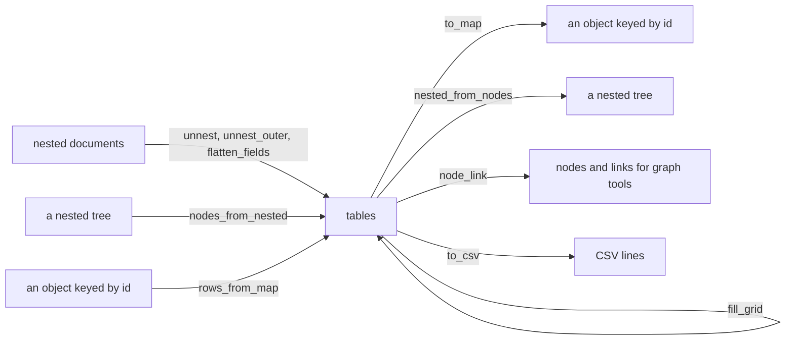

# Shapes in and out

Generated from `src/jq_analytics/analytics.jq` and `docs/readout/notes/shapes-in-and-out.md`. Do not edit.

Fifteen definitions that convert between the forms data arrives in (nested documents, objects keyed by id) and the tables the rest of the library takes, and from those tables to what the next tool reads.



## _distinct_in_order

`_distinct_in_order/0`, lines 660 to 661:

```jq
# the distinct values of an array in order of first appearance (jq's unique sorts them)
# (each first sighting is stored with its position and the positions sorted at the end: appending
# to an array inside the reduce copied it every time, 47 s for 400,000 values)
def _distinct_in_order: reduce .[] as $x ({n: 0, s: {}}; ($x | tojson) as $k
  | if .s[$k] then . else .s[$k] = [.n, $x] | .n += 1 end) | [.s[]] | sort_by(.[0]) | map(.[1]);
```

The distinct values of an array, in the order they first appear. jq's `unique` sorts, which loses that order.

`reduce … ({n: 0, s: {}}; …)`: `s` maps each value (as JSON text) to `[position of first sighting, value]`; a value already in `s` is skipped. At the end `[.s[]] | sort_by(.[0]) | map(.[1])` puts the first sightings back in order. The comment records why it is not the obvious "append when new": that version copied the growing array on every append.

```jq
["b", "a", "b", 1, "1", "a"] | _distinct_in_order
```

```json
["b","a",1,"1"]
```

The number 1 and the string `"1"` stay distinct because their JSON texts differ.

## _unnest_arr, unnest, unnest_outer

`_unnest_arr/2`, lines 667 to 670:

```jq
# unnest: one row per element of the array at f, the element in field $as. A row whose array is
# empty or null is dropped, as SQL's UNNEST drops it; unnest_outer keeps it once with $as null
# (LEFT JOIN LATERAL). A value at f that is neither an array nor null is an error naming the row's
# position. Elements come out in array order, rows in input order.
def _unnest_arr(f; $i):
  (f) as $a
  | if $a == null then [] elif ($a | type) == "array" then $a
    else error("unnest: row \($i) holds a \($a | type), not an array") end;
```

`unnest/2`, lines 671 to 672:

```jq
def unnest(f; $as):
  [to_entries[] | .key as $i | .value as $r | ($r | _unnest_arr(f; $i))[] as $x | $r + {($as): $x}];
```

`unnest_outer/2`, lines 673 to 675:

```jq
def unnest_outer(f; $as):
  [to_entries[] | .key as $i | .value as $r
   | ($r | _unnest_arr(f; $i) | if length == 0 then [null] else . end)[] as $x | $r + {($as): $x}];
```

One row per element of an array field.

- `_unnest_arr(f; $i)` returns the array at `f`, an empty array for null, and an error naming the row's position for anything else.
- `unnest`: `to_entries[]` supplies the position; for each element `$x` of the array the row is repeated with field `$as` set to it. A row with an empty or null array produces nothing.
- `unnest_outer` differs in one step: an empty array is replaced by `[null]`, so such a row comes out once with `$as` null.

The original array field stays on every output row; drop it afterwards with `del` if it is not wanted.

```jq
[{id: 1, tags: ["x", "y"]}, {id: 2, tags: []}, {id: 3, tags: null}]
| {unnest: (unnest(.tags; "tag") | map([.id, .tag])), outer: (unnest_outer(.tags; "tag") | map([.id, .tag]))},
  (try ([{id: 4, tags: "x"}] | unnest(.tags; "tag")) catch .)
```

```json
{"unnest":[[1,"x"],[1,"y"]],"outer":[[1,"x"],[1,"y"],[2,null],[3,null]]}
"unnest: row 0 holds a string, not an array"
```

## _flat, flatten_fields

`_flat/2`, lines 681 to 684:

```jq
# flatten_fields: nested objects become columns named by their path joined with $sep
# ({"user": {"dept": "x"}} gives "user.dept"). Arrays and scalars are left as values, for unnest to
# take; an empty object stays as the value {}. Two paths that flatten to the same name are an error.
# (jq's own flatten flattens arrays; this flattens the objects inside each row.)
def _flat($p; $sep):
  if type == "object" and length > 0
  then to_entries[] | .key as $k | .value | _flat(if $p == null then $k else $p + $sep + $k end; $sep)
  else {key: $p, value: .} end;
```

`flatten_fields/1`, lines 685 to 691:

```jq
def flatten_fields($sep):
  map(if length == 0 then {}
      else [_flat(null; $sep)] as $e | ($e | from_entries) as $o
        | if ($o | length) != ($e | length)   # a repeated name collapsed in from_entries
          then error("flatten_fields: two fields flatten to the same name: \($e | map(.key) | group_by(.) | map(select(length > 1)[0]) | tojson)")
          else $o end
      end);
```

Nested objects become columns named by their path.

- `_flat($p; $sep)` walks one value. A non-empty object recurses into each field, extending the path `$p` with the field's name; anything else (a scalar, an array, an empty object) is emitted as `{key: path, value}`.
- `flatten_fields` collects those pairs for each row and builds the object with `from_entries`. If the object has fewer fields than there were pairs, two paths produced the same name and one overwrote the other; that is an error naming the name.

```jq
[{user: {name: "ann", dept: {id: 7}}, tags: ["a"], meta: {}}] | flatten_fields("."),
(try ([{a: {b: 1}, "a.b": 2}] | flatten_fields(".")) catch .)
```

```json
[{"user.name":"ann","user.dept.id":7,"tags":["a"],"meta":{}}]
"flatten_fields: two fields flatten to the same name: [\"a.b\"]"
```

## _nodes, nodes_from_nested

`_nodes/3`, lines 696 to 697:

```jq
# nodes_from_nested: a nested tree (each node holding its children in an array at `children`)
# becomes node rows, each with `parent` set to its parent's id (null for a root) and the children
# array removed. The input is one root object or an array of roots. Rows are in depth-first order.
def _nodes(id; children; $p): . as $n
  | ($n | del(children) + {parent: $p}), ((($n | children) // [])[] | _nodes(id; children; ($n | id)));
```

`nodes_from_nested/2`, line 698:

```jq
def nodes_from_nested(id; children): [(if type == "array" then .[] else . end) | _nodes(id; children; null)];
```

A nested tree to node rows.

`_nodes(id; children; $p)` emits the node itself, without its children array and with `parent` set to `$p`, then recurses into each child with this node's id as the parent. `// []` treats a missing children field as no children. `nodes_from_nested` accepts one root or an array of roots and starts each with a null parent. Rows come out depth first.

```jq
{id: "ceo", reports: [{id: "eng", reports: [{id: "web"}]}, {id: "ops"}]} | nodes_from_nested(.id; .reports)
```

```json
[
  {"id": "ceo", "parent": null},
  {"id": "eng", "parent": "ceo"},
  {"id": "web", "parent": "eng"},
  {"id": "ops", "parent": "ceo"}
]
```

## rows_from_map

`rows_from_map/1`, lines 704 to 709:

```jq
# rows_from_map: an object keyed by id becomes rows, the key in field $as, sorted by key. A value
# that is not an object becomes {($as): key, value: v}. Sorted because gojq does not keep an
# object's key order, so the order the keys were written in cannot be the same on every engine.
# A value that already has a field named $as is an error: it would replace the key.
def rows_from_map($as):
  to_entries | sort_by(.key) | map(. as $e
    | if ($e.value | type) != "object" then {($as): $e.key, value: $e.value}
      elif ($e.value | has($as))
      then error("rows_from_map: the value of key \($e.key | tojson) already has a field \($as | tojson)")
      else {($as): $e.key} + $e.value end);
```

An object keyed by id to rows, the key in field `$as`. `sort_by(.key)` because gojq does not keep the order keys were written in, so sorted order is the only order every engine can agree on. An object value contributes its fields; any other value goes in a field called `value`. An object value that already has a field named `$as` is an error, because it would replace the key.

```jq
{web01: {ram: 16}, db01: {ram: 64}, note: "spare"} | rows_from_map("host"),
(try ({a: {id: "zzz"}} | rows_from_map("id")) catch .)
```

```json
[{"host":"db01","ram":64},{"host":"note","value":"spare"},{"host":"web01","ram":16}]
"rows_from_map: the value of key \"a\" already has a field \"id\""
```

**Review finding 13, fixed in 0.9.0.** Until 0.8.1 the row was built as the key field plus the value, so a value with a field of that name replaced the key and the key was lost. It is now the error shown above.

## fill_grid

`fill_grid/4`, lines 717 to 728:

```jq
# fill_grid: every combination of the $keys fields' values (in first appearance) at every time from
# the earliest to the latest in steps of $step seconds; a missing combination gets a row with the
# key fields, the time field and $fill. $keys and $time are field names; times are epoch seconds
# and must sit on the grid (an offset from the earliest that is a multiple of $step), else an
# error. Without the filled rows a lag or a moving mean steps over an empty period as if it were
# the next one.
def fill_grid($keys; $time; $step; $fill):
  if length == 0 then []
  elif any(.[]; .[$time] == null) then error("fill_grid: a row has no time") else
  (map(.[$time]) | min) as $t0 | (map(.[$time]) | max) as $t1
  | (map(select(((.[$time] - $t0) % $step) != 0)) | if length > 0
       then error("fill_grid: \(.[0][$time]) is not on the \($step)-second grid from \($t0)") else . end) as $_
  | (reduce .[] as $r ({}; .[[$r[$keys[]], $r[$time]] | tojson] += [$r])) as $ix
  | ([.[] | [.[$keys[]]]] | _distinct_in_order) as $combos
  | [$combos[] as $k | range($t0; $t1 + 1; $step) as $t
     | ($ix[$k + [$t] | tojson] // [([$keys, $k] | transpose | map({key: .[0], value: .[1]}) | from_entries)
                                     + {($time): $t} + $fill])[]]
  end;
```

Every combination of the key fields at every time step, with made-up rows where the data has none.

- A row with a null time is an error.
- `$t0`, `$t1`: the earliest and latest time. A row whose time is not a whole number of steps from `$t0` is an error.
- `$ix`: the rows by `[key values…, time]`.
- `$combos`: the distinct key combinations, in order of first appearance.
- For each combination and each time from `$t0` to `$t1`: the rows found in `$ix`, or one filler row made of the key fields (`[$keys, $k] | transpose` pairs each name with its value), the time and `$fill`.

Without the filler rows, `lag` or `moving_mean` would treat the row after a gap as the next period.

```jq
[{g: "a", t: 0, v: 1}, {g: "a", t: 120, v: 3}, {g: "b", t: 60, v: 5}] | fill_grid(["g"]; "t"; 60; {v: 0}) | map([.g, .t, .v]),
(try ([{g: "a", t: 0}, {g: "a", t: 90}] | fill_grid(["g"]; "t"; 60; {})) catch .)
```

```json
[["a",0,1],["a",60,0],["a",120,3],["b",0,0],["b",60,5],["b",120,0]]
"fill_grid: 90 is not on the 60-second grid from 0"
```

**Review finding 14, fixed in 0.9.0.** Until 0.8.1 a null time ended in jq's own subtraction error. It is now `fill_grid: a row has no time`.

## to_map

`to_map/1`, lines 732 to 734:

```jq
# to_map: rows become an object keyed by `key` (as a string). A duplicate key is an error; jq's
# own INDEX(key) keeps the last row silently.
def to_map(key):
  reduce .[] as $r ({}; ($r | key | tostring) as $k
    | if has($k) then error("to_map: duplicate key \($k | tojson)") else .[$k] = $r end);
```

Rows to an object keyed by `key` as text. Unlike jq's `INDEX`, which keeps the last row for a repeated key, a repeated key is an error. Because the key is turned into text, the number 1 and the string `"1"` count as the same key and raise that error.

```jq
[{id: "web01", ram: 16}, {id: "db01", ram: 64}] | to_map(.id),
(try ([{id: "a"}, {id: "a"}] | to_map(.id)) catch .)
```

```json
{"web01":{"id":"web01","ram":16},"db01":{"id":"db01","ram":64}}
"to_map: duplicate key \"a\""
```

## _nest, nested_from_nodes

`_nest/3`, line 739:

```jq
# nested_from_nodes: node rows (id, parent) become a nested tree, each node's children in an array
# in field $as, the roots in an array. Checked with tree_paths first, so a missing parent or a
# cycle is the same error as there.
def _nest($by; id; $as): . as $n | $n + {($as): [($by[$n | id | tojson] // [])[] | _nest($by; id; $as)]};
```

`nested_from_nodes/3`, lines 740 to 743:

```jq
def nested_from_nodes(id; parent; $as):
  (tree_paths(id; parent) | length) as $_
  | (group_by(parent) | map({key: (.[0] | parent | tojson), value: .}) | from_entries) as $by
  | [.[] | select((parent) == null or (parent) == "") | _nest($by; id; $as)];
```

Node rows to a nested tree.

- `(tree_paths(id; parent) | length) as $_` runs `tree_paths` only for its checks: a missing parent or a cycle stops here with that function's error.
- `$by`: the rows grouped under their parent's id, by `group_by(parent)`, which keeps the children in input order.
- The roots (parent null or `""`) are each expanded by `_nest`, which adds field `$as` holding the node's children, each expanded the same way.

```jq
[{id: "ceo", boss: null}, {id: "eng", boss: "ceo"}, {id: "web", boss: "eng"}, {id: "ops", boss: "ceo"}]
| nested_from_nodes(.id; .boss; "reports")
```

```json
[
  {"id": "ceo", "boss": null, "reports": [{"id": "eng", "boss": "ceo", "reports": [{"id": "web", "boss": "eng", "reports": []}]}, {"id": "ops", "boss": "ceo", "reports": []}]}
]
```

**Review finding 15, fixed in 0.9.0.** Until 0.8.1 `$by` was built by appending each row to its parent's array inside a `reduce`, which took time with the square of one parent's children. In the Python `jq` package, 80,000 nodes under one root took 44.2 s before and 3.67 s after.

## node_link

`node_link/2`, lines 747 to 749:

```jq
# node_link: edge rows become the node-link form graph tools read (networkx, d3, Cytoscape):
# {nodes: [{id}], links: [row + {source, target}]}. Nodes are in order of first appearance.
def node_link(from; to):
  {nodes: ([.[] | (from), (to)] | _distinct_in_order | map({id: .})),
   links: map(. + {source: (from), target: (to)})};
```

Edge rows to the `{nodes, links}` form that networkx, d3 and Cytoscape read. The nodes are the distinct ends of the edges in order of first appearance; each link is the edge row with `source` and `target` added.

```jq
[{a: "fetch", b: "compile", min: 1}, {a: "compile", b: "test", min: 2}] | node_link(.a; .b)
```

```json
{
  "nodes": [{"id": "fetch"}, {"id": "compile"}, {"id": "test"}],
  "links": [{"a": "fetch", "b": "compile", "min": 1, "source": "fetch", "target": "compile"}, {"a": "compile", "b": "test", "min": 2, "source": "compile", "target": "test"}]
}
```

## to_csv

`to_csv/1`, line 754:

```jq
# to_csv: a header line, then one CSV line per row, columns in the order of $cols; a stream of
# strings, so run jq with -r. A null is an empty cell. A nested value in a cell is an error from
# @csv itself: flatten_fields first.
def to_csv($cols): ($cols | @csv), (.[] | [.[$cols[]]] | @csv);
```

A stream of strings: the header, then one line per row with the columns in the order of `$cols`. `@csv` does the quoting; a null becomes an empty cell. Run jq with `-r` to get plain lines; the run below shows them as JSON strings.

```jq
[{host: "web01", ram: 16}, {host: "db, 01", ram: null}] | [to_csv(["host", "ram"])]
```

```json
["\"host\",\"ram\"","\"web01\",16","\"db, 01\","]
```
