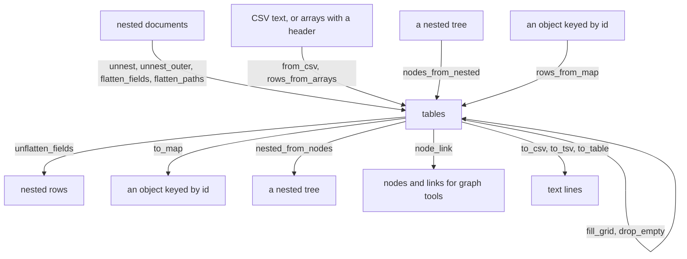

# Shapes in and out

Generated from `src/jq_analytics/analytics.jq` and `docs/readout/notes/shapes-in-and-out.md`. Do not edit.

## Design

### What it is for

Twenty-five definitions that convert between the forms data arrives in (nested documents, objects keyed by id, CSV text) and the tables the rest of the library takes, and from those tables to what the next tool reads (CSV, TSV, a printed table, an object keyed by id, a nested tree, a node-link graph). A table here is an array of objects, one object per row. They answer "how do I get this API reply into rows", "how do I fill the gaps in this time series", and "how do I hand this result to a spreadsheet or a graph viewer".



A small trip from an API reply to CSV: an object keyed by host becomes rows, then text.

```jq
{web01: {ram: 16, tags: ["web"]}, db01: {ram: 64}} | rows_from_map("host") | [to_csv(null)]
```

```json
["\"host\",\"ram\",\"tags\"","\"db01\",64,","\"web01\",16,\"[\"\"web\"\"]\""]
```

The keys come back sorted (`db01` first), the columns are every field name, sorted, and the list in `tags` is written as its JSON text in one cell. `docs/design/05-shapes.md` places these converters among the library's shapes (table, several tables, intervals, tree, graph, star) and traces one nested export through three of them.

Two jq reminders for this family. A `;` separates arguments. A parameter written `$as` is a value, here usually a field name as a string; a parameter without the `$`, such as `f` in `unnest(f; $as)`, is a filter the function runs on each row, so `.tags` there means "this row's tags".

### The rules it keeps

- **A converter changes form, never values.** No cast and no rounding: `from_csv` gives every value as a string, for `cast_columns` to type.
- **Output order is stated and the same on every engine.** Where an object's key order would decide it, the library sorts, because gojq does not keep the order keys were written in: `rows_from_map` sorts by key, `to_csv(null)` sorts the column names. Where the data has an order, it is kept: `unnest` emits rows in input order and elements in array order, `nodes_from_nested` goes depth first, `node_link` lists nodes in order of first appearance, `fill_grid` goes combination by combination in time order.
- **Empty is a value where it matters.** `unnest` drops a row whose array is empty or null (SQL's `CROSS JOIN UNNEST`); `unnest_outer` keeps it once with a null (`LEFT JOIN LATERAL`). `flatten_fields` keeps an empty object as `{}`. `drop_empty` removes null, `""`, `[]` and `{}` at every depth, and a container left empty by that, but keeps `false` and `0`.
- **Refuses rather than guesses**, each with an error naming the row, key or line: an array field that is neither an array nor null (`unnest`); two paths that flatten to one name (`flatten_fields`, `flatten_paths`); a value that already has the key field (`rows_from_map`); a repeated key, with `1` and `"1"` counting as a repeat (`to_map`); a row with no time, or a time off the step grid (`fill_grid`); a parent that is not a node, a cycle, or a repeated id (`nested_from_nodes`, through `tree_paths`); a CSV record longer than its header, or a header that repeats a name (`rows_from_arrays`); anything but text given to `from_csv`. And an input that is not a table (page 00).
- **Limits:** a key made only of digits comes back from `unflatten_fields` as an array position, not a key. `from_csv` reads RFC 4180 only (comma, double quotes), at about 5 s a megabyte in jq 1.7.1; larger files belong to DuckDB's `read_csv`.

### Beside core jq, SQL and pandas

Core jq has pieces of most of these, and the library's versions exist where the piece stops short. Each idiom below was run on jq 1.7.1, gojq and jaq:

| Need | Core jq | Where it stops short |
|---|---|---|
| object keyed by id to rows | `to_entries \| map({host: .key} + .value)` | the row order is the key order the engine keeps: written order on jq and jaq, sorted on gojq |
| CSV out | `@csv` on an array of cells | stops on a nested cell, with a different message on each engine (`array (["x"]) is not valid in a csv row` on jq); no header; the column list is yours to build |
| CSV in | none; `split("\n") \| map(split(","))` | splits inside quotes: `a,"b,c"` gives three cells, `a`, `"b`, `c"`, on all three engines |
| flatten to path names | `[paths(scalars) \| map(tostring) \| join(".")]` | gives the names but drops empty containers (`e: []` is lost); `leaf_paths` is not defined in jq 1.7.1, gojq or jaq |
| drop nulls | `del(.. \| nulls)` | works on all three and is the right tool for nulls alone (`drop_nulls` was left out for that reason); `drop_empty` also removes `""`, `[]`, `{}` and containers emptied by that |
| rows to an object by key | `INDEX(.id)` | keeps the last row of a repeated key silently; not in jaq |

SQL: `CROSS JOIN UNNEST` and `LEFT JOIN LATERAL` are `unnest` and `unnest_outer`; a cross join of the keys with `generate_series`, left-joined to the data, is `fill_grid`; DuckDB's `read_csv` with every column as text reads the test file as `from_csv` does, and the test suite holds that answer.

pandas, checked with pandas 3.1.1: `explode("tags")` is `unnest_outer` (an empty or missing list gives one row with NaN); `pd.json_normalize` is `flatten_fields` with `.` as the separator, except that it drops an empty object where `flatten_fields` keeps `{}`; `read_csv` and `to_csv` are the CSV pair, with type guessing on read that `from_csv` leaves to `cast_columns`.

What the family adds: the conversions at the edges of a jq program, with a stated order and an error instead of a silent loss.

### Decisions

- **2026-11-18, spec 10, version 0.2.0.** Ten converters, in the one library file. A converter changes form, never values, refuses input that is not its source, and states its output order; an object keyed by id becomes rows sorted by key. Parquet, Excel and schema validation were left out: jq cannot write binary formats.
- **0.9.0 (2026-11-18, spec 55).** `rows_from_map` refuses a value that already has the key field (review finding 13; before, the key was lost); `fill_grid` refuses a null time (finding 14); `nested_from_nodes` groups children by parent once instead of appending inside a `reduce` (finding 15), so its cost no longer grows with the number of children of one parent.
- **2026-11-19, spec 65, version 0.15.0.** From a survey of the questions people ask about jq: `to_csv(null)` infers the columns (sorted, because first-seen order differs on gojq) and writes a nested cell as JSON text instead of stopping; `to_tsv` and `to_table` added; `from_csv` and `rows_from_arrays` read CSV; `drop_empty`; `flatten_paths` and `unflatten_fields`, which round-trip. `unflatten_fields` sets values through its own `_setp`, because jaq 3.1.2 will neither create an array from null nor assign past an array's end. Deep merge, other CSV dialects and an approximate document diff were left out.

## The functions

In the order of the file:

| Function | Whose | What it is for |
|---|---|---|
| `_distinct_in_order` | Internal helper, not for callers | The distinct values of an array, in the order they first appear |
| `_unnest_arr`, `unnest`, `unnest_outer` | Public functions and internal helpers | One row per element of an array field |
| `_flat`, `flatten_fields` | Public functions and internal helpers | Nested objects become columns named by their path, so `{"user": {"dept": "x"}}` gives a column `user.dept` |
| `_nodes`, `nodes_from_nested` | Public functions and internal helpers | A nested tree, where each node holds its children in an array, becomes node rows, each with a `parent` field |
| `rows_from_map` | Public function | An object keyed by id becomes rows, with the key in field `$as` |
| `fill_grid` | Public function | Completes a time series: every combination of the key fields gets a row at every time step from the earliest time to the latest, and a missing combination gets a filler row |
| `to_map` | Public function | Rows become an object keyed by `key`, for looking a row up by id |
| `_nest`, `nested_from_nodes` | Public functions and internal helpers | The reverse of `nodes_from_nested`: node rows with an id and a parent become a nested tree, each node's children in an array in field `$as` |
| `node_link` | Public function | Edge rows become the `{nodes, links}` object that graph tools such as networkx, d3 and Cytoscape read |
| `_cell`, `_cols`, `to_csv`, `to_tsv`, `to_table` | Public functions and internal helpers | A table as text for another tool or a person: CSV, TSV, or padded columns for a terminal |
| `rows_from_arrays`, `from_csv` | Public functions | CSV text into rows, the other direction |
| `flatten_paths`, `_setp`, `unflatten_fields` | Public functions and internal helpers | Nested rows as flat columns and back |
| `drop_empty` | Public function | A document without empty values at any depth: null, `""`, `[]` and `{}` go, as fields and as array items, and a container that ends up empty goes with them |

---

## _distinct_in_order

**Internal helper, not for callers** · `_distinct_in_order`

The distinct values of an array, in the order they first appear. jq's `unique` also removes repeats, but it sorts, which loses that order.

### _distinct_in_order: the example

```jq
["b", "a", "b", 1, "1", "a"] | _distinct_in_order, unique
```

```json
["b","a",1,"1"]
[1,"1","a","b"]
```

Two values: this function's result, then the builtin's. `b` stays first because it appeared first. The number 1 and the string `"1"` are different values and both stay.

### _distinct_in_order: what happens inside, on the example

Step 1, the `reduce`: one pass over the values. `s` maps each value, as JSON text, to `[position of first sighting, value]`; a value already in `s` is skipped. `n` counts the distinct values so far.

```jq
["b", "a", "b", 1, "1", "a"]
| reduce .[] as $x ({n: 0, s: {}}; ($x | tojson) as $k | if .s[$k] then . else .s[$k] = [.n, $x] | .n += 1 end)
```

```json
{"n":4,"s":{"\"b\"":[0,"b"],"\"a\"":[1,"a"],"1":[2,1],"\"1\"":[3,"1"]}}
```

The keys `1` and `"\"1\""` differ because the JSON text of a number has no quotes.

Step 2, `[.s[]] | sort_by(.[0]) | map(.[1])`: the four pairs sorted by position, then the positions dropped. That is the first result at the top.

### _distinct_in_order: the definition

`_distinct_in_order/0`, lines 766 to 770:

```jq
# the distinct values of an array in order of first appearance (jq's unique sorts them)
# (each first sighting is stored with its position and the positions sorted at the end: appending
# to an array inside the reduce copied it every time, 47 s for 400,000 values)
def _distinct_in_order: reduce .[] as $x ({n: 0, s: {}}; ($x | tojson) as $k
  | if .s[$k] then . else .s[$k] = [.n, $x] | .n += 1 end) | [.s[]] | sort_by(.[0]) | map(.[1]);
```

Built into jq: `map`, `sort_by`, `tojson`.

The first sightings are written into an object by key and sorted once at the end. The shorter "append the value when it is new" copies the growing array on every append, so its cost grows with the square of the number of distinct values. The sort at the end is also what makes the order the same on engines that do not keep an object's key order.

---

## _unnest_arr, unnest, unnest_outer

**Public functions and internal helpers** · `_unnest_arr(f; $i)`, `unnest(f; $as)`, `unnest_outer(f; $as)`

One row per element of an array field. `unnest` is SQL's `CROSS JOIN UNNEST(tags)`: a row with no elements disappears. `unnest_outer` is `LEFT JOIN LATERAL`: such a row is kept once, with a null. `_unnest_arr` is the helper that reads the array from one row.

### _unnest_arr and the others: the example

| id | tags |
|---|---|
| 1 | ["x", "y"] |
| 2 | [] |
| 3 | null |

```jq
[{id: 1, tags: ["x", "y"]}, {id: 2, tags: []}, {id: 3, tags: null}]
| unnest(.tags; "tag"), unnest_outer(.tags; "tag")
```

```json
[{"id":1,"tags":["x","y"],"tag":"x"},{"id":1,"tags":["x","y"],"tag":"y"}]
[{"id":1,"tags":["x","y"],"tag":"x"},{"id":1,"tags":["x","y"],"tag":"y"},{"id":2,"tags":[],"tag":null},{"id":3,"tags":null,"tag":null}]
```

Two values. `unnest` gives two rows, both from id 1; ids 2 and 3 have nothing to give. `unnest_outer` gives the same two rows and then ids 2 and 3 once each with `tag` null. The `tags` array stays on every row; drop it afterwards with `map(del(.tags))` if it is not wanted.

A value that is neither an array nor null is refused. The error names the row's position, counting from 0:

```jq
[{id: 1, tags: ["x"]}, {id: 4, tags: "x"}] | try unnest(.tags; "tag") catch .
```

```json
"unnest: row 1 holds a string, not an array"
```

### _unnest_arr and the others: what happens inside, on the example

Step 1, `_unnest_arr(f; $i)` on each row: the array at `.tags`, with null read as an empty array. `to_entries` supplies each row's position `$i` for the error message.

```jq
[{id: 1, tags: ["x", "y"]}, {id: 2, tags: []}, {id: 3, tags: null}]
| to_entries | map(.key as $i | .value | _unnest_arr(.tags; $i))
```

```json
[
  ["x", "y"],
  [],
  []
]
```

Step 2, `unnest`: for each element `$x` of a row's array, the row is emitted once with field `$as` added. An empty array has no elements, so its row is emitted zero times.

Step 2 in `unnest_outer`: an empty array is first replaced by `[null]`, so its row is emitted once with a null:

```jq
[["x", "y"], [], []] | map(if length == 0 then [null] else . end)
```

```json
[
  ["x", "y"],
  [null],
  [null]
]
```

### _unnest_arr and the others: the definition

`_unnest_arr/2`, lines 772 to 776:

```jq
# the array at f for one row: [] for null, an error naming the row for anything else
def _unnest_arr(f; $i):
  (f) as $a
  | if $a == null then [] elif ($a | type) == "array" then $a
    else error("unnest: row \($i) holds a \($a | type), not an array") end;
```

Built into jq: `error`, `type`.

`unnest/2`, lines 778 to 783:

```jq
# unnest: one row per element of the array at f, the element in field $as. A row whose array is
# empty or null is dropped, as SQL's UNNEST drops it; unnest_outer keeps it once with $as null
# (LEFT JOIN LATERAL). A value at f that is neither an array nor null is an error naming the row's
# position. Elements come out in array order, rows in input order.
def unnest(f; $as): _table("unnest"; "the input") |
  [to_entries[] | .key as $i | .value as $r | ($r | _unnest_arr(f; $i))[] as $x | $r + {($as): $x}];
```

Built into jq: `to_entries`. From this library: `_table`, `_unnest_arr`.

`unnest_outer/2`, lines 784 to 786:

```jq
def unnest_outer(f; $as): _table("unnest_outer"; "the input") |
  [to_entries[] | .key as $i | .value as $r
   | ($r | _unnest_arr(f; $i) | if length == 0 then [null] else . end)[] as $x | $r + {($as): $x}];
```

Built into jq: `length`, `to_entries`. From this library: `_table`, `_unnest_arr`.

- `_unnest_arr`: `(f) as $a` runs the caller's filter on the row. Null gives `[]`, an array is returned as it is, anything else is the error.
- `to_entries[] | .key as $i | .value as $r` walks the rows with their positions. `as` binds a name without changing the input.
- `($r | _unnest_arr(f; $i))[] as $x` takes the elements one at a time. `$r + {($as): $x}` is the row with the new field; `($as)` in parentheses uses the value of `$as` as the field name.
- Elements come out in array order and rows in input order.

---

## _flat, flatten_fields

**Public functions and internal helpers** · `_flat($p; $sep)`, `flatten_fields($sep)`

Nested objects become columns named by their path, so `{"user": {"dept": "x"}}` gives a column `user.dept`. jq's own `flatten` flattens arrays; this flattens the objects inside each row.

### _flat and the others: the example

One row with an object two levels deep, an array and an empty object:

```jq
[{user: {name: "ann", dept: {id: 7}}, tags: ["a"], meta: {}}] | flatten_fields(".")
```

```json
[
  {"user.name": "ann", "user.dept.id": 7, "tags": ["a"], "meta": {}}
]
```

`user` is gone and its leaves are columns `user.name` and `user.dept.id`. The array `tags` is left as a value, for `unnest` to take. The empty object `meta` has no leaves and stays as `{}`.

Two paths that flatten to the same name are refused:

```jq
[{a: {b: 1}, "a.b": 2}] | try flatten_fields(".") catch .
```

```json
"flatten_fields: two fields flatten to the same name: [\"a.b\"]"
```

### _flat and the others: what happens inside, on the example

Step 1, `_flat(null; ".")` on the row: one `{key, value}` pair per leaf, the key being the path so far. `_flat` emits the pairs one at a time; the run collects them in an array and sorts them by key, because engines walk an object's fields in different orders.

```jq
{user: {name: "ann", dept: {id: 7}}, tags: ["a"], meta: {}} | [_flat(null; ".")] | sort_by(.key)
```

```json
[
  {"key": "meta", "value": {}},
  {"key": "tags", "value": ["a"]},
  {"key": "user.dept.id", "value": 7},
  {"key": "user.name", "value": "ann"}
]
```

Step 2, `from_entries`: the pairs become one object, the row of the result at the top. If the object has fewer fields than there were pairs, two pairs had the same key and one replaced the other. That is the case the error reports.

### _flat and the others: the definition

`_flat/2`, lines 788 to 792:

```jq
# one value flattened to {key: path, value} pairs; a non-empty object recurses, anything else is a leaf
def _flat($p; $sep):
  if type == "object" and length > 0
  then to_entries[] | .key as $k | .value | _flat(if $p == null then $k else $p + $sep + $k end; $sep)
  else {key: $p, value: .} end;
```

Built into jq: `length`, `to_entries`, `type`.

`flatten_fields/1`, lines 794 to 804:

```jq
# flatten_fields: nested objects become columns named by their path joined with $sep
# ({"user": {"dept": "x"}} gives "user.dept"). Arrays and scalars are left as values, for unnest to
# take; an empty object stays as the value {}. Two paths that flatten to the same name are an error.
# (jq's own flatten flattens arrays; this flattens the objects inside each row.)
def flatten_fields($sep): _table("flatten_fields"; "the input") |
  map(if length == 0 then {}
      else [_flat(null; $sep)] as $e | ($e | from_entries) as $o
        | if ($o | length) != ($e | length)   # a repeated name collapsed in from_entries
          then error("flatten_fields: two fields flatten to the same name: \($e | map(.key) | group_by(.) | map(select(length > 1)[0]) | tojson)")
          else $o end
      end);
```

Built into jq: `error`, `from_entries`, `group_by`, `length`, `map`, `select`, `tojson`. From this library: `_flat`, `_table`.

- `_flat($p; $sep)`: a non-empty object recurses into each field, with the path extended by the field's name (`$p + $sep + $k`, or `$k` at the top where `$p` is null). Anything else, a scalar, an array or an empty object, is a leaf and is emitted as `{key: $p, value: .}`.
- `flatten_fields`: `if length == 0 then {}` passes an empty row through.
- `[_flat(null; $sep)] as $e | ($e | from_entries) as $o` keeps both the pairs and the object built from them.
- `if ($o | length) != ($e | length)` detects the repeated name; `group_by(.) | map(select(length > 1)[0])` finds which names repeat, for the message.

---

## _nodes, nodes_from_nested

**Public functions and internal helpers** · `_nodes(id; children; $p)`, `nodes_from_nested(id; children)`

A nested tree, where each node holds its children in an array, becomes node rows, each with a `parent` field. That is the shape `tree_paths` and `tree_rollup` take.

### _nodes and the others: the example

A small reporting tree: ceo has eng and ops under it, and eng has web.

```jq
{id: "ceo", reports: [{id: "eng", reports: [{id: "web"}]}, {id: "ops"}]} | nodes_from_nested(.id; .reports)
```

```json
[
  {"id": "ceo", "parent": null},
  {"id": "eng", "parent": "ceo"},
  {"id": "web", "parent": "eng"},
  {"id": "ops", "parent": "ceo"}
]
```

Four rows, one per node, in depth-first order: a node, then everything under it, then its next sibling. The `reports` arrays are gone and `parent` holds the id of the node above; the root's is null.

### _nodes and the others: reading the call

| Argument | In the example | Runs on | Meaning |
|---|---|---|---|
| `id` | `.id` | one node | the node's id, written into its children's `parent` |
| `children` | `.reports` | one node | the array of the node's children; missing means none |

### _nodes and the others: what happens inside, on the example

`_nodes(id; children; $p)` does the work for one node: it emits the node without its children array and with `parent` set to `$p`, then calls itself on each child with this node's id as `$p`. It emits several values, one per node. Called on the `eng` subtree with parent `"ceo"`:

```jq
{id: "eng", reports: [{id: "web"}]} | [_nodes(.id; .reports; "ceo")]
```

```json
[
  {"id": "eng", "parent": "ceo"},
  {"id": "web", "parent": "eng"}
]
```

`nodes_from_nested` calls it on the root with a null parent and collects everything emitted into one array.

### _nodes and the others: the definition

`_nodes/3`, lines 806 to 808:

```jq
# one nested node and its descendants as rows, depth first, each with its parent's id
def _nodes(id; children; $p): . as $n
  | ($n | del(children) + {parent: $p}), ((($n | children) // [])[] | _nodes(id; children; ($n | id)));
```

Built into jq: `del`.

`nodes_from_nested/2`, lines 810 to 813:

```jq
# nodes_from_nested: a nested tree (each node holding its children in an array at `children`)
# becomes node rows, each with `parent` set to its parent's id (null for a root) and the children
# array removed. The input is one root object or an array of roots. Rows are in depth-first order.
def nodes_from_nested(id; children): [(if type == "array" then .[] else . end) | _nodes(id; children; null)];
```

Built into jq: `type`. From this library: `_nodes`.

- `$n | del(children) + {parent: $p}` is the node's own row.
- `(($n | children) // [])[]` takes the children one at a time; `// []` reads a missing or null children field as no children, which is how `web` and `ops` end the recursion.
- `nodes_from_nested`: `if type == "array" then .[] else . end` accepts one root object or an array of roots.

---

## rows_from_map

**Public function** · `rows_from_map($as)`

An object keyed by id becomes rows, with the key in field `$as`. Many APIs return a table in this form.

### rows_from_map: the example

Three keys; two values are objects and one is a string.

```jq
{web01: {ram: 16}, db01: {ram: 64}, note: "spare"} | rows_from_map("host")
```

```json
[
  {"host": "db01", "ram": 64},
  {"host": "note", "value": "spare"},
  {"host": "web01", "ram": 16}
]
```

One row per key, sorted by key. An object value contributes its fields beside the key. The string has no field name of its own, so it goes in a field called `value`.

A value that already has a field named `$as` is refused, because that field would replace the key:

```jq
{a: {id: "zzz"}} | try rows_from_map("id") catch .
```

```json
"rows_from_map: the value of key \"a\" already has a field \"id\""
```

### rows_from_map: what happens inside, on the example

Step 1, `to_entries | sort_by(.key)`: one `{key, value}` pair per key, in key order.

```jq
{web01: {ram: 16}, db01: {ram: 64}, note: "spare"} | to_entries | sort_by(.key)
```

```json
[
  {"key": "db01", "value": {"ram": 64}},
  {"key": "note", "value": "spare"},
  {"key": "web01", "value": {"ram": 16}}
]
```

Step 2: each pair becomes a row. For `db01`, `{host: "db01"} + {ram: 64}`. That gives the result at the top.

### rows_from_map: the definition

`rows_from_map/1`, lines 815 to 824:

```jq
# rows_from_map: an object keyed by id becomes rows, the key in field $as, sorted by key. A value
# that is not an object becomes {($as): key, value: v}. Sorted because gojq does not keep an
# object's key order, so the order the keys were written in cannot be the same on every engine.
# A value that already has a field named $as is an error: it would replace the key.
def rows_from_map($as):
  to_entries | sort_by(.key) | map(. as $e
    | if ($e.value | type) != "object" then {($as): $e.key, value: $e.value}
      elif ($e.value | has($as))
      then error("rows_from_map: the value of key \($e.key | tojson) already has a field \($as | tojson)")
      else {($as): $e.key} + $e.value end);
```

Built into jq: `error`, `has`, `map`, `sort_by`, `to_entries`, `tojson`, `type`.

- `sort_by(.key)`: gojq does not keep the order an object's keys were written in, so sorted order is the one order every engine can agree on.
- `if ($e.value | type) != "object"`: a value that is not an object becomes `{($as): key, value: v}`.
- `elif ($e.value | has($as))`: the error case above.
- `else {($as): $e.key} + $e.value`: the key first, then the value's fields.

---

## fill_grid

**Public function** · `fill_grid($keys; $time; $step; $fill)`

Completes a time series: every combination of the key fields gets a row at every time step from the earliest time to the latest, and a missing combination gets a filler row. Without the filler rows, `lag` or `moving_mean` treats the row after a gap as the next period. In SQL this is a cross join of the keys with `generate_series`, left joined to the data.

### fill_grid: the example

Readings every 60 seconds for two series, `a` and `b`, with gaps:

| g | t | v |
|---|---|---|
| a | 0 | 1 |
| a | 120 | 3 |
| b | 60 | 5 |

```jq
[{g: "a", t: 0, v: 1}, {g: "a", t: 120, v: 3}, {g: "b", t: 60, v: 5}] | fill_grid(["g"]; "t"; 60; {v: 0})
```

```json
[
  {"g": "a", "t": 0, "v": 1},
  {"g": "a", "t": 60, "v": 0},
  {"g": "a", "t": 120, "v": 3},
  {"g": "b", "t": 0, "v": 0},
  {"g": "b", "t": 60, "v": 5},
  {"g": "b", "t": 120, "v": 0}
]
```

Six rows: two series times three time steps (0, 60, 120). The three input rows are there unchanged; the other three are fillers with `v` 0.

### fill_grid: reading the call

All four arguments are values, not filters.

| Argument | In the example | Meaning |
|---|---|---|
| `$keys` | `["g"]` | the names of the fields that identify a series |
| `$time` | `"t"` | the name of the time field, holding epoch seconds |
| `$step` | `60` | seconds between grid points |
| `$fill` | `{v: 0}` | the fields a filler row gets besides its keys and time |

### fill_grid: what happens inside, on the example

Step 1: the checks, then the range. No row may lack a time, and every time must be a whole number of steps from the earliest. Here `$t0` is 0 and `$t1` is 120. The two errors:

```jq
(try ([{g: "a", t: 0}, {g: "a", t: null}] | fill_grid(["g"]; "t"; 60; {})) catch .),
(try ([{g: "a", t: 0}, {g: "a", t: 90}] | fill_grid(["g"]; "t"; 60; {})) catch .)
```

```json
"fill_grid: a row has no time"
"fill_grid: 90 is not on the 60-second grid from 0"
```

Step 2, `$ix`: the rows indexed by their key values and time, as JSON text.

```jq
[{g: "a", t: 0, v: 1}, {g: "a", t: 120, v: 3}, {g: "b", t: 60, v: 5}]
| reduce .[] as $r ({}; .[[$r[["g"][]], $r["t"]] | tojson] += [$r])
```

```json
{
  "[\"a\",0]": [{"g": "a", "t": 0, "v": 1}],
  "[\"a\",120]": [{"g": "a", "t": 120, "v": 3}],
  "[\"b\",60]": [{"g": "b", "t": 60, "v": 5}]
}
```

Step 3, `$combos`: the distinct key combinations, in order of first appearance.

```jq
[{g: "a", t: 0, v: 1}, {g: "a", t: 120, v: 3}, {g: "b", t: 60, v: 5}] | [.[] | [.[["g"][]]]] | _distinct_in_order
```

```json
[
  ["a"],
  ["b"]
]
```

Step 4: for each combination and each time 0, 60, 120, the rows found in `$ix`, or one filler row. The filler starts from the key fields, built by pairing each key name with its value:

```jq
[["g"], ["a"]] | transpose | map({key: .[0], value: .[1]}) | from_entries
```

```json
{"g":"a"}
```

For `["a"]` at time 60 there is no entry in `$ix`, so the row is `{"g":"a"} + {"t":60} + {"v":0}`, the second row of the result.

### fill_grid: the definition

`fill_grid/4`, lines 826 to 843:

```jq
# fill_grid: every combination of the $keys fields' values (in first appearance) at every time from
# the earliest to the latest in steps of $step seconds; a missing combination gets a row with the
# key fields, the time field and $fill. $keys and $time are field names; times are epoch seconds
# and must sit on the grid (an offset from the earliest that is a multiple of $step), else an
# error. Without the filled rows a lag or a moving mean steps over an empty period as if it were
# the next one.
def fill_grid($keys; $time; $step; $fill): _table("fill_grid"; "the input") |
  if length == 0 then []
  elif any(.[]; .[$time] == null) then error("fill_grid: a row has no time") else
  (map(.[$time]) | min) as $t0 | (map(.[$time]) | max) as $t1
  | (map(select(((.[$time] - $t0) % $step) != 0)) | if length > 0
       then error("fill_grid: \(.[0][$time]) is not on the \($step)-second grid from \($t0)") else . end) as $_
  | (reduce .[] as $r ({}; .[[$r[$keys[]], $r[$time]] | tojson] += [$r])) as $ix
  | ([.[] | [.[$keys[]]]] | _distinct_in_order) as $combos
  | [$combos[] as $k | range($t0; $t1 + 1; $step) as $t
     | ($ix[$k + [$t] | tojson] // [([$keys, $k] | transpose | map({key: .[0], value: .[1]}) | from_entries)
                                     + {($time): $t} + $fill])[]]
  end;
```

Built into jq: `any`, `error`, `from_entries`, `length`, `map`, `max`, `min`, `range`, `select`, `tojson`, `transpose`. From this library: `_distinct_in_order`, `_table`.

- `if length == 0 then []`: no rows in, no rows out.
- `(map(select(...)) | if length > 0 then error(...) else . end) as $_` runs the grid check for its error only; `$_` is not used again.
- `.[[$r[$keys[]], $r[$time]] | tojson] += [$r]`: several rows with the same keys and time are all kept, under one index entry.
- `range($t0; $t1 + 1; $step)` emits the grid times, the last one included.
- `($ix[...] // [filler])[]` emits the found rows, or the one filler. Rows come out combination by combination, each in time order.

---

## to_map

**Public function** · `to_map(key)`

Rows become an object keyed by `key`, for looking a row up by id. jq's own `INDEX(key)` does the same but keeps the last row when a key repeats; here a repeated key is an error.

### to_map: the example

```jq
[{id: "web01", ram: 16}, {id: "db01", ram: 64}] | to_map(.id)
```

```json
{"web01":{"id":"web01","ram":16},"db01":{"id":"db01","ram":64}}
```

One object with one entry per row; each value is the whole row.

The key is turned into a string, because an object key has to be one. So a repeat is refused, and the number 1 and the string `"1"` count as a repeat too:

```jq
(try ([{id: "a"}, {id: "a"}] | to_map(.id)) catch .),
(try ([{id: 1}, {id: "1"}] | to_map(.id)) catch .)
```

```json
"to_map: duplicate key \"a\""
"to_map: duplicate key \"1\""
```

### to_map: the definition

`to_map/1`, lines 845 to 849:

```jq
# to_map: rows become an object keyed by `key` (as a string). A duplicate key is an error; jq's
# own INDEX(key) keeps the last row silently.
def to_map(key): _table("to_map"; "the input") |
  reduce .[] as $r ({}; ($r | key | tostring) as $k
    | if has($k) then error("to_map: duplicate key \($k | tojson)") else .[$k] = $r end);
```

Built into jq: `error`, `has`, `tojson`, `tostring`. From this library: `_table`.

`reduce .[] as $r ({}; ...)` adds one row at a time to an object that starts empty. `($r | key | tostring) as $k` runs the caller's filter on the row. `if has($k)` is the duplicate check; otherwise `.[$k] = $r`.

---

## _nest, nested_from_nodes

**Public functions and internal helpers** · `_nest($by; id; $as)`, `nested_from_nodes(id; parent; $as)`

The reverse of `nodes_from_nested`: node rows with an id and a parent become a nested tree, each node's children in an array in field `$as`. This is the form a tree view or a JSON API wants.

### _nest and the others: the example

| id | boss |
|---|---|
| ceo | null |
| eng | ceo |
| web | eng |
| ops | ceo |

```jq
[{id: "ceo", boss: null}, {id: "eng", boss: "ceo"}, {id: "web", boss: "eng"}, {id: "ops", boss: "ceo"}]
| nested_from_nodes(.id; .boss; "reports")
```

```json
[
  {"id": "ceo", "boss": null, "reports": [{"id": "eng", "boss": "ceo", "reports": [{"id": "web", "boss": "eng", "reports": []}]}, {"id": "ops", "boss": "ceo", "reports": []}]}
]
```

An array with one root, `ceo`. Its `reports` holds `eng` and `ops`, and `eng`'s holds `web`. A node with no children gets an empty array. Each node keeps its own fields, `boss` included.

A parent that is not a node, or a cycle, is refused with the error of `tree_paths`, which does the checking:

```jq
(try ([{id: "a", boss: "zz"}] | nested_from_nodes(.id; .boss; "reports")) catch .),
(try ([{id: "a", boss: "b"}, {id: "b", boss: "a"}] | nested_from_nodes(.id; .boss; "reports")) catch .)
```

```json
"tree_paths: parent \"zz\" is not a node"
"tree_paths: cycle through \"a\""
```

### _nest and the others: what happens inside, on the example

Step 1: `tree_paths(id; parent)` runs for its checks; its result is thrown away.

Step 2, `$by`: the rows grouped under their parent's id, as JSON text. The root is under the key `null`.

```jq
[{id: "ceo", boss: null}, {id: "eng", boss: "ceo"}, {id: "web", boss: "eng"}, {id: "ops", boss: "ceo"}]
| group_by(.boss) | map({key: (.[0] | .boss | tojson), value: .}) | from_entries
```

```json
{
  "null": [{"id": "ceo", "boss": null}],
  "\"ceo\"": [{"id": "eng", "boss": "ceo"}, {"id": "ops", "boss": "ceo"}],
  "\"eng\"": [{"id": "web", "boss": "eng"}]
}
```

Step 3: each root is expanded by `_nest`, which adds field `reports` holding the node's children from `$by`, each expanded the same way. For `ceo` it looks up `"\"ceo\""` and finds `eng` and `ops`; for `eng` it finds `web`; for `web` and `ops` it finds nothing and adds an empty array.

### _nest and the others: the definition

`_nest/3`, lines 851 to 852:

```jq
# one node with its children, and theirs, nested under field $as
def _nest($by; id; $as): . as $n | $n + {($as): [($by[$n | id | tojson] // [])[] | _nest($by; id; $as)]};
```

Built into jq: `tojson`.

`nested_from_nodes/3`, lines 854 to 860:

```jq
# nested_from_nodes: node rows (id, parent) become a nested tree, each node's children in an array
# in field $as, the roots in an array. Checked with tree_paths first, so a missing parent or a
# cycle is the same error as there.
def nested_from_nodes(id; parent; $as): _table("nested_from_nodes"; "the input") |
  (tree_paths(id; parent) | length) as $_
  | (group_by(parent) | map({key: (.[0] | parent | tojson), value: .}) | from_entries) as $by
  | [.[] | select((parent) == null or (parent) == "") | _nest($by; id; $as)];
```

Built into jq: `from_entries`, `group_by`, `length`, `map`, `select`, `tojson`. From this library: `_nest`, `_table`, `tree_paths`.

- `(tree_paths(id; parent) | length) as $_` forces `tree_paths` to run; `$_` is not used again.
- `group_by(parent)` keeps the children of one parent in input order.
- `select((parent) == null or (parent) == "")` picks the roots: a null or empty parent.
- `_nest`: `($by[$n | id | tojson] // [])[]` is the node's children, none when it has no entry. The recursion ends at nodes without children.

---

## node_link

**Public function** · `node_link(from; to)`

Edge rows become the `{nodes, links}` object that graph tools such as networkx, d3 and Cytoscape read.

### node_link: the example

```jq
[{a: "fetch", b: "compile", min: 1}, {a: "compile", b: "test", min: 2}] | node_link(.a; .b)
```

```json
{
  "nodes": [{"id": "fetch"}, {"id": "compile"}, {"id": "test"}],
  "links": [{"a": "fetch", "b": "compile", "min": 1, "source": "fetch", "target": "compile"}, {"a": "compile", "b": "test", "min": 2, "source": "compile", "target": "test"}]
}
```

`nodes` lists each end of an edge once, in order of first appearance. Each link is the edge row with `source` and `target` added, so other fields such as `min` travel along.

### node_link: the definition

`node_link/2`, lines 862 to 866:

```jq
# node_link: edge rows become the node-link form graph tools read (networkx, d3, Cytoscape):
# {nodes: [{id}], links: [row + {source, target}]}. Nodes are in order of first appearance.
def node_link(from; to): _table("node_link"; "the input") |
  {nodes: ([.[] | (from), (to)] | _distinct_in_order | map({id: .})),
   links: map(. + {source: (from), target: (to)})};
```

Built into jq: `map`. From this library: `_distinct_in_order`, `_table`.

- `[.[] | (from), (to)] | _distinct_in_order | map({id: .})`: both ends of every edge, repeats removed, each wrapped as `{id}`.
- `map(. + {source: (from), target: (to)})`: `from` and `to` are the caller's filters, run on each edge row.

---

## _cell, _cols, to_csv, to_tsv, to_table

**Public functions and internal helpers** · `_cell`, `_cols($cols)`, `to_csv($cols)`, `to_tsv($cols)`, `to_table($cols)`

A table as text for another tool or a person: CSV, TSV, or padded columns for a terminal. Since 0.15.0 the columns can be left to the function (`null`) and a nested value is written as its JSON text instead of stopping the run, the two things people most often trip on when they turn JSON into CSV.

### _cell and the others: the example

Three rows: a host name with a comma in its note, a list of tags, an owner object, and nulls.

```jq
[{id: 1, host: "web01", note: "disk full, again", tags: ["disk", "p2"], owner: {team: "ops"}},
 {id: 2, host: "db01", note: "said \"restart\"", tags: [], owner: null},
 {id: 3, host: "app07", note: null}]
| [to_csv(null)], [to_tsv(["id", "note", "tags"])], [to_table(["id", "host", "note"])]
```

```json
["\"host\",\"id\",\"note\",\"owner\",\"tags\"","\"web01\",1,\"disk full, again\",\"{\"\"team\"\":\"\"ops\"\"}\",\"[\"\"disk\"\",\"\"p2\"\"]\"","\"db01\",2,\"said \"\"restart\"\"\",,\"[]\"","\"app07\",3,,,"]
["id\tnote\ttags","1\tdisk full, again\t[\"disk\",\"p2\"]","2\tsaid \"restart\"\t[]","3\t\t"]
["id  host   note","1   web01  disk full, again","2   db01   said \"restart\"","3   app07"]
```

Each function emits one string per line; the run collects them in arrays to show them as JSON. Run jq with `-r` to get the plain lines.

- `to_csv(null)`: the columns are every field name of the table, sorted: `host, id, note, owner, tags`. The comma and the quotes inside a note stay in one cell (`@csv` quotes strings and doubles their quotes). The tags and the owner come out as JSON text in one cell; a null or a missing field is an empty cell.
- `to_tsv`: tabs between cells, no quotes; a tab, line break or backslash inside a value would be written as `\t`, `\n`, `\\`.
- `to_table`: each column as wide as its longest value, two spaces between columns, no trailing spaces, so the last row ends after `app07`.

### _cell and the others: what happens inside, on the example

`_cols(null)` collects every row's keys and keeps each name once, sorted:

```jq
[{id: 1, host: "web01"}, {id: 3, note: null}] | _cols(null)
```

```json
["host","id","note"]
```

`_cell` leaves a string, number, boolean or null alone and turns an array or object into its JSON text:

```jq
[1, "a, b", null, ["x"], {team: "ops"}] | map(_cell)
```

```json
[1,"a, b",null,"[\"x\"]","{\"team\":\"ops\"}"]
```

`to_table` first builds a grid of strings, the header row first, with null as the empty string; then the width of each column is its longest string; then each cell is padded to that width and the row joined with two spaces:

```jq
[{id: 1, host: "web01"}, {id: 12, host: "db"}] | [to_table(null)]
```

```json
["host   id","web01  1","db     12"]
```

### _cell and the others: why the inferred columns are sorted

The order in which fields first appear would be the natural choice, but gojq does not keep an object's key order, so the same program would give different columns on different engines. Sorted names are the same everywhere. Pass the list to choose the order.

### _cell and the others: the definition

`_cell/0`, lines 868 to 869:

```jq
# a cell's value for text output: an array or object becomes its JSON text, anything else stays
def _cell: if type == "object" or type == "array" then tojson else . end;
```

Built into jq: `tojson`, `type`.

`_cols/1`, lines 871 to 873:

```jq
# the columns for text output: $cols as given, or with null every field name of the table, sorted
# (sorted, not first seen, because gojq does not keep an object's key order)
def _cols($cols): if $cols == null then [.[] | keys[]] | unique else $cols end;
```

Built into jq: `keys`, `unique`.

`to_csv/1`, lines 875 to 878:

```jq
# to_csv: a header line, then one CSV line per row, columns in the order of $cols (null: every
# field name, sorted); a stream of strings, so run jq with -r. A null is an empty cell; a nested
# value is written as its JSON text.
def to_csv($cols): _table("to_csv"; "the input") | _cols($cols) as $c | ($c | @csv), (.[] | [.[$c[]] | _cell] | @csv);
```

From this library: `_cell`, `_cols`, `_table`.

`to_tsv/1`, lines 880 to 881:

```jq
# to_tsv: as to_csv, with tabs; a tab, line break or backslash in a value is escaped as jq's @tsv does
def to_tsv($cols): _table("to_tsv"; "the input") | _cols($cols) as $c | ($c | @tsv), (.[] | [.[$c[]] | _cell] | @tsv);
```

From this library: `_cell`, `_cols`, `_table`.

`to_table/1`, lines 883 to 888:

```jq
# to_table: the rows as plain-text columns for a terminal, a header line first, each column as wide
# as its longest value, two spaces between, no trailing spaces; run jq with -r
def to_table($cols): _table("to_table"; "the input") | _cols($cols) as $c
  | ([$c] + map([.[$c[]] | _cell | if . == null then "" else tostring end])) as $g
  | [range($c | length) as $j | $g | map(.[$j] | length) | max] as $w
  | $g[] | [range($c | length) as $j | .[$j] + (" " * ($w[$j] - (.[$j] | length)) // "")] | join("  ") | sub(" +$"; "");
```

Built into jq: `join`, `length`, `map`, `max`, `range`, `sub`, `tostring`. From this library: `_cell`, `_cols`, `_table`.

- `_cols($cols)`: the list as given, or `[.[] | keys[]] | unique` (keys of every row, sorted, each once).
- `to_csv` and `to_tsv`: the header is the column list through `@csv` or `@tsv`; each row is its values for those columns, each through `_cell`, through the same format.
- `to_table`: `$g` is the grid of strings; `$w` the width of each column (`max` of the lengths down the column); each cell gets `" " * (width - length)` spaces, which is null for zero in jq 1.7, hence `// ""`; `sub(" +$"; "")` removes the padding after the last column.

---

## rows_from_arrays, from_csv

**Public functions** · `rows_from_arrays`, `from_csv`

CSV text into rows, the other direction. `from_csv` reads the text of a CSV file, read whole with `jq -Rs`, by RFC 4180, the rules most CSV writers follow; `rows_from_arrays` turns a header and value arrays into rows, for data that is already split.

### rows_from_arrays and the others: the example

A file with a comma inside quotes, doubled quotes, a line break inside quotes, an empty field, Windows line ends and a blank line:

```jq
"id,host,note\r\n1,web01,\"disk full, again\"\r\n2,db01,\"said \"\"restart\"\"\"\r\n3,,\"line one\nline two\"\r\n\r\n" | from_csv
```

```json
[
  {"id": "1", "host": "web01", "note": "disk full, again"},
  {"id": "2", "host": "db01", "note": "said \"restart\""},
  {"id": "3", "host": "", "note": "line one\nline two"}
]
```

Three rows. Every value is a string, `""` for the empty host: CSV has no types, so give the columns their types next with `cast_columns`. The blank line is skipped. DuckDB's `read_csv` with every column as text reads the test file the same way.

`rows_from_arrays` on data already split into arrays; a short row gets nulls:

```jq
[["host", "site"], ["web01", "N"], ["db01"]] | rows_from_arrays
```

```json
[
  {"host": "web01", "site": "N"},
  {"host": "db01", "site": null}
]
```

### rows_from_arrays and the others: what happens inside, on the example

`from_csv` turns the text into its characters' code points with `explode` and reads them one at a time with `reduce`, keeping a small state: the rows so far, the cells of the current row, the characters of the current cell, whether it is inside quotes (`q`), and whether the last character was a quote that may end the quoted part (`pq`):

- Inside quotes, every character belongs to the cell, commas and line breaks included; a quote ends the quoted part for now.
- A quote right after that (`pq`) was a doubled quote: one quote goes into the cell and the quoted part goes on.
- Outside quotes, a comma ends the cell, a line feed ends the row, a carriage return is dropped (so CRLF and LF both work), anything else goes into the cell.
- `-1`, added after the last character, ends the last row if it has anything in it.

Then `rows_from_arrays` makes the first record the header.

### rows_from_arrays and the others: what is refused

```jq
(try ([["host"], ["web01", "N"]] | rows_from_arrays) catch .),
(try ([["host", "host"], ["a", "b"]] | rows_from_arrays) catch .),
(try ([{id: 1}] | from_csv) catch .)
```

```json
"rows_from_arrays: record 1 has 2 cells, the header 1"
"rows_from_arrays: the header repeats a name: \"host\""
"from_csv: the input is an array, not the text of a CSV file. Read the file with jq -Rs."
```

A record longer than the header (a cell would have no name), a header that repeats a name (one value would overwrite the other), and anything but text given to `from_csv`.

### rows_from_arrays and the others: cost

One step of `reduce` per character: about 5 seconds a megabyte in jq 1.7.1 and 2 in jaq (measured on a 0.5 MB file of 20,000 rows: 2.5 s, gojq 1.1 s, jaq 0.85 s). For files of more than a few megabytes, read them with DuckDB's `read_csv`.

### rows_from_arrays and the others: the definition

`rows_from_arrays/0`, lines 890 to 897:

```jq
# rows_from_arrays: [header, row, row, ...] as rows; a short row's missing cells are null, a row
# longer than the header or a header that repeats a name is an error
def rows_from_arrays: _table("rows_from_arrays"; "the input") | .[0] as $h
  | if ($h | unique | length) != ($h | length)
    then error("rows_from_arrays: the header repeats a name: \($h | group_by(.) | map(select(length > 1)[0])[0] | tojson)") else . end
  | [.[1:] | to_entries[] | .key as $i | .value
     | if length > ($h | length) then error("rows_from_arrays: record \($i + 1) has \(length) cells, the header \($h | length)") else . end
     | . as $r | [range($h | length) as $j | {key: $h[$j], value: $r[$j]}] | from_entries];
```

Built into jq: `error`, `from_entries`, `group_by`, `length`, `map`, `range`, `select`, `to_entries`, `tojson`, `unique`. From this library: `_table`.

`from_csv/0`, lines 899 to 915:

```jq
# from_csv: the text of a CSV file (jq -Rs) as rows, by RFC 4180: the first record names the
# fields; quoted fields may hold commas, line breaks and doubled quotes; CRLF or LF line ends; blank
# lines skipped. Every value stays a string, for cast_columns. Reads one character at a time:
# about 5 s a megabyte in jq 1.7, 2 s in jaq; past a few megabytes, DuckDB's read_csv.
def from_csv:
  if type != "string" then error("from_csv: the input is \(_what), not the text of a CSV file. Read the file with jq -Rs.") else . end
  | explode
  | reduce (.[], -1) as $c ({rows: [], row: [], f: [], q: false, pq: false, any: false};
      if $c == -1 then (if .any or (.row | length) > 0 then .rows += [.row + [.f | implode]] else . end)
      elif .q then (if $c == 34 then .q = false | .pq = true else .f += [$c] end)
      elif $c == 34 then (if .pq then .f += [34] | .q = true | .pq = false else .q = true | .any = true end)
      else .pq = false
        | if $c == 44 then .row += [.f | implode] | .f = [] | .any = true
          elif $c == 10 then (if .any or (.row | length) > 0 then .rows += [.row + [.f | implode]] else . end) | .row = [] | .f = [] | .any = false
          elif $c == 13 then .
          else .f += [$c] | .any = true end end)
  | .rows | rows_from_arrays;
```

Built into jq: `error`, `explode`, `implode`, `length`, `type`. From this library: `_what`, `rows_from_arrays`.

- `rows_from_arrays`: the header check, then for each later record its cells paired with the header names by position; `from_entries` makes the row.
- `from_csv`: the type check (a CSV file must be read with `-Rs` to arrive as one string), `explode`, the `reduce` described above with `-1` as the end marker, then `.rows | rows_from_arrays`. `any` records that the current row has started, so that a row of one empty cell (`""` alone on a line, written as `,` would be two) is kept while a blank line is not.

---

## flatten_paths, _setp, unflatten_fields

**Public functions and internal helpers** · `flatten_paths($sep)`, `_setp($p; $v)`, `unflatten_fields($sep)`

Nested rows as flat columns and back. `flatten_fields` (above) flattens only objects and leaves arrays for `unnest`; `flatten_paths` flattens arrays too, naming each item by its position, which is what a spreadsheet or a CSV needs. `unflatten_fields` rebuilds the nesting from such names.

### flatten_paths and the others: the example

```jq
[{id: 1, tags: ["disk", "p2"], owner: {team: "ops"}}, {id: 2, tags: [], owner: null}]
| . as $rows
| flatten_paths(".") | ., (unflatten_fields(".") == $rows)
```

```json
[{"id":1,"tags.0":"disk","tags.1":"p2","owner.team":"ops"},{"id":2,"tags":[],"owner":null}]
true
```

The first row's tags become `tags.0` and `tags.1`, its owner `owner.team`. The second keeps `tags: []` and `owner: null`, since an empty array and a null are leaves. Unflattening gives the rows back exactly.

### flatten_paths and the others: what happens inside, on the example

`flatten_paths` asks jq for the path of every leaf (`paths(f)` with `f` true for a scalar or an empty container), then names each by joining the path's parts:

```jq
{id: 1, tags: ["disk", "p2"]} | [paths(type != "object" and type != "array" or length == 0)]
```

```json
[
  ["id"],
  ["tags", 0],
  ["tags", 1]
]
```

`unflatten_fields` splits each name back into parts, reads a part made only of digits as an array position, and sets the value at that path with `_setp`, which makes an array where it meets a number and pads it with nulls up to the position:

```jq
[{"a.1": "x", "a.0": "y", "c.2": 1}] | unflatten_fields(".")
```

```json
[
  {"a": ["y", "x"], "c": [null, null, 1]}
]
```

### flatten_paths and the others: limits

A key made only of digits, such as an object keyed by year, comes back as an array position, not a key. Two paths that flatten to the same name (a field literally called `"tags.0"` next to a list `tags`) are an error, as in `flatten_fields`.

### flatten_paths and the others: the definition

`flatten_paths/1`, lines 917 to 926:

```jq
# flatten_paths: like flatten_fields, arrays included: every leaf becomes a column named by its
# path joined with $sep, array positions as numbers ({"tags": ["x"]} gives "tags.0"); an empty
# array or object stays as the value. Two paths that give the same name are an error.
def flatten_paths($sep): _table("flatten_paths"; "the input")
  | map(. as $r | [paths(type != "object" and type != "array" or length == 0)]
        | map({key: (map(tostring) | join($sep)), value: (. as $p | $r | getpath($p))}) as $e
        | ($e | from_entries) as $o
        | if ($o | length) != ($e | length)
          then error("flatten_paths: two paths flatten to the same name: \($e | map(.key) | group_by(.) | map(select(length > 1)[0]) | tojson)")
          else $o end);
```

Built into jq: `error`, `from_entries`, `getpath`, `group_by`, `join`, `length`, `map`, `paths`, `select`, `tojson`, `tostring`, `type`. From this library: `_table`.

`_setp/2`, lines 928 to 935:

```jq
# set the value at path $p, making an array for a number and an object for a string where nothing
# is yet, and padding an array with nulls up to a position (jaq will not assign past the end)
def _setp($p; $v):
  if ($p | length) == 0 then $v
  else $p[0] as $k
    | (if . == null then (if ($k | type) == "number" then [] else {} end) else . end)
    | (if ($k | type) == "number" and $k >= length then . + [range(length; $k + 1) | null] else . end)
    | .[$k] = (.[$k] | _setp($p[1:]; $v)) end;
```

Built into jq: `length`, `range`, `type`.

`unflatten_fields/1`, lines 937 to 940:

```jq
# unflatten_fields: the reverse of flatten_paths and flatten_fields: a field "a.b.0" becomes
# {a: {b: [value]}}; a part made only of digits is an array position, so a key "0" cannot survive
def unflatten_fields($sep): _table("unflatten_fields"; "the input")
  | map(reduce to_entries[] as $e ({}; _setp($e.key | split($sep) | map(if test("^[0-9]+$") then tonumber else . end); $e.value)));
```

Built into jq: `map`, `split`, `test`, `to_entries`, `tonumber`. From this library: `_setp`, `_table`.

- `flatten_paths`: per row, the leaf paths, each as `{key: joined name, value: getpath(path)}`, then `from_entries`; fewer fields than paths means a name collided.
- `_setp`: jq's own `setpath` does this on jq and gojq, but jaq will not create an array from null or assign past the end of one, so the library builds the step itself: null becomes `[]` or `{}` by the kind of the next part, and an array is padded with nulls before the assignment.
- `unflatten_fields`: per row, `reduce` over its fields, setting each one's value at its path.

---

## drop_empty

**Public function** · `drop_empty`

A document without empty values at any depth: null, `""`, `[]` and `{}` go, as fields and as array items, and a container that ends up empty goes with them. `false` and `0` stay; they are values. For nulls alone, jq's own `del(.. | nulls)` does it.

### drop_empty: the example

```jq
{host: "web01", tags: ["", null, "p2"], owner: {team: ""}, note: null, ok: false, n: 0, extra: [[], {}]} | drop_empty
```

```json
{"host":"web01","tags":["p2"],"ok":false,"n":0}
```

`owner` held only an empty string, so it is empty after the cleanup and goes too; `extra` held two empty containers and goes the same way.

### drop_empty: the definition

`drop_empty/0`, lines 942 to 949:

```jq
# drop_empty: a document without null, "", [] or {} at any depth, fields and array items alike;
# a container left empty by that is removed too. false and 0 stay. Any value in. (For nulls only,
# jq's own del(.. | nulls).)
def drop_empty:
  def _e: . == null or . == "" or . == [] or . == {};
  def d: if type == "object" then with_entries(.value |= d | select(.value | _e | not))
         elif type == "array" then map(d | select(_e | not)) else . end;
  d;
```

Built into jq: `map`, `not`, `select`, `type`, `with_entries`.

- `d` works from the bottom up: it first cleans a field's value or an array's item, then tests whether what is left is empty, which is how a container emptied by the cleanup is removed in the same pass.
- Any value can be the input, not only a table: a document, a row, a list.
