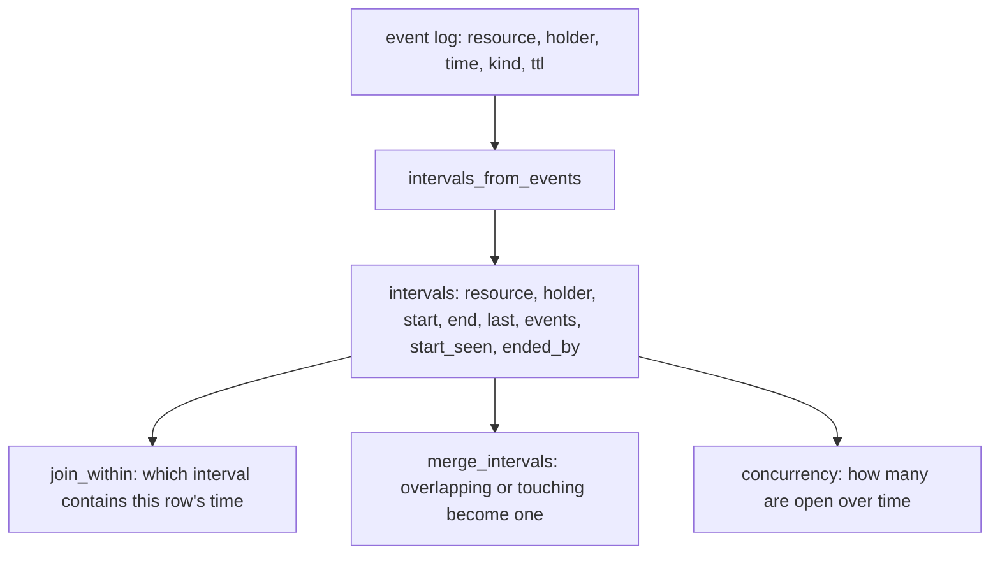

# Intervals

Generated from `src/jq_analytics/analytics.jq` and `docs/readout/notes/intervals.md`. Do not edit.

Six definitions. An interval is a row with a key, a start and an end, read as `[start, end)`: the start belongs to it, the end does not, and a null end means still open. `intervals_from_events` builds intervals from an event log; `join_within` finds the interval that contains a moment; `merge_intervals` and `concurrency` summarise a set of intervals.



In every call below a `;` separates the arguments, and the arguments without a `$` are filters run on each row: `intervals_from_events(.seat; .who; .t; .k; .ttl)` reads each event's resource from its `seat` field, its holder from `who`, and so on.

Two of the definitions, `intervals_from_events` and `merge_intervals`, share one loop pattern: a `foreach` that carries the open interval in `.cur` and hands finished intervals out through `.out`.

- The state is `{cur, out}`. Each step first sets `.out = []`, then puts the intervals that close at this step into `.out`.
- The third part of the `foreach`, `.out[]`, emits whatever closed at this step. Finished intervals leave as they close.
- The loop runs over `(.[], null)`: the rows, then one extra `null` as an end-of-data marker, so the interval still open after the last row has a step at which to leave.

A `reduce` that appends each finished interval to a result array copies that array on every append, and the cost grows with the square of the output. The `foreach` avoids that.

## _iv_check

The input check of `intervals_from_events`. It emits nothing; it exists to stop with an error, before any work is done, when an event's kind is not one of `open`, `hold`, `release` or null, or when an event with a kind has no time.

### The example

Three calls: clean events, an unknown kind, and a kind with no time.

```jq
([{t: 1, k: "hold"}, {t: null, k: null}] | [_iv_check(.t; .k)]),
(try ([{t: 1, k: "hold"}, {t: 2, k: "renew"}] | [_iv_check(.t; .k)]) catch .),
(try ([{t: null, k: "hold"}] | [_iv_check(.t; .k)]) catch .)
```

```json
[]
"intervals_from_events: event 1 has kind \"renew\"; expected \"open\", \"hold\", \"release\" or null"
"intervals_from_events: event 0 has a kind but no time"
```

The first emits nothing, so the array collected around it is empty; its second event has no time, but it has no kind either and is ignored. The messages name the event by its position, counting from 0, and carry the name of the public function.

### The definition

`_iv_check/2`, lines 770 to 777:

```jq
# an event's kind must be one of the three and, when it has a kind, it needs a time
def _iv_check(time; kind):
  to_entries[] | .key as $i | .value | (kind) as $k
  | if $k == null then empty
    elif $k != "open" and $k != "hold" and $k != "release"
    then error("intervals_from_events: event \($i) has kind \($k | tojson); expected \"open\", \"hold\", \"release\" or null")
    elif (time) == null then error("intervals_from_events: event \($i) has a kind but no time")
    else empty end;
```

- `to_entries[] | .key as $i | .value` walks the events with their position, so the message can say which event is wrong.
- `if $k == null then empty`: an event with no kind is skipped here, as the builder skips it.
- The two `elif` branches are the two errors. `else empty`: a good event emits nothing.
- `intervals_from_events` calls it as `([_iv_check(time; kind)] | length) as $_`. Collecting the empty output forces the check to run over every event, and binding the result to `$_` leaves the input as it was.

## intervals_from_events

Builds validity intervals from an event log: who held a resource (a seat, an address, a session id) and from when to when. A resource has at most one holder at a time. SQL has no single equivalent; it takes a chain of window functions.

Each event says one of three things in `kind`: `open` or `hold` is evidence that the holder has the resource at that time (a grant, a renewal, a keep-alive), and `release` means the holder gives it up. `ttl` is how many seconds a hold stays valid without another one, or null when holds do not expire.

### The example

Seven events on one seat:

| t | who | k | ttl |
|---|---|---|---|
| 0 | ann | open | 100 |
| 50 | ann | hold | 100 |
| 120 | bo | hold | 100 |
| 130 | ann | release | null |
| 200 | bo | release | null |
| 300 | cy | hold | 50 |
| 400 | cy | hold | 50 |

```jq
[{t: 0, who: "ann", k: "open", ttl: 100}, {t: 50, who: "ann", k: "hold", ttl: 100},
 {t: 120, who: "bo", k: "hold", ttl: 100}, {t: 130, who: "ann", k: "release", ttl: null},
 {t: 200, who: "bo", k: "release", ttl: null}, {t: 300, who: "cy", k: "hold", ttl: 50},
 {t: 400, who: "cy", k: "hold", ttl: 50}]
| map(.seat = "seat-7")
| intervals_from_events(.seat; .who; .t; .k; .ttl)
```

```json
[
  {"resource": "seat-7", "holder": "ann", "start": 0, "end": 120, "last": 50, "events": 2, "start_seen": true, "ended_by": "taken_over"},
  {"resource": "seat-7", "holder": "bo", "start": 120, "end": 200, "last": 120, "events": 1, "start_seen": false, "ended_by": "released"},
  {"resource": "seat-7", "holder": "cy", "start": 300, "end": 350, "last": 300, "events": 1, "start_seen": false, "ended_by": "lapsed"},
  {"resource": "seat-7", "holder": "cy", "start": 400, "end": 450, "last": 400, "events": 1, "start_seen": false, "ended_by": "open"}
]
```

Four intervals, and each ended in a different way, recorded in `ended_by`:

- ann, 0 to 120, `taken_over`: bo's hold at 120 arrived while ann's was still valid (until 150).
- bo, 120 to 200, `released`.
- cy, 300 to 350, `lapsed`: the hold at 300 was good for 50 seconds and the next event came at 400.
- cy, 400 to 450, `open`: still open when the data ends; its end is the last hold plus its ttl.

`last` is the time of the interval's last hold, `events` the number of opens and holds in it, and `start_seen` is true only when the first event was an `open`: a first `hold` may be a renewal of something that began before the data does.

### Reading the call

All five arguments are filters, each run on one event.

| Argument | In the example | Meaning |
|---|---|---|
| `resource` | `.seat` | the thing that is held |
| `holder` | `.who` | who holds it |
| `time` | `.t` | when the event happened |
| `kind` | `.k` | "open", "hold", "release", or null for an event to ignore |
| `ttl` | `.ttl` | seconds this hold stays valid, or null for no expiry |

### What happens inside, on the example

Step 1: `_iv_check` runs over the events (see above).

Step 2: events with a null kind are dropped, the rest are grouped by resource with `_groups`, and each resource's events are sorted by time and, at the same time, by kind in the order open, hold, release. The example is already in that order, so this run uses three other events to show the sort: a release and a hold logged in the same second, release first.

```jq
[{t: 10, who: "ann", k: "release"}, {t: 10, who: "ann", k: "hold"}, {t: 0, who: "ann", k: "open"}]
| sort_by([(.t), ((.k) as $k | if $k == "open" then 0 elif $k == "hold" then 1 else 2 end)])
```

```json
[
  {"t": 0, "who": "ann", "k": "open"},
  {"t": 10, "who": "ann", "k": "hold"},
  {"t": 10, "who": "ann", "k": "release"}
]
```

They apply as "held, then released", whichever line came first in the log.

Step 3: the loop, one step per event. The loop body cannot be run by itself, so this is a hand trace on the seven events:

| t | Event | What happens | Open interval afterwards |
|---|---|---|---|
| 0 | open, ann | nothing was open: start | ann, 0 to 100, 1 event, start seen |
| 50 | hold, ann | same holder: the end becomes the later of 100 and 50 + 100 | ann, 0 to 150, 2 events, last 50 |
| 120 | hold, bo | 120 is before 150, so no lapse. Another holder: ann's closes at 120 as `taken_over` | bo, 120 to 220, start not seen |
| 130 | release, ann | ann does not hold it: ignored | bo, 120 to 220 |
| 200 | release, bo | the holder releases: closes at 200 as `released` | none |
| 300 | hold, cy | nothing open: start | cy, 300 to 350 |
| 400 | hold, cy | 400 is at or past 350: cy's closes at 350 as `lapsed`, then a new one starts | cy, 400 to 450 |
| end marker | | the open one leaves as `open` | none |

The four intervals that close in the trace are the four rows of the result.

### The definition

`intervals_from_events/5`, lines 779 to 828:

```jq
# intervals_from_events: validity intervals built from an event log. A resource (an address, a
# seat, a session id) has at most one holder at a time. For each event, `kind` gives "open" or
# "hold" (evidence that `holder` has `resource` at `time`: a grant, a renewal, a start, a
# keep-alive), "release" (the holder gives it up), or null (ignored). `ttl` gives how many seconds
# a hold stays valid without another one, or null when holds do not expire.
#   - A hold opens an interval, or extends the open one when it is from the same holder: its end
#     becomes the later of its end and time + ttl (null when this hold's ttl is null).
#   - An interval ends in exactly one way, in `ended_by`: "released" (a release from its holder, at
#     that time), "taken_over" (a hold from another holder while it is still valid, at that time),
#     "lapsed" (its end passed before the next event on the resource), or "open" (still open at the
#     end of the data; its end is the last hold + ttl, or null).
#   - At the same time on one resource, events apply in the order open, hold, release. A release from someone
#     who does not hold the resource, or when nothing is held, is ignored.
#   - `start_seen` is true when the interval's first event was "open": a "hold" may be a renewal of
#     something that began before the data does.
# `last` is the time of the interval's last hold: the last evidence, which is what there is to go
# on when an open interval has no end.
# One row per interval: {resource, holder, start, end, last, events, start_seen, ended_by}; resources in
# order of first appearance, intervals in time order. Intervals of one resource never overlap.
# A kind other than the three, or a null time on an event with a kind, is an error naming the event.
def intervals_from_events(resource; holder; time; kind; ttl):
  ([_iv_check(time; kind)] | length) as $_
  | [map(select((kind) != null)) | _groups(resource)[]
     | (.[0] | resource) as $res
     | sort_by([(time), ((kind) as $k | if $k == "open" then 0 elif $k == "hold" then 1 else 2 end)])
     # one pass; closed intervals leave through .out as they close, so nothing is appended to a
     # growing array. The trailing null is the end-of-data marker.
     | foreach (.[], null) as $e ({cur: null, out: []};
         .out = []
         | if $e == null then
             (if .cur != null then .out = [.cur + {ended_by: "open"}] | .cur = null else . end)
           else
             ($e | time) as $t | ($e | kind) as $k | ($e | holder) as $h | ($e | ttl) as $ttl
             | (if .cur != null and .cur.end != null and $t >= .cur.end
                then .out += [.cur + {ended_by: "lapsed"}] | .cur = null else . end)
             | if $k == "release" then
                 (if .cur != null and .cur.holder == $h
                  then .out += [.cur + {end: $t, ended_by: "released"}] | .cur = null else . end)
               elif .cur != null and .cur.holder == $h then
                 .cur.events += 1 | .cur.last = $t
                 | .cur.end = (if $ttl == null then null elif .cur.end == null then $t + $ttl
                               else ([.cur.end, $t + $ttl] | max) end)
               else
                 (if .cur != null then .out += [.cur + {end: $t, ended_by: "taken_over"}] else . end)
                 | .cur = {resource: $res, holder: $h, start: $t,
                           end: (if $ttl == null then null else $t + $ttl end),
                           last: $t, events: 1, start_seen: ($k == "open")}
               end
           end;
         .out[])];
```

Before the loop:

- `map(select((kind) != null))` drops ignored events. `_groups(resource)[]` gives the events of each resource, resources in order of first appearance. `$res` is the group's resource.
- `sort_by([(time), (0, 1 or 2 for the kind)])` is the sort of step 2.

Each loop step, for event `$e` with time `$t`, kind `$k`, holder `$h`:

1. **Lapse.** `if .cur != null and .cur.end != null and $t >= .cur.end`: the open interval's validity ran out before this event. It closes as `lapsed` at the end it already had. `>=` because the end is outside the interval.
2. **Release.** If the current holder releases, the interval closes at `$t` as `released`. A release from anyone else, or with nothing open, changes nothing.
3. **The same holder again** (`open` or `hold`): the interval is extended. `events` and `last` are updated, and `end` becomes the later of the old end and `$t + $ttl`. A null `$ttl` on this event makes the end null: the newest evidence says it does not expire.
4. **Anyone else, or nothing open:** an open interval closes at `$t` as `taken_over`; then a new interval starts at `$t`, with `start_seen` true only when the kind is `open`.

At the end marker, an interval still open leaves with `ended_by: "open"` and the end its last hold gave it, which is null when that hold had no ttl. Intervals of one resource never overlap.

## join_within

A left outer join of rows that have a time to the interval of the same key that contains that time. It answers "who held this at time T". In SQL: `LEFT JOIN intervals i ON i.key = l.key AND l.t >= i.start AND (i.end IS NULL OR l.t < i.end)`.

### The example

Three intervals on seat s1, with a gap from 200 to 400 and no end on the last:

| seat | holder | start | end |
|---|---|---|---|
| s1 | ann | 0 | 120 |
| s1 | bo | 120 | 200 |
| s1 | cy | 400 | null |

Six left rows ask about the times 119, 120, 250, 9999, -5 and null.

```jq
[{seat: "s1", holder: "ann", start: 0, end: 120}, {seat: "s1", holder: "bo", start: 120, end: 200},
 {seat: "s1", holder: "cy", start: 400, end: null}] as $held
| [{at: 119}, {at: 120}, {at: 250}, {at: 9999}, {at: -5}, {at: null}]
| map(.seat = "s1")
| join_within($held; .seat; .seat; .at; .start; .end)
```

```json
[
  {"at": 119, "seat": "s1", "holder": "ann", "start": 0, "end": 120},
  {"at": 120, "seat": "s1", "holder": "bo", "start": 120, "end": 200},
  {"at": 250, "seat": "s1"},
  {"at": 9999, "seat": "s1", "holder": "cy", "start": 400, "end": null},
  {"at": -5, "seat": "s1"},
  {"at": null, "seat": "s1"}
]
```

119 is ann's last moment and 120 is bo's first: the end is outside the interval. 250 falls in the gap, so the left row comes back alone. cy's interval has no end, so it holds 9999. -5 is before every start, and a null time matches nothing.

When several intervals of a key contain the time, the one that started last is taken:

```jq
[{k: "s1", who: "long", start: 0, end: 100}, {k: "s1", who: "short", start: 10, end: 20}] as $iv
| [{k: "s1", at: 15}, {k: "s1", at: 50}] | join_within($iv; .k; .k; .at; .start; .end)
```

```json
[
  {"k": "s1", "at": 15, "who": "short", "start": 10, "end": 20},
  {"k": "s1", "at": 50, "who": "long", "start": 0, "end": 100}
]
```

At 15 both contain the time and `short` started later. At 50 only `long` does.

### Reading the call

| Argument | In the example | Runs on | Meaning |
|---|---|---|---|
| `$intervals` | `$held` | nothing: a value | the interval table |
| `lkey` | `.seat` | one left row | the left row's key |
| `rkey` | `.seat` | one interval | the interval's key |
| `ltime` | `.at` | one left row | the moment asked about |
| `rstart` | `.start` | one interval | the interval's start |
| `rend` | `.end` | one interval | the interval's end; null for still open |

### What happens inside, on the example

Step 1, the index `$ix`, built once: per key, the intervals sorted by start, with three parallel lists. `s` holds the starts. `e` holds the ends, a null end replaced by the largest number a double can hold, so an open interval contains every later time without a special case. `m` holds, for each position, the latest end among the intervals up to and including it. The run leaves out the fourth part, `rows`, the interval rows themselves.

```jq
[{seat: "s1", holder: "ann", start: 0, end: 120}, {seat: "s1", holder: "bo", start: 120, end: 200},
 {seat: "s1", holder: "cy", start: 400, end: null}]
| 1.7976931348623157e308 as $inf
| group_by(.seat)
| map(sort_by(.start) | {key: (.[0] | .seat | tojson), value: {s: map(.start), e: map(.end // $inf)}}
      | .value.m = [foreach .value.e[] as $x (null; if . == null or $x > . then $x else . end)])
| from_entries
```

```json
{
  "\"s1\"": {"s": [0, 120, 400], "e": [120, 200, 1.7976931348623157e+308], "m": [120, 200, 1.7976931348623157e+308]}
}
```

Step 2, per left row: a binary search of `s` for the time. jq's `bsearch` returns the position when the value is found, and `-1 - (where it would be inserted)` when it is not; `-2 - $i` turns the second form into the position of the last start below the time. The run shows both numbers for the five times.

```jq
[0, 120, 400] as $s
| [119, 120, 250, 9999, -5]
| map(. as $t | ($s | bsearch($t)) as $i | {t: $t, bsearch: $i, at: (if $i >= 0 then $i else -2 - $i end)})
```

```json
[
  {"t": 119, "bsearch": -2, "at": 0},
  {"t": 120, "bsearch": 1, "at": 1},
  {"t": 250, "bsearch": -3, "at": 1},
  {"t": 9999, "bsearch": -4, "at": 2},
  {"t": -5, "bsearch": -1, "at": -1}
]
```

Step 3: from that position, move forward while the next start is also at or before the time (several intervals can start at the same moment), then walk back until an interval's end is after the time. A hand trace for three of the times:

| Time | Position | Walk back | Result |
|---|---|---|---|
| 119 | 0 (ann) | ann's end 120 is after 119: stop | joined to ann |
| 250 | 1 (bo) | bo's end 200 is not after 250, and `m` at 1 is 200: no earlier interval ends after 250, stop | left row alone |
| -5 | -1 | before the first interval: stop | left row alone |

Step 4: a left row that stopped on an interval containing its time is merged with it by `_merge`, the same helper the flat joins use: a field on both sides with different values is an error.

### The definition

`join_within/6`, lines 830 to 854:

```jq
# join_within (left outer): each left row with the interval of the same key whose [rstart, rend)
# contains the left row's ltime; a null rend means still open. No such interval, or a null key or
# time on the left: the left row alone. When several intervals of a key contain the time, the one
# that started last. Merged like every flat join: a field on both sides with different values is
# an error. Use it for "who held this at T"; join_asof is for "the latest value at or before T".
def join_within($intervals; lkey; rkey; ltime; rstart; rend):
  1.7976931348623157e308 as $inf
  | ([$intervals[] | select((rkey) != null and (rstart) != null)] | group_by(rkey)
     | map(sort_by(rstart)
           | {key: (.[0] | rkey | tojson),
              value: {rows: ., s: map(rstart), e: map((rend) // $inf)}}
           # m[i]: the latest end among rows 0..i, so a search going back can stop early
           | .value.m = [foreach .value.e[] as $x (null; if . == null or $x > . then $x else . end)])
     | from_entries) as $ix
  | [.[] as $l | ($l | lkey) as $k | ($l | ltime) as $t
     | if $k == null or $t == null or $ix[$k | tojson] == null then $l
       else $ix[$k | tojson] as $g
       | ($g.s | bsearch($t)) as $i
       | (if $i >= 0 then $i else -2 - $i end) as $at
       # the last start <= $t (bsearch may land on any of several equal starts)
       | ($at | until(. + 1 >= ($g.s | length) or $g.s[. + 1] > $t; . + 1)) as $last
       # go back until an interval contains $t, or no earlier one can
       | ($last | until(. < 0 or $g.e[.] > $t or $g.m[.] <= $t; . - 1)) as $c
       | if $c >= 0 and $g.e[$c] > $t then _merge($l; $g.rows[$c]) else $l end
       end];
```

- `select((rkey) != null and (rstart) != null)`: intervals with no key or no start are left out of the index.
- `if $k == null or $t == null or $ix[$k | tojson] == null then $l`: a left row with no key, no time, or a key with no intervals comes back alone.
- `until(. + 1 >= ($g.s | length) or $g.s[. + 1] > $t; . + 1)` is the move forward to the last start at or before `$t`.
- `until(. < 0 or $g.e[.] > $t or $g.m[.] <= $t; . - 1)` is the walk back. It stops at the first interval whose end is after `$t`; that interval started at or before `$t`, so it contains it. Walking back from the last start is what makes the answer "the one that started last".
- `$g.m[.] <= $t` stops the walk as soon as no interval this far back can contain `$t`. Without `m`, a time that falls in a gap would walk to the front of the key's intervals. For intervals that do not overlap, which is what `intervals_from_events` produces, the walk is at most one step.

## _iv_order_check

The input check shared by `merge_intervals` and `concurrency`. It passes its input through unchanged, or stops with an error when an interval has no start, or an end before its start. A null end is allowed.

### The example

```jq
([{s: 1, e: null}] | _iv_order_check(.s; .e; "merge_intervals")),
([{s: 5, e: 3}] | try _iv_order_check(.s; .e; "merge_intervals") catch .),
([{s: null, e: 3}] | try _iv_order_check(.s; .e; "concurrency") catch .)
```

```json
[{"s":1,"e":null}]
"merge_intervals: an interval ends before it starts"
"concurrency: an interval has no start"
```

The first input is fine and comes back as it was. The other two are the two errors.

### The definition

`_iv_order_check/3`, lines 856 to 859:

```jq
# an interval needs a start, and an end that is not before it
def _iv_order_check(start; fin; $who):
  if any(.[]; (start) == null) then error("\($who): an interval has no start")
  elif any(.[]; (fin) != null and (fin) < (start)) then error("\($who): an interval ends before it starts") else . end;
```

`any(.[]; cond)` is true when the condition holds for at least one row. `$who` is the name of the calling function, for the message. `else .` returns the input.

## merge_intervals

Per key, intervals that overlap or touch become one. It turns a set of bookings into the stretches of time that are covered. In SQL this is the "gaps and islands" pattern.

### The example

| room | s | e |
|---|---|---|
| A | 1 | 3 |
| A | 3 | 5 |
| A | 8 | 9 |
| B | 2 | null |
| B | 7 | 8 |

```jq
[{room: "A", s: 1, e: 3}, {room: "A", s: 3, e: 5}, {room: "A", s: 8, e: 9},
 {room: "B", s: 2, e: null}, {room: "B", s: 7, e: 8}]
| merge_intervals({room}; .s; .e)
```

```json
[
  {"room": "A", "start": 1, "end": 5, "merged": 2},
  {"room": "A", "start": 8, "end": 9, "merged": 1},
  {"room": "B", "start": 2, "end": null, "merged": 2}
]
```

Room A's first two intervals touch at 3 and become 1 to 5, with `merged` 2; 8 to 9 stays alone. Room B's first interval has no end, so it absorbs the one that starts at 7, and the merged interval has no end either.

The key `{room}` is short for `{room: .room}` and gives the output its `room` column. A key that is not an object, such as `.room`, goes in a column called `key`:

```jq
[{room: "A", s: 1, e: 3}, {room: "A", s: 3, e: 5}] | merge_intervals(.room; .s; .e)
```

```json
[
  {"key": "A", "start": 1, "end": 5, "merged": 2}
]
```

### What happens inside, on the example

Step 1: `_iv_order_check` (above).

Step 2: `_groups(key)` gives one group per key, in order of first appearance, and each group is sorted by start.

```jq
[{room: "A", s: 1, e: 3}, {room: "A", s: 3, e: 5}, {room: "A", s: 8, e: 9},
 {room: "B", s: 2, e: null}, {room: "B", s: 7, e: 8}]
| _groups({room}) | map(sort_by(.s))
```

```json
[
  [{"room": "A", "s": 1, "e": 3}, {"room": "A", "s": 3, "e": 5}, {"room": "A", "s": 8, "e": 9}],
  [{"room": "B", "s": 2, "e": null}, {"room": "B", "s": 7, "e": 8}]
]
```

Step 3: the `foreach` described at the top of the page, once per group. A hand trace for room A:

| Interval | Test | Open interval afterwards | Leaves |
|---|---|---|---|
| 1 to 3 | nothing open | 1 to 3, merged 1 | |
| 3 to 5 | 3 is at or before the open end 3: joins | 1 to 5, merged 2 | |
| 8 to 9 | 8 is after 5: the open one leaves, a new one starts | 8 to 9, merged 1 | 1 to 5 |
| end marker | | none | 8 to 9 |

For room B, 7 to 8 joins because the open interval has no end.

### The definition

`merge_intervals/3`, lines 861 to 880:

```jq
# merge_intervals: per key, intervals that overlap or touch become one row
# {key..., start, end, merged (how many went in)}; keys in order of first appearance, intervals in
# time order. A null end is open-ended and absorbs everything of its key that starts after it.
def merge_intervals(key; start; fin):
  _iv_order_check(start; fin; "merge_intervals")
  | [_groups(key)[]
     | (.[0] | key | if type == "object" then . else {key: .} end) as $k
     | sort_by(start)
     | foreach (.[], null) as $r ({cur: null, out: []};
         .out = []
         | if $r == null then (if .cur != null then .out = [.cur] | .cur = null else . end)
           else ($r | start) as $s | ($r | fin) as $e
           | if .cur != null and (.cur.end == null or $s <= .cur.end)
             then .cur.merged += 1
                  | .cur.end = (if .cur.end == null or $e == null then null else ([.cur.end, $e] | max) end)
             else (if .cur != null then .out = [.cur] else . end)
                  | .cur = $k + {start: $s, end: $e, merged: 1}
             end
           end;
         .out[])];
```

- `$k` is the key as fields for the output row: the key itself when it is an object, otherwise `{key: value}`.
- `if .cur != null and (.cur.end == null or $s <= .cur.end)`: the join test. `<=`, not `<`, so an interval that starts exactly where the open one ends is merged with it.
- On a join, `merged` goes up by one and the end becomes the later of the two, or null if either is null.
- Otherwise the open interval goes to `.out` and `$r` starts a new one: `$k + {start: $s, end: $e, merged: 1}`.

## concurrency

How many intervals are open over time: one row `{t, open}` per moment the count changes. It answers "how many sessions were running at once".

### The example

| s | e |
|---|---|
| 1 | 5 |
| 2 | 5 |
| 5 | 9 |
| 7 | null |

```jq
[{s: 1, e: 5}, {s: 2, e: 5}, {s: 5, e: 9}, {s: 7, e: null}] | concurrency(.s; .e)
```

```json
[
  {"t": 1, "open": 1},
  {"t": 2, "open": 2},
  {"t": 5, "open": 1},
  {"t": 7, "open": 2},
  {"t": 9, "open": 1}
]
```

Read it as a step function: 1 open from time 1, 2 from time 2, back to 1 at 5, 2 again from 7, and 1 from 9 on. The interval with no end keeps the count at 1 after 9. The second parameter is called `fin` in the code because `end` is a jq keyword.

### What happens inside, on the example

Step 1: each interval becomes two small records, `+1` at its start and `-1` at its end. A null end gives no second record.

```jq
[{s: 1, e: 5}, {s: 2, e: 5}, {s: 5, e: 9}, {s: 7, e: null}]
| [.[] | {t: (.s), d: 1}, ((.e) as $e | if $e == null then empty else {t: $e, d: -1} end)]
```

```json
[
  {"t": 1, "d": 1},
  {"t": 5, "d": -1},
  {"t": 2, "d": 1},
  {"t": 5, "d": -1},
  {"t": 5, "d": 1},
  {"t": 9, "d": -1},
  {"t": 7, "d": 1}
]
```

Step 2, `group_by(.t)`: the records of one moment together, moments in time order. The run adds each group's net change, which the loop computes as `$net`.

```jq
[{s: 1, e: 5}, {s: 2, e: 5}, {s: 5, e: 9}, {s: 7, e: null}]
| [.[] | {t: (.s), d: 1}, ((.e) as $e | if $e == null then empty else {t: $e, d: -1} end)]
| group_by(.t) | map({t: .[0].t, net: (map(.d) | add)})
```

```json
[
  {"t": 1, "net": 1},
  {"t": 2, "net": 1},
  {"t": 5, "net": -1},
  {"t": 7, "net": 1},
  {"t": 9, "net": -1}
]
```

At 5 two intervals end and one starts: net -1.

Step 3: the `foreach` keeps a running sum of the net changes, 1, 2, 1, 2, 1, and emits `{t, open}` at each moment. That is the result at the top.

### The definition

`concurrency/2`, lines 882 to 891:

```jq
# concurrency: how many intervals are open over time: one row {t, open} per moment the count
# changes, in time order (`end` is a jq keyword, so the parameter is called fin). An interval counts from its start up to, not including, its end; one
# with a null end never stops counting. The peak is `concurrency(...) | max_by(.open)`.
def concurrency(start; fin):
  _iv_order_check(start; fin; "concurrency")
  | [.[] | {t: (start), d: 1}, ((fin) as $e | if $e == null then empty else {t: $e, d: -1} end)]
  | group_by(.t)
  | [foreach .[] as $g ({open: 0};
       ($g | map(.d) | add) as $net | {open: (.open + $net), t: $g[0].t, net: $net};
       select(.net != 0) | {t, open})];
```

- An interval counts from its start up to, not including, its end, because the `-1` lands exactly at the end.
- The `foreach` state is `{open, t, net}`; the first part of its body computes `$net` for the moment's group.
- `select(.net != 0) | {t, open}` emits a row only when the count changed. One interval ending exactly when another starts gives a net of 0 and no row.
- The peak is `concurrency(...) | max_by(.open)`.
