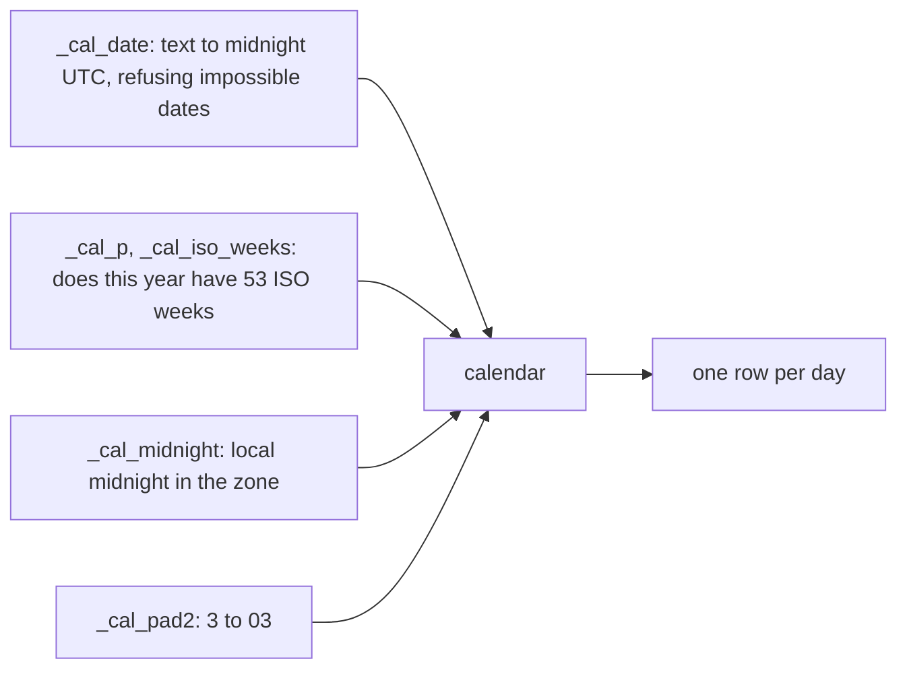

# Calendar

Generated from `src/jq_analytics/analytics.jq` and `docs/readout/notes/calendar.md`. Do not edit.

Eight definitions; six are small helpers of `calendar`, which makes one row per day. A day row carries the day's calendar fields (year, quarter, month, ISO week, US week) and the moments its local day starts and ends in a named zone, so a day is an interval and `join_within` can put an event in its day.



## _cal_bad, _cal_date

`_cal_bad/1`, line 886:

```jq
def _cal_bad($who): error("\($who): \(tojson) is not a date (YYYY-MM-DD)");
```

`_cal_date/1`, lines 888 to 893:

```jq
# "YYYY-MM-DD" as epoch seconds of that day's midnight UTC; an impossible date (2026-02-30) is an error
def _cal_date($who):
  . as $s
  | if type != "string" or (test("^[0-9]{4}-[0-9]{2}-[0-9]{2}$") | not) then _cal_bad($who)
    else (try (($s + "T00:00:00Z") | fromdateiso8601) catch null) as $e
    | if $e == null or ($e | gmtime | strftime("%Y-%m-%d")) != $s then ($s | _cal_bad($who)) else $e end
    end;
```

`_cal_date` turns `"YYYY-MM-DD"` into the moment of that day's midnight UTC.

- The pattern test refuses anything that is not ten characters of that form, and anything that is not a string.
- `try (… | fromdateiso8601) catch null`: some engines refuse an impossible date here.
- `($e | gmtime | strftime("%Y-%m-%d")) != $s`: the others accept `2026-02-30` and quietly carry it over to 2 March. Printing the result back and comparing it with the input catches that on every engine.
- `_cal_bad` is the one error message, with the caller's name in front.

```jq
["2026-03-08", "2026-02-30", "08/03/2026", 20260308] | map(try _cal_date("calendar") catch .)
```

```json
[1772928000,"calendar: \"2026-02-30\" is not a date (YYYY-MM-DD)","calendar: \"08/03/2026\" is not a date (YYYY-MM-DD)","calendar: 20260308 is not a date (YYYY-MM-DD)"]
```

This is the guard that `parse_ts` lacks (review finding 3).

## _cal_p, _cal_iso_weeks

`_cal_p/0`, line 894:

```jq
def _cal_p: (. + (. / 4 | floor) - (. / 100 | floor) + (. / 400 | floor)) % 7;
```

`_cal_iso_weeks/0`, line 895:

```jq
def _cal_iso_weeks: if _cal_p == 4 or ((. - 1) | _cal_p) == 3 then 53 else 52 end;   # ISO weeks in year .
```

Input: a year. `_cal_iso_weeks` gives the number of ISO weeks in it, 52 or 53.

`_cal_p` is the weekday of 31 December of the year (0 is Sunday), by the usual leap-year count: `(y + y/4 - y/100 + y/400) mod 7`, each division rounded down. An ISO year has 53 weeks when it ends on a Thursday (`_cal_p == 4`) or the year before it ended on a Wednesday, which means it starts on a Thursday (`(. - 1) | _cal_p == 3`).

```jq
[2015, 2020, 2021, 2026] | map({year: ., dec31_weekday: _cal_p, iso_weeks: _cal_iso_weeks})
```

```json
[
  {"year": 2015, "dec31_weekday": 4, "iso_weeks": 53},
  {"year": 2020, "dec31_weekday": 4, "iso_weeks": 53},
  {"year": 2021, "dec31_weekday": 5, "iso_weeks": 52},
  {"year": 2026, "dec31_weekday": 4, "iso_weeks": 53}
]
```

2020 ended on a Thursday (4) and has 53 weeks; 2026 starts on a Thursday (2025 ended on Wednesday, 3) and has 53 too.

## _cal_pad2

`_cal_pad2/0`, line 896:

```jq
def _cal_pad2: if . < 10 then "0\(.)" else tostring end;
```

A number below 10 gets a leading zero and becomes text; `"0\(.)"` is string interpolation. Used for `2026-03` and `2026-W09`.

```jq
[3, 12] | map(_cal_pad2)
```

```json
["03","12"]
```

## _cal_midnight

`_cal_midnight/1`, line 899:

```jq
# the moment whose local clock in zone $z reads the UTC date of the input at 00:00; the second step
# corrects a first guess that fell on the other side of a clock change
def _cal_midnight($z): . as $m | ($m - ($m | tz_offset($z))) as $e | $m - ($e | tz_offset($z));
```

Input: `$m`, midnight UTC of some date. Output: the moment at which clocks in zone `$z` read that date at 00:00.

Local midnight is `$m` minus the zone's offset, but the offset depends on the moment, and the moment is what is being looked for. Two steps:

1. `($m - ($m | tz_offset($z))) as $e`: a first guess, using the offset in force at `$m` itself.
2. `$m - ($e | tz_offset($z))`: the answer, using the offset in force at the guess.

The second step only changes anything when a clock change falls between `$m` and the guess. For the zones in the tables, changes happen in the small hours local time, and the guess is already right; the step is there so the function stays right for a zone that changes closer to midnight.

```jq
tz("America/Detroit") as $z
| ["2026-03-07", "2026-03-08", "2026-03-09"]
| map(_cal_date("x") as $m | {date: ., starts_utc: ($m | _cal_midnight($z) | todate),
                              hours_long: ((($m + 86400 | _cal_midnight($z)) - ($m | _cal_midnight($z))) / 3600)})
```

```json
[
  {"date": "2026-03-07", "starts_utc": "2026-03-07T05:00:00Z", "hours_long": 24},
  {"date": "2026-03-08", "starts_utc": "2026-03-08T05:00:00Z", "hours_long": 23},
  {"date": "2026-03-09", "starts_utc": "2026-03-09T04:00:00Z", "hours_long": 24}
]
```

8 March 2026 starts at 05:00 UTC, on winter time, and the next day starts at 04:00 UTC, on summer time: the day is 23 hours long.

## calendar

`calendar/3`, lines 911 to 932:

```jq
# calendar: one row per day from $from to $to inclusive (both "YYYY-MM-DD"), ignoring its input:
#   {date, year, quarter, month, day, weekday (0 = Sunday), day_of_year,
#    iso_year, iso_week   (weeks start Monday; week 1 holds the year's first Thursday; a day near
#                          New Year can belong to the neighbouring ISO year),
#    us_week              (weeks start Sunday; week 1 holds 1 January: a spreadsheet's WEEKNUM(d, 1)),
#    year_month "2026-03", year_quarter "2026-Q1", iso_year_week "2026-W09",
#    start, end}          epoch seconds of local midnight in $zone (a name or tz($name)) at the
#                         day's start and end, so a day is the interval [start, end): 23 or 25
#                         hours long when the clocks change, and join_within puts an event in its day.
# calendar($from; $to) is in UTC. Not a date, $from after $to, or an unknown zone: an error.
def calendar($from; $to; $zone):
  ($zone | if type == "string" then tz(.) else . end) as $z
  | ($from | _cal_date("calendar")) as $d0 | ($to | _cal_date("calendar")) as $d1
  | if $d0 > $d1 then error("calendar: from \($from | tojson) is after to \($to | tojson)")
    else
    [range(0; (($d1 - $d0) / 86400 | round) + 1) as $i
     | ($d0 + 86400 * $i) as $m | ($m | gmtime) as $g
     | ($g[0] | round) as $y | (($g[1] | round) + 1) as $mo | ($g[6] | round) as $wd | (($g[7] | round) + 1) as $doy
     | (if $wd == 0 then 7 else $wd end) as $dow
     | ((($doy - $dow + 10) / 7) | floor) as $w
     | (if $w < 1 then {y: ($y - 1), w: (($y - 1) | _cal_iso_weeks)}
        elif $w > ($y | _cal_iso_weeks) then {y: ($y + 1), w: 1}
        else {y: $y, w: $w} end) as $iso
     | ((($wd - ($doy - 1)) % 7 + 7) % 7) as $jan1
     | ((($mo - 1) / 3 | floor) + 1) as $q
     | {date: ($g | strftime("%Y-%m-%d")), year: $y, quarter: $q, month: $mo, day: ($g[2] | round),
        weekday: $wd, day_of_year: $doy, iso_year: $iso.y, iso_week: $iso.w,
        us_week: ((($doy + $jan1 - 1) / 7 | floor) + 1),
        year_month: "\($y)-\($mo | _cal_pad2)", year_quarter: "\($y)-Q\($q)",
        iso_year_week: "\($iso.y)-W\($iso.w | _cal_pad2)",
        start: ($m | _cal_midnight($z)), end: (($m + 86400) | _cal_midnight($z))}]
    end;
```

`calendar/2`, line 933:

```jq
def calendar($from; $to): calendar($from; $to; "UTC");
```

Ignores its input. One row per day from `$from` to `$to`.

- **Setup.** The zone is resolved once. Both dates go through `_cal_date`; `$from` after `$to` is an error.
- **`range(0; (($d1 - $d0) / 86400 | round) + 1) as $i`**: day numbers. `$m = $d0 + 86400 * $i` is that day's midnight UTC, always exact because UTC has no clock changes.
- **`($m | gmtime) as $g`** and the four `round`s: year, month, weekday, day of year. `round` is there because some engines return these fields as floats, and a float would print as `2026.0` inside `"\($y)-…"`.
- **ISO week.** `$dow` is the weekday with Monday 1 to Sunday 7. `$w = floor(($doy - $dow + 10) / 7)` is the standard formula. `$w < 1` means the day belongs to the last week of the previous year (52 or 53, from `_cal_iso_weeks`); `$w` above this year's week count means it belongs to week 1 of the next.
- **US week.** `$jan1` is the weekday of 1 January, worked back from today's weekday and day of year; the double `% 7 + 7) % 7` keeps it from going negative. Weeks start on Sunday and week 1 contains 1 January, so `us_week = floor(($doy + $jan1 - 1) / 7) + 1`.
- **`start`, `end`**: `_cal_midnight` of this day and of the next.

The two-parameter form is the same in UTC.

```jq
calendar("2020-12-31"; "2021-01-04") | map({date, weekday, iso_year_week, us_week, year_quarter})
```

```json
[
  {"date": "2020-12-31", "weekday": 4, "iso_year_week": "2020-W53", "us_week": 53, "year_quarter": "2020-Q4"},
  {"date": "2021-01-01", "weekday": 5, "iso_year_week": "2020-W53", "us_week": 1, "year_quarter": "2021-Q1"},
  {"date": "2021-01-02", "weekday": 6, "iso_year_week": "2020-W53", "us_week": 1, "year_quarter": "2021-Q1"},
  {"date": "2021-01-03", "weekday": 0, "iso_year_week": "2020-W53", "us_week": 2, "year_quarter": "2021-Q1"},
  {"date": "2021-01-04", "weekday": 1, "iso_year_week": "2021-W01", "us_week": 2, "year_quarter": "2021-Q1"}
]
```

Hand check. 31 December 2020 is a Thursday (4). Friday 1 January to Sunday 3 January 2021 still belong to ISO week 53 of 2020, since ISO weeks run Monday to Sunday and that week's Thursday is in 2020; Monday 4 January starts 2021-W01. In US weeks, 1 January is in week 1 by definition, and Sunday 3 January starts week 2.

```jq
calendar("2026-03-07"; "2026-03-09"; "America/Detroit") | map({date, hours: ((.end - .start) / 3600)}),
(try calendar("2026-03-09"; "2026-03-07") catch .)
```

```json
[{"date":"2026-03-07","hours":24},{"date":"2026-03-08","hours":23},{"date":"2026-03-09","hours":24}]
"calendar: from \"2026-03-09\" is after to \"2026-03-07\""
```
