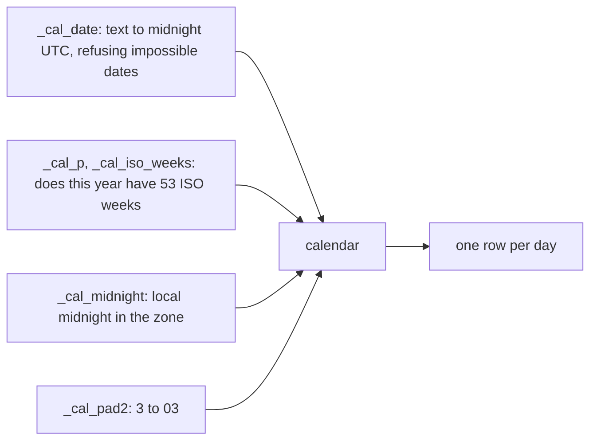

# Calendar

Generated from `src/jq_analytics/analytics.jq` and `docs/readout/notes/calendar.md`. Do not edit.

Eight definitions; six are small helpers of `calendar`, which makes one row per day. A day row carries the day's calendar fields (year, quarter, month, ISO week, US week) and the moments its local day starts and ends in a named zone, so a day is an interval and `join_within` can put an event in its day.



Times are epoch seconds: the number of seconds since 1970-01-01 00:00 UTC. A day is 86,400 of them.

On this page, in the order of the file:

| Function | Whose | What it is for |
|---|---|---|
| `_cal_bad`, `_cal_date` | Internal helpers, not for callers | `_cal_date` turns the text `"YYYY-MM-DD"` into the epoch seconds of that day's midnight UTC, and refuses anything that is not a real date |
| `_cal_p`, `_cal_iso_weeks` | Internal helpers, not for callers | Input: a year |
| `_cal_pad2` | Internal helper, not for callers | A number as text of at least two digits, for `2026-03` and `2026-W09` |
| `_cal_midnight` | Internal helper, not for callers | Input: `$m`, midnight UTC of some date |
| `calendar` | Public function | A date table: one row per day from `$from` to `$to`, both included |

---

## _cal_bad, _cal_date

**Internal helpers, not for callers** · `_cal_bad($who)`, `_cal_date($who)`

`_cal_date` turns the text `"YYYY-MM-DD"` into the epoch seconds of that day's midnight UTC, and refuses anything that is not a real date. `_cal_bad` is its one error message, with the caller's name in front.

### _cal_bad and the others: the example

A good date, an impossible one, the wrong format, and a number:

```jq
["2026-03-08", "2026-02-30", "08/03/2026", 20260308] | map(try _cal_date("calendar") catch .)
```

```json
[1772928000,"calendar: \"2026-02-30\" is not a date (YYYY-MM-DD)","calendar: \"08/03/2026\" is not a date (YYYY-MM-DD)","calendar: 20260308 is not a date (YYYY-MM-DD)"]
```

The first is midnight UTC of 8 March 2026. The other three are refused with the same message, each quoting its input.

### _cal_bad and the others: what happens inside, on the example

Step 1, the pattern test: the input must be a string of four digits, a dash, two digits, a dash, two digits. `"08/03/2026"` and the number stop here.

Step 2: `T00:00:00Z` is appended and jq's `fromdateiso8601` parses it. For the good date:

```jq
"2026-03-08" + "T00:00:00Z" | fromdateiso8601
```

```json
1772928000
```

Step 3, the round trip: the number is printed back as a date and compared with the input. `"2026-02-30"` passes the pattern, and some engines also accept it in step 2 and carry it over to 2 March. Printed back it no longer equals the input, so it is refused. The check, written out for the good date:

```jq
1772928000 | gmtime | strftime("%Y-%m-%d")
```

```json
"2026-03-08"
```

### _cal_bad and the others: the definition

`_cal_bad/1`, line 962:

```jq
def _cal_bad($who): error("\($who): \(tojson) is not a date (YYYY-MM-DD)");
```

Built into jq: `error`, `tojson`.

`_cal_date/1`, lines 963 to 969:

```jq
# "YYYY-MM-DD" as epoch seconds of that day's midnight UTC; an impossible date (2026-02-30) is an error
def _cal_date($who):
  . as $s
  | if type != "string" or (test("^[0-9]{4}-[0-9]{2}-[0-9]{2}$") | not) then _cal_bad($who)
    else (try (($s + "T00:00:00Z") | fromdateiso8601) catch null) as $e
    | if $e == null or ($e | gmtime | strftime("%Y-%m-%d")) != $s then ($s | _cal_bad($who)) else $e end
    end;
```

Built into jq: `fromdateiso8601`, `gmtime`, `not`, `strftime`, `test`, `type`. From this library: `_cal_bad`.

- `type != "string" or (test(...) | not)` is step 1.
- `try (...) catch null`: an engine that refuses an impossible date in `fromdateiso8601` gives null here; the others give a number. `$e == null or (... != $s)` treats both the same way, which makes the result equal on every engine.
- `($s | _cal_bad($who))`: `_cal_bad` builds its message from its input with `tojson`, so a string is quoted and a number is not.

---

## _cal_p, _cal_iso_weeks

**Internal helpers, not for callers** · `_cal_p`, `_cal_iso_weeks`

Input: a year. `_cal_iso_weeks` gives the number of ISO weeks in it, 52 or 53. `_cal_p` is the helper it is built from: the weekday of 31 December of the year, with 0 for Sunday.

### _cal_p and the others: the example

```jq
[2015, 2020, 2021, 2026] | map({year: ., dec31_weekday: _cal_p, iso_weeks: _cal_iso_weeks})
```

```json
[
  {"year": 2015, "dec31_weekday": 4, "iso_weeks": 53},
  {"year": 2020, "dec31_weekday": 4, "iso_weeks": 53},
  {"year": 2021, "dec31_weekday": 5, "iso_weeks": 52},
  {"year": 2026, "dec31_weekday": 4, "iso_weeks": 53}
]
```

2015, 2020 and 2026 end on a Thursday (4) and have 53 weeks. 2021 ends on a Friday (5) and did not start on a Thursday, so it has 52.

### _cal_p and the others: the definition

`_cal_p/0`, line 970:

```jq
def _cal_p: (. + (. / 4 | floor) - (. / 100 | floor) + (. / 400 | floor)) % 7;
```

Built into jq: `floor`.

`_cal_iso_weeks/0`, line 971:

```jq
def _cal_iso_weeks: if _cal_p == 4 or ((. - 1) | _cal_p) == 3 then 53 else 52 end;   # ISO weeks in year .
```

From this library: `_cal_p`.

- `_cal_p` is `(y + y/4 - y/100 + y/400) mod 7`, each division rounded down. One weekday step per year, and one more per leap year.
- An ISO week runs Monday to Sunday and belongs to the year that holds its Thursday. A year has 53 of them when it ends on a Thursday (`_cal_p == 4`) or starts on one, which is the same as the year before ending on a Wednesday (`(. - 1) | _cal_p == 3`).

---

## _cal_pad2

**Internal helper, not for callers** · `_cal_pad2`

A number as text of at least two digits, for `2026-03` and `2026-W09`.

### _cal_pad2: the example

```jq
[3, 12] | map(_cal_pad2)
```

```json
["03","12"]
```

### _cal_pad2: the definition

`_cal_pad2/0`, line 972:

```jq
def _cal_pad2: if . < 10 then "0\(.)" else tostring end;
```

Built into jq: `tostring`.

`"0\(.)"` is string interpolation: the text `0` followed by the input. A number of 10 or more goes through `tostring`.

---

## _cal_midnight

**Internal helper, not for callers** · `_cal_midnight($z)`

Input: `$m`, midnight UTC of some date. Output: the moment at which clocks in zone `$z` read that same date at 00:00. `calendar` uses it for a day's `start` and `end`.

### _cal_midnight: the example

Three days around a clock change. In the zone `America/Detroit`, clocks go forward one hour on 8 March 2026. For each date the run shows when the local day starts, in UTC, and how long it is.

```jq
tz("America/Detroit") as $z
| ["2026-03-07", "2026-03-08", "2026-03-09"]
| map(_cal_date("x") as $m
      | {date: ., starts_utc: ($m | _cal_midnight($z) | todate),
         hours_long: ((($m + 86400 | _cal_midnight($z)) - ($m | _cal_midnight($z))) / 3600)})
```

```json
[
  {"date": "2026-03-07", "starts_utc": "2026-03-07T05:00:00Z", "hours_long": 24},
  {"date": "2026-03-08", "starts_utc": "2026-03-08T05:00:00Z", "hours_long": 23},
  {"date": "2026-03-09", "starts_utc": "2026-03-09T04:00:00Z", "hours_long": 24}
]
```

8 March starts at 05:00 UTC, on winter time, five hours behind UTC. The next day starts at 04:00 UTC, on summer time. So 8 March is 23 hours long.

### _cal_midnight: what happens inside, on the example

Local midnight is `$m` minus the zone's offset from UTC. The offset depends on the moment, and the moment is what is being looked for, so the function guesses and then corrects. For 8 March:

```jq
tz("America/Detroit") as $z | ("2026-03-08" | _cal_date("x")) as $m
| ($m | tz_offset($z)) as $o1 | ($m - $o1) as $guess | ($guess | tz_offset($z)) as $o2
| {m: $m, offset_at_m: $o1, guess: $guess, offset_at_guess: $o2, result: ($m - $o2)}
```

```json
{
  "m": 1772928000,
  "offset_at_m": -18000,
  "guess": 1772946000,
  "offset_at_guess": -18000,
  "result": 1772946000
}
```

Step 1: the offset in force at `$m` is -18000 seconds (five hours behind), so the guess is `$m` plus 18000. Step 2: the offset in force at the guess is the same, so the result equals the guess.

### _cal_midnight: the definition

`_cal_midnight/1`, lines 973 to 975:

```jq
# the moment whose local clock in zone $z reads the UTC date of the input at 00:00; the second step
# corrects a first guess that fell on the other side of a clock change
def _cal_midnight($z): . as $m | ($m - ($m | tz_offset($z))) as $e | $m - ($e | tz_offset($z));
```

From this library: `tz_offset`.

- `($m - ($m | tz_offset($z))) as $e` is the guess. `$m - ($e | tz_offset($z))` is the answer, using the offset at the guess.
- The second step changes the answer only when a clock change falls between `$m` and the guess. In the example the change is at 2 in the morning local time, after local midnight, so the guess is already right. The step keeps the function right for a zone that changes closer to midnight.

---

## calendar

**Public function** · `calendar($from; $to; $zone)`, `calendar($from; $to)`

A date table: one row per day from `$from` to `$to`, both included. It ignores its input. A report joins events to it to get weeks, quarters and day boundaries, the way a SQL warehouse uses a date dimension. The two-argument form is the same in UTC.

### calendar: the example

One day in full:

```jq
calendar("2021-01-01"; "2021-01-01") | .[0]
```

```json
{
  "date": "2021-01-01",
  "year": 2021,
  "quarter": 1,
  "month": 1,
  "day": 1,
  "weekday": 5,
  "day_of_year": 1,
  "iso_year": 2020,
  "iso_week": 53,
  "us_week": 1,
  "year_month": "2021-01",
  "year_quarter": "2021-Q1",
  "iso_year_week": "2020-W53",
  "start": 1609459200,
  "end": 1609545600
}
```

1 January 2021 is a Friday (`weekday` 5, with 0 for Sunday). `iso_year` and `iso_week` say 2020 and 53: ISO weeks run Monday to Sunday, and this week's Thursday is 31 December 2020. `us_week` is 1: US weeks start on Sunday and week 1 is the one that holds 1 January. `start` and `end` are the day's first moment and the next day's, so the day is the interval `[start, end)`.

Five days across that New Year, with the week columns picked out:

```jq
calendar("2020-12-31"; "2021-01-04") | map({date, weekday, iso_year_week, us_week, year_quarter})
```

```json
[
  {"date": "2020-12-31", "weekday": 4, "iso_year_week": "2020-W53", "us_week": 53, "year_quarter": "2020-Q4"},
  {"date": "2021-01-01", "weekday": 5, "iso_year_week": "2020-W53", "us_week": 1, "year_quarter": "2021-Q1"},
  {"date": "2021-01-02", "weekday": 6, "iso_year_week": "2020-W53", "us_week": 1, "year_quarter": "2021-Q1"},
  {"date": "2021-01-03", "weekday": 0, "iso_year_week": "2020-W53", "us_week": 2, "year_quarter": "2021-Q1"},
  {"date": "2021-01-04", "weekday": 1, "iso_year_week": "2021-W01", "us_week": 2, "year_quarter": "2021-Q1"}
]
```

Hand check. Friday 1 to Sunday 3 January still belong to 2020-W53; Monday 4 January starts 2021-W01. In US weeks, Sunday 3 January starts week 2.

With a zone, `start` and `end` are local midnights:

```jq
calendar("2026-03-07"; "2026-03-09"; "America/Detroit") | map({date, start, end, hours: ((.end - .start) / 3600)})
```

```json
[
  {"date": "2026-03-07", "start": 1772859600, "end": 1772946000, "hours": 24},
  {"date": "2026-03-08", "start": 1772946000, "end": 1773028800, "hours": 23},
  {"date": "2026-03-09", "start": 1773028800, "end": 1773115200, "hours": 24}
]
```

Each day ends where the next starts, and 8 March is 23 hours long.

Refused: a `$from` after `$to`, a zone the tables do not have, and anything `_cal_date` refuses.

```jq
(try calendar("2026-03-09"; "2026-03-07") catch .),
(try calendar("2026-03-07"; "2026-03-09"; "Mars/Base") catch .)
```

```json
"calendar: from \"2026-03-09\" is after to \"2026-03-07\""
"tz: zone not in the zone tables: Mars/Base"
```

### calendar: reading the call

All three arguments are values.

| Argument | In the example | Meaning |
|---|---|---|
| `$from` | `"2026-03-07"` | the first day, as "YYYY-MM-DD" |
| `$to` | `"2026-03-09"` | the last day, included |
| `$zone` | `"America/Detroit"` | a zone name, or the result of `tz(name)`; decides `start` and `end` only |

### calendar: what happens inside, on the example

Step 1: both dates go through `_cal_date`, giving `$d0` and `$d1`, and `range` numbers the days from 0. Day `$i` has midnight UTC `$m = $d0 + 86400 * $i`, which is exact because UTC has no clock changes.

Step 2: `$m | gmtime` breaks the moment into year, month, weekday and day of year, and the week numbers are worked out from those. The run shows the intermediate values for three of the five days: `wd` the weekday with Sunday 0, `doy` the day of the year, `dow` the weekday with Monday 1 to Sunday 7, `w` the first ISO week number, `weeks_in_y` from `_cal_iso_weeks`, and `jan1` the weekday of 1 January.

```jq
["2020-12-31", "2021-01-01", "2021-01-04"]
| map(. as $d | (_cal_date("x") | gmtime) as $g
      | ($g[0] | round) as $y | ($g[6] | round) as $wd | (($g[7] | round) + 1) as $doy
      | (if $wd == 0 then 7 else $wd end) as $dow
      | {date: $d, y: $y, wd: $wd, doy: $doy, dow: $dow, w: ((($doy - $dow + 10) / 7) | floor),
         weeks_in_y: ($y | _cal_iso_weeks), jan1: ((($wd - ($doy - 1)) % 7 + 7) % 7)})
```

```json
[
  {"date": "2020-12-31", "y": 2020, "wd": 4, "doy": 366, "dow": 4, "w": 53, "weeks_in_y": 53, "jan1": 3},
  {"date": "2021-01-01", "y": 2021, "wd": 5, "doy": 1, "dow": 5, "w": 0, "weeks_in_y": 52, "jan1": 5},
  {"date": "2021-01-04", "y": 2021, "wd": 1, "doy": 4, "dow": 1, "w": 1, "weeks_in_y": 52, "jan1": 5}
]
```

Step 3, the ISO week from `w`. For 1 January 2021, `w` is floor((1 - 5 + 10) / 7) = 0. A `w` below 1 means the day belongs to the last week of the year before, and 2020 has 53 weeks: 2020-W53. For 31 December 2020, `w` is floor((366 - 4 + 10) / 7) = 53, which 2020 has, so it stays. A `w` above the year's week count would mean week 1 of the next year.

Step 4, the US week: floor((doy + jan1 - 1) / 7) + 1. For 4 January 2021, floor((4 + 5 - 1) / 7) + 1 = 2.

Step 5: `start` is `_cal_midnight` of `$m` and `end` is `_cal_midnight` of `$m + 86400`.

### calendar: the definition

`calendar/3`, lines 977 to 1008:

```jq
# calendar: one row per day from $from to $to inclusive (both "YYYY-MM-DD"), ignoring its input:
#   {date, year, quarter, month, day, weekday (0 = Sunday), day_of_year,
#    iso_year, iso_week   (weeks start Monday; week 1 holds the year's first Thursday; a day near
#                          New Year can belong to the neighbouring ISO year),
#    us_week              (weeks start Sunday; week 1 holds 1 January: a spreadsheet's WEEKNUM(d, 1)),
#    year_month "2026-03", year_quarter "2026-Q1", iso_year_week "2026-W09",
#    start, end}          epoch seconds of local midnight in $zone (a name or tz($name)) at the
#                         day's start and end, so a day is the interval [start, end): 23 or 25
#                         hours long when the clocks change, and join_within puts an event in its day.
# calendar($from; $to) is in UTC. Not a date, $from after $to, or an unknown zone: an error.
def calendar($from; $to; $zone):
  ($zone | if type == "string" then tz(.) else . end) as $z
  | ($from | _cal_date("calendar")) as $d0 | ($to | _cal_date("calendar")) as $d1
  | if $d0 > $d1 then error("calendar: from \($from | tojson) is after to \($to | tojson)")
    else
    [range(0; (($d1 - $d0) / 86400 | round) + 1) as $i
     | ($d0 + 86400 * $i) as $m | ($m | gmtime) as $g
     | ($g[0] | round) as $y | (($g[1] | round) + 1) as $mo | ($g[6] | round) as $wd | (($g[7] | round) + 1) as $doy
     | (if $wd == 0 then 7 else $wd end) as $dow
     | ((($doy - $dow + 10) / 7) | floor) as $w
     | (if $w < 1 then {y: ($y - 1), w: (($y - 1) | _cal_iso_weeks)}
        elif $w > ($y | _cal_iso_weeks) then {y: ($y + 1), w: 1}
        else {y: $y, w: $w} end) as $iso
     | ((($wd - ($doy - 1)) % 7 + 7) % 7) as $jan1
     | ((($mo - 1) / 3 | floor) + 1) as $q
     | {date: ($g | strftime("%Y-%m-%d")), year: $y, quarter: $q, month: $mo, day: ($g[2] | round),
        weekday: $wd, day_of_year: $doy, iso_year: $iso.y, iso_week: $iso.w,
        us_week: ((($doy + $jan1 - 1) / 7 | floor) + 1),
        year_month: "\($y)-\($mo | _cal_pad2)", year_quarter: "\($y)-Q\($q)",
        iso_year_week: "\($iso.y)-W\($iso.w | _cal_pad2)",
        start: ($m | _cal_midnight($z)), end: (($m + 86400) | _cal_midnight($z))}]
    end;
```

Built into jq: `error`, `floor`, `gmtime`, `range`, `round`, `strftime`, `tojson`, `type`. From this library: `_cal_date`, `_cal_iso_weeks`, `_cal_midnight`, `_cal_pad2`, `tz`.

`calendar/2`, line 1009:

```jq
def calendar($from; $to): calendar($from; $to; "UTC");
```

- `$zone | if type == "string" then tz(.) else . end` resolves the zone once, and is where an unknown zone stops.
- `range(0; (($d1 - $d0) / 86400 | round) + 1) as $i` emits the day numbers; one row is built per number.
- The `round`s on the `gmtime` fields are there because some engines return them as floats, and a float would print as `2026.0` inside `"\($y)-..."`. `gmtime` counts months and days of the year from 0, hence the `+ 1`.
- `$w = floor(($doy - $dow + 10) / 7)` is the standard ISO week formula. The `if` after it is step 3.
- `$jan1`: the weekday of 1 January, worked back from this day's weekday and day of year. The double `% 7 + 7) % 7` keeps it from going negative.
- `$q = floor(($mo - 1) / 3) + 1` is the quarter.
- `def calendar($from; $to): calendar($from; $to; "UTC");` is the two-argument form.
