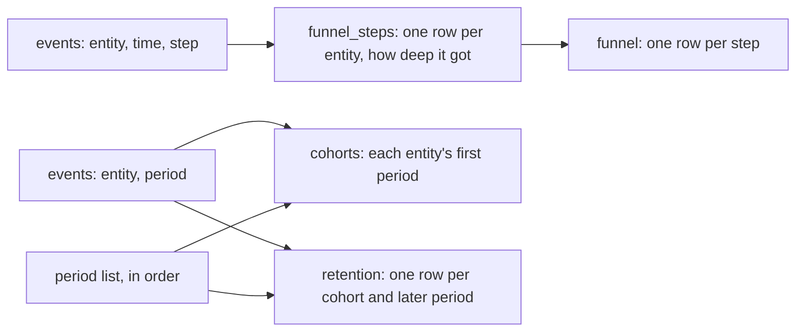

# Event paths: funnels, cohorts, retention

Generated from `src/jq_analytics/analytics.jq` and `docs/readout/notes/event-paths.md`. Do not edit.

Eight definitions: four public (`funnel_steps`, `funnel`, `cohorts`, `retention`) and four helpers.



## _entity_key

`_entity_key/0`, line 946:

```jq
def _entity_key: if type == "object" then . else {key: .} end;
```

An object stays as it is; anything else becomes `{key: value}`. The same rule `group_agg` applies, as a named helper.

```jq
[{user: "u1"}, "u1"] | map(_entity_key)
```

```json
[
  {"user": "u1"},
  {"key": "u1"}
]
```

## _funnel_check

`_funnel_check/3`, lines 948 to 954:

```jq
def _funnel_check(time; step; $steps):
  if ($steps | length) == 0 then error("funnel: the step list is empty")
  elif ($steps | unique | length) != ($steps | length)
  then error("funnel: step \($steps | group_by(.) | map(select(length > 1)[0])[0] | tojson) is listed twice")
  else (first(.[] | select((step) as $s | any($steps[]; . == $s) and (time) == null) | [step]) // null) as $bad
    | if $bad != null then error("funnel: an event of step \($bad[0] | tojson) has no time") else . end
  end;
```

Passes its input through, or stops with an error, before any work:

- an empty step list;
- a step listed twice: `unique | length` differs from `length`, and `group_by(.) | map(select(length > 1)[0])[0]` finds one repeated name for the message;
- an event of a listed step with a null time. `first(… | [step]) // null` wraps the step in an array so that a step whose name is `false` or null would still count as found.

```jq
[{t: 1, s: "view"}] | (try _funnel_check(.t; .s; ["view", "pay", "view"]) catch .), (try _funnel_check(.t; .s; []) catch .)
```

```json
"funnel: step \"view\" is listed twice"
"funnel: the step list is empty"
```

## funnel_steps

`funnel_steps/5`, lines 965 to 984:

```jq
# funnel_steps: how far each entity gets through the ordered steps in $steps. An entity reaches
# step n when it has events for steps 1 to n in time order (a later step at the same time as the
# one before counts). With $within (seconds; null for no limit) every step must happen within that
# long of the entity's first step, and the entity is credited with the deepest chain any of its
# first-step events can start: an early first step that times out does not hide a later one that
# completes. One row per entity that reaches step 1, entities in order of first appearance:
# {entity key..., depth (1 to the number of steps), times (the time of each step reached)}.
# Events whose step is not listed are ignored. An empty step list, a step listed twice, or a null
# time on an event of a listed step is an error.
def funnel_steps(entity; time; step; $steps; $within):
  _funnel_check(time; step; $steps)
  | ($steps | length) as $n
  | [map(select((step) as $s | any($steps[]; . == $s))) | _groups(entity)[]
     | (.[0] | entity | _entity_key) as $k
     | (. as $ev | [$steps[] as $s | [$ev[] | select((step) == $s) | time] | sort]) as $t
     | (reduce $t[0][] as $t1 (null;
          if . != null and length == $n then .
          else (if $within == null then null else $t1 + $within end) as $lim
            # for a fixed first event the earliest matching event is always the best next step:
            # a later one can only remove options for the steps after it
            | (reduce range(1; $n) as $i ({c: [$t1], ok: true};
                 if .ok | not then .
                 else .c[-1] as $prev
                   | (first($t[$i][] | select(. >= $prev and ($lim == null or . <= $lim)) | [.]) // null) as $x
                   | if $x == null then .ok = false else .c += $x end
                 end) | .c) as $chain
            | if . == null or ($chain | length) > length then $chain else . end
          end)) as $best
     | select($best != null) | $k + {depth: ($best | length), times: $best}];
```

One row per entity that reaches step 1, with how deep it got.

- **Per entity.** Events of unlisted steps are dropped, then `_groups(entity)`. `$t` is, for each step in order, the sorted list of that entity's times for the step: `$t[0]` the first step's times, `$t[1]` the second's.
- **Outer `reduce` over `$t[0]`**, the first-step events, earliest first. Its state is the best chain so far. `if . != null and length == $n then .` stops trying once a complete chain is found.
- **Inner `reduce` over the later steps.** `$lim` is the first event's time plus `$within`. For step `$i`, `first($t[$i][] | select(. >= $prev and …) | [.])` takes the earliest time of that step at or after the previous step's time and within the limit. Found: appended to the chain. Not found: `.ok = false` and the chain ends there.
- **`if . == null or ($chain | length) > length then $chain else . end`**: keep the longer chain; on a tie, the earlier one.
- `>=`, not `>`: two steps logged at the same moment count as in order.

Taking the earliest matching event at every step is safe: for a fixed first event, an earlier next step leaves at least as many choices for the steps after it as a later one would.

Five made-up users, steps view, cart, pay, all within an hour (3,600 s):

| user | events | depth | why |
|---|---|---|---|
| u1 | view 0, cart 100, pay 200 | 3 | in order, within the hour |
| u2 | view 0, pay 50, cart 60 | 2 | pay came before cart; no pay after the cart |
| u3 | view 0, cart 5000 | 1 | the cart is outside the hour |
| u4 | view 0, view 4000, cart 4100, pay 4200 | 3 | the first view times out; the second completes |
| u5 | cart 10, pay 20 | | never viewed: not in the output |

```jq
[["u1", 0, "view"], ["u1", 100, "cart"], ["u1", 200, "pay"], ["u2", 0, "view"], ["u2", 50, "pay"], ["u2", 60, "cart"],
 ["u3", 0, "view"], ["u3", 5000, "cart"], ["u4", 0, "view"], ["u4", 4000, "view"], ["u4", 4100, "cart"], ["u4", 4200, "pay"],
 ["u5", 10, "cart"], ["u5", 20, "pay"]]
| map({user: .[0], t: .[1], step: .[2]})
| funnel_steps({user}; .t; .step; ["view", "cart", "pay"]; 3600)
```

```json
[
  {"user": "u1", "depth": 3, "times": [0, 100, 200]},
  {"user": "u2", "depth": 2, "times": [0, 60]},
  {"user": "u3", "depth": 1, "times": [0]},
  {"user": "u4", "depth": 3, "times": [4000, 4100, 4200]}
]
```

## funnel

`funnel/5`, lines 989 to 995:

```jq
# funnel: one row per step, in order: {step, entities (how many reached it), from_previous,
# from_first}: the count divided by the previous step's and by the first step's; null where the
# divisor is zero, and from_previous is null on the first step. A funnel only narrows.
def funnel(entity; time; step; $steps; $within):
  (funnel_steps(entity; time; step; $steps; $within) | map(.depth)) as $d
  | [range(0; $steps | length) as $i | ($d | map(select(. > $i)) | length)] as $c
  | [range(0; $steps | length) as $i
     | {step: $steps[$i], entities: $c[$i],
        from_previous: (if $i == 0 or $c[$i - 1] == 0 then null else $c[$i] / $c[$i - 1] end),
        from_first: (if $c[0] == 0 then null else $c[$i] / $c[0] end)}];
```

Counts from `funnel_steps`. `$d` is every entity's depth; `$c[$i]` is how many have depth above `$i`, that is, reached step `$i + 1`. The two ratios divide by the previous step's count and the first step's, with null where the divisor is zero.

```jq
[["u1", 0, "view"], ["u1", 100, "cart"], ["u1", 200, "pay"], ["u2", 0, "view"], ["u2", 50, "pay"], ["u2", 60, "cart"],
 ["u3", 0, "view"], ["u3", 5000, "cart"], ["u4", 0, "view"], ["u4", 4000, "view"], ["u4", 4100, "cart"], ["u4", 4200, "pay"],
 ["u5", 10, "cart"], ["u5", 20, "pay"]]
| map({user: .[0], t: .[1], step: .[2]})
| funnel({user}; .t; .step; ["view", "cart", "pay"]; 3600)
| map(.from_previous |= (if . == null then null else round_to(4) end))
```

```json
[
  {"step": "view", "entities": 4, "from_previous": null, "from_first": 1},
  {"step": "cart", "entities": 3, "from_previous": 0.75, "from_first": 0.75},
  {"step": "pay", "entities": 2, "from_previous": 0.6667, "from_first": 0.5}
]
```

Four viewed, three of them reached the cart, two paid.

## _period_pos, _period_idx

`_period_pos/0`, line 997:

```jq
def _period_pos: . as $p | reduce range(0; length) as $i ({}; .[$p[$i] | tojson] = $i);
```

`_period_idx/3`, lines 998 to 1000:

```jq
def _period_idx(period; $pos; $who):
  (period) as $p | $pos[$p | tojson] as $i
  | if $i == null then error("\($who): period \($p | tojson) is not in the period list") else $i end;
```

`_period_pos` turns the ordered period list into a lookup from period (through `tojson`) to position. `_period_idx` looks one event's period up in it and raises an error, under the caller's name, when the period is not in the list. Positions are what make "earlier" and "later" mean the order of the list, not the order of the values.

```jq
["2026-01", "2026-02", "2026-03"] | _period_pos as $pos
| [{p: "2026-03"}, {p: "2025-12"}] | map(try _period_idx(.p; $pos; "cohorts") catch .)
```

```json
[2,"cohorts: period \"2025-12\" is not in the period list"]
```

## cohorts

`cohorts/3`, lines 1005 to 1007:

```jq
# cohorts: one row per entity, in order of first appearance: {entity key..., cohort}, the earliest
# period, in $periods order, in which it has an event. $periods is every period in order, for
# example calendar(...) | map(.year_month) | unique. A period not in the list is an error.
def cohorts(entity; period; $periods):
  ($periods | _period_pos) as $pos
  | [_groups(entity)[] | (.[0] | entity | _entity_key) + {cohort: $periods[map(_period_idx(period; $pos; "cohorts")) | min]}];
```

One row per entity: its key and `cohort`, the earliest period in which it has an event. `map(_period_idx(…)) | min` is the smallest position among the entity's events, and `$periods[…]` turns it back into the period.

```jq
[["a", "2026-02"], ["a", "2026-01"], ["b", "2026-01"], ["b", "2026-03"], ["c", "2026-02"]]
| map({user: .[0], month: .[1]})
| cohorts({user}; .month; ["2026-01", "2026-02", "2026-03"])
```

```json
[
  {"user": "a", "cohort": "2026-01"},
  {"user": "b", "cohort": "2026-01"},
  {"user": "c", "cohort": "2026-02"}
]
```

## retention

`retention/3`, lines 1014 to 1023:

```jq
# retention: of the entities first seen in a period (a cohort), how many have at least one event
# in each later period. One row per cohort and period, from the cohort's own period to the last in
# $periods: {cohort, period, offset (periods after the cohort's; 0 for its own), entities,
# cohort_size, rate (entities / cohort_size)}. The table is complete: a period in which nobody of
# the cohort is active has a row with 0. Periods with no first-time entities form no cohort.
def retention(entity; period; $periods):
  ($periods | _period_pos) as $pos
  | [_groups(entity)[] | map(_period_idx(period; $pos; "retention")) | {c: min, a: unique}] as $e
  | ($periods | length) as $np
  | ($e | group_by(.c) | map({key: (.[0].c | tostring), value: .}) | from_entries) as $byc
  | [range(0; $np) as $c | ($byc[$c | tostring] // []) as $m | select(($m | length) > 0)
     | ($m | [.[].a[]] | group_by(.) | map({key: (.[0] | tostring), value: length}) | from_entries) as $cnt
     | range($c; $np) as $p | ($cnt[$p | tostring] // 0) as $n
     | {cohort: $periods[$c], period: $periods[$p], offset: ($p - $c), entities: $n,
        cohort_size: ($m | length), rate: ($n / ($m | length))}];
```

- `$e`: per entity, `{c: its cohort position, a: the distinct positions in which it is active}`.
- `$byc`: the entities grouped by cohort position, built once.
- For each period position `$c` that is some entity's cohort: `$m` is that cohort's entities, one lookup in `$byc`, and `$cnt` counts, per position, how many of them are active there (`[.[].a[]] | group_by(.)`).
- `range($c; $np) as $p` then emits one row for every period from the cohort's own to the last, with `$cnt[$p] // 0`, so a period in which nobody came back still has its row.

Hand check: a is active in January, February and March, b in January and March, c in February only. The January cohort is a and b: 2 of 2 in January, 1 of 2 in February, 2 of 2 in March. The February cohort is c: 1 of 1, then 0 of 1.

```jq
[["a", "2026-01"], ["a", "2026-02"], ["a", "2026-03"], ["b", "2026-01"], ["b", "2026-03"], ["c", "2026-02"]]
| map({user: .[0], month: .[1]})
| retention({user}; .month; ["2026-01", "2026-02", "2026-03"])
```

```json
[
  {"cohort": "2026-01", "period": "2026-01", "offset": 0, "entities": 2, "cohort_size": 2, "rate": 1},
  {"cohort": "2026-01", "period": "2026-02", "offset": 1, "entities": 1, "cohort_size": 2, "rate": 0.5},
  {"cohort": "2026-01", "period": "2026-03", "offset": 2, "entities": 2, "cohort_size": 2, "rate": 1},
  {"cohort": "2026-02", "period": "2026-02", "offset": 0, "entities": 1, "cohort_size": 1, "rate": 1},
  {"cohort": "2026-02", "period": "2026-03", "offset": 1, "entities": 0, "cohort_size": 1, "rate": 0}
]
```

**Review finding 10, fixed in 0.9.0.** Until 0.8.1 every entity was scanned once for every period. The entities are now grouped by cohort once. In the Python `jq` package, 40,000 entities over 365 periods took 18.6 s before and 1.31 s after.
