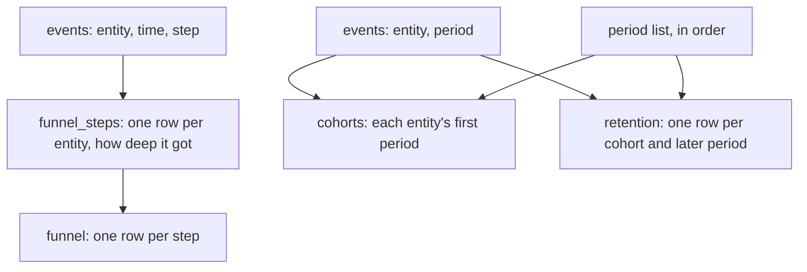

# Event paths: funnels, cohorts, retention

Generated from `src/jq_analytics/analytics.jq` and `docs/readout/notes/event-paths.md`. Do not edit.

Eight definitions: four public (`funnel_steps`, `funnel`, `cohorts`, `retention`) and four helpers. They read an event log, one row per thing an entity (a user, a device) did, and answer how far entities get through a sequence of steps and how many come back in later periods.



In the calls below a `;` separates the arguments. Arguments without a `$` are filters run on each event (`.t` is "this event's time"); `{user}` is short for `{user: .user}`; `$steps`, `$within` and `$periods` are values.

On this page, in the order of the file:

| Function | Whose | What it is for |
|---|---|---|
| `_entity_key` | Internal helper, not for callers | Turns an entity key into the fields that start an output row |
| `_funnel_check` | Internal helper, not for callers | The input check of `funnel_steps` |
| `funnel_steps` | Public function | How far each entity gets through an ordered list of steps |
| `funnel` | Public function | The funnel as a table: one row per step with how many entities reached it, and that count as a fraction of the previous step's and of the first step's |
| `_period_pos`, `_period_idx` | Internal helpers, not for callers | Two helpers of `cohorts` and `retention` |
| `cohorts` | Public function | One row per entity: its key and `cohort`, the earliest period in which it has an event |
| `retention` | Public function | Of the entities first seen in a period, how many have at least one event in each later period |

---

## _entity_key

**Internal helper, not for callers** · `_entity_key`

Turns an entity key into the fields that start an output row. An object stays as it is; anything else becomes `{key: value}`. It is the rule `group_agg` applies to its key, as a named helper.

### _entity_key: the example

```jq
[{user: "u1"}, "u1"] | map(_entity_key)
```

```json
[
  {"user": "u1"},
  {"key": "u1"}
]
```

So `funnel_steps({user}; ...)` gives rows with a `user` column, and `funnel_steps(.user; ...)` gives rows with a `key` column.

### _entity_key: the definition

`_entity_key/0`, line 993:

```jq
def _entity_key: if type == "object" then . else {key: .} end;
```

Built into jq: `type`.

One `if`: `type == "object"` decides.

---

## _funnel_check

**Internal helper, not for callers** · `_funnel_check(time; step; $steps)`

The input check of `funnel_steps`. It passes its input through unchanged, or stops with an error when the step list is empty, a step is listed twice, or an event of a listed step has no time.

### _funnel_check: the example

One good call, then the three errors:

```jq
([{t: 1, s: "view"}] | _funnel_check(.t; .s; ["view", "pay"])),
(try ([{t: 1, s: "view"}] | _funnel_check(.t; .s; [])) catch .),
(try ([{t: 1, s: "view"}] | _funnel_check(.t; .s; ["view", "pay", "view"])) catch .),
(try ([{t: null, s: "view"}] | _funnel_check(.t; .s; ["view", "pay"])) catch .)
```

```json
[{"t":1,"s":"view"}]
"funnel: the step list is empty"
"funnel: step \"view\" is listed twice"
"funnel: an event of step \"view\" has no time"
```

### _funnel_check: the definition

`_funnel_check/3`, lines 995 to 1001:

```jq
def _funnel_check(time; step; $steps):
  if ($steps | length) == 0 then error("funnel: the step list is empty")
  elif ($steps | unique | length) != ($steps | length)
  then error("funnel: step \($steps | group_by(.) | map(select(length > 1)[0])[0] | tojson) is listed twice")
  else (first(.[] | select((step) as $s | any($steps[]; . == $s) and (time) == null) | [step]) // null) as $bad
    | if $bad != null then error("funnel: an event of step \($bad[0] | tojson) has no time") else . end
  end;
```

Built into jq: `any`, `error`, `first`, `group_by`, `length`, `map`, `select`, `tojson`, `unique`.

- `($steps | unique | length) != ($steps | length)`: `unique` removes repeats, so a shorter list means a step is there twice. `group_by(.) | map(select(length > 1)[0])[0]` finds one repeated name for the message.
- `first(.[] | select(...) | [step]) // null` finds the first event whose step is in the list and whose time is null. The step is wrapped in an array so that a step named `false` or `null` still counts as found.
- An event whose step is not in the list may have a null time: it is ignored later anyway.

---

## funnel_steps

**Public function** · `funnel_steps(entity; time; step; $steps; $within)`

How far each entity gets through an ordered list of steps. An entity reaches step n when it has events for steps 1 to n in time order. One row per entity that reaches step 1: its key, `depth`, and the time of each step reached.

### funnel_steps: the example

Five made-up users and the steps view, cart, pay. Every step must happen within an hour (3,600 seconds) of the user's view.

| user | events (step and time) | Expected |
|---|---|---|
| u1 | view 0, cart 100, pay 200 | all three, in order |
| u2 | view 0, pay 50, cart 60 | pay came before cart: stops at cart |
| u3 | view 0, cart 5000 | the cart is outside the hour: stops at view |
| u4 | view 0, view 4000, cart 4100, pay 4200 | the first view times out; the second completes |
| u5 | cart 10, pay 20 | never viewed: no row |

```jq
[["u1", 0, "view"], ["u1", 100, "cart"], ["u1", 200, "pay"], ["u2", 0, "view"], ["u2", 50, "pay"], ["u2", 60, "cart"],
 ["u3", 0, "view"], ["u3", 5000, "cart"], ["u4", 0, "view"], ["u4", 4000, "view"], ["u4", 4100, "cart"], ["u4", 4200, "pay"],
 ["u5", 10, "cart"], ["u5", 20, "pay"]]
| map({user: .[0], t: .[1], step: .[2]})
| funnel_steps({user}; .t; .step; ["view", "cart", "pay"]; 3600)
```

```json
[
  {"user": "u1", "depth": 3, "times": [0, 100, 200]},
  {"user": "u2", "depth": 2, "times": [0, 60]},
  {"user": "u3", "depth": 1, "times": [0]},
  {"user": "u4", "depth": 3, "times": [4000, 4100, 4200]}
]
```

Four rows, in the order the users first appear. u4's `times` start at 4000: the chain that completes begins at the second view.

With no time limit (`null`), u3's late cart counts, and u4's chain starts at its first view:

```jq
[["u1", 0, "view"], ["u1", 100, "cart"], ["u1", 200, "pay"], ["u2", 0, "view"], ["u2", 50, "pay"], ["u2", 60, "cart"],
 ["u3", 0, "view"], ["u3", 5000, "cart"], ["u4", 0, "view"], ["u4", 4000, "view"], ["u4", 4100, "cart"], ["u4", 4200, "pay"],
 ["u5", 10, "cart"], ["u5", 20, "pay"]]
| map({user: .[0], t: .[1], step: .[2]})
| funnel_steps({user}; .t; .step; ["view", "cart", "pay"]; null)
```

```json
[
  {"user": "u1", "depth": 3, "times": [0, 100, 200]},
  {"user": "u2", "depth": 2, "times": [0, 60]},
  {"user": "u3", "depth": 2, "times": [0, 5000]},
  {"user": "u4", "depth": 3, "times": [0, 4100, 4200]}
]
```

A later step at the same time as the one before counts as in order:

```jq
[{user: "u1", t: 5, step: "view"}, {user: "u1", t: 5, step: "cart"}] | funnel_steps(.user; .t; .step; ["view", "cart"]; null)
```

```json
[
  {"key": "u1", "depth": 2, "times": [5, 5]}
]
```

### funnel_steps: reading the call

| Argument | In the example | Runs on | Meaning |
|---|---|---|---|
| `entity` | `{user}` | one event | who the event belongs to; also the first columns of the output row |
| `time` | `.t` | one event | when it happened, a number |
| `step` | `.step` | one event | which step the event is |
| `$steps` | `["view", "cart", "pay"]` | nothing: a value | the steps in order |
| `$within` | `3600` | nothing: a value | seconds allowed from the first step; null for no limit |

### funnel_steps: what happens inside, on the example

Step 1: `_funnel_check`, then events whose step is not listed are dropped and the rest are grouped by entity with `_groups`.

Step 2, `$t`, per entity: for each step in order, the sorted times of the entity's events of that step. The run shows it for the five users.

```jq
[["u1", 0, "view"], ["u1", 100, "cart"], ["u1", 200, "pay"], ["u2", 0, "view"], ["u2", 50, "pay"], ["u2", 60, "cart"],
 ["u3", 0, "view"], ["u3", 5000, "cart"], ["u4", 0, "view"], ["u4", 4000, "view"], ["u4", 4100, "cart"], ["u4", 4200, "pay"],
 ["u5", 10, "cart"], ["u5", 20, "pay"]]
| map({user: .[0], t: .[1], step: .[2]})
| _groups({user})
| map(. as $ev | {user: .[0].user, t: [("view", "cart", "pay") as $s | [$ev[] | select(.step == $s) | .t] | sort]})
```

```json
[
  {"user": "u1", "t": [[0], [100], [200]]},
  {"user": "u2", "t": [[0], [60], [50]]},
  {"user": "u3", "t": [[0], [5000], []]},
  {"user": "u4", "t": [[0, 4000], [4100], [4200]]},
  {"user": "u5", "t": [[], [10], [20]]}
]
```

u4 has two view times, one cart time and one pay time. u2's pay time, 50, is before its cart time, 60.

Step 3, the search. For each first-step time, earliest first, a chain is built: start with that time, and for each later step take the earliest time that is at or after the previous step's time and within the limit. A step with no such time ends the chain. The longest chain wins, and the search stops once a chain is complete. The search cannot be run by itself, so this is a hand trace for two users, with the limit 3600:

| User | First-step time | Limit | Cart | Pay | Chain |
|---|---|---|---|---|---|
| u2 | 0 | 3600 | 60 | 50 is before 60: none | 0, 60 |
| u4 | 0 | 3600 | 4100 is past the limit: none | not tried | 0 |
| u4 | 4000 | 7600 | 4100 | 4200 | 4000, 4100, 4200 |

u4's second chain is longer than its first, so it is the one kept.

Step 4: an entity with a chain gets a row: its key, the chain's length as `depth`, and the chain as `times`. u5 has no first-step time, so no chain and no row.

### funnel_steps: the definition

`funnel_steps/5`, lines 1003 to 1031:

```jq
# funnel_steps: how far each entity gets through the ordered steps in $steps. An entity reaches
# step n when it has events for steps 1 to n in time order (a later step at the same time as the
# one before counts). With $within (seconds; null for no limit) every step must happen within that
# long of the entity's first step, and the entity is credited with the deepest chain any of its
# first-step events can start: an early first step that times out does not hide a later one that
# completes. One row per entity that reaches step 1, entities in order of first appearance:
# {entity key..., depth (1 to the number of steps), times (the time of each step reached)}.
# Events whose step is not listed are ignored. An empty step list, a step listed twice, or a null
# time on an event of a listed step is an error.
def funnel_steps(entity; time; step; $steps; $within):
  _funnel_check(time; step; $steps)
  | ($steps | length) as $n
  | [map(select((step) as $s | any($steps[]; . == $s))) | _groups(entity)[]
     | (.[0] | entity | _entity_key) as $k
     | (. as $ev | [$steps[] as $s | [$ev[] | select((step) == $s) | time] | sort]) as $t
     | (reduce $t[0][] as $t1 (null;
          if . != null and length == $n then .
          else (if $within == null then null else $t1 + $within end) as $lim
            # for a fixed first event the earliest matching event is always the best next step:
            # a later one can only remove options for the steps after it
            | (reduce range(1; $n) as $i ({c: [$t1], ok: true};
                 if .ok | not then .
                 else .c[-1] as $prev
                   | (first($t[$i][] | select(. >= $prev and ($lim == null or . <= $lim)) | [.]) // null) as $x
                   | if $x == null then .ok = false else .c += $x end
                 end) | .c) as $chain
            | if . == null or ($chain | length) > length then $chain else . end
          end)) as $best
     | select($best != null) | $k + {depth: ($best | length), times: $best}];
```

Built into jq: `any`, `first`, `length`, `map`, `not`, `range`, `select`, `sort`. From this library: `_entity_key`, `_funnel_check`, `_groups`.

- `map(select((step) as $s | any($steps[]; . == $s)))` keeps the events of listed steps.
- `$k` is the entity key as fields, through `_entity_key`. `$t` is the list of step 2.
- The outer `reduce` runs over `$t[0]`, the first-step times. Its state is the best chain so far, null at the start. `if . != null and length == $n then .` skips the rest once a complete chain is found.
- `$lim` is the first-step time plus `$within`, or null for no limit.
- The inner `reduce` runs over the later steps. `first($t[$i][] | select(. >= $prev and ($lim == null or . <= $lim)) | [.]) // null` is the earliest usable time of step `$i`. Found: appended to the chain. Not found: `.ok = false`, and the remaining steps are skipped.
- `>=`, not `>`: two steps at the same moment count as in order.
- `if . == null or ($chain | length) > length then $chain else . end` keeps the longer chain, and the earlier one on a tie.
- Taking the earliest usable time at every step is safe. For a fixed first event, an earlier next step leaves at least as many choices for the steps after it as a later one.

---

## funnel

**Public function** · `funnel(entity; time; step; $steps; $within)`

The funnel as a table: one row per step with how many entities reached it, and that count as a fraction of the previous step's and of the first step's.

### funnel: the example

The same events and limit as under `funnel_steps`.

```jq
[["u1", 0, "view"], ["u1", 100, "cart"], ["u1", 200, "pay"], ["u2", 0, "view"], ["u2", 50, "pay"], ["u2", 60, "cart"],
 ["u3", 0, "view"], ["u3", 5000, "cart"], ["u4", 0, "view"], ["u4", 4000, "view"], ["u4", 4100, "cart"], ["u4", 4200, "pay"],
 ["u5", 10, "cart"], ["u5", 20, "pay"]]
| map({user: .[0], t: .[1], step: .[2]})
| funnel({user}; .t; .step; ["view", "cart", "pay"]; 3600)
```

```json
[
  {"step": "view", "entities": 4, "from_previous": null, "from_first": 1},
  {"step": "cart", "entities": 3, "from_previous": 0.75, "from_first": 0.75},
  {"step": "pay", "entities": 2, "from_previous": 0.6666666666666666, "from_first": 0.5}
]
```

Four users viewed, three of them reached the cart (u1, u2, u4), two paid (u1, u4). Hand check: 3 / 4 = 0.75 from the view; 2 / 3 from the cart; 2 / 4 = 0.5 of the first step.

With no events every count is 0 and every ratio is null, because the divisor is 0:

```jq
[] | funnel(.user; .t; .step; ["view", "cart"]; null)
```

```json
[
  {"step": "view", "entities": 0, "from_previous": null, "from_first": null},
  {"step": "cart", "entities": 0, "from_previous": null, "from_first": null}
]
```

### funnel: what happens inside, on the example

Step 1, `$d`: every entity's depth, from `funnel_steps`. Step 2, `$c`: for each step position `$i`, how many depths are above `$i`, which is how many entities reached step `$i + 1`. The run prints both.

```jq
[["u1", 0, "view"], ["u1", 100, "cart"], ["u1", 200, "pay"], ["u2", 0, "view"], ["u2", 50, "pay"], ["u2", 60, "cart"],
 ["u3", 0, "view"], ["u3", 5000, "cart"], ["u4", 0, "view"], ["u4", 4000, "view"], ["u4", 4100, "cart"], ["u4", 4200, "pay"],
 ["u5", 10, "cart"], ["u5", 20, "pay"]]
| map({user: .[0], t: .[1], step: .[2]})
| (funnel_steps({user}; .t; .step; ["view", "cart", "pay"]; 3600) | map(.depth)) as $d
| $d, [range(0; 3) as $i | ($d | map(select(. > $i)) | length)]
```

```json
[3,2,1,3]
[4,3,2]
```

Step 3: one row per step from `$c`, with the two ratios.

### funnel: the definition

`funnel/5`, lines 1033 to 1042:

```jq
# funnel: one row per step, in order: {step, entities (how many reached it), from_previous,
# from_first}: the count divided by the previous step's and by the first step's; null where the
# divisor is zero, and from_previous is null on the first step. A funnel only narrows.
def funnel(entity; time; step; $steps; $within):
  (funnel_steps(entity; time; step; $steps; $within) | map(.depth)) as $d
  | [range(0; $steps | length) as $i | ($d | map(select(. > $i)) | length)] as $c
  | [range(0; $steps | length) as $i
     | {step: $steps[$i], entities: $c[$i],
        from_previous: (if $i == 0 or $c[$i - 1] == 0 then null else $c[$i] / $c[$i - 1] end),
        from_first: (if $c[0] == 0 then null else $c[$i] / $c[0] end)}];
```

Built into jq: `length`, `map`, `range`, `select`. From this library: `funnel_steps`.

- `from_previous` is `$c[$i] / $c[$i - 1]`, null on the first step and where the previous count is 0.
- `from_first` is `$c[$i] / $c[0]`, null where the first count is 0.
- An entity with depth 3 is counted at steps 1, 2 and 3, so the counts never grow from one step to the next.

---

## _period_pos, _period_idx

**Internal helpers, not for callers** · `_period_pos`, `_period_idx(period; $pos; $who)`

Two helpers of `cohorts` and `retention`. `_period_pos` turns the ordered period list into a lookup from period to position. `_period_idx` looks one event's period up in it. Positions make "earlier" and "later" mean the order of the list, not the sort order of the values, so a list such as `["Dec", "Jan", "Feb"]` works.

### _period_pos and the others: the example

The lookup for three months, then two events looked up in it, one of them outside the list:

```jq
["2026-01", "2026-02", "2026-03"] | _period_pos as $pos
| $pos, ([{p: "2026-03"}, {p: "2025-12"}] | map(try _period_idx(.p; $pos; "cohorts") catch .))
```

```json
{"\"2026-01\"":0,"\"2026-02\"":1,"\"2026-03\"":2}
[2,"cohorts: period \"2025-12\" is not in the period list"]
```

The keys are the periods as JSON text. `"2026-03"` is at position 2. A period that is not in the list is an error under the caller's name.

### _period_pos and the others: the definition

`_period_pos/0`, line 1044:

```jq
def _period_pos: . as $p | reduce range(0; length) as $i ({}; .[$p[$i] | tojson] = $i);
```

Built into jq: `length`, `range`, `tojson`.

`_period_idx/3`, lines 1045 to 1047:

```jq
def _period_idx(period; $pos; $who):
  (period) as $p | $pos[$p | tojson] as $i
  | if $i == null then error("\($who): period \($p | tojson) is not in the period list") else $i end;
```

Built into jq: `error`, `tojson`.

- `_period_pos`: `reduce range(0; length) as $i ({}; .[$p[$i] | tojson] = $i)` writes each period's position under its JSON text.
- `_period_idx`: `(period) as $p` runs the caller's filter on the event; `$pos[$p | tojson]` is the position, and null means not in the list.

---

## cohorts

**Public function** · `cohorts(entity; period; $periods)`

One row per entity: its key and `cohort`, the earliest period in which it has an event. A cohort is the group of entities that were first seen in the same period.

### cohorts: the example

| user | month |
|---|---|
| a | 2026-02 |
| a | 2026-01 |
| b | 2026-01 |
| b | 2026-03 |
| c | 2026-02 |

```jq
[["a", "2026-02"], ["a", "2026-01"], ["b", "2026-01"], ["b", "2026-03"], ["c", "2026-02"]]
| map({user: .[0], month: .[1]})
| cohorts({user}; .month; ["2026-01", "2026-02", "2026-03"])
```

```json
[
  {"user": "a", "cohort": "2026-01"},
  {"user": "b", "cohort": "2026-01"},
  {"user": "c", "cohort": "2026-02"}
]
```

a's events are in February and January, in that order in the input; the earlier one in the period list is January. Rows come in the order the users first appear.

### cohorts: what happens inside, on the example

Step 1: the events grouped by entity, and each event's period replaced by its position in the list.

```jq
["2026-01", "2026-02", "2026-03"] as $periods | ($periods | _period_pos) as $pos
| [["a", "2026-02"], ["a", "2026-01"], ["b", "2026-01"], ["b", "2026-03"], ["c", "2026-02"]]
| map({user: .[0], month: .[1]})
| [_groups({user})[] | {user: .[0].user, positions: map(_period_idx(.month; $pos; "cohorts"))}]
```

```json
[
  {"user": "a", "positions": [1, 0]},
  {"user": "b", "positions": [0, 2]},
  {"user": "c", "positions": [1]}
]
```

Step 2: the smallest position of each entity, turned back into a period: 0 is `"2026-01"` for a and b, 1 is `"2026-02"` for c.

### cohorts: the definition

`cohorts/3`, lines 1049 to 1054:

```jq
# cohorts: one row per entity, in order of first appearance: {entity key..., cohort}, the earliest
# period, in $periods order, in which it has an event. $periods is every period in order, for
# example calendar(...) | map(.year_month) | unique. A period not in the list is an error.
def cohorts(entity; period; $periods):
  ($periods | _period_pos) as $pos
  | [_groups(entity)[] | (.[0] | entity | _entity_key) + {cohort: $periods[map(_period_idx(period; $pos; "cohorts")) | min]}];
```

Built into jq: `map`, `min`. From this library: `_entity_key`, `_groups`, `_period_idx`, `_period_pos`.

- `(.[0] | entity | _entity_key)` is the entity's key as fields.
- `$periods[map(_period_idx(period; $pos; "cohorts")) | min]`: the positions, their minimum, and the period at that position.
- `$periods` is every period in order, for example `calendar(...) | map(.year_month) | unique`.

---

## retention

**Public function** · `retention(entity; period; $periods)`

Of the entities first seen in a period, how many have at least one event in each later period. One row per cohort and period, from the cohort's own period to the last in the list.

### retention: the example

| user | months with an event |
|---|---|
| a | 2026-01, 2026-02, 2026-03 |
| b | 2026-01, 2026-03 |
| c | 2026-02 |

```jq
[["a", "2026-01"], ["a", "2026-02"], ["a", "2026-03"], ["b", "2026-01"], ["b", "2026-03"], ["c", "2026-02"]]
| map({user: .[0], month: .[1]})
| retention({user}; .month; ["2026-01", "2026-02", "2026-03"])
```

```json
[
  {"cohort": "2026-01", "period": "2026-01", "offset": 0, "entities": 2, "cohort_size": 2, "rate": 1},
  {"cohort": "2026-01", "period": "2026-02", "offset": 1, "entities": 1, "cohort_size": 2, "rate": 0.5},
  {"cohort": "2026-01", "period": "2026-03", "offset": 2, "entities": 2, "cohort_size": 2, "rate": 1},
  {"cohort": "2026-02", "period": "2026-02", "offset": 0, "entities": 1, "cohort_size": 1, "rate": 1},
  {"cohort": "2026-02", "period": "2026-03", "offset": 1, "entities": 0, "cohort_size": 1, "rate": 0}
]
```

Hand check. The January cohort is a and b: 2 of 2 active in January, 1 of 2 in February (a), 2 of 2 in March. The February cohort is c: 1 of 1 in February, 0 of 1 in March. The row with 0 is there: the table is complete. Nobody was first seen in March, so there is no March cohort.

### retention: what happens inside, on the example

Step 1, `$e`: per entity, `c`, the position of its cohort, and `a`, the distinct positions in which it is active.

```jq
["2026-01", "2026-02", "2026-03"] as $periods | ($periods | _period_pos) as $pos
| [["a", "2026-01"], ["a", "2026-02"], ["a", "2026-03"], ["b", "2026-01"], ["b", "2026-03"], ["c", "2026-02"]]
| map({user: .[0], month: .[1]})
| [_groups({user})[] | map(_period_idx(.month; $pos; "retention")) | {c: min, a: unique}]
```

```json
[
  {"c": 0, "a": [0, 1, 2]},
  {"c": 0, "a": [0, 2]},
  {"c": 1, "a": [1]}
]
```

Step 2, `$byc`: the entities grouped by cohort position.

```jq
[{c: 0, a: [0, 1, 2]}, {c: 0, a: [0, 2]}, {c: 1, a: [1]}]
| group_by(.c) | map({key: (.[0].c | tostring), value: .}) | from_entries
```

```json
{"0":[{"c":0,"a":[0,1,2]},{"c":0,"a":[0,2]}],"1":[{"c":1,"a":[1]}]}
```

Step 3, `$cnt`, per cohort: how many of its entities are active at each position. For cohort 0, the positions 0, 1, 2 and 0, 2 are pooled and counted:

```jq
[{c: 0, a: [0, 1, 2]}, {c: 0, a: [0, 2]}] | [.[].a[]] | group_by(.) | map({key: (.[0] | tostring), value: length}) | from_entries
```

```json
{"0":2,"1":1,"2":2}
```

Step 4: for each position from the cohort's own to the last, one row with that count, or 0 when the position is missing from `$cnt`. For cohort 0 that gives 2, 1, 2 out of a cohort size of 2: the first three rows of the result.

### retention: the definition

`retention/3`, lines 1056 to 1070:

```jq
# retention: of the entities first seen in a period (a cohort), how many have at least one event
# in each later period. One row per cohort and period, from the cohort's own period to the last in
# $periods: {cohort, period, offset (periods after the cohort's; 0 for its own), entities,
# cohort_size, rate (entities / cohort_size)}. The table is complete: a period in which nobody of
# the cohort is active has a row with 0. Periods with no first-time entities form no cohort.
def retention(entity; period; $periods):
  ($periods | _period_pos) as $pos
  | [_groups(entity)[] | map(_period_idx(period; $pos; "retention")) | {c: min, a: unique}] as $e
  | ($periods | length) as $np
  | ($e | group_by(.c) | map({key: (.[0].c | tostring), value: .}) | from_entries) as $byc
  | [range(0; $np) as $c | ($byc[$c | tostring] // []) as $m | select(($m | length) > 0)
     | ($m | [.[].a[]] | group_by(.) | map({key: (.[0] | tostring), value: length}) | from_entries) as $cnt
     | range($c; $np) as $p | ($cnt[$p | tostring] // 0) as $n
     | {cohort: $periods[$c], period: $periods[$p], offset: ($p - $c), entities: $n,
        cohort_size: ($m | length), rate: ($n / ($m | length))}];
```

Built into jq: `from_entries`, `group_by`, `length`, `map`, `min`, `range`, `select`, `tostring`, `unique`. From this library: `_groups`, `_period_idx`, `_period_pos`.

- `{c: min, a: unique}` runs on one entity's list of positions.
- `range(0; $np) as $c | ($byc[$c | tostring] // []) as $m | select(($m | length) > 0)` walks the periods in order and keeps those that are some entity's cohort.
- `range($c; $np) as $p` emits the cohort's own period and every later one. `$cnt[$p | tostring] // 0` is why a period in which nobody came back still has its row.
- `offset` is `$p - $c`, and `rate` is the count divided by the cohort size.
