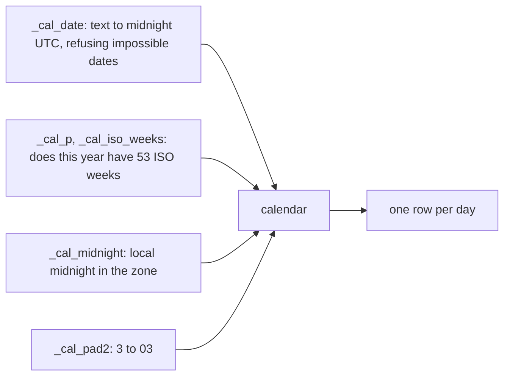

Eight definitions; six are small helpers of `calendar`, which makes one row per day. A day row carries the day's calendar fields (year, quarter, month, ISO week, US week) and the moments its local day starts and ends in a named zone, so a day is an interval and `join_within` can put an event in its day.



## _cal_bad/1, _cal_date/1
<!-- code: 7ae2c44b -->

`_cal_date` turns `"YYYY-MM-DD"` into the moment of that day's midnight UTC.

- The pattern test refuses anything that is not ten characters of that form, and anything that is not a string.
- `try (… | fromdateiso8601) catch null`: some engines refuse an impossible date here.
- `($e | gmtime | strftime("%Y-%m-%d")) != $s`: the others accept `2026-02-30` and quietly carry it over to 2 March. Printing the result back and comparing it with the input catches that on every engine.
- `_cal_bad` is the one error message, with the caller's name in front.

```jq run
["2026-03-08", "2026-02-30", "08/03/2026", 20260308] | map(try _cal_date("calendar") catch .)
```

This is the guard that `parse_ts` lacks (review finding 3).

## _cal_p/0, _cal_iso_weeks/0
<!-- code: b58a7a68 -->

Input: a year. `_cal_iso_weeks` gives the number of ISO weeks in it, 52 or 53.

`_cal_p` is the weekday of 31 December of the year (0 is Sunday), by the usual leap-year count: `(y + y/4 - y/100 + y/400) mod 7`, each division rounded down. An ISO year has 53 weeks when it ends on a Thursday (`_cal_p == 4`) or the year before it ended on a Wednesday, which means it starts on a Thursday (`(. - 1) | _cal_p == 3`).

```jq run
[2015, 2020, 2021, 2026] | map({year: ., dec31_weekday: _cal_p, iso_weeks: _cal_iso_weeks})
```

2020 ended on a Thursday (4) and has 53 weeks; 2026 starts on a Thursday (2025 ended on Wednesday, 3) and has 53 too.

## _cal_pad2/0
<!-- code: 53704638 -->

A number below 10 gets a leading zero and becomes text; `"0\(.)"` is string interpolation. Used for `2026-03` and `2026-W09`.

```jq run
[3, 12] | map(_cal_pad2)
```

## _cal_midnight/1
<!-- code: d5b40dfe -->

Input: `$m`, midnight UTC of some date. Output: the moment at which clocks in zone `$z` read that date at 00:00.

Local midnight is `$m` minus the zone's offset, but the offset depends on the moment, and the moment is what is being looked for. Two steps:

1. `($m - ($m | tz_offset($z))) as $e`: a first guess, using the offset in force at `$m` itself.
2. `$m - ($e | tz_offset($z))`: the answer, using the offset in force at the guess.

The second step only changes anything when a clock change falls between `$m` and the guess. For the zones in the tables, changes happen in the small hours local time, and the guess is already right; the step is there so the function stays right for a zone that changes closer to midnight.

```jq run
tz("America/Detroit") as $z
| ["2026-03-07", "2026-03-08", "2026-03-09"]
| map(_cal_date("x") as $m | {date: ., starts_utc: ($m | _cal_midnight($z) | todate),
                              hours_long: ((($m + 86400 | _cal_midnight($z)) - ($m | _cal_midnight($z))) / 3600)})
```

8 March 2026 starts at 05:00 UTC, on winter time, and the next day starts at 04:00 UTC, on summer time: the day is 23 hours long.

## calendar/3, calendar/2
<!-- code: e4ea1195 -->

Ignores its input. One row per day from `$from` to `$to`.

- **Setup.** The zone is resolved once. Both dates go through `_cal_date`; `$from` after `$to` is an error.
- **`range(0; (($d1 - $d0) / 86400 | round) + 1) as $i`**: day numbers. `$m = $d0 + 86400 * $i` is that day's midnight UTC, always exact because UTC has no clock changes.
- **`($m | gmtime) as $g`** and the four `round`s: year, month, weekday, day of year. `round` is there because some engines return these fields as floats, and a float would print as `2026.0` inside `"\($y)-…"`.
- **ISO week.** `$dow` is the weekday with Monday 1 to Sunday 7. `$w = floor(($doy - $dow + 10) / 7)` is the standard formula. `$w < 1` means the day belongs to the last week of the previous year (52 or 53, from `_cal_iso_weeks`); `$w` above this year's week count means it belongs to week 1 of the next.
- **US week.** `$jan1` is the weekday of 1 January, worked back from today's weekday and day of year; the double `% 7 + 7) % 7` keeps it from going negative. Weeks start on Sunday and week 1 contains 1 January, so `us_week = floor(($doy + $jan1 - 1) / 7) + 1`.
- **`start`, `end`**: `_cal_midnight` of this day and of the next.

The two-parameter form is the same in UTC.

```jq run
calendar("2020-12-31"; "2021-01-04") | map({date, weekday, iso_year_week, us_week, year_quarter})
```

Hand check. 31 December 2020 is a Thursday (4). Friday 1 January to Sunday 3 January 2021 still belong to ISO week 53 of 2020, since ISO weeks run Monday to Sunday and that week's Thursday is in 2020; Monday 4 January starts 2021-W01. In US weeks, 1 January is in week 1 by definition, and Sunday 3 January starts week 2.

```jq run
calendar("2026-03-07"; "2026-03-09"; "America/Detroit") | map({date, hours: ((.end - .start) / 3600)}),
(try calendar("2026-03-09"; "2026-03-07") catch .)
```
