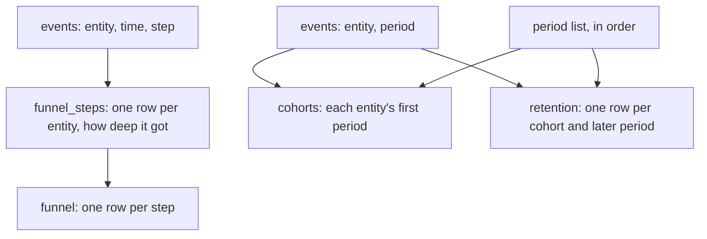

### What it is for

Eight definitions: four public (`funnel_steps`, `funnel`, `cohorts`, `retention`) and four helpers. They read an event log, one row per thing an entity (a user, a device) did, and answer how far entities get through a sequence of steps and how many come back in later periods.



A funnel is an ordered list of steps; an entity reaches step n when it has events for steps 1 to n in time order, optionally all within a time limit from its first step. Five made-up users, the steps view, cart and pay, and a limit of one hour:

| user | events | depth | why |
|---|---|---|---|
| u1 | view 0, cart 100, pay 200 | 3 | in order, within the hour |
| u2 | view 0, pay 50, cart 60 | 2 | pay came before cart |
| u3 | view 0, cart 5000 | 1 | the cart is outside the hour |
| u4 | view 0, view 4000, cart 4100, pay 4200 | 3 | the first view times out; the second completes |
| u5 | cart 10, pay 20 | none | never viewed |

`funnel` gives 4 at view, 3 at cart (0.75 of the previous step) and 2 at pay (0.6667 of the previous, 0.5 of the first). The definitions below run this example.

Retention takes the list of periods from the caller, in order. With a active in January and March, b in January only, and nobody in February:

```jq run
[{user: "a", month: "2026-01"}, {user: "a", month: "2026-03"}, {user: "b", month: "2026-01"}]
| retention({user}; .month; ["2026-01", "2026-02", "2026-03"]) | map([.cohort, .period, .entities, .rate])
```

February has a row with 0: a period in which nobody came back is still a period.

In the calls below a `;` separates the arguments. Arguments without a `$` are filters run on each event (`.t` is "this event's time"); `{user}` is short for `{user: .user}`; `$steps`, `$within` and `$periods` are values.

### The rules it keeps

- **An entity is credited with the deepest chain any of its first-step events can start.** u4's first view times out, its second completes, so u4 has depth 3. Among chains of equal length the earlier one is kept.
- **Steps at the same moment count as in order** (`>=`, not `>`).
- **The time limit counts from the chain's first step**; `null` means no limit.
- **An entity that never reaches step 1 has no row** in `funnel_steps`; the counts in `funnel` never grow from one step to the next. With no entities every count is 0 and every ratio null.
- **Periods are positions in the caller's list**, not sorted values, so `["Dec", "Jan", "Feb"]` works, and a period with no events still gets its rows in `retention`. A cohort is an entity's earliest period in that list.
- **Order:** entities in the order they first appear; `retention` cohort by cohort in period order, each from its own period to the last.
- **The entity key becomes the first columns**: an object key's fields, otherwise a field `key`.
- **Refuses:** an empty step list, a step listed twice, an event of a listed step with no time (`funnel_steps`, `funnel`); an event whose period is not in the list (`cohorts`, `retention`, naming the function); an input that is not a table (page 00).
- **Cost**, measured in the Python jq package: `funnel` 5.7 s at 200,000 events; `retention` with 40,000 entities over 365 periods 1.3 s.

### Beside core jq, SQL and pandas

Core jq has nothing for either. A funnel by hand needs per-entity grouping, a sort, and a search over chains; a shortcut that starts every chain at the entity's earliest first-step event gives u4 depth 1, since its cart comes 4,100 s after that view, outside the hour.

SQL writes a funnel as a self-join per step (view to cart within the limit, cart to pay at or after the cart) or with window functions, and a cohort table as `min(period) OVER (PARTITION BY entity)` and a `GROUP BY cohort, period`. A period with no events at all has no group, so the empty period disappears unless the query joins to a period list.

pandas, checked with pandas 3.1.1: cohort `groupby("user").month.transform("min")` and then `pd.crosstab(cohort, month, values=user, aggfunc="nunique")` gives January's cohort 2 in January and 1 in March, with **no February column**, because no event falls in February. `retention` gives the February row with 0 and a rate. pandas has no funnel function.

What the family adds: a funnel with a stated chain rule and a retention table complete over the caller's periods.

### Decisions

- **2026-11-18, spec 25, version 0.5.0.** Periods come from a caller-supplied ordered list, as `on_calendar` takes one, so empty periods count and the order is the caller's. Events at the same time satisfy consecutive steps. Funnels with repeating or unordered steps, sessions inside funnels (cut events with `sessions` first and use the session as the entity), survival curves and churn models were left out.
- **0.9.0 (2026-11-18, spec 55).** `retention` scanned every entity once per period (review finding 10). It now groups the entities by cohort once: 40,000 entities over 365 periods went from 18.6 s to 1.3 s in the Python jq package, with no answer changed.

## _entity_key/0
<!-- code: 024526e6 -->

Turns an entity key into the fields that start an output row. An object stays as it is; anything else becomes `{key: value}`. It is the rule `group_agg` applies to its key, as a named helper.

### The example

```jq run
[{user: "u1"}, "u1"] | map(_entity_key)
```

So `funnel_steps({user}; ...)` gives rows with a `user` column, and `funnel_steps(.user; ...)` gives rows with a `key` column.

### The definition

<!-- definition -->

One `if`: `type == "object"` decides.

## _funnel_check/3
<!-- code: 5445bb0e -->

The input check of `funnel_steps`. It passes its input through unchanged, or stops with an error when the step list is empty, a step is listed twice, or an event of a listed step has no time.

### The example

One good call, then the three errors:

```jq run
([{t: 1, s: "view"}] | _funnel_check(.t; .s; ["view", "pay"])),
(try ([{t: 1, s: "view"}] | _funnel_check(.t; .s; [])) catch .),
(try ([{t: 1, s: "view"}] | _funnel_check(.t; .s; ["view", "pay", "view"])) catch .),
(try ([{t: null, s: "view"}] | _funnel_check(.t; .s; ["view", "pay"])) catch .)
```

### The definition

<!-- definition -->

- `($steps | unique | length) != ($steps | length)`: `unique` removes repeats, so a shorter list means a step is there twice. `group_by(.) | map(select(length > 1)[0])[0]` finds one repeated name for the message.
- `first(.[] | select(...) | [step]) // null` finds the first event whose step is in the list and whose time is null. The step is wrapped in an array so that a step named `false` or `null` still counts as found.
- An event whose step is not in the list may have a null time: it is ignored later anyway.

## funnel_steps/5
<!-- code: 04bb0e27 -->

How far each entity gets through an ordered list of steps. An entity reaches step n when it has events for steps 1 to n in time order. One row per entity that reaches step 1: its key, `depth`, and the time of each step reached.

### The example

Five made-up users and the steps view, cart, pay. Every step must happen within an hour (3,600 seconds) of the user's view.

| user | events (step and time) | Expected |
|---|---|---|
| u1 | view 0, cart 100, pay 200 | all three, in order |
| u2 | view 0, pay 50, cart 60 | pay came before cart: stops at cart |
| u3 | view 0, cart 5000 | the cart is outside the hour: stops at view |
| u4 | view 0, view 4000, cart 4100, pay 4200 | the first view times out; the second completes |
| u5 | cart 10, pay 20 | never viewed: no row |

```jq run
[["u1", 0, "view"], ["u1", 100, "cart"], ["u1", 200, "pay"], ["u2", 0, "view"], ["u2", 50, "pay"], ["u2", 60, "cart"],
 ["u3", 0, "view"], ["u3", 5000, "cart"], ["u4", 0, "view"], ["u4", 4000, "view"], ["u4", 4100, "cart"], ["u4", 4200, "pay"],
 ["u5", 10, "cart"], ["u5", 20, "pay"]]
| map({user: .[0], t: .[1], step: .[2]})
| funnel_steps({user}; .t; .step; ["view", "cart", "pay"]; 3600)
```

Four rows, in the order the users first appear. u4's `times` start at 4000: the chain that completes begins at the second view.

With no time limit (`null`), u3's late cart counts, and u4's chain starts at its first view:

```jq run
[["u1", 0, "view"], ["u1", 100, "cart"], ["u1", 200, "pay"], ["u2", 0, "view"], ["u2", 50, "pay"], ["u2", 60, "cart"],
 ["u3", 0, "view"], ["u3", 5000, "cart"], ["u4", 0, "view"], ["u4", 4000, "view"], ["u4", 4100, "cart"], ["u4", 4200, "pay"],
 ["u5", 10, "cart"], ["u5", 20, "pay"]]
| map({user: .[0], t: .[1], step: .[2]})
| funnel_steps({user}; .t; .step; ["view", "cart", "pay"]; null)
```

A later step at the same time as the one before counts as in order:

```jq run
[{user: "u1", t: 5, step: "view"}, {user: "u1", t: 5, step: "cart"}] | funnel_steps(.user; .t; .step; ["view", "cart"]; null)
```

### Reading the call

| Argument | In the example | Runs on | Meaning |
|---|---|---|---|
| `entity` | `{user}` | one event | who the event belongs to; also the first columns of the output row |
| `time` | `.t` | one event | when it happened, a number |
| `step` | `.step` | one event | which step the event is |
| `$steps` | `["view", "cart", "pay"]` | nothing: a value | the steps in order |
| `$within` | `3600` | nothing: a value | seconds allowed from the first step; null for no limit |

### What happens inside, on the example

Step 1: `_funnel_check`, then events whose step is not listed are dropped and the rest are grouped by entity with `_groups`.

Step 2, `$t`, per entity: for each step in order, the sorted times of the entity's events of that step. The run shows it for the five users.

```jq run
[["u1", 0, "view"], ["u1", 100, "cart"], ["u1", 200, "pay"], ["u2", 0, "view"], ["u2", 50, "pay"], ["u2", 60, "cart"],
 ["u3", 0, "view"], ["u3", 5000, "cart"], ["u4", 0, "view"], ["u4", 4000, "view"], ["u4", 4100, "cart"], ["u4", 4200, "pay"],
 ["u5", 10, "cart"], ["u5", 20, "pay"]]
| map({user: .[0], t: .[1], step: .[2]})
| _groups({user})
| map(. as $ev | {user: .[0].user, t: [("view", "cart", "pay") as $s | [$ev[] | select(.step == $s) | .t] | sort]})
```

u4 has two view times, one cart time and one pay time. u2's pay time, 50, is before its cart time, 60.

Step 3, the search. For each first-step time, earliest first, a chain is built: start with that time, and for each later step take the earliest time that is at or after the previous step's time and within the limit. A step with no such time ends the chain. The longest chain wins, and the search stops once a chain is complete. The search cannot be run by itself, so this is a hand trace for two users, with the limit 3600:

| User | First-step time | Limit | Cart | Pay | Chain |
|---|---|---|---|---|---|
| u2 | 0 | 3600 | 60 | 50 is before 60: none | 0, 60 |
| u4 | 0 | 3600 | 4100 is past the limit: none | not tried | 0 |
| u4 | 4000 | 7600 | 4100 | 4200 | 4000, 4100, 4200 |

u4's second chain is longer than its first, so it is the one kept.

Step 4: an entity with a chain gets a row: its key, the chain's length as `depth`, and the chain as `times`. u5 has no first-step time, so no chain and no row.

### The definition

<!-- definition -->

- `map(select((step) as $s | any($steps[]; . == $s)))` keeps the events of listed steps.
- `$k` is the entity key as fields, through `_entity_key`. `$t` is the list of step 2.
- The outer `reduce` runs over `$t[0]`, the first-step times. Its state is the best chain so far, null at the start. `if . != null and length == $n then .` skips the rest once a complete chain is found.
- `$lim` is the first-step time plus `$within`, or null for no limit.
- The inner `reduce` runs over the later steps. `first($t[$i][] | select(. >= $prev and ($lim == null or . <= $lim)) | [.]) // null` is the earliest usable time of step `$i`. Found: appended to the chain. Not found: `.ok = false`, and the remaining steps are skipped.
- `>=`, not `>`: two steps at the same moment count as in order.
- `if . == null or ($chain | length) > length then $chain else . end` keeps the longer chain, and the earlier one on a tie.
- Taking the earliest usable time at every step is safe. For a fixed first event, an earlier next step leaves at least as many choices for the steps after it as a later one.

## funnel/5
<!-- code: 08b5e8d5 -->

The funnel as a table: one row per step with how many entities reached it, and that count as a fraction of the previous step's and of the first step's.

### The example

The same events and limit as under `funnel_steps`.

```jq run
[["u1", 0, "view"], ["u1", 100, "cart"], ["u1", 200, "pay"], ["u2", 0, "view"], ["u2", 50, "pay"], ["u2", 60, "cart"],
 ["u3", 0, "view"], ["u3", 5000, "cart"], ["u4", 0, "view"], ["u4", 4000, "view"], ["u4", 4100, "cart"], ["u4", 4200, "pay"],
 ["u5", 10, "cart"], ["u5", 20, "pay"]]
| map({user: .[0], t: .[1], step: .[2]})
| funnel({user}; .t; .step; ["view", "cart", "pay"]; 3600)
```

Four users viewed, three of them reached the cart (u1, u2, u4), two paid (u1, u4). Hand check: 3 / 4 = 0.75 from the view; 2 / 3 from the cart; 2 / 4 = 0.5 of the first step.

With no events every count is 0 and every ratio is null, because the divisor is 0:

```jq run
[] | funnel(.user; .t; .step; ["view", "cart"]; null)
```

### What happens inside, on the example

Step 1, `$d`: every entity's depth, from `funnel_steps`. Step 2, `$c`: for each step position `$i`, how many depths are above `$i`, which is how many entities reached step `$i + 1`. The run prints both.

```jq run
[["u1", 0, "view"], ["u1", 100, "cart"], ["u1", 200, "pay"], ["u2", 0, "view"], ["u2", 50, "pay"], ["u2", 60, "cart"],
 ["u3", 0, "view"], ["u3", 5000, "cart"], ["u4", 0, "view"], ["u4", 4000, "view"], ["u4", 4100, "cart"], ["u4", 4200, "pay"],
 ["u5", 10, "cart"], ["u5", 20, "pay"]]
| map({user: .[0], t: .[1], step: .[2]})
| (funnel_steps({user}; .t; .step; ["view", "cart", "pay"]; 3600) | map(.depth)) as $d
| $d, [range(0; 3) as $i | ($d | map(select(. > $i)) | length)]
```

Step 3: one row per step from `$c`, with the two ratios.

### The definition

<!-- definition -->

- `from_previous` is `$c[$i] / $c[$i - 1]`, null on the first step and where the previous count is 0.
- `from_first` is `$c[$i] / $c[0]`, null where the first count is 0.
- An entity with depth 3 is counted at steps 1, 2 and 3, so the counts never grow from one step to the next.

## _period_pos/0, _period_idx/3
<!-- code: 62c33165 -->

Two helpers of `cohorts` and `retention`. `_period_pos` turns the ordered period list into a lookup from period to position. `_period_idx` looks one event's period up in it. Positions make "earlier" and "later" mean the order of the list, not the sort order of the values, so a list such as `["Dec", "Jan", "Feb"]` works.

### The example

The lookup for three months, then two events looked up in it, one of them outside the list:

```jq run
["2026-01", "2026-02", "2026-03"] | _period_pos as $pos
| $pos, ([{p: "2026-03"}, {p: "2025-12"}] | map(try _period_idx(.p; $pos; "cohorts") catch .))
```

The keys are the periods as JSON text. `"2026-03"` is at position 2. A period that is not in the list is an error under the caller's name.

### The definition

<!-- definition -->

- `_period_pos`: `reduce range(0; length) as $i ({}; .[$p[$i] | tojson] = $i)` writes each period's position under its JSON text.
- `_period_idx`: `(period) as $p` runs the caller's filter on the event; `$pos[$p | tojson]` is the position, and null means not in the list.

## cohorts/3
<!-- code: fdaa047c -->

One row per entity: its key and `cohort`, the earliest period in which it has an event. A cohort is the group of entities that were first seen in the same period.

### The example

| user | month |
|---|---|
| a | 2026-02 |
| a | 2026-01 |
| b | 2026-01 |
| b | 2026-03 |
| c | 2026-02 |

```jq run
[["a", "2026-02"], ["a", "2026-01"], ["b", "2026-01"], ["b", "2026-03"], ["c", "2026-02"]]
| map({user: .[0], month: .[1]})
| cohorts({user}; .month; ["2026-01", "2026-02", "2026-03"])
```

a's events are in February and January, in that order in the input; the earlier one in the period list is January. Rows come in the order the users first appear.

### What happens inside, on the example

Step 1: the events grouped by entity, and each event's period replaced by its position in the list.

```jq run
["2026-01", "2026-02", "2026-03"] as $periods | ($periods | _period_pos) as $pos
| [["a", "2026-02"], ["a", "2026-01"], ["b", "2026-01"], ["b", "2026-03"], ["c", "2026-02"]]
| map({user: .[0], month: .[1]})
| [_groups({user})[] | {user: .[0].user, positions: map(_period_idx(.month; $pos; "cohorts"))}]
```

Step 2: the smallest position of each entity, turned back into a period: 0 is `"2026-01"` for a and b, 1 is `"2026-02"` for c.

### The definition

<!-- definition -->

- `(.[0] | entity | _entity_key)` is the entity's key as fields.
- `$periods[map(_period_idx(period; $pos; "cohorts")) | min]`: the positions, their minimum, and the period at that position.
- `$periods` is every period in order, for example `calendar(...) | map(.year_month) | unique`.

## retention/3
<!-- code: d4e29a9a -->

Of the entities first seen in a period, how many have at least one event in each later period. One row per cohort and period, from the cohort's own period to the last in the list.

### The example

| user | months with an event |
|---|---|
| a | 2026-01, 2026-02, 2026-03 |
| b | 2026-01, 2026-03 |
| c | 2026-02 |

```jq run
[["a", "2026-01"], ["a", "2026-02"], ["a", "2026-03"], ["b", "2026-01"], ["b", "2026-03"], ["c", "2026-02"]]
| map({user: .[0], month: .[1]})
| retention({user}; .month; ["2026-01", "2026-02", "2026-03"])
```

Hand check. The January cohort is a and b: 2 of 2 active in January, 1 of 2 in February (a), 2 of 2 in March. The February cohort is c: 1 of 1 in February, 0 of 1 in March. The row with 0 is there: the table is complete. Nobody was first seen in March, so there is no March cohort.

### What happens inside, on the example

Step 1, `$e`: per entity, `c`, the position of its cohort, and `a`, the distinct positions in which it is active.

```jq run
["2026-01", "2026-02", "2026-03"] as $periods | ($periods | _period_pos) as $pos
| [["a", "2026-01"], ["a", "2026-02"], ["a", "2026-03"], ["b", "2026-01"], ["b", "2026-03"], ["c", "2026-02"]]
| map({user: .[0], month: .[1]})
| [_groups({user})[] | map(_period_idx(.month; $pos; "retention")) | {c: min, a: unique}]
```

Step 2, `$byc`: the entities grouped by cohort position.

```jq run
[{c: 0, a: [0, 1, 2]}, {c: 0, a: [0, 2]}, {c: 1, a: [1]}]
| group_by(.c) | map({key: (.[0].c | tostring), value: .}) | from_entries
```

Step 3, `$cnt`, per cohort: how many of its entities are active at each position. For cohort 0, the positions 0, 1, 2 and 0, 2 are pooled and counted:

```jq run
[{c: 0, a: [0, 1, 2]}, {c: 0, a: [0, 2]}] | [.[].a[]] | group_by(.) | map({key: (.[0] | tostring), value: length}) | from_entries
```

Step 4: for each position from the cohort's own to the last, one row with that count, or 0 when the position is missing from `$cnt`. For cohort 0 that gives 2, 1, 2 out of a cohort size of 2: the first three rows of the result.

### The definition

<!-- definition -->

- `{c: min, a: unique}` runs on one entity's list of positions.
- `range(0; $np) as $c | ($byc[$c | tostring] // []) as $m | select(($m | length) > 0)` walks the periods in order and keeps those that are some entity's cohort.
- `range($c; $np) as $p` emits the cohort's own period and every later one. `$cnt[$p | tostring] // 0` is why a period in which nobody came back still has its row.
- `offset` is `$p - $c`, and `rate` is the count divided by the cohort size.
