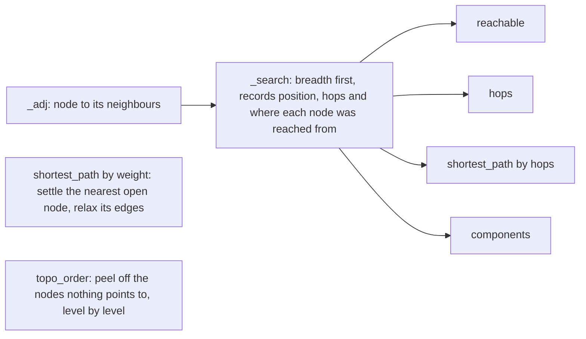

Eight definitions. A graph is a table of edges: one row per edge. The arguments `from` and `to` are filters that give each edge's two ends, so `reachable(.a; .b; "fetch")` reads an edge row's start from its `a` field and its end from its `b` field. In jq a `;` separates arguments, a bare parameter such as `from` is a filter run on each row, and a `$name` parameter such as `$start` is a value. Four functions share one breadth-first search, `_search`.



The examples use one made-up graph of build steps. An edge means "must come before".

```text
fetch -> compile -> test -> package
fetch -> lint    -> package
docs  -> package
```

As a table of edges, in the order every example lists them:

| a | b |
|---|---|
| fetch | compile |
| compile | test |
| test | package |
| fetch | lint |
| lint | package |
| docs | package |

## _adj/2
<!-- code: 93629dc7 -->

A lookup from a node to the list of nodes its edges lead to. Every search below reads a node's neighbours from it with one lookup.

### The example

```jq run
[["fetch", "compile"], ["compile", "test"], ["test", "package"], ["fetch", "lint"], ["lint", "package"], ["docs", "package"]]
| map({a: .[0], b: .[1]}) | _adj(.a; .b)
```

One object. Each key is a node written as JSON text, which is why `fetch` appears as `"\"fetch\""`: an object key has to be a string, and `tojson` turns any node (a number, an array) into one. `fetch` has two neighbours, in the order its edges appear in the input. `package` has no key because no edge starts there.

### What happens inside, on the example

Step 1, `group_by(.a)`: one array of five groups, one per starting node. The builtin sorts the groups by the node, and inside a group the edges keep their input order.

```jq run
[["fetch", "compile"], ["compile", "test"], ["test", "package"], ["fetch", "lint"], ["lint", "package"], ["docs", "package"]]
| map({a: .[0], b: .[1]}) | group_by(.a)
```

Step 2, `map({key: ..., value: map(to)})`: each group becomes one key and value pair. The key is the group's node as JSON text; the value is the far ends of its edges.

```jq run
[["fetch", "compile"], ["compile", "test"], ["test", "package"], ["fetch", "lint"], ["lint", "package"], ["docs", "package"]]
| map({a: .[0], b: .[1]}) | group_by(.a) | map({key: (.[0] | .a | tojson), value: map(.b)})
```

Step 3, `from_entries`: the pairs become one object, the result at the top.

### The definition

<!-- definition -->

- `group_by(from)` gathers each node's edges. Nothing is appended edge by edge.
- `.[0] | from | tojson` takes the node from the group's first edge; every edge of a group starts at the same node.
- `map(to)` runs `to` on each edge of the group.
- `from_entries` builds the object in one step.

## _search/2
<!-- code: e9e1adbe -->

Breadth-first search from `$start`: every node that can be reached, the start first, in the order met. Each row says how many edges away the node is (`hops`) and which node it was reached from (`via`). `$adj` is the lookup that `_adj` makes.

### The example

```jq run
[["fetch", "compile"], ["compile", "test"], ["test", "package"], ["fetch", "lint"], ["lint", "package"], ["docs", "package"]]
| map({a: .[0], b: .[1]}) | _adj(.a; .b) as $adj | _search($adj; "fetch")
```

`compile` and `lint` are one edge from `fetch`. `test` and `package` are two edges away. `package` was reached from `lint`, not from `test`, because the search met it at distance 2 through `lint` before it looked at `test`'s edges. `docs` is missing: no edge leads to it from `fetch`.

### What happens inside, on the example

The search keeps a state object and changes it once per round:

- `seen`: node (as JSON text) to `[position, node, hops, via]`. Position counts the nodes in the order they were first met.
- `frontier`: the nodes met in the previous round. `next`: the nodes met in this round, stored under their position.
- `level`: the round number, which is the distance of the nodes this round finds.

Each round takes every edge out of the frontier, frontier nodes in order and each node's edges in input order, and records the far end if it is not in `seen`. Then `next`, sorted by position, becomes the frontier. The loop body cannot be run by itself, so this table is a hand trace of the rounds on the example:

| Round | Frontier at the start | Edges looked at | New in `seen` | Frontier at the end |
|---|---|---|---|---|
| start | | | fetch: position 0, hops 0, via null | fetch |
| 1 | fetch | fetch to compile, fetch to lint | compile: position 1, hops 1, via fetch. lint: position 2, hops 1, via fetch | compile, lint |
| 2 | compile, lint | compile to test, lint to package | test: position 3, hops 2, via compile. package: position 4, hops 2, via lint | test, package |
| 3 | test, package | test to package | nothing: package is already seen | empty, so the loop stops |

The frontiers of the trace can be read back from the result by grouping its rows on `hops`:

```jq run
[["fetch", "compile"], ["compile", "test"], ["test", "package"], ["fetch", "lint"], ["lint", "package"], ["docs", "package"]]
| map({a: .[0], b: .[1]}) | _adj(.a; .b) as $adj | _search($adj; "fetch") | group_by(.hops) | map(map(.node))
```

After the loop, `[.seen[]] | sort_by(.[0])` puts the five records in position order, and `map({node: .[1], hops: .[2], via: .[3]})` names their parts. That is the result at the top.

### The definition

<!-- definition -->

- The first line is the starting state: the start is seen at position 0 with 0 hops and no `via`.
- `until((.frontier | length) == 0; ...)` repeats the round until a round finds nothing new.
- `$f[] as $u | $adj[$u | tojson][]? | [$u, .]` emits one `[from, to]` pair per edge out of the frontier. The `?` covers a node with no key in `$adj`, such as `package`.
- `if .seen[$k] != null then .` skips a node met before. This is what makes a cycle safe: a node is recorded once.
- `.next[.n | tostring] = $e[1]` stores the new node under its position, and `sort_by(.key | tonumber)` reads them back in that order. `next` and `seen` are objects written by key because appending to an array inside a loop copies the array each time, and the cost then grows with the square of the graph.

## reachable/3, hops/3
<!-- code: 8c7abf96 -->

`reachable` lists every node that can be reached from `$start` along the edges, nearest first. `hops` gives the same nodes with their distance in edges, the start included at 0. In SQL both need a recursive query.

### The example

```jq run
[["fetch", "compile"], ["compile", "test"], ["test", "package"], ["fetch", "lint"], ["lint", "package"], ["docs", "package"]]
| map({a: .[0], b: .[1]})
| reachable(.a; .b; "compile"), hops(.a; .b; "fetch")
```

Two values. From `compile` the build can go on to `test` and then `package`. From `fetch`, the hop counts are the ones `_search` found above.

`reachable` never lists the start, even when a cycle leads back to it. With one more edge from `package` back to `fetch`:

```jq run
[["fetch", "compile"], ["compile", "test"], ["test", "package"], ["fetch", "lint"], ["lint", "package"], ["docs", "package"], ["package", "fetch"]]
| map({a: .[0], b: .[1]}) | reachable(.a; .b; "fetch")
```

### The definition

<!-- definition -->

Both run `_adj` and then `_search`, and differ in what they keep of the search result:

- `reachable`: `.[1:]` drops the first row, which is always the start, and `map(.node)` keeps the names.
- `hops`: `map({node, hops})` keeps two of the three fields. `{node, hops}` is short for `{node: .node, hops: .hops}`.

## shortest_path/4
<!-- code: 11629c72 -->

The route from `$start` to `$goal` with the fewest edges, as `{path, cost}`, where `cost` is the number of edges.

### The example

Three calls: a goal that can be reached, one that cannot, and the start itself.

```jq run
[["fetch", "compile"], ["compile", "test"], ["test", "package"], ["fetch", "lint"], ["lint", "package"], ["docs", "package"]]
| map({a: .[0], b: .[1]})
| shortest_path(.a; .b; "fetch"; "package"), shortest_path(.a; .b; "fetch"; "docs"), shortest_path(.a; .b; "fetch"; "fetch")
```

Through `lint` takes two edges; through `compile` and `test` takes three. No route gives null. The start to itself is a path of one node and cost 0.

### What happens inside, on the example

Step 1: the search result, indexed by node. `$ix` is one object from each node (as JSON text) to its search row.

```jq run
[["fetch", "compile"], ["compile", "test"], ["test", "package"], ["fetch", "lint"], ["lint", "package"], ["docs", "package"]]
| map({a: .[0], b: .[1]}) | _adj(.a; .b) as $adj
| reduce _search($adj; "fetch")[] as $r ({}; .[$r.node | tojson] = $r)
```

Step 2: start at the goal and follow `via` back. `package` was reached from `lint`, and `lint` from `fetch`, whose `via` is null, so the walk stops there.

```jq run
[["fetch", "compile"], ["compile", "test"], ["test", "package"], ["fetch", "lint"], ["lint", "package"], ["docs", "package"]]
| map({a: .[0], b: .[1]}) | _adj(.a; .b) as $adj
| (reduce _search($adj; "fetch")[] as $r ({}; .[$r.node | tojson] = $r)) as $ix
| ["package" | recurse($ix[tojson].via | select(. != null))]
```

Step 3: `reverse` turns goal to start into start to goal, and the goal's `hops` is the cost. That is the first result at the top.

### The definition

<!-- definition -->

- `reduce _search(...)[] as $r ({}; ...)` builds `$ix`, one entry per node the search met.
- `if $ix[$goal | tojson] == null then null`: a goal the search never met has no route.
- `recurse(f)` emits its input, then `f` of it, then `f` of that, until `f` emits nothing. Here `f` looks up the node's `via`, and `select(. != null)` ends the walk at the start.
- Among routes with the same number of edges, the result is the one the breadth-first search finds first, following edges in input order.

## shortest_path/5
<!-- code: 2ccb0dec -->

The route with the lowest total weight, where `weight` is a filter giving each edge's weight. The output is the same `{path, cost}`, with `cost` the total weight. This is Dijkstra's algorithm.

### The example

Each edge carries a duration in minutes:

| a | b | min |
|---|---|---|
| fetch | compile | 1 |
| compile | test | 1 |
| test | package | 1 |
| fetch | lint | 5 |
| lint | package | 5 |
| docs | package | 2 |

```jq run
[["fetch", "compile", 1], ["compile", "test", 1], ["test", "package", 1], ["fetch", "lint", 5], ["lint", "package", 5], ["docs", "package", 2]]
| map({a: .[0], b: .[1], min: .[2]})
| shortest_path(.a; .b; .min; "fetch"; "package")
```

The route through `compile` and `test` has three edges and costs 1 + 1 + 1 = 3. The route through `lint` has two edges and costs 5 + 5 = 10. The four-argument form picked the second; this one picks the first.

### Reading the call

| Argument | In the example | Runs on | Meaning |
|---|---|---|---|
| `from` | `.a` | one edge row | the node the edge starts at |
| `to` | `.b` | one edge row | the node the edge ends at |
| `weight` | `.min` | one edge row | the edge's weight, a number at or above 0 |
| `$start` | `"fetch"` | nothing: a value | where the route begins |
| `$goal` | `"package"` | nothing: a value | where it ends |

### What happens inside, on the example

Step 1: the weights are checked. A weight that is not a number, or is below 0, stops the call with an error that names it.

```jq run
[["fetch", "compile", 1], ["compile", "test", 1]] | map({a: .[0], b: .[1], min: -1})
| try shortest_path(.a; .b; .min; "fetch"; "test") catch .
```

Step 2: the neighbour lookup. It is built like `_adj`, with each neighbour as a `[node, weight]` pair.

```jq run
[["fetch", "compile", 1], ["compile", "test", 1], ["test", "package", 1], ["fetch", "lint", 5], ["lint", "package", 5], ["docs", "package", 2]]
| map({a: .[0], b: .[1], min: .[2]})
| group_by(.a) | map({key: (.[0] | .a | tojson), value: map([(.b), (.min)])}) | from_entries
```

Step 3: the rounds. The state holds `d`, the best known cost and `via` for each node met; `open`, the nodes with a known cost that are not final yet; and `done`, the nodes whose cost is final. Each round picks the open node with the lowest cost (`$u`), makes it final, and tries each of its edges. The loop body cannot be run by itself, so this is a hand trace:

| Round | Open at the start | `$u`, the lowest | Edges tried | Open at the end |
|---|---|---|---|---|
| 1 | fetch 0 | fetch | to compile: 0 + 1 = 1, new. To lint: 0 + 5 = 5, new | compile 1, lint 5 |
| 2 | compile 1, lint 5 | compile | to test: 1 + 1 = 2, new | lint 5, test 2 |
| 3 | lint 5, test 2 | test | to package: 2 + 1 = 3, new | lint 5, package 3 |
| 4 | lint 5, package 3 | package | none: it is the goal, so the loop stops | |

`lint` is never made final: the goal is reached at cost 3 before any node at cost 5 is picked.

Step 4: the path is read from `d` as in the four-argument form, following each node's `via` back from the goal (`package`, `test`, `compile`, `fetch`) and reversing. The goal's cost in `d` is the result's `cost`.

### The definition

<!-- definition -->

- `first(.[] | (weight) | select(type != "number" or . < 0) | [.]) // null` finds the first bad weight. It is wrapped in an array so that a weight of `null` or `false` is still found.
- Each entry of `d` and `open` is `[cost, order found, node, via]`.
- `min_by([.[0], .[1]])` picks the lowest cost, and on a tie the node found earliest. So among routes of equal cost the result is the one found first.
- `if $u == null or $u[2] == $goal then .stop = true`: stop when nothing is open (the goal cannot be reached) or when the goal is the lowest open node. With weights at or above 0, no later route can be cheaper than the lowest open cost, so that cost is final.
- Inside the `reduce`, `$nd` is the cost of reaching the neighbour through `$u`. A neighbour already final is left alone. One not met before gets `$nd`. One met at a higher cost gets `$nd` and `$u` as its new `via`, and keeps its order found.
- The lowest open node is found by looking at every open node each round, with no priority queue. The work grows with the nodes made final times the nodes open, which suits a few thousand nodes.

## topo_order/2
<!-- code: 1429f198 -->

A dependency order: one row per node with a `level`, such that every edge goes from a lower level to a higher one. Nodes on the same level do not depend on each other, so a build could run them at the same time.

### The example

```jq run
[["fetch", "compile"], ["compile", "test"], ["test", "package"], ["fetch", "lint"], ["lint", "package"], ["docs", "package"]]
| map({a: .[0], b: .[1]}) | topo_order(.a; .b)
```

Nothing points to `docs` or `fetch`, so they are at level 0. `package` is at level 3: one more than `test` (2), the highest among the three nodes that point to it, `test`, `lint` (1) and `docs` (0). Rows are sorted by level, then by node.

A graph with a cycle has no such order. The error names a node on the cycle:

```jq run
[["fetch", "compile"], ["compile", "test"], ["test", "package"], ["fetch", "lint"], ["lint", "package"], ["docs", "package"], ["package", "compile"]]
| map({a: .[0], b: .[1]}) | try topo_order(.a; .b) catch .
```

### What happens inside, on the example

Step 1: `$nodes`, every node named at either end of an edge, sorted, and `$deg0`, for each node the number of edges that point to it. The run prints the two values.

```jq run
[["fetch", "compile"], ["compile", "test"], ["test", "package"], ["fetch", "lint"], ["lint", "package"], ["docs", "package"]]
| map({a: .[0], b: .[1]})
| ([.[] | (.a), (.b)] | unique) as $nodes
| $nodes, (reduce .[] as $e (reduce $nodes[] as $n ({}; .[$n | tojson] = 0); .[$e | .b | tojson] += 1))
```

Step 2: the rounds. The frontier is the nodes whose count is 0. They get the current level. Each edge out of them lowers its target's count by one, and a target that reaches 0 joins the next frontier. This is a hand trace:

| Round | Level | Frontier | Counts lowered | Next frontier |
|---|---|---|---|---|
| 1 | 0 | docs, fetch | package 3 to 2 (from docs), compile 1 to 0, lint 1 to 0 | compile, lint |
| 2 | 1 | compile, lint | test 1 to 0, package 2 to 1 | test |
| 3 | 2 | test | package 1 to 0 | package |
| 4 | 3 | package | none | empty, so the loop stops |

A node joins the frontier in the round after the last node pointing to it was handled. That is why its level is one more than the highest level among them.

Step 3: all six nodes were given a level, so there is no cycle, and the rows are sorted by level and node. In the cycle example, `compile`, `test` and `package` never reach a count of 0, the frontier runs empty with three nodes left, and the error branch runs.

### The definition

<!-- definition -->

- `[.[] | (from), (to)] | unique` is `$nodes`. `$deg0` starts every node at 0 and adds one per edge to the edge's target.
- `left` counts the nodes with no level yet. `out` collects each round's rows under the round number, for the same reason `_search` writes to objects.
- `.frontier = ([.next[]] | sort)`: the next frontier in sorted order, so the result does not depend on the order of the input edges.
- `if .left > 0`: nodes are left when the frontier runs empty. Each of them still has a count above 0, so each has another left node pointing to it.
- `$pred` is the reversed graph among the left nodes. The walk starts at the first left node and steps to its smallest predecessor until it lands on a node it has visited. That node is on a cycle. Taking the smallest predecessor makes the node named the same on every run.

## components/2
<!-- code: a437fee8 -->

Connected groups, with the edges read as undirected: one row per node, `{node, component}`, where `component` is the smallest node of the node's group.

### The example

Three edges. `lint` points to `fetch`, against the direction of the other `fetch` edge; `x` and `y` touch nothing else.

```jq run
[["fetch", "compile"], ["lint", "fetch"], ["x", "y"]] | map({a: .[0], b: .[1]}) | components(.a; .b)
```

Two groups. `compile`, `fetch` and `lint` are joined through `fetch`, and the group is named `compile`, its smallest node in jq's sort order. `x` and `y` form the group `x`.

### What happens inside, on the example

Step 1: the neighbour lookup holds every edge in both directions, so the search can walk an edge either way.

```jq run
[["fetch", "compile"], ["lint", "fetch"], ["x", "y"]] | map({a: .[0], b: .[1]})
| [.[] | [(.a), (.b)], [(.b), (.a)]] | group_by(.[0]) | map({key: (.[0][0] | tojson), value: map(.[1])}) | from_entries
```

Step 2: the nodes are taken in sorted order: `compile`, `fetch`, `lint`, `x`, `y`. A node not yet in a group starts a search, and everything the search meets is its group. `compile` is first; then `fetch` and `lint` are already seen and skipped; `x` starts the second search; `y` is skipped. The run prints the two searches.

```jq run
[["fetch", "compile"], ["lint", "fetch"], ["x", "y"]] | map({a: .[0], b: .[1]})
| ([.[] | [(.a), (.b)], [(.b), (.a)]] | group_by(.[0]) | map({key: (.[0][0] | tojson), value: map(.[1])}) | from_entries) as $adj
| (_search($adj; "compile") | map(.node)), (_search($adj; "x") | map(.node))
```

Step 3: each member is labelled with the node that started its search, and the rows are sorted by node. That is the result at the top.

### The definition

<!-- definition -->

- `[.[] | [(a), (b)], [(b), (a)]]` emits each edge twice, once per direction, before grouping.
- `reduce $nodes[] as $n (...)` visits the nodes in sorted order. `if .seen[$n | tojson] then .` skips a node that an earlier search met.
- Because nodes are visited in sorted order, the node that starts a group's search is the group's smallest, so the label is the smallest node.
- `.parts[.k | tostring] = ...` stores each group under a counter, and `[.parts[][]] | sort_by(.node)` flattens the groups into rows.
