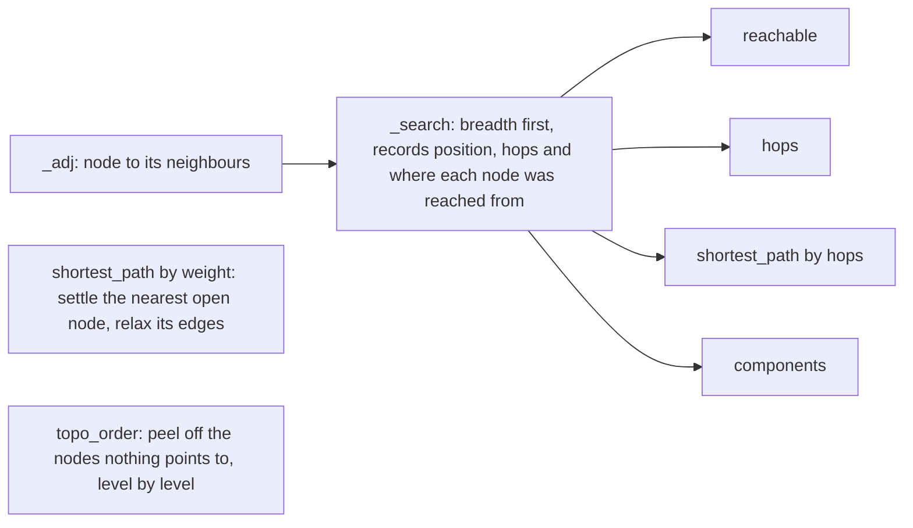

Eight definitions. A graph is a table of edges; `from` and `to` are expressions giving each edge's two ends. Four functions share one breadth-first search, `_search`.



The examples use one made-up graph of build steps, an edge meaning "must come before":

```text
fetch -> compile -> test -> package
fetch -> lint    -> package
docs  -> package
```

## _adj/2
<!-- code: 93629dc7 -->

A lookup from a node (as JSON text) to the list of nodes its edges lead to. `group_by(from)` gathers each node's edges, keeping their input order inside the group; one `from_entries` builds the object. Nothing is appended edge by edge.

```jq run
[["fetch", "compile"], ["compile", "test"], ["test", "package"], ["fetch", "lint"], ["lint", "package"], ["docs", "package"]]
| map({a: .[0], b: .[1]}) | _adj(.a; .b)
```

## _search/2
<!-- code: e9e1adbe -->

Breadth-first search from `$start`. The state:

- `seen`: node (as text) to `[position, node, hops, via]`. Position is the order in which nodes were first met; `via` is the node it was reached from.
- `frontier`: the nodes met at the current distance; `next`: those met while expanding them, stored under their position as a key.

Each round takes the frontier, and for every edge out of it, in input order, records the far end if it is new. Then `next`, sorted by position, becomes the frontier. At the end `seen` is sorted by position once.

`next` and `seen` are objects written to by key. The first version of this search appended each new node to an array inside the loop; jq copies the array on each append, and the search slowed with the square of the graph.

```jq run
[["fetch", "compile"], ["compile", "test"], ["test", "package"], ["fetch", "lint"], ["lint", "package"], ["docs", "package"]]
| map({a: .[0], b: .[1]}) | _adj(.a; .b) as $adj | _search($adj; "fetch")
```

`compile` and `lint` are at distance 1. Expanding them in that order meets `test` (from `compile`) and then `package` (from `lint`), both at distance 2. `docs` is not reachable from `fetch`.

## reachable/3, hops/3
<!-- code: 8c7abf96 -->

Both are `_search` with a different cut of its output: `reachable` drops the start (`.[1:]`) and keeps the node names; `hops` keeps `{node, hops}` and includes the start at 0.

```jq run
[["fetch", "compile"], ["compile", "test"], ["test", "package"], ["fetch", "lint"], ["lint", "package"], ["docs", "package"]]
| map({a: .[0], b: .[1]})
| {reachable_from_compile: reachable(.a; .b; "compile"), hops_from_fetch: (hops(.a; .b; "fetch") | map([.node, .hops]))}
```

## shortest_path/4
<!-- code: 11629c72 -->

The fewest edges. `$ix` indexes the search result by node. `[$goal | recurse($ix[tojson].via | select(. != null))]` starts at the goal and follows `via` back until it reaches the start, whose `via` is null; `reverse` turns that into start to goal. `cost` is the goal's hop count. A goal the search never met gives null.

```jq run
[["fetch", "compile"], ["compile", "test"], ["test", "package"], ["fetch", "lint"], ["lint", "package"], ["docs", "package"]]
| map({a: .[0], b: .[1]})
| [shortest_path(.a; .b; "fetch"; "package"), shortest_path(.a; .b; "fetch"; "docs"), shortest_path(.a; .b; "fetch"; "fetch")]
```

## shortest_path/5
<!-- code: 2ccb0dec -->

The lowest total weight: Dijkstra's algorithm without a priority queue.

- **Check first.** `first(… | select(type != "number" or . < 0) | [.])` finds a weight that is not a non-negative number; the error names it.
- **`$adj`** here holds `[neighbour, weight]` pairs.
- **State.** `d`: the best known `[cost, order found, node, via]` per node. `open`: the nodes with a known cost that are not settled yet. `done`: the settled ones.
- **Each round.** `$u` is the open node with the lowest cost, the earliest found on a tie (`min_by([.[0], .[1]])`). If there is none, or it is the goal, stop: a settled node's cost is final. Otherwise `$u` moves from `open` to `done`, and each of its edges is tried: a neighbour not seen before gets a cost; one seen at a higher cost gets the lower one and its `via` changed; a settled one is left alone.
- **Path.** As in the four-argument form, following `via` back from the goal.

The scan for the lowest open node looks at every open node each round, so the time grows with nodes times open nodes. The comment says so; the measurement is in the spec's log.

Weights in minutes: fetch to compile 1, compile to test 1, test to package 1, fetch to lint 5, lint to package 5, docs to package 2. Through compile and test costs 3 with three edges; through lint costs 10 with two.

```jq run
[["fetch", "compile", 1], ["compile", "test", 1], ["test", "package", 1], ["fetch", "lint", 5], ["lint", "package", 5], ["docs", "package", 2]]
| map({a: .[0], b: .[1], min: .[2]})
| shortest_path(.a; .b; .min; "fetch"; "package"),
  (try (map(.min = -1) | shortest_path(.a; .b; .min; "fetch"; "package")) catch .)
```

## topo_order/2
<!-- code: 1429f198 -->

A dependency order with levels.

- `$nodes`: every node named at either end of an edge, sorted. `$deg0`: for each, how many edges point to it.
- **Each round**: the frontier is the nodes with nothing left pointing to them. They get the current level and go into `out`; each edge out of them lowers its target's count by one, and a target that reaches zero joins `next`. `[.next[]] | sort` is the next frontier.
- A node therefore gets its level in the round after the last of its predecessors got theirs: one more than the highest level among them.
- **Cycle.** If nodes are left when the frontier runs empty, each of them has another left node pointing to it. `$pred` is the reversed graph among those nodes; walking back along it from any left node must come round to a node already visited, and that node is on a cycle. The walk always takes the smallest predecessor, so the node named is the same on every run.

```jq run
[["fetch", "compile"], ["compile", "test"], ["test", "package"], ["fetch", "lint"], ["lint", "package"], ["docs", "package"]]
| map({a: .[0], b: .[1]})
| (topo_order(.a; .b) | map([.node, .level])),
  (try (. + [{a: "package", b: "compile"}] | topo_order(.a; .b)) catch .)
```

`package` is at level 3: one more than `test` (2), the highest of `test`, `lint` (1) and `docs` (0).

## components/2
<!-- code: a437fee8 -->

Edges read as undirected. `$adj` therefore holds every edge in both directions (`[(a), (b)], [(b), (a)]`). Then, for each node in sorted order that is not yet in a group, `_search` finds its whole group; every member is marked seen and labelled with that node. Since nodes are taken in sorted order, the label is the smallest node of the group.

```jq run
[["fetch", "compile"], ["lint", "fetch"], ["x", "y"]] | map({a: .[0], b: .[1]}) | components(.a; .b)
```
