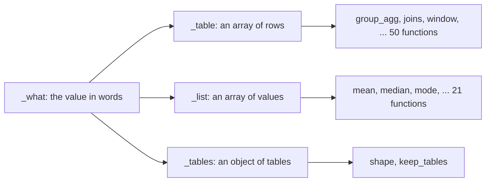

Four internal definitions that every other page calls first. A function here takes its whole input as one value: a table is one array of rows, a list is one array of values (README, rule 6 "One value in"). The usual mistake is `$rows[] | f`, which runs `f` once per row. Before version 0.14.0 that gave jq's own message, which names neither the function nor the cause, or, for `mode`, `value_counts` and `count_nonnull`, a wrong answer with no error. Now the function stops and says what it was given and what to write instead.



Only the outer type is checked. The rows of a table are not required to be objects, so `map(.site) | group_agg({site: .}; {n: length})`, a table of plain values, still works, and so does an edge list of pairs. Checking every item would also cost a pass over the rows; checking the outer type costs nothing measurable.

## _what/0
<!-- code: 261c0db7 -->

What a value is, in words, for the messages: "one object" for an object, since an object given where a table belongs is almost always one row; otherwise its type.

### The example

```jq run
{site: "N"}, [1, 2], "N", 3, null | _what
```

## _table/2
<!-- code: 593ae317 -->

The input, or an argument, must be a table. `$who` is the function's name and `$arg` says which value is checked: `"the input"`, or for an argument a phrase such as `"the right table"`. A table passes through unchanged, so `_table(...) | rest` is the function as it was.

### The example

The mistake, then the right call, on the same three rows:

```jq run
[{site: "N", n: 1}, {site: "S", n: 2}, {site: "N", n: 3}] as $rows
| (try ($rows[] | group_agg({site}; {n: length})) catch .),
  ($rows | group_agg({site}; {n: length}))
```

The first line is the message, given once: the first row stops the run. The second is the answer.

A row passed where an argument table belongs:

```jq run
[{host: "web01"}] | try join_left({host: "web01", site: "N"}; .host; .host) catch .
```

### The definition

<!-- definition -->

- `type == "array"`: a table of any rows passes, an empty one included.
- For the input, the message shows the call written both ways, with the function's own name.

## _list/1, _tables/1
<!-- code: 4776de5c -->

`_list`: the input must be a list of values. `_tables`: the input must be an object whose fields are tables, the shape `split_by` makes and `shape` and `keep_tables` read.

### The example

`count_nonnull` used to count a row's fields when given one row. Now it stops, and on the column it counts the rows:

```jq run
[{site: "N"}, {site: null}, {site: "S"}] as $rows
| (try ($rows[] | count_nonnull) catch .),
  ($rows | map(.site) | count_nonnull)
```

`shape` given one table instead of an object of tables:

```jq run
try ([{site: "N"}] | shape) catch .
```

### The definition

<!-- definition -->

The same pattern as `_table`, with a message that says how to make the right input: `map(.site)` for a list, `split_by` for an object of tables.
