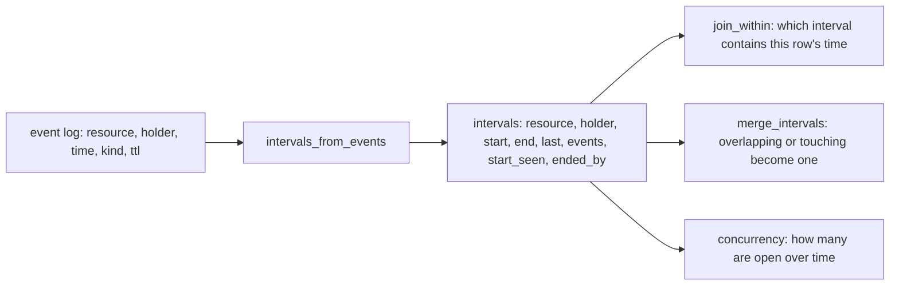

Six definitions. An interval is a row with a key, a start and an end, read as `[start, end)`: the start belongs to it, the end does not, and a null end means still open. `intervals_from_events` builds intervals from an event log; `join_within` finds the interval that contains a moment; `merge_intervals` and `concurrency` summarise a set of intervals.



Two of them, `intervals_from_events` and `merge_intervals`, share one pattern worth reading once: **a `foreach` that carries the open interval in `.cur` and hands finished intervals out through `.out`**.

- The state is `{cur, out}`. Each step first sets `.out = []`, then may put the intervals that close at this step into `.out`.
- The third part of the `foreach`, `.out[]`, emits whatever closed at this step. Finished intervals leave as they close.
- The loop runs over `(.[], null)`: the rows, then one extra `null` as an end-of-data marker, so the interval still open after the last row has a step at which to leave.

The obvious alternative, `reduce` appending each finished interval to a result array, copies that array on every append in jq, and the time grows with the square of the output. That was measured and repaired elsewhere in this library; these two were written this way from the start.
## _iv_check/2
<!-- code: 409d3cdb -->


Input: the event rows. Emits nothing; it exists to raise an error before any work is done.

- `to_entries[] | .key as $i | .value` walks the events with their position, so the message can say which event is wrong.
- A null `kind` is skipped: such an event is ignored by the builder too.
- A kind other than `open`, `hold` or `release` is an error; so is a known kind with a null time.

`intervals_from_events` calls it as `([_iv_check(time; kind)] | length) as $_`: collecting its (empty) output forces it to run over every event, and the binding to `$_` keeps the original input flowing on.

```jq run
[{t: 1, k: "hold"}, {t: 2, k: "renew"}] | try [_iv_check(.t; .k)] catch .
```
## intervals_from_events/5
<!-- code: c2e0cd69 -->


Input: an event table. `resource`, `holder`, `time`, `kind` and `ttl` are expressions evaluated on each event. Output: one row per interval.

Before the loop:

- `map(select((kind) != null))` drops ignored events.
- `_groups(resource)[]` (from the grouping family) gives the events of each resource, resources in order of first appearance.
- `sort_by([(time), (… 0, 1 or 2)])` orders one resource's events by time, and at the same time by kind: open, hold, release. A release and a renewal logged in the same second therefore apply as "renewed, then released", whichever line came first in the log. This rule came from real lease logs, where the other order produced intervals that never started.

Each step of the loop, for event `$e` with time `$t`, kind `$k`, holder `$h`:

1. **Lapse.** `if .cur != null and .cur.end != null and $t >= .cur.end`: the open interval's validity ran out before this event, so it closes as `lapsed` at the end it already had, and nothing is open. `>=` because the end itself is outside the interval.
2. **Release.** If the current holder releases, the interval closes at `$t` as `released`. A release from anyone else, or with nothing open, falls through `else .` and changes nothing.
3. **Same holder again** (`open` or `hold`): the interval is extended. `events` and `last` are updated, and `end` becomes the later of the old end and `$t + $ttl`. A null `$ttl` on this event makes the end null: the newest evidence says it does not expire.
4. **Anyone else, or nothing open:** if an interval is open it closes at `$t` as `taken_over`; then a new interval starts at `$t`, with `start_seen` true only when the event's kind is `open`.

At the end-of-data marker, an interval still open leaves with `ended_by: "open"` and whatever end its last hold gave it.

One resource, traced. `ttl` is 100 on every event except the last two, where it is 50:

| time | event | what happens | open interval afterwards |
|---|---|---|---|
| 0 | open, ann | nothing was open: start | ann, 0 to 100, 1 event, start seen |
| 50 | hold, ann | same holder: extend to max(100, 150) | ann, 0 to 150, 2 events, last 50 |
| 120 | hold, bo | 120 is before 150, so no lapse; another holder: ann's closes at 120, `taken_over` | bo, 120 to 220, start not seen |
| 130 | release, ann | ann does not hold it: ignored | bo, 120 to 220 |
| 200 | release, bo | holder releases: closes at 200, `released` | none |
| 300 | hold, cy | nothing open: start | cy, 300 to 350 |
| 400 | hold, cy | 400 is past 350: cy's closes at 350, `lapsed`; then start | cy, 400 to 450 |
| end | | still open: leaves as `open` | |

```jq run
[{t: 0, who: "ann", k: "open", ttl: 100}, {t: 50, who: "ann", k: "hold", ttl: 100},
 {t: 120, who: "bo", k: "hold", ttl: 100}, {t: 130, who: "ann", k: "release", ttl: null},
 {t: 200, who: "bo", k: "release", ttl: null}, {t: 300, who: "cy", k: "hold", ttl: 50},
 {t: 400, who: "cy", k: "hold", ttl: 50}]
| map(.seat = "seat-7")
| intervals_from_events(.seat; .who; .t; .k; .ttl)
| map(del(.resource))
```
## join_within/6
<!-- code: 1a4b05ff -->


Left outer: each left row with the interval of the same key that contains the row's time.

The index, built once per key from the intervals with a non-null key and start, sorted by start:

- `rows`: the interval rows; `s`: their starts; `e`: their ends, with a null end replaced by `$inf`, the largest number a double can hold, so an open interval contains every later time without a special case.
- `m`: for each position, the latest end among the rows up to and including it. `foreach .value.e[] as $x (null; if . == null or $x > . then $x else . end)` is a running maximum.

For a left row with key `$k` and time `$t`:

1. `($g.s | bsearch($t))` and the `-2 - $i` step find a start at or before `$t`, as in `join_asof`.
2. `until(. + 1 >= ($g.s | length) or $g.s[. + 1] > $t; . + 1)` moves forward to the last such start, since several intervals can start at the same time and `bsearch` may land on any of them.
3. `until(. < 0 or $g.e[.] > $t or $g.m[.] <= $t; . - 1)` walks back. It stops at the first interval whose end is after `$t` (it started at or before `$t`, so it contains it), or as soon as `m` says no interval this far back ends after `$t`, or at the front. Walking back from the last start is what makes the answer "the one that started last" when several contain `$t`.
4. If it stopped on an interval that contains `$t`, the rows are merged with `_merge`; otherwise the left row comes back alone.

Without `m`, step 3 would have to walk to the front of the key's intervals for every time that falls in a gap. For intervals that do not overlap, which is what `intervals_from_events` produces, the walk is at most one step.

```jq run
[{seat: "s1", holder: "ann", start: 0, end: 120}, {seat: "s1", holder: "bo", start: 120, end: 200},
 {seat: "s1", holder: "cy", start: 400, end: null}] as $held
| [{at: 119}, {at: 120}, {at: 250}, {at: 9999}, {at: -5}]
| map(.seat = "s1")
| join_within($held; .seat; .seat; .at; .start; .end)
| map({at, holder})
```

119 is ann's last moment and 120 is bo's first: the end is outside the interval. 250 falls in a gap. cy's interval has no end, so it holds every time from 400 on.
## _iv_order_check/3
<!-- code: 17bb0b45 -->


Passes its input through unchanged, or stops with an error when any interval has no start, or an end before its start. `$who` is the name of the calling function, for the message. A null end is allowed.

**Review finding 1, fixed in 0.9.0.** Until 0.8.1 a null start was not checked: `merge_intervals` treated it as the earliest start and `concurrency` emitted a row with a null time. Both now raise `F: an interval has no start`.

```jq run
([{s: 5, e: 3}] | try _iv_order_check(.s; .e; "merge_intervals") catch .),
([{s: null, e: 3}] | try _iv_order_check(.s; .e; "concurrency") catch .)
```
## merge_intervals/3
<!-- code: 5b3dafeb -->


Per key, intervals that overlap or touch become one.

- `_groups(key)[]` takes each key's intervals; `$k` is the key as fields to put on the output row: the key itself when it is an object such as `{room}`, otherwise `{key: value}`.
- `sort_by(start)`, then the same `foreach` pattern as above. For each interval `$r`: if one is open and `$s <= .cur.end` (or the open one has no end), `$r` joins it: `merged` goes up by one and the end becomes the later of the two, or null if either is null. Otherwise the open one leaves and `$r` starts a new one.
- `<=`, not `<`: an interval that starts exactly where the previous one ends is merged with it.

```jq run
[{room: "A", s: 1, e: 3}, {room: "A", s: 3, e: 5}, {room: "A", s: 8, e: 9},
 {room: "B", s: 2, e: null}, {room: "B", s: 7, e: 8}]
| merge_intervals({room}; .s; .e)
```
## concurrency/2
<!-- code: 46298a10 -->


How many intervals are open, as a step function: one row per moment the count changes.

- Each interval becomes two small records: `{t: start, d: 1}` and, unless its end is null, `{t: end, d: -1}`.
- `group_by(.t)` gathers everything that happens at one moment, in time order.
- The `foreach` keeps a running count. `$net` is the sum of the `d` values at that moment; the state becomes `{open, t, net}`.
- `select(.net != 0) | {t, open}` emits a row only when the count really changed. One interval ending exactly when another starts gives a net of zero and no row: the count did not change.

```jq run
[{s: 1, e: 5}, {s: 2, e: 5}, {s: 5, e: 9}, {s: 7, e: null}] | concurrency(.s; .e)
```

At 5 two intervals end and one starts, so the count goes from 2 to 1. The interval with no end keeps the count at 1 after 9.
