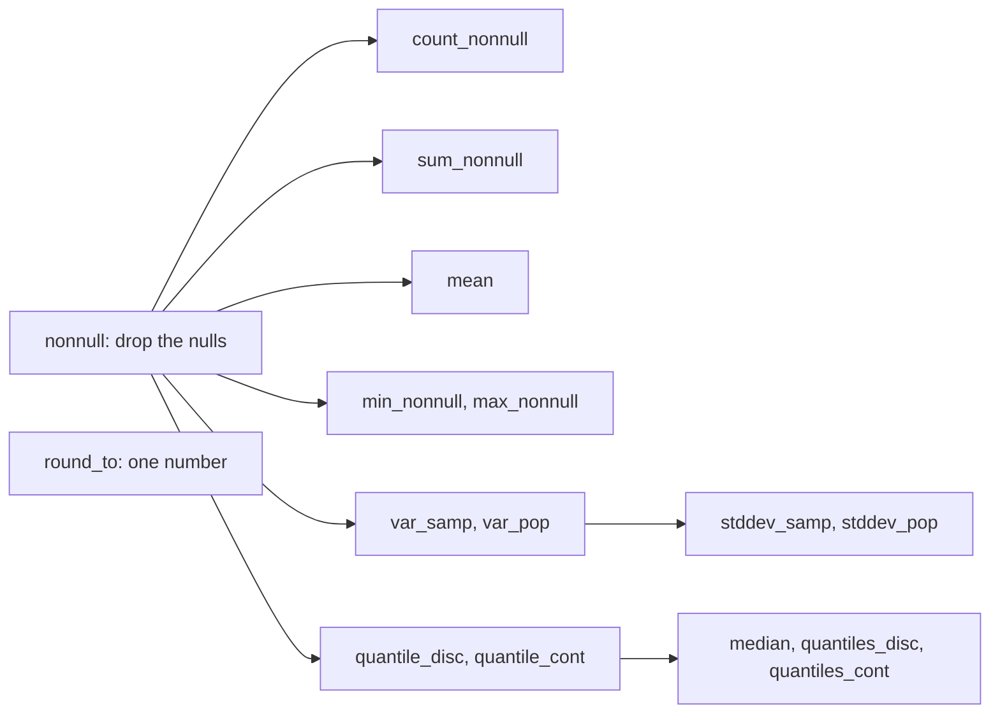

Eighteen definitions over a list of values, usually one column of a table (`map(.x)`). One rule runs through all of them: **nulls are skipped, and "no values" gives null**, as SQL aggregates do. jq's own `add`, `min` and `length` do not skip nulls, which is why these exist under their own names.



Two jq reminders for this page. A bare word such as `mean` is a call to the function of that name, and it runs on the current input, which here is the list. A comma between calls (`count_nonnull, mean`) runs each on the same input and emits each result as its own value, so a run with commas prints several lines.

## nonnull/0, count_nonnull/0, sum_nonnull/0, mean/0
<!-- code: 23ab2dcc -->

The list without its nulls, and the count, sum and mean of what is left. They are SQL's `COUNT(x)`, `SUM(x)` and `AVG(x)`, and a spreadsheet's `COUNT`, `SUM` and `AVERAGE`, which also skip empty cells.

### The example

A column of three rows, one of them with no value. The four functions, in the order of the heading:

```jq run
[1, null, 3] | nonnull, count_nonnull, sum_nonnull, mean
```

Four values, one per function. Two values are left after the null is dropped, their sum is 4, and the mean is 4 / 2 = 2.

The same column with jq's own builtins:

```jq run
[1, null, 3] | length, add, (add / length)
```

`length` counts the null, so the plain mean divides 4 by 3 rows. `add` gives the same sum as `sum_nonnull`, because adding null to a number leaves the number.

A column with no values at all gives null for the sum and the mean, and 0 for the count:

```jq run
[null] | nonnull, count_nonnull, sum_nonnull, mean
```

### What happens inside, on the example

Each of the three starts from `nonnull` and then does one thing. For `mean`:

Step 1, `nonnull`: the two values.

```jq run
[1, null, 3] | nonnull
```

Step 2, `add / length` on that list: 4 / 2.

```jq run
[1, 3] | add, length, (add / length)
```

### The definition

<!-- definition -->

- `nonnull` is `map(select(. != null))`: the list without its nulls. Everything below starts with it.
- `count_nonnull` is its length. Plain `length` counts the nulls too.
- `sum_nonnull`: `if length == 0 then null else add end`. jq's `add` already skips a null among numbers and gives null for an empty list, so the result rarely differs from plain `add`. The definition is here so that the sum follows the same stated rule as the others, and reads as such in a query.
- `mean`: `add / length` after the nulls are gone (step 2), so the divisor is the number of values, not the number of rows. The `if length == 0` branch gives null for no values, where a plain division by 0 is an error.

## min_nonnull/0, max_nonnull/0, min_by_nonnull/1, max_by_nonnull/1
<!-- code: f702ca43 -->

The least and greatest value of a column, and the whole row that holds it. They are SQL's `MIN`, `MAX`, `ARG_MIN` and `ARG_MAX`.

### The example

Four rows. Row 1 has no x, and rows 2 and 4 share the highest x.

| id | x |
|---|---|
| 1 | null |
| 2 | 5 |
| 3 | 2 |
| 4 | 5 |

On the column `map(.x)`: jq's own `min`, then `min_nonnull` and `max_nonnull`.

```jq run
[{id: 1, x: null}, {id: 2, x: 5}, {id: 3, x: 2}, {id: 4, x: 5}]
| map(.x) | min, min_nonnull, max_nonnull
```

The plain `min` is null, because in jq's ordering null sorts below every number. `min_nonnull` gives 2.

On the rows: the row with the lowest x, then the row with the highest.

```jq run
[{id: 1, x: null}, {id: 2, x: 5}, {id: 3, x: 2}, {id: 4, x: 5}]
| min_by_nonnull(.x), max_by_nonnull(.x)
```

Two rows, each whole. Rows 2 and 4 tie for the highest x, and row 4, the last of them, is returned. On a tie `min_by_nonnull` returns the first such row.

With nothing left after the nulls are dropped, all four give null:

```jq run
[{id: 1, x: null}] | (map(.x) | min_nonnull, max_nonnull), min_by_nonnull(.x), max_by_nonnull(.x)
```

### Reading the call

`min_nonnull` takes no argument and runs on a list of values. `min_by_nonnull(.x)` runs on a list of rows, and its argument `.x` is a filter: a piece of program that the function runs on each row to get the value to compare. A field is always written with the dot; a bare `x` would be a call to a function named `x`.

### What happens inside, on the example

Step 1, `map(select((.x) != null))`: the rows whose x is null are dropped.

```jq run
[{id: 1, x: null}, {id: 2, x: 5}, {id: 3, x: 2}, {id: 4, x: 5}]
| map(select((.x) != null))
```

Step 2, jq's `min_by(.x)` or `max_by(.x)` on those three rows gives the results above.

### The definition

<!-- definition -->

- `min_nonnull` and `max_nonnull` are jq's `min` and `max` after `nonnull`. Both builtins give null for an empty list, which is the "no values" rule.
- `min_by_nonnull(f)` and `max_by_nonnull(f)` drop the rows whose `f` is null (step 1), then call `min_by(f)` or `max_by(f)` (step 2). The tie rule is the builtins' own: the first such row for `min_by`, the last for `max_by`.

## var_samp/0, var_pop/0, stddev_samp/0, stddev_pop/0
<!-- code: 99f64a23 -->

Variance and standard deviation: how far the values lie from their mean. The `_pop` forms divide by the number of values (SQL `VAR_POP`, `STDDEV_POP`; a spreadsheet's `VAR.P`, `STDEV.P`). The `_samp` forms divide by one less (SQL `VAR_SAMP`, `STDDEV_SAMP`; `VAR.S`, `STDEV.S`).

### The example

Eight values and one null.

```jq run
[2, 4, 4, null, 4, 5, 5, 7, 9] | var_pop, stddev_pop, var_samp, stddev_samp
```

Four values, in the order of the calls. The hand check is in the steps below: the squared differences sum to 32, so the population variance is 32 / 8 = 4 and its square root is 2. The sample variance is 32 / 7.

### What happens inside, on the example

Step 1, `nonnull | length as $n`: the eight values, and `$n` is 8. `as $n` gives the count a name and leaves the list as the input of the next step.

```jq run
[2, 4, 4, null, 4, 5, 5, 7, 9] | nonnull | ., length
```

Step 2, `(add / $n) as $m`: the mean, 40 / 8.

```jq run
[2, 4, 4, 4, 5, 5, 7, 9] | add / length
```

Step 3, `map((. - $m) * (. - $m))`: each value's difference from the mean, squared.

```jq run
[2, 4, 4, 4, 5, 5, 7, 9] | map((. - 5) * (. - 5))
```

Step 4, `add` of those, then the division: by `$n` for `var_pop`, by `$n - 1` for `var_samp`.

```jq run
[9, 1, 1, 1, 0, 0, 4, 16] | add, (add / 8), (add / 7)
```

Step 5, for the `stddev_` forms only: `sqrt` of the variance.

### Too few values

One value has a population variance (0) and no sample variance. No values give null everywhere.

```jq run
([3] | var_pop, var_samp, stddev_samp), ([null] | var_pop, stddev_pop)
```

### The definition

<!-- definition -->

- `nonnull | length as $n`: step 1.
- `if $n < 2 then null` in `var_samp`: one value has no sample variance, and the division would be by 0. `var_pop` is null only when `$n == 0`.
- `(add / $n) as $m`: the mean, step 2. This is the first of two passes over the values.
- `map((. - $m) * (. - $m)) | add`: the second pass, steps 3 and 4. It is written as a multiplication and not as `pow(.; 2)`, so there is no function call per value.
- `stddev_samp` and `stddev_pop` are `sqrt` of the variance, with null passed through, because `null | sqrt` is an error in jq.

## quantile_disc/1, quantile_cont/1, median/0, quantiles_disc/1, quantiles_cont/1
<!-- code: 136f945d -->

The value below which a share `$p` of the data lies, with `$p` from 0 to 1. `quantile_disc` returns a value that is in the data (SQL `PERCENTILE_DISC`). `quantile_cont` interpolates between two neighbours (SQL `PERCENTILE_CONT`, a spreadsheet's `PERCENTILE.INC`). `median` is `quantile_cont(0.5)`.

### The example

Four values and a null, not in order.

```jq run
[40, 10, null, 30, 20] | quantile_disc(0.25), quantile_cont(0.25), median
```

Three values. A quarter of the way through the sorted values `[10, 20, 30, 40]`, the discrete form gives 10, a value from the data. The continuous form gives 17.5, three quarters of the way from 10 to 20. The median is halfway between 20 and 30.

The plural forms take a list of `$p` and return a list:

```jq run
[40, 10, null, 30, 20] | quantiles_disc([0, 0.25, 0.5, 0.75, 1]), quantiles_cont([0.25, 0.5, 0.75, 1])
```

The hand check for every `$p`, with the sorted values `[10, 20, 30, 40]` and `$n = 4`:

| `$p` | disc: rank `ceil(4p)` | disc value | cont: `$h = 3p` | cont value |
|---|---|---|---|---|
| 0.25 | 1 | 10 | 0.75 | 10 + 0.75 × 10 = 17.5 |
| 0.5 | 2 | 20 | 1.5 | 20 + 0.5 × 10 = 25 |
| 0.75 | 3 | 30 | 2.25 | 30 + 0.25 × 10 = 32.5 |
| 1 | 4 | 40 | 3 | 40 |

### Reading the call

`$p` is written with a `$` in the definitions, which makes it a value: `quantile_disc(0.25)` receives the number 0.25. That differs from `min_by_nonnull(.x)` above, whose argument is a filter run on each row. The input of every function here is the list of values.

### What happens inside, on the example

Both forms start the same way. Step 1, `nonnull | sort as $x | length as $n`: the sorted values are `$x`, and `$n` is 4.

```jq run
[40, 10, null, 30, 20] | nonnull | sort | ., length
```

**`quantile_disc(0.25)`.** Step 2, the rank `ceil($n * $p)`, and at least 1:

```jq run
[(4 * 0.25 | ceil), 1] | max
```

Step 3, `$x[rank - 1]`: ranks count from 1 and positions from 0, so rank 1 is position 0.

```jq run
[10, 20, 30, 40] | .[1 - 1]
```

**`quantile_cont(0.25)`.** Step 2, `(($n - 1) * $p) as $h | ($h | floor) as $lo`: `$h` is a position with a fraction, and `$lo` is the whole position below it.

```jq run
(4 - 1) * 0.25 | ., floor
```

Step 3, `$x[$lo] + ($h - $lo) * ($x[$lo + 1] - $x[$lo])`: start at the value at position 0 and go the fraction 0.75 of the step to the value at position 1.

```jq run
[10, 20, 30, 40] | .[0] + (0.75 - 0) * (.[1] - .[0])
```

### Edge cases

`$p = 0` gives the smallest value in both forms, and `$p = 1` the largest. With no values the single forms give null, and the plural forms give one null, not a list of nulls.

```jq run
([40, 10, null, 30, 20] | quantile_disc(0), quantile_cont(0), quantile_cont(1)),
([null] | quantile_disc(0.5), median, quantiles_cont([0.25, 0.5]))
```

### The definition

<!-- definition -->

- `nonnull | sort as $x | length as $n`: step 1, in both forms.
- **`quantile_disc`**: `[(($n * $p) | ceil), 1] | max` is the rank, with 1 as its floor so that `$p = 0` gives the smallest value. The `- 1` turns the rank into a position.
- **`quantile_cont`**: `$h` and `$lo` are step 2 and the last line is step 3. `if $lo + 1 >= $n` catches `$p = 1`, where `$lo` is the last position and there is no next value to step toward.
- `median` is `quantile_cont(0.5)`.
- The plural forms call the single form once per `$p`. `[$ps[] as $p | ...]` collects the results into a list. `if count_nonnull == 0 then null` gives a single null for no values, which is what DuckDB's list form does.

## round_to/1
<!-- code: faf62b1a -->

A number rounded to `$d` decimal places, as SQL's and a spreadsheet's `ROUND(x, d)`. Halves go away from zero. Null stays null.

### The example

Its input is one number, not a list, so the run uses `map` to round each of five inputs to two places and then to none.

```jq run
[0.125, 2.5, -2.5, 1.005, null] | map(round_to(2)), map(round_to(0))
```

Two lists: the first rounded to two places, the second to none. To two places 0.125 becomes 0.13. To no places 2.5 and -2.5 become 3 and -3. In both the half goes away from zero. To two places 1.005 becomes 1 and not 1.01, which the steps below explain.

jaq prints a rounded whole number with a decimal point (`3.0` where jq prints `3`). The values are equal.

### What happens inside, on the example

For `0.125 | round_to(2)`. Step 1, `pow(10; $d) as $m`: the multiplier, 100. Step 2, `. * $m`: the decimal point moves two places right. Step 3, `round`: to a whole number. Step 4, `/ $m`: the point moves back. The four results, in that order:

```jq run
0.125 | pow(10; 2), (. * 100), (. * 100 | round), ((. * 100 | round) / 100)
```

The same steps 2 and 3 for 1.005:

```jq run
1.005 | (. * 100), (. * 100 | round)
```

1.005 cannot be stored exactly as a binary number. The stored value is a little below it, so times 100 it is a little below 100.5 and rounds to 100. The rounding is of the number as stored.

### The definition

<!-- definition -->

- `if . == null then null`: null in, null out, where `null * 100` would give an error.
- `pow(10; $d) as $m | (. * $m | round) / $m`: steps 1 to 4. jq's `round` sends halves away from zero.
