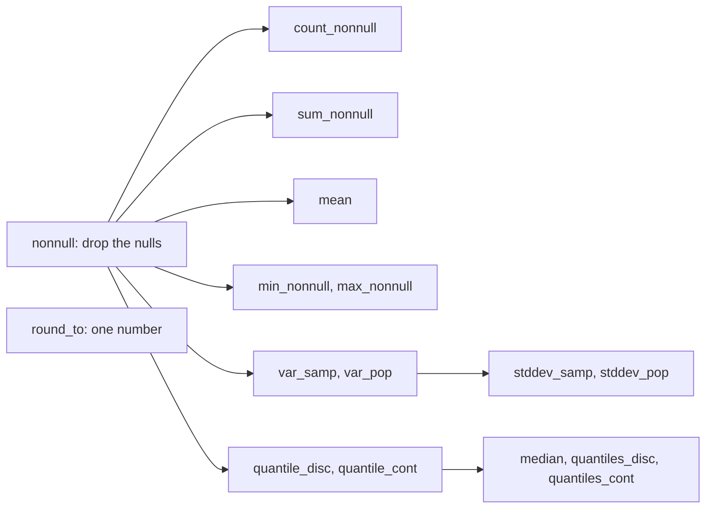

Eighteen definitions over a list of values, usually one column of a table (`map(.x)`). One rule runs through all of them: **nulls are skipped, and "no values" gives null**, as SQL aggregates do. jq's own `add`, `min` and `length` do not skip nulls, which is why these exist under their own names.



## nonnull/0, count_nonnull/0, sum_nonnull/0, mean/0
<!-- code: fc85b810 -->

- `nonnull` is `map(select(. != null))`: the list without its nulls. Everything below starts with it.
- `count_nonnull` is its length. Plain `length` counts the nulls too.
- `sum_nonnull`: `if length == 0 then null else add end`. jq's `add` already skips a null among numbers and gives null for an empty list, so the result rarely differs from plain `add`; the definition is here so that the sum follows the same stated rule as the others, and reads as such in a query.
- `mean`: `add / length` after the nulls are gone, so the divisor is the number of values, not the number of rows.

```jq run
[1, null, 3] | {plain: (add / length), mean: mean, length: length, count_nonnull: count_nonnull,
                sum_nonnull: sum_nonnull, of_nothing: ([null] | [mean, sum_nonnull, count_nonnull])}
```

The plain form divides 4 by 3 rows; `mean` divides it by 2 values.

## min_nonnull/0, max_nonnull/0, min_by_nonnull/1, max_by_nonnull/1
<!-- code: 49ed13c0 -->

- `min_nonnull` and `max_nonnull` are jq's `min` and `max` after `nonnull`. In jq's ordering null sorts below every number, so a plain `min` over a column with one null returns null.
- `min_by_nonnull(f)` and `max_by_nonnull(f)` take rows and return the whole row whose `f` is least or greatest, after dropping rows whose `f` is null. On a tie `min_by` returns the first such row and `max_by` the last; these inherit that.

```jq run
[{id: 1, x: null}, {id: 2, x: 5}, {id: 3, x: 2}, {id: 4, x: 5}]
| {plain_min: (map(.x) | min), min_nonnull: (map(.x) | min_nonnull), max_nonnull: (map(.x) | max_nonnull),
   lowest_row: min_by_nonnull(.x).id, highest_row: max_by_nonnull(.x).id, none: ([{x: null}] | min_by_nonnull(.x))}
```

Rows 2 and 4 tie for the highest `x`; the last of them, 4, is returned.

## var_samp/0, var_pop/0, stddev_samp/0, stddev_pop/0
<!-- code: 4bc47a93 -->

Two passes over the non-null values: the mean `$m`, then the sum of squared differences from it.

- `var_samp` divides by `$n - 1` and is null below two values (one value has no sample variance).
- `var_pop` divides by `$n` and is null only when there are no values.
- `(. - $m) * (. - $m)` rather than `pow(.; 2)`: a multiplication, with no call.
- `stddev_*` is `sqrt` of the variance, with null passed through, because `null | sqrt` is an error in jq.

Hand check on `[2, 4, 4, 4, 5, 5, 7, 9]`: the mean is 5; the squared differences are 9, 1, 1, 1, 0, 0, 4, 16, which sum to 32. Population variance 32 / 8 = 4, standard deviation 2; sample variance 32 / 7.

```jq run
[2, 4, 4, 4, 5, 5, 7, 9] | {var_pop: var_pop, stddev_pop: stddev_pop, var_samp_times_7: (var_samp * 7 | round),
                            one_value: ([3] | [var_samp, var_pop]), none: ([] | [var_samp, var_pop, stddev_pop])}
```

## quantile_disc/1, quantile_cont/1, median/0, quantiles_disc/1, quantiles_cont/1
<!-- code: c3b5f2b1 -->

Both sort the non-null values into `$x` with `$n` values and take `$p` from 0 to 1.

- **`quantile_disc`** returns a value that is in the data: the one at rank `ceil($n * $p)`, counting from 1, and at least rank 1 (so `$p = 0` gives the smallest). `[…, 1] | max` is that floor; the `- 1` turns the rank into a position.
- **`quantile_cont`** interpolates. `$h = ($n - 1) * $p` is a fractional position; `$lo` is the position below it. The result is `$x[$lo]` plus the fraction `$h - $lo` of the step to the next value. `if $lo + 1 >= $n` catches `$p = 1`, where there is no next value.
- `median` is `quantile_cont(0.5)`.
- The plural forms take a list of `$p` and return a list, or a single null when there are no values, which is what DuckDB's list form does.

Hand check on `[40, 10, null, 30, 20]`: sorted `[10, 20, 30, 40]`, `$n = 4`.

| `$p` | disc: rank `ceil(4p)` | disc value | cont: `$h = 3p` | cont value |
|---|---|---|---|---|
| 0.25 | 1 | 10 | 0.75 | 10 + 0.75 × 10 = 17.5 |
| 0.5 | 2 | 20 | 1.5 | 20 + 0.5 × 10 = 25 |
| 0.75 | 3 | 30 | 2.25 | 30 + 0.25 × 10 = 32.5 |
| 1 | 4 | 40 | 3 | 40 |

```jq run
[40, 10, null, 30, 20] | {disc: quantiles_disc([0, 0.25, 0.5, 0.75, 1]), cont: quantiles_cont([0.25, 0.5, 0.75, 1]),
                          median: median, none: ([null] | [quantile_disc(0.5), quantiles_cont([0.5])])}
```

**Review finding 2, fixed in 0.9.0.** The comment above `quantile_disc` used to name a file outside this repository; that clause is gone.

## round_to/1
<!-- code: faf62b1a -->

`pow(10; $d) as $m | (. * $m | round) / $m`: shift the decimal point right by `$d` places, round to a whole number, shift back. jq's `round` sends halves away from zero. Null stays null.

The rounding is of the number as stored. 1.005 cannot be stored exactly; the stored value is a little below it, so times 100 it is a little below 100.5 and rounds to 100.

```jq run
[0.125, 2.5, -2.5, 1.005, null] | [map(round_to(2)), map(round_to(0))]
```

jaq prints a rounded whole number with a decimal point (`3.0` where jq prints `3`); the values are equal.
