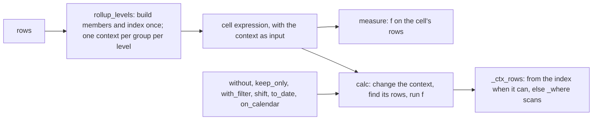

Thirteen definitions that let a report compute one measure at several levels and compare a cell with a different slice of the data: its share of a total, the previous period, a running total. This is the part of the library modelled on DAX's `CALCULATE`.

Three words carry it:

- A **measure** is any jq expression over an array of rows, such as `map(.rev) | sum_nonnull`.
- A **context** is the object a cell is evaluated in: which filters it stands for (`at`), the rows that match them (`rows`), every row (`all`), and two lookups built once per report (`members`, `index`).
- A **context change** takes a context and returns another: remove a filter, add one, move to a neighbouring value.



All runs below use five made-up sales rows:

```text
region  month     rev
E       2026-01   10
E       2026-01   20
E       2026-03   10
W       2026-01   30
W       2026-03   30
```

There are no February rows; that matters for `shift`.

## _where/1
<!-- code: 95d97c56 -->

Rows matching a filter object, by scanning. `$at | to_entries | all(…)` requires every filter to hold for the row. A plain value is equality. An object `{from, to}` is a closed range: the row's value must not be null and must lie at or above `from` and at or below `to`, where a missing bound is no bound.

```jq run
[{r: "E", rev: 10}, {r: "E", rev: 20}, {r: "W", rev: 30}, {r: "E", rev: null}]
| _where({r: "E", rev: {from: 15}}), (_where({rev: {to: 20}}) | length)
```

## _ctx_rows/0
<!-- code: 12f42ebf -->

Input: a context. Output: the rows it stands for. Three paths:

- `$ks` is the sorted list of the filter's fields, and `$c.index[$ks | tojson]` is the report's index for exactly that set of fields, if the report has a level with those fields.
- **No such index, or more than one range filter:** scan all rows with `_where`.
- **An index and no range:** one lookup, `$ix[[values in key order] | tojson]`, or no rows.
- **An index and one range** on field `$d`: take that field's member values that fall in the range, in order, and concatenate the index groups for each. This is what a running total uses.

The index is why changing a context is cheap in the common case: `without("month")` at a region and month cell leaves a filter on region alone, and the region level's groups are already there. A filter on a field that is not a level scans every row, once per cell.

```jq run
[["E", "2026-01", 10], ["E", "2026-01", 20], ["E", "2026-03", 10], ["W", "2026-01", 30], ["W", "2026-03", 30]]
| map({region: .[0], month: .[1], rev: .[2]})
| rollup_levels([["region", "month"], ["region"]];
    {from_index: (without("month") | _ctx_rows | length),
     by_scan: (with_filter({rev: {from: 20}}) | _ctx_rows | length)})
```

At `E / 2026-01`, removing the month leaves the three E rows; adding "rev at least 20" leaves one of that cell's two rows.

## rollup_levels/2
<!-- code: a561ee02 -->

One output row per group at each listed level.

- **`$members`**: for every field named in any level, its sorted distinct values over all rows. `shift` and `to_date` step through these.
- **`$index`**: for every level's set of fields (and the empty set), the rows grouped by those fields, keyed by the values as JSON text. `(reduce $lvl[] as $d ({}; .[$d] = 1)) | keys` is the level's fields sorted and without repeats, so `["region", "month"]` and `["month", "region"]` share one index. `if has(…) then .` skips a set already built.
- **Per level**: each index group becomes a context `{at, rows}`; `sort_by([.at[$lvl[]]])` orders the groups by the level's values in the order the caller listed the fields.
- **Per group**: the full context is assembled and `cell` runs with it as input. The output row is the filter fields, a `level` name (`"region/month"`, or `"all"` for the empty level) and whatever `cell` returned.

Every level is computed from rows. Nothing is added up from finer cells, so a median or a ratio is right at the total.

```jq run
[["E", "2026-01", 10], ["E", "2026-01", 20], ["E", "2026-03", 10], ["W", "2026-01", 30], ["W", "2026-03", 30]]
| map({region: .[0], month: .[1], rev: .[2]})
| rollup_levels([["region"], ["month"], []]; {rows: measure(length), rev: measure(map(.rev) | sum_nonnull), median: measure(map(.rev) | median)})
```

The median of all five rows is 20; it is not derivable from the regions' medians (10 and 30).

## rollup/2
<!-- code: 3adb2706 -->

The levels of a hierarchy: all the fields, then one fewer from the right, down to none. `range($dims | length; -1; -1) as $n | $dims[0:$n]` produces `["region", "month"]`, `["region"]`, `[]`.

```jq run
[["E", "2026-01", 10], ["E", "2026-01", 20], ["E", "2026-03", 10], ["W", "2026-01", 30], ["W", "2026-03", 30]]
| map({region: .[0], month: .[1], rev: .[2]})
| rollup(["region", "month"]; {rev: measure(map(.rev) | sum_nonnull)}) | map([.level, .region, .month, .rev])
```

## measure/1, calc/2, share/2
<!-- code: 5404c91d -->

- `measure(f)` is `.rows | f`: the measure on the cell's own rows.
- `calc(f; change)` applies the change to the context, and unless the change left no context (`.void`), finds the changed context's rows with `_ctx_rows` and runs `f` on them. A void context gives null without running `f`.
- `share(f; change)` is the measure here divided by the measure there, null when either is null or the divisor is 0.

```jq run
[["E", "2026-01", 10], ["E", "2026-01", 20], ["E", "2026-03", 10], ["W", "2026-01", 30], ["W", "2026-03", 30]]
| map({region: .[0], month: .[1], rev: .[2]})
| rollup_levels([["region", "month"]];
    {rev: measure(map(.rev) | sum_nonnull),
     region_rev: calc(map(.rev) | sum_nonnull; without("month")),
     of_region: share(map(.rev) | sum_nonnull; without("month")),
     of_all: share(map(.rev) | sum_nonnull; keep_only([]))})
| map(del(.level))
```

Hand check: E in January is 30 of E's 40 (0.75) and of the 100 in all (0.3).

## without/1, keep_only/1, with_filter/1
<!-- code: 34bfef00 -->

Each edits `.at`, the filter object, and nothing else.

- `without($dim)` deletes one filter. It is written `.at |= del(.[$dim])` because on gojq `del(.at[$dim])` copied the whole context, rows included, on every call.
- `keep_only($dims)` keeps the listed filters and drops the rest; `keep_only([])` is the grand total.
- `with_filter($at)` adds or replaces filters: a value, or a `{from, to}` range.

```jq run
{at: {region: "E", month: "2026-01"}} | [without("month"), keep_only(["month"]), with_filter({month: "2026-03", rev: {from: 20}})] | map(.at)
```

## shift/2
<!-- code: 520696ad -->

Moves the filter on `$dim` to the value `$k` places along in `.members[$dim]`.

- No filter on `$dim` (a total row), a null value, or a range: `.void = true`, since there is nothing to move from.
- A field with no member list (not a level of the report, and no `on_calendar`) is an error naming the field.
- `index($v)` finds the current value's position in the members. Not found, or the move would step off either end: void.
- Otherwise the filter takes the neighbouring value.

Members are the values present in the data unless `on_calendar` replaced them.

**Review finding 12, fixed in 0.9.0.** Until 0.8.1, `shift` on a field with no member list gave a null cell on jq and gojq and the error `cannot index null` on jaq. It is now one error on every engine: `shift: "m" is not a level of this report; add it to a level or use on_calendar`.

## on_calendar/2
<!-- code: d032a9ab -->

One assignment: the member list of `$dim` becomes `$values`. `shift` and `to_date` read that list, so nothing else has to change for them to step through calendar periods, including ones with no rows.

```jq run
[["E", "2026-01", 10], ["E", "2026-01", 20], ["E", "2026-03", 10], ["W", "2026-01", 30], ["W", "2026-03", 30]]
| map({region: .[0], month: .[1], rev: .[2]})
| ["2026-01", "2026-02", "2026-03"] as $months
| rollup_levels([["region", "month"], ["region"]];
    {rev: measure(map(.rev) | sum_nonnull),
     prev_with_rows: calc(map(.rev) | sum_nonnull; shift("month"; -1)),
     prev_calendar: calc(map(.rev) | sum_nonnull; on_calendar("month"; $months) | shift("month"; -1))})
| map(del(.level))
```

For March, the previous month that has rows is January (30 for E), while the previous calendar month is February, which has no rows, so the measure runs on nothing and gives null. January has no previous value either way. At the region level there is no month to move from, so both are null.

## to_date/1
<!-- code: 0bfe47cd -->

Turns the filter on `$dim` into the range "up to and including this value", keeping the other filters. No filter on `$dim`: the context is unchanged, so a total row shows the total. A null value: void.

```jq run
[["E", "2026-01", 10], ["E", "2026-01", 20], ["E", "2026-03", 10], ["W", "2026-01", 30], ["W", "2026-03", 30]]
| map({region: .[0], month: .[1], rev: .[2]})
| rollup(["region", "month"]; {rev: measure(map(.rev) | sum_nonnull), to_date: calc(map(.rev) | sum_nonnull; to_date("month"))})
| map([.level, .region, .month, .rev, .to_date])
```

E's running total is 30 after January and 40 after March.
