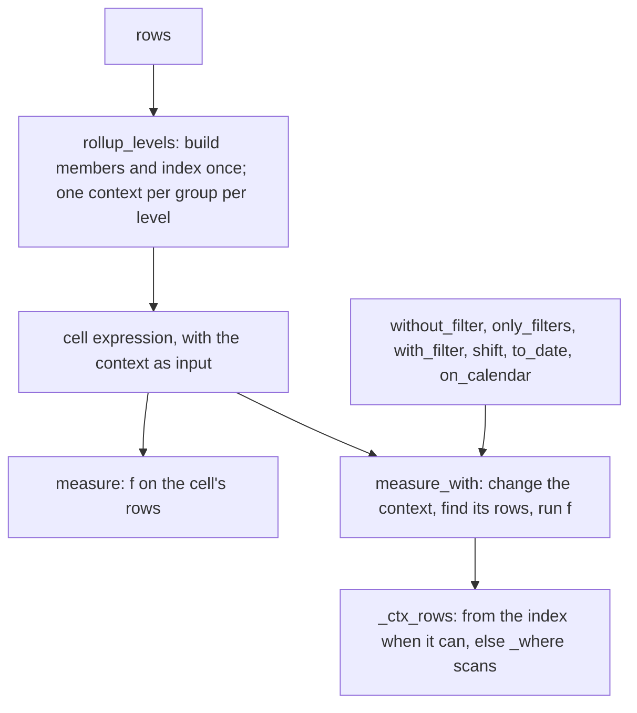

Thirteen definitions that let a report compute one measure at several levels and compare a cell with a different slice of the data: its share of a total, the previous period, a running total. This is the part of the library modelled on DAX's `CALCULATE`.

Three words carry it:

- A **measure** is any jq expression over an array of rows, such as `map(.rev) | sum_nonnull`.
- A **context** is the object a cell is evaluated in: which filters it stands for (`at`), the rows that match them (`rows`), every row (`all`), and two lookups built once per report (`members`, `index`).
- A **context change** takes a context and returns another: remove a filter, add one, move to a neighbouring value.



All runs below use five made-up sales rows unless they say otherwise:

| region | month | rev |
|---|---|---|
| E | 2026-01 | 10 |
| E | 2026-01 | 20 |
| E | 2026-03 | 10 |
| W | 2026-01 | 30 |
| W | 2026-03 | 30 |

There are no February rows; that matters for `shift`. Each run builds the table from triples with `map({region: .[0], month: .[1], rev: .[2]})`.

Three jq reminders for this family. A `;` separates arguments. A `$name` parameter is a value, and a parameter without the `$` is a filter that the function runs later on an input it chooses. Inside a `cell` argument, `.` is the context, not a row.

## _where/1
<!-- code: 95d97c56 -->

The rows that match a filter object, found by testing every row. It is SQL's `WHERE` with the conditions joined by `AND`. A filter `{field: value}` is equality; `{field: {from, to}}` is a closed range.

### The example

Four rows, one with no `rev`:

| r | rev |
|---|---|
| E | 10 |
| E | 20 |
| W | 30 |
| E | null |

Three filters: region E and rev at least 15; rev at most 20; no filter.

```jq run
[{r: "E", rev: 10}, {r: "E", rev: 20}, {r: "W", rev: 30}, {r: "E", rev: null}]
| _where({r: "E", rev: {from: 15}}), _where({rev: {to: 20}}), _where({})
```

Three values, one per call. The first keeps the one E row with rev 15 or more. The second keeps 10 and 20 and drops the null: a null never satisfies a range. The third has nothing to test, so every row passes.

### The definition

<!-- definition -->

- `map(select(...))` keeps the rows for which the test is true. `. as $r` names the row, because the next step changes the input to the filter object.
- `$at | to_entries | all(...)` turns `{r: "E", rev: {from: 15}}` into one `{key, value}` pair per filter and requires the test to hold for every pair. With no pairs, `all` is true.
- `$r[$k] as $x` is the row's value for the filter's field.
- `if ($v | type) == "object"`: a filter value that is an object is a range. The row's value must not be null, must be at or above `from` and at or below `to`. A bound that is missing or null is no bound.
- `else $x == $v`: any other filter value is compared for equality. `{rev: null}` therefore matches rows whose rev is null.

## _ctx_rows/0
<!-- code: 12f42ebf -->

Input: a context. Output: the rows that its filters (`.at`) stand for. `measure_with` calls it after a context change, when `.rows` no longer matches `.at`. It reads the rows from the report's index when it can and scans with `_where` when it cannot.

### The example

A context exists only inside a report, so the example is a report with two levels, region with month and region alone. This is the context of its first cell, with `all` (the five rows) and `index` (shown under `rollup_levels`) left out:

```jq run
[["E", "2026-01", 10], ["E", "2026-01", 20], ["E", "2026-03", 10], ["W", "2026-01", 30], ["W", "2026-03", 30]]
| map({region: .[0], month: .[1], rev: .[2]})
| rollup_levels([["region", "month"], ["region"]]; {context: {at, level, rows, members}}) | .[0].context
```

Now three changed contexts per cell, each passed to `_ctx_rows`. To keep the output short, each list shows the `rev` of the rows found.

```jq run
[["E", "2026-01", 10], ["E", "2026-01", 20], ["E", "2026-03", 10], ["W", "2026-01", 30], ["W", "2026-03", 30]]
| map({region: .[0], month: .[1], rev: .[2]})
| rollup_levels([["region", "month"], ["region"]];
    {no_month: (without_filter("month") | _ctx_rows | map(.rev)),
     up_to_here: (to_date("month") | _ctx_rows | map(.rev)),
     rev_20_up: (with_filter({rev: {from: 20}}) | _ctx_rows | map(.rev))})
```

Read the second row, E in March. Without the month filter it stands for E's three rows (10, 20, 10). Up to and including March is the same three rows. Adding "rev at least 20" to E in March leaves nothing, because that cell's one row has rev 10.

### What happens inside, on the example

`_ctx_rows` first works out three things about the context: the filter's fields in sorted order (`$ks`), which of them are ranges (`$ranges`), and whether the report's index has an entry for exactly that set of fields. The run shows them for the three changed contexts of the E in March cell. `look` is defined in the run to print them.

```jq run
def look: {at, ks: (.at | keys), ranges: (.at | to_entries | map(select(.value | type == "object") | .key)), in_index: ((.at | keys | tojson) as $k | .index | has($k))};
[["E", "2026-01", 10], ["E", "2026-01", 20], ["E", "2026-03", 10], ["W", "2026-01", 30], ["W", "2026-03", 30]]
| map({region: .[0], month: .[1], rev: .[2]})
| rollup_levels([["region", "month"], ["region"]];
    {no_month: (without_filter("month") | look), up_to_here: (to_date("month") | look), rev_20_up: (with_filter({rev: {from: 20}}) | look)})
| .[1] | .no_month, .up_to_here, .rev_20_up
```

Three values, and each takes a different path:

| Changed context | In the index | Ranges | Path |
|---|---|---|---|
| region E | yes: region is a level | none | one lookup of the group for E |
| region E, month up to 2026-03 | yes: region with month is a level | one, on month | the month's values in the range, 2026-01 and 2026-03, in order; the groups for E in each, joined end to end |
| region E, month 2026-03, rev from 20 | no: no level has these three fields | one | scan all five rows with `_where` |

### The definition

<!-- definition -->

- `$c.index[$ks | tojson]` is the index entry for the filter's set of fields, or null when no level of the report has exactly those fields.
- `if $ix == null or ($ranges | length) > 1`: no entry, or more than one range, scans every row.
- `elif ($ranges | length) == 0`: all filters are plain values. `[$c.at[$ks[]]]` is the values in the order of `$ks`, and its JSON text is the group's key. `// []` gives no rows for a combination that has none.
- `else`: one range, on field `$d`. `$c.members[$d]` lists the field's values in order. Each value inside the range is put in place of the range (`$c.at + {($d): $m}`), looked up, and its rows emitted. `[]?` skips a value with no group. A running total uses this path.
- The index makes a changed context cheap in the common case. A filter on a field that is not a level scans every row once per cell, so the cost grows with rows times cells.

## rollup_levels/2
<!-- code: a03bf0c3 -->

A report at several levels: one output row per group at each level listed. It is SQL's `GROUP BY GROUPING SETS`. Every level is computed from the rows, so a median or a ratio is right at a total.

### The example

Three levels: by region, by month, and the grand total (`[]`). The cell asks for the row count, the revenue and the median revenue.

```jq run
[["E", "2026-01", 10], ["E", "2026-01", 20], ["E", "2026-03", 10], ["W", "2026-01", 30], ["W", "2026-03", 30]]
| map({region: .[0], month: .[1], rev: .[2]})
| rollup_levels([["region"], ["month"], []];
    {rows: measure(length), rev: measure(map(.rev) | sum_nonnull), median: measure(map(.rev) | median)})
```

Five rows: two regions, two months, one total. Each carries the level's fields, a `level` name and the cell's fields. Hand check: E has rows 10, 20 and 10, so rev 40 and median 10. The total's median is the middle of 10, 10, 20, 30, 30, which is 20. It cannot be worked out from the regions' medians, 10 and 30.

A row that lacks a level's field forms its own group, with null as the value. No input rows give no output rows:

```jq run
([{region: "E", rev: 10}, {rev: 5}] | rollup_levels([["region"]]; {rows: measure(length)})),
([] | rollup_levels([["region"], []]; {rows: measure(length)}))
```

### Reading the call

| Argument | In the example | Runs on | Meaning |
|---|---|---|---|
| `$levels` | `[["region"], ["month"], []]` | nothing: a value | the list of levels; each level is a list of field names |
| `cell` | `{rows: measure(length), ...}` | one context: one group at one level | an object of result columns |

### What happens inside, on the example

Step 1, `$members`: for every field named in any level, its distinct values over all rows, sorted. `shift` and `to_date` step through these lists.

```jq run
[["E", "2026-01", 10], ["E", "2026-01", 20], ["E", "2026-03", 10], ["W", "2026-01", 30], ["W", "2026-03", 30]]
| map({region: .[0], month: .[1], rev: .[2]})
| . as $all | reduce ([["region"], ["month"], []] | add // [] | unique)[] as $d ({}; .[$d] = ($all | map(.[$d]) | unique))
```

Step 2, `$index`: for each level's set of fields, and for the empty set, the rows grouped by those fields. The outer key is the field list as JSON text; the inner key is the group's values as JSON text. The run reads it from a context.

```jq run
[["E", "2026-01", 10], ["E", "2026-01", 20], ["E", "2026-03", 10], ["W", "2026-01", 30], ["W", "2026-03", 30]]
| map({region: .[0], month: .[1], rev: .[2]})
| rollup_levels([["region"], ["month"], []]; {index}) | .[0].index
```

Step 3: for each level in the order listed, each index group becomes a context, the groups sorted by the level's values. The run prints the `at`, `level` and `rows` of the five contexts. The other three parts, `all`, `members` and `index`, are the same in every context.

```jq run
[["E", "2026-01", 10], ["E", "2026-01", 20], ["E", "2026-03", 10], ["W", "2026-01", 30], ["W", "2026-03", 30]]
| map({region: .[0], month: .[1], rev: .[2]})
| rollup_levels([["region"], ["month"], []]; {context: {at, level, rows}}) | map(.context)
```

Step 4: `cell` runs with each context as its input, and the output row is `.at`, then the level name, then what `cell` returned. For the first context that is `{"region":"E"}`, `{"level":"region"}` and `{"rows":3,"rev":40,"median":10}`, merged into the first row of the result at the top.

### The definition

<!-- definition -->

- `$levels | add // [] | unique` is every field named in any level, once.
- `(reduce $lvl[] as $d ({}; .[$d] = 1)) | keys` is the level's fields sorted and without repeats, so `["region", "month"]` and `["month", "region"]` share one index entry. `if has(...) then .` skips a set already built. `$levels + [[]]` makes sure the empty set is there, which `only_filters([])` needs.
- `group_by([.[$ks[]]])` groups the rows by the level's values; a row missing a field has null there.
- `sort_by([.at[$lvl[]]])` orders a level's groups by its values, in the order the caller listed the fields.
- `.at + {level: ...} + cell`: a cell field named like a level field, or named `level`, would overwrite it.

## rollup/2
<!-- code: dbf871e0 -->

The levels of a hierarchy: all the fields, then one fewer from the right, down to the grand total. It is SQL's `GROUP BY ROLLUP(region, month)`.

### The example

```jq run
[["E", "2026-01", 10], ["E", "2026-01", 20], ["E", "2026-03", 10], ["W", "2026-01", 30], ["W", "2026-03", 30]]
| map({region: .[0], month: .[1], rev: .[2]})
| rollup(["region", "month"]; {rev: measure(map(.rev) | sum_nonnull)})
```

Four rows for region with month, two subtotals for the regions, one grand total. Hand check: E's months are 30 and 10, its subtotal is 40; the two subtotals 40 and 60 make the total 100.

### What happens inside, on the example

The one step before `rollup_levels` is the list of levels:

```jq run
["region", "month"] as $dims | [range($dims | length; -1; -1) as $n | $dims[0:$n]]
```

### The definition

<!-- definition -->

`range($dims | length; -1; -1)` counts down from the number of fields to 0, here 2, 1, 0. `$dims[0:$n]` is the first `$n` fields. The list goes to `rollup_levels` with the same `cell`.

## measure/1, measure_with/2, share_of/2
<!-- code: 886a82df -->

The three functions a cell is written with. `measure(f)` runs measure `f` on the cell's own rows. `measure_with(f; change)` runs it on the rows of a changed context, which is DAX's `CALCULATE`. `share_of(f; change)` divides the first by the second.

### The example

At the region with month level: the cell's revenue, its region's revenue, its share of the region, and its share of everything.

```jq run
[["E", "2026-01", 10], ["E", "2026-01", 20], ["E", "2026-03", 10], ["W", "2026-01", 30], ["W", "2026-03", 30]]
| map({region: .[0], month: .[1], rev: .[2]})
| rollup_levels([["region", "month"]];
    {rev: measure(map(.rev) | sum_nonnull),
     region_rev: measure_with(map(.rev) | sum_nonnull; without_filter("month")),
     of_region: share_of(map(.rev) | sum_nonnull; without_filter("month")),
     of_all: share_of(map(.rev) | sum_nonnull; only_filters([]))})
```

Hand check on the first row: E in January is 10 + 20 = 30. E in all months is 40, so the share is 30 / 40 = 0.75. Everything is 100, so the share of all is 0.3.

### Reading the call

| Argument | In the example | Runs on | Meaning |
|---|---|---|---|
| `f` | `map(.rev)` then `sum_nonnull` | an array of rows: the cell's, or the changed context's | the measure |
| `change` | `without_filter("month")`, `only_filters([])` | the cell's context | returns the context to measure in; several changes can be piped |

### What happens inside, on the example

For `measure_with(map(.rev) | sum_nonnull; without_filter("month"))` in the first cell, E in January. Step 1, the change: the context's `at` loses its month.

```jq run
[["E", "2026-01", 10], ["E", "2026-01", 20], ["E", "2026-03", 10], ["W", "2026-01", 30], ["W", "2026-03", 30]]
| map({region: .[0], month: .[1], rev: .[2]})
| rollup_levels([["region", "month"]]; {before: .at, after: (without_filter("month") | .at)}) | .[0] | .before, .after
```

Step 2, `_ctx_rows` finds the rows of the changed context, and step 3 runs the measure on them. The run prints both for the same cell.

```jq run
[["E", "2026-01", 10], ["E", "2026-01", 20], ["E", "2026-03", 10], ["W", "2026-01", 30], ["W", "2026-03", 30]]
| map({region: .[0], month: .[1], rev: .[2]})
| rollup_levels([["region", "month"]]; {found: (without_filter("month") | _ctx_rows), measured: (without_filter("month") | _ctx_rows | map(.rev) | sum_nonnull)})
| .[0] | .found, .measured
```

`share_of` then divides the cell's own 30 by this 40.

A change can leave no context: `shift` past the first value marks the context `void`. `measure_with` then returns null without running `f`, and `share_of` returns null. At the region level there is no month to move from:

```jq run
[["E", "2026-01", 10], ["E", "2026-01", 20], ["E", "2026-03", 10], ["W", "2026-01", 30], ["W", "2026-03", 30]]
| map({region: .[0], month: .[1], rev: .[2]})
| rollup_levels([["region"]]; {prev: measure_with(length; shift("month"; -1)), vs_prev: share_of(length; shift("month"; -1))})
```

### The definition

<!-- definition -->

- `measure(f)` is `.rows | f`.
- `measure_with`: `(change) as $c` runs the change on the cell's context. `if $c.void then null` is the no-context case. Otherwise `$c | _ctx_rows | f`.
- `share_of`: `measure(f) as $a | measure_with(f; change) as $b` binds both numbers without changing the input. The result is null when either is null or the divisor is 0, and `$a / $b` otherwise.

## without_filter/1, only_filters/1, with_filter/1
<!-- code: b8a55b57 -->

Three context changes that edit `.at`, the filter object, and nothing else. `without_filter` removes one filter (DAX's `ALL` or `REMOVEFILTERS` on one column), `only_filters` drops all but the listed ones (`ALLEXCEPT`), `with_filter` adds or replaces filters.

### The example

A context is an object, so the changes can be tried on a hand-made one that has only `at`. Four calls on a cell for region E in January:

```jq run
{at: {region: "E", month: "2026-01"}}
| without_filter("month"), only_filters(["month"]), only_filters([]), with_filter({month: "2026-03", rev: {from: 20}})
```

Four contexts. `without_filter("month")` leaves the region. `only_filters(["month"])` leaves the month. `only_filters([])` leaves no filter, which is the grand total. `with_filter` replaces the month and adds a range on `rev`.

### The definition

<!-- definition -->

- `without_filter`: `.at |= del(.[$dim])` deletes one key of `.at`. It is written with `|=` and not as `del(.at[$dim])` because on gojq the second form copies the whole context, every row included, on each call.
- `only_filters`: `with_entries(select(...))` keeps the entries of `.at` whose key is in `$dims`.
- `with_filter`: `.at += $at` merges the new filters in; a field already filtered takes the new value.

## shift/2
<!-- code: 520696ad -->

A context change that moves the filter on `$dim` to a neighbouring value: `shift("month"; -1)` is the previous month, `shift("month"; 1)` the next. It is how a cell reads the previous period.

### The example

A hand-made context for E in March, in a report whose months are January and March. Three calls: one back, one forward, and one back for a cell with no month filter.

```jq run
{at: {region: "E", month: "2026-03"}, members: {month: ["2026-01", "2026-03"]}}
| shift("month"; -1), shift("month"; 1), (.at = {region: "E"} | shift("month"; -1))
```

The first moves to January. That is the previous month that has rows; February is skipped because it is not in `members`. The second would step past the last value, and the third has no month to move from: both come back marked `void`, which makes `measure_with` return null.

In a report, the previous month's revenue beside the cell's own:

```jq run
[["E", "2026-01", 10], ["E", "2026-01", 20], ["E", "2026-03", 10], ["W", "2026-01", 30], ["W", "2026-03", 30]]
| map({region: .[0], month: .[1], rev: .[2]})
| rollup_levels([["region", "month"]]; {rev: measure(map(.rev) | sum_nonnull), prev: measure_with(map(.rev) | sum_nonnull; shift("month"; -1))})
```

A field with a filter but no member list is refused. Here the report's only level is region, and the cell adds a month filter before shifting:

```jq run
[["E", "2026-01", 10], ["E", "2026-03", 10]] | map({region: .[0], month: .[1], rev: .[2]})
| try rollup_levels([["region"]]; {prev: measure_with(length; with_filter({month: "2026-03"}) | shift("month"; -1))}) catch .
```

### The definition

<!-- definition -->

- `.at[$dim] as $v` is the current value of the filter.
- First branch: no filter on `$dim` (a total row), a null value, or a range. There is nothing to move from, so `.void = true`.
- Second branch: `.members[$dim] == null` means the field is not a level of the report and `on_calendar` has not supplied a list. That is the error above.
- `index($v)` is the position of the current value in the member list. Not found, or a move past either end: void.
- Otherwise `.at[$dim]` takes the value `$k` places along.
- The member list is the values present in the data, sorted as values, unless `on_calendar` replaced it. So "previous" means the previous value that has rows anywhere in the table, and month names such as "Mar" would sort alphabetically.

## on_calendar/2
<!-- code: d032a9ab -->

Makes `shift` and `to_date` on `$dim` step through a list of periods the caller gives, in place of the values present in the data. With it, the previous month of March is February even when February has no rows.

### The example

The same hand-made context as under `shift`, with and without a calendar of three months:

```jq run
{at: {region: "E", month: "2026-03"}, members: {month: ["2026-01", "2026-03"]}}
| ["2026-01", "2026-02", "2026-03"] as $months
| (shift("month"; -1) | .at), (on_calendar("month"; $months) | shift("month"; -1) | .at)
```

In a report, both kinds of "previous month" side by side:

```jq run
[["E", "2026-01", 10], ["E", "2026-01", 20], ["E", "2026-03", 10], ["W", "2026-01", 30], ["W", "2026-03", 30]]
| map({region: .[0], month: .[1], rev: .[2]})
| ["2026-01", "2026-02", "2026-03"] as $months
| rollup_levels([["region", "month"], ["region"]];
    {rev: measure(map(.rev) | sum_nonnull),
     prev_with_rows: measure_with(map(.rev) | sum_nonnull; shift("month"; -1)),
     prev_calendar: measure_with(map(.rev) | sum_nonnull; on_calendar("month"; $months) | shift("month"; -1))})
```

For E in March, the previous month that has rows is January (30). The previous calendar month is February; it has no rows, so the measure runs on an empty list and `sum_nonnull` gives null. January has no previous value either way. At the region level there is no month to move from, so both are null.

### The definition

<!-- definition -->

One assignment: the member list of `$dim` becomes `$values`. `shift` and `to_date` read that list, so nothing else changes. `$values` is every period in order, for example `calendar(...) | map(.year_month) | unique`. A cell whose own value is not in the list has no context after a shift. `to_date` compares values, so the list has to sort the way it is ordered: "2026-03" does, "Mar" does not.

## to_date/1
<!-- code: 0bfe47cd -->

A context change that turns the filter on `$dim` into "everything up to and including this value", with the other filters kept. It gives a running total; with the year as another filter it is DAX's `DATESYTD`.

### The example

Three hand-made contexts: a month filter, no month filter, and a null month.

```jq run
({at: {region: "E", month: "2026-03"}} | to_date("month")),
({at: {region: "E"}} | to_date("month")),
({at: {region: "E", month: null}} | to_date("month"))
```

The first becomes the range `{to: "2026-03"}`, which `_where` and `_ctx_rows` read as "at or below". The second is unchanged, so a total row shows the total. The third is void.

In a report:

```jq run
[["E", "2026-01", 10], ["E", "2026-01", 20], ["E", "2026-03", 10], ["W", "2026-01", 30], ["W", "2026-03", 30]]
| map({region: .[0], month: .[1], rev: .[2]})
| rollup(["region", "month"]; {rev: measure(map(.rev) | sum_nonnull), to_date: measure_with(map(.rev) | sum_nonnull; to_date("month"))})
```

Hand check: E's running total is 30 after January and 30 + 10 = 40 after March. At the region and total levels, `to_date` equals `rev`.

### The definition

<!-- definition -->

- `if (.at | has($dim) | not) then .`: no filter on the field, nothing to do.
- `elif .at[$dim] == null then .void = true`: a null value has no "up to".
- `else .at[$dim] = {to: .at[$dim]}`: the value becomes the upper bound of a range with no lower bound.
