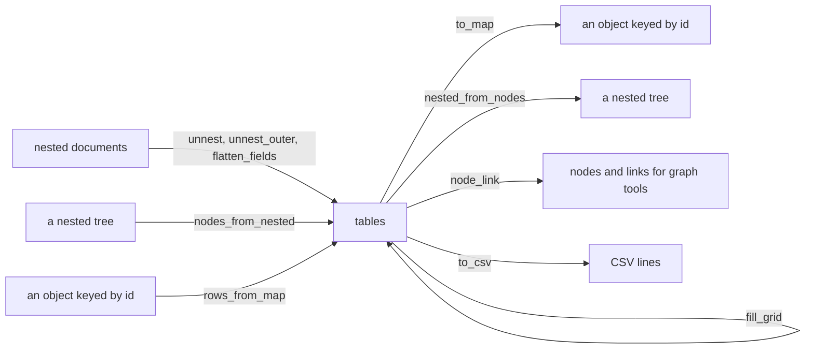

Fifteen definitions that convert between the forms data arrives in (nested documents, objects keyed by id) and the tables the rest of the library takes, and from those tables to what the next tool reads.



## _distinct_in_order/0
<!-- code: f7b39916 -->

The distinct values of an array, in the order they first appear. jq's `unique` sorts, which loses that order.

`reduce … ({n: 0, s: {}}; …)`: `s` maps each value (as JSON text) to `[position of first sighting, value]`; a value already in `s` is skipped. At the end `[.s[]] | sort_by(.[0]) | map(.[1])` puts the first sightings back in order. The comment records why it is not the obvious "append when new": that version copied the growing array on every append.

```jq run
["b", "a", "b", 1, "1", "a"] | _distinct_in_order
```

The number 1 and the string `"1"` stay distinct because their JSON texts differ.

## _unnest_arr/2, unnest/2, unnest_outer/2
<!-- code: 605c5f11 -->

One row per element of an array field.

- `_unnest_arr(f; $i)` returns the array at `f`, an empty array for null, and an error naming the row's position for anything else.
- `unnest`: `to_entries[]` supplies the position; for each element `$x` of the array the row is repeated with field `$as` set to it. A row with an empty or null array produces nothing.
- `unnest_outer` differs in one step: an empty array is replaced by `[null]`, so such a row comes out once with `$as` null.

The original array field stays on every output row; drop it afterwards with `del` if it is not wanted.

```jq run
[{id: 1, tags: ["x", "y"]}, {id: 2, tags: []}, {id: 3, tags: null}]
| {unnest: (unnest(.tags; "tag") | map([.id, .tag])), outer: (unnest_outer(.tags; "tag") | map([.id, .tag]))},
  (try ([{id: 4, tags: "x"}] | unnest(.tags; "tag")) catch .)
```

## _flat/2, flatten_fields/1
<!-- code: 45aa83a0 -->

Nested objects become columns named by their path.

- `_flat($p; $sep)` walks one value. A non-empty object recurses into each field, extending the path `$p` with the field's name; anything else (a scalar, an array, an empty object) is emitted as `{key: path, value}`.
- `flatten_fields` collects those pairs for each row and builds the object with `from_entries`. If the object has fewer fields than there were pairs, two paths produced the same name and one overwrote the other; that is an error naming the name.

```jq run
[{user: {name: "ann", dept: {id: 7}}, tags: ["a"], meta: {}}] | flatten_fields("."),
(try ([{a: {b: 1}, "a.b": 2}] | flatten_fields(".")) catch .)
```

## _nodes/3, nodes_from_nested/2
<!-- code: 87c6a03d -->

A nested tree to node rows.

`_nodes(id; children; $p)` emits the node itself, without its children array and with `parent` set to `$p`, then recurses into each child with this node's id as the parent. `// []` treats a missing children field as no children. `nodes_from_nested` accepts one root or an array of roots and starts each with a null parent. Rows come out depth first.

```jq run
{id: "ceo", reports: [{id: "eng", reports: [{id: "web"}]}, {id: "ops"}]} | nodes_from_nested(.id; .reports)
```

## rows_from_map/1
<!-- code: 5800ac00 -->

An object keyed by id to rows, the key in field `$as`. `sort_by(.key)` because gojq does not keep the order keys were written in, so sorted order is the only order every engine can agree on. An object value contributes its fields; any other value goes in a field called `value`.

```jq run
{web01: {ram: 16}, db01: {ram: 64}, note: "spare"} | rows_from_map("host")
```

**Review finding 13.** The row is built as `{($as): key} + value`, so a value that already has a field named `$as` overwrites the key: `{"a": {"id": "zzz"}} | rows_from_map("id")` gives `[{"id": "zzz"}]` and the key `a` is gone. Proposed: an error when the value has that field, as joins raise one on a clashing field.

## fill_grid/4
<!-- code: be1e7f4a -->

Every combination of the key fields at every time step, with made-up rows where the data has none.

- `$t0`, `$t1`: the earliest and latest time. A row whose time is not a whole number of steps from `$t0` is an error.
- `$ix`: the rows by `[key values…, time]`.
- `$combos`: the distinct key combinations, in order of first appearance.
- For each combination and each time from `$t0` to `$t1`: the rows found in `$ix`, or one filler row made of the key fields (`[$keys, $k] | transpose` pairs each name with its value), the time and `$fill`.

Without the filler rows, `lag` or `moving_mean` would treat the row after a gap as the next period.

```jq run
[{g: "a", t: 0, v: 1}, {g: "a", t: 120, v: 3}, {g: "b", t: 60, v: 5}] | fill_grid(["g"]; "t"; 60; {v: 0}) | map([.g, .t, .v]),
(try ([{g: "a", t: 0}, {g: "a", t: 90}] | fill_grid(["g"]; "t"; 60; {})) catch .)
```

**Review finding 14.** A null time is not checked: `fill_grid` then stops with jq's own `null (null) and null (null) cannot be subtracted`. This is the same gap as review finding 9.

## to_map/1
<!-- code: 91913b64 -->

Rows to an object keyed by `key` as text. Unlike jq's `INDEX`, which keeps the last row for a repeated key, a repeated key is an error. Because the key is turned into text, the number 1 and the string `"1"` count as the same key and raise that error.

```jq run
[{id: "web01", ram: 16}, {id: "db01", ram: 64}] | to_map(.id),
(try ([{id: "a"}, {id: "a"}] | to_map(.id)) catch .)
```

## _nest/3, nested_from_nodes/3
<!-- code: c32c022b -->

Node rows to a nested tree.

- `(tree_paths(id; parent) | length) as $_` runs `tree_paths` only for its checks: a missing parent or a cycle stops here with that function's error.
- `$by`: the rows grouped under their parent's id.
- The roots (parent null or `""`) are each expanded by `_nest`, which adds field `$as` holding the node's children, each expanded the same way.

```jq run
[{id: "ceo", boss: null}, {id: "eng", boss: "ceo"}, {id: "web", boss: "eng"}, {id: "ops", boss: "ceo"}]
| nested_from_nodes(.id; .boss; "reports")
```

**Review finding 15.** `$by` is built by appending each row to its parent's array inside a `reduce`, so the time grows with the square of the number of children of one parent: a root with 20,000 children took 0.9 s, 40,000 took 2.9 s and 80,000 took 11.4 s (jq 1.8.2). A tree where every node has three children is fine (80,000 nodes: 1.4 s). `group_by(parent)` would remove it, as `_adj` does for graphs.

## node_link/2
<!-- code: 93013b54 -->

Edge rows to the `{nodes, links}` form that networkx, d3 and Cytoscape read. The nodes are the distinct ends of the edges in order of first appearance; each link is the edge row with `source` and `target` added.

```jq run
[{a: "fetch", b: "compile", min: 1}, {a: "compile", b: "test", min: 2}] | node_link(.a; .b)
```

## to_csv/1
<!-- code: 5ef9958b -->

A stream of strings: the header, then one line per row with the columns in the order of `$cols`. `@csv` does the quoting; a null becomes an empty cell. Run jq with `-r` to get plain lines; the run below shows them as JSON strings.

```jq run
[{host: "web01", ram: 16}, {host: "db, 01", ram: null}] | [to_csv(["host", "ram"])]
```
