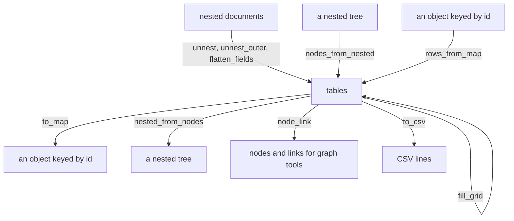

Fifteen definitions that convert between the forms data arrives in (nested documents, objects keyed by id) and the tables the rest of the library takes, and from those tables to what the next tool reads. A table here is an array of objects, one object per row.



Two jq reminders for this family. A `;` separates arguments. A parameter written `$as` is a value, here usually a field name as a string; a parameter without the `$`, such as `f` in `unnest(f; $as)`, is a filter the function runs on each row, so `.tags` there means "this row's tags".

## _distinct_in_order/0
<!-- code: f7b39916 -->

The distinct values of an array, in the order they first appear. jq's `unique` also removes repeats, but it sorts, which loses that order.

### The example

```jq run
["b", "a", "b", 1, "1", "a"] | _distinct_in_order, unique
```

Two values: this function's result, then the builtin's. `b` stays first because it appeared first. The number 1 and the string `"1"` are different values and both stay.

### What happens inside, on the example

Step 1, the `reduce`: one pass over the values. `s` maps each value, as JSON text, to `[position of first sighting, value]`; a value already in `s` is skipped. `n` counts the distinct values so far.

```jq run
["b", "a", "b", 1, "1", "a"]
| reduce .[] as $x ({n: 0, s: {}}; ($x | tojson) as $k | if .s[$k] then . else .s[$k] = [.n, $x] | .n += 1 end)
```

The keys `1` and `"\"1\""` differ because the JSON text of a number has no quotes.

Step 2, `[.s[]] | sort_by(.[0]) | map(.[1])`: the four pairs sorted by position, then the positions dropped. That is the first result at the top.

### The definition

<!-- definition -->

The first sightings are written into an object by key and sorted once at the end. The shorter "append the value when it is new" copies the growing array on every append, so its cost grows with the square of the number of distinct values. The sort at the end is also what makes the order the same on engines that do not keep an object's key order.

## _unnest_arr/2, unnest/2, unnest_outer/2
<!-- code: 605c5f11 -->

One row per element of an array field. `unnest` is SQL's `CROSS JOIN UNNEST(tags)`: a row with no elements disappears. `unnest_outer` is `LEFT JOIN LATERAL`: such a row is kept once, with a null. `_unnest_arr` is the helper that reads the array from one row.

### The example

| id | tags |
|---|---|
| 1 | ["x", "y"] |
| 2 | [] |
| 3 | null |

```jq run
[{id: 1, tags: ["x", "y"]}, {id: 2, tags: []}, {id: 3, tags: null}]
| unnest(.tags; "tag"), unnest_outer(.tags; "tag")
```

Two values. `unnest` gives two rows, both from id 1; ids 2 and 3 have nothing to give. `unnest_outer` gives the same two rows and then ids 2 and 3 once each with `tag` null. The `tags` array stays on every row; drop it afterwards with `map(del(.tags))` if it is not wanted.

A value that is neither an array nor null is refused. The error names the row's position, counting from 0:

```jq run
[{id: 1, tags: ["x"]}, {id: 4, tags: "x"}] | try unnest(.tags; "tag") catch .
```

### What happens inside, on the example

Step 1, `_unnest_arr(f; $i)` on each row: the array at `.tags`, with null read as an empty array. `to_entries` supplies each row's position `$i` for the error message.

```jq run
[{id: 1, tags: ["x", "y"]}, {id: 2, tags: []}, {id: 3, tags: null}]
| to_entries | map(.key as $i | .value | _unnest_arr(.tags; $i))
```

Step 2, `unnest`: for each element `$x` of a row's array, the row is emitted once with field `$as` added. An empty array has no elements, so its row is emitted zero times.

Step 2 in `unnest_outer`: an empty array is first replaced by `[null]`, so its row is emitted once with a null:

```jq run
[["x", "y"], [], []] | map(if length == 0 then [null] else . end)
```

### The definition

<!-- definition -->

- `_unnest_arr`: `(f) as $a` runs the caller's filter on the row. Null gives `[]`, an array is returned as it is, anything else is the error.
- `to_entries[] | .key as $i | .value as $r` walks the rows with their positions. `as` binds a name without changing the input.
- `($r | _unnest_arr(f; $i))[] as $x` takes the elements one at a time. `$r + {($as): $x}` is the row with the new field; `($as)` in parentheses uses the value of `$as` as the field name.
- Elements come out in array order and rows in input order.

## _flat/2, flatten_fields/1
<!-- code: 45aa83a0 -->

Nested objects become columns named by their path, so `{"user": {"dept": "x"}}` gives a column `user.dept`. jq's own `flatten` flattens arrays; this flattens the objects inside each row.

### The example

One row with an object two levels deep, an array and an empty object:

```jq run
[{user: {name: "ann", dept: {id: 7}}, tags: ["a"], meta: {}}] | flatten_fields(".")
```

`user` is gone and its leaves are columns `user.name` and `user.dept.id`. The array `tags` is left as a value, for `unnest` to take. The empty object `meta` has no leaves and stays as `{}`.

Two paths that flatten to the same name are refused:

```jq run
[{a: {b: 1}, "a.b": 2}] | try flatten_fields(".") catch .
```

### What happens inside, on the example

Step 1, `_flat(null; ".")` on the row: one `{key, value}` pair per leaf, the key being the path so far. `_flat` emits the pairs one at a time; the run collects them in an array and sorts them by key, because engines walk an object's fields in different orders.

```jq run
{user: {name: "ann", dept: {id: 7}}, tags: ["a"], meta: {}} | [_flat(null; ".")] | sort_by(.key)
```

Step 2, `from_entries`: the pairs become one object, the row of the result at the top. If the object has fewer fields than there were pairs, two pairs had the same key and one replaced the other. That is the case the error reports.

### The definition

<!-- definition -->

- `_flat($p; $sep)`: a non-empty object recurses into each field, with the path extended by the field's name (`$p + $sep + $k`, or `$k` at the top where `$p` is null). Anything else, a scalar, an array or an empty object, is a leaf and is emitted as `{key: $p, value: .}`.
- `flatten_fields`: `if length == 0 then {}` passes an empty row through.
- `[_flat(null; $sep)] as $e | ($e | from_entries) as $o` keeps both the pairs and the object built from them.
- `if ($o | length) != ($e | length)` detects the repeated name; `group_by(.) | map(select(length > 1)[0])` finds which names repeat, for the message.

## _nodes/3, nodes_from_nested/2
<!-- code: 87c6a03d -->

A nested tree, where each node holds its children in an array, becomes node rows, each with a `parent` field. That is the shape `tree_paths` and `tree_rollup` take.

### The example

A small reporting tree: ceo has eng and ops under it, and eng has web.

```jq run
{id: "ceo", reports: [{id: "eng", reports: [{id: "web"}]}, {id: "ops"}]} | nodes_from_nested(.id; .reports)
```

Four rows, one per node, in depth-first order: a node, then everything under it, then its next sibling. The `reports` arrays are gone and `parent` holds the id of the node above; the root's is null.

### Reading the call

| Argument | In the example | Runs on | Meaning |
|---|---|---|---|
| `id` | `.id` | one node | the node's id, written into its children's `parent` |
| `children` | `.reports` | one node | the array of the node's children; missing means none |

### What happens inside, on the example

`_nodes(id; children; $p)` does the work for one node: it emits the node without its children array and with `parent` set to `$p`, then calls itself on each child with this node's id as `$p`. It emits several values, one per node. Called on the `eng` subtree with parent `"ceo"`:

```jq run
{id: "eng", reports: [{id: "web"}]} | [_nodes(.id; .reports; "ceo")]
```

`nodes_from_nested` calls it on the root with a null parent and collects everything emitted into one array.

### The definition

<!-- definition -->

- `$n | del(children) + {parent: $p}` is the node's own row.
- `(($n | children) // [])[]` takes the children one at a time; `// []` reads a missing or null children field as no children, which is how `web` and `ops` end the recursion.
- `nodes_from_nested`: `if type == "array" then .[] else . end` accepts one root object or an array of roots.

## rows_from_map/1
<!-- code: 70158b64 -->

An object keyed by id becomes rows, with the key in field `$as`. Many APIs return a table in this form.

### The example

Three keys; two values are objects and one is a string.

```jq run
{web01: {ram: 16}, db01: {ram: 64}, note: "spare"} | rows_from_map("host")
```

One row per key, sorted by key. An object value contributes its fields beside the key. The string has no field name of its own, so it goes in a field called `value`.

A value that already has a field named `$as` is refused, because that field would replace the key:

```jq run
{a: {id: "zzz"}} | try rows_from_map("id") catch .
```

### What happens inside, on the example

Step 1, `to_entries | sort_by(.key)`: one `{key, value}` pair per key, in key order.

```jq run
{web01: {ram: 16}, db01: {ram: 64}, note: "spare"} | to_entries | sort_by(.key)
```

Step 2: each pair becomes a row. For `db01`, `{host: "db01"} + {ram: 64}`. That gives the result at the top.

### The definition

<!-- definition -->

- `sort_by(.key)`: gojq does not keep the order an object's keys were written in, so sorted order is the one order every engine can agree on.
- `if ($e.value | type) != "object"`: a value that is not an object becomes `{($as): key, value: v}`.
- `elif ($e.value | has($as))`: the error case above.
- `else {($as): $e.key} + $e.value`: the key first, then the value's fields.

## fill_grid/4
<!-- code: a7376410 -->

Completes a time series: every combination of the key fields gets a row at every time step from the earliest time to the latest, and a missing combination gets a filler row. Without the filler rows, `lag` or `moving_mean` treats the row after a gap as the next period. In SQL this is a cross join of the keys with `generate_series`, left joined to the data.

### The example

Readings every 60 seconds for two series, `a` and `b`, with gaps:

| g | t | v |
|---|---|---|
| a | 0 | 1 |
| a | 120 | 3 |
| b | 60 | 5 |

```jq run
[{g: "a", t: 0, v: 1}, {g: "a", t: 120, v: 3}, {g: "b", t: 60, v: 5}] | fill_grid(["g"]; "t"; 60; {v: 0})
```

Six rows: two series times three time steps (0, 60, 120). The three input rows are there unchanged; the other three are fillers with `v` 0.

### Reading the call

All four arguments are values, not filters.

| Argument | In the example | Meaning |
|---|---|---|
| `$keys` | `["g"]` | the names of the fields that identify a series |
| `$time` | `"t"` | the name of the time field, holding epoch seconds |
| `$step` | `60` | seconds between grid points |
| `$fill` | `{v: 0}` | the fields a filler row gets besides its keys and time |

### What happens inside, on the example

Step 1: the checks, then the range. No row may lack a time, and every time must be a whole number of steps from the earliest. Here `$t0` is 0 and `$t1` is 120. The two errors:

```jq run
(try ([{g: "a", t: 0}, {g: "a", t: null}] | fill_grid(["g"]; "t"; 60; {})) catch .),
(try ([{g: "a", t: 0}, {g: "a", t: 90}] | fill_grid(["g"]; "t"; 60; {})) catch .)
```

Step 2, `$ix`: the rows indexed by their key values and time, as JSON text.

```jq run
[{g: "a", t: 0, v: 1}, {g: "a", t: 120, v: 3}, {g: "b", t: 60, v: 5}]
| reduce .[] as $r ({}; .[[$r[["g"][]], $r["t"]] | tojson] += [$r])
```

Step 3, `$combos`: the distinct key combinations, in order of first appearance.

```jq run
[{g: "a", t: 0, v: 1}, {g: "a", t: 120, v: 3}, {g: "b", t: 60, v: 5}] | [.[] | [.[["g"][]]]] | _distinct_in_order
```

Step 4: for each combination and each time 0, 60, 120, the rows found in `$ix`, or one filler row. The filler starts from the key fields, built by pairing each key name with its value:

```jq run
[["g"], ["a"]] | transpose | map({key: .[0], value: .[1]}) | from_entries
```

For `["a"]` at time 60 there is no entry in `$ix`, so the row is `{"g":"a"} + {"t":60} + {"v":0}`, the second row of the result.

### The definition

<!-- definition -->

- `if length == 0 then []`: no rows in, no rows out.
- `(map(select(...)) | if length > 0 then error(...) else . end) as $_` runs the grid check for its error only; `$_` is not used again.
- `.[[$r[$keys[]], $r[$time]] | tojson] += [$r]`: several rows with the same keys and time are all kept, under one index entry.
- `range($t0; $t1 + 1; $step)` emits the grid times, the last one included.
- `($ix[...] // [filler])[]` emits the found rows, or the one filler. Rows come out combination by combination, each in time order.

## to_map/1
<!-- code: 91913b64 -->

Rows become an object keyed by `key`, for looking a row up by id. jq's own `INDEX(key)` does the same but keeps the last row when a key repeats; here a repeated key is an error.

### The example

```jq run
[{id: "web01", ram: 16}, {id: "db01", ram: 64}] | to_map(.id)
```

One object with one entry per row; each value is the whole row.

The key is turned into a string, because an object key has to be one. So a repeat is refused, and the number 1 and the string `"1"` count as a repeat too:

```jq run
(try ([{id: "a"}, {id: "a"}] | to_map(.id)) catch .),
(try ([{id: 1}, {id: "1"}] | to_map(.id)) catch .)
```

### The definition

<!-- definition -->

`reduce .[] as $r ({}; ...)` adds one row at a time to an object that starts empty. `($r | key | tostring) as $k` runs the caller's filter on the row. `if has($k)` is the duplicate check; otherwise `.[$k] = $r`.

## _nest/3, nested_from_nodes/3
<!-- code: 153a5eb6 -->

The reverse of `nodes_from_nested`: node rows with an id and a parent become a nested tree, each node's children in an array in field `$as`. This is the form a tree view or a JSON API wants.

### The example

| id | boss |
|---|---|
| ceo | null |
| eng | ceo |
| web | eng |
| ops | ceo |

```jq run
[{id: "ceo", boss: null}, {id: "eng", boss: "ceo"}, {id: "web", boss: "eng"}, {id: "ops", boss: "ceo"}]
| nested_from_nodes(.id; .boss; "reports")
```

An array with one root, `ceo`. Its `reports` holds `eng` and `ops`, and `eng`'s holds `web`. A node with no children gets an empty array. Each node keeps its own fields, `boss` included.

A parent that is not a node, or a cycle, is refused with the error of `tree_paths`, which does the checking:

```jq run
(try ([{id: "a", boss: "zz"}] | nested_from_nodes(.id; .boss; "reports")) catch .),
(try ([{id: "a", boss: "b"}, {id: "b", boss: "a"}] | nested_from_nodes(.id; .boss; "reports")) catch .)
```

### What happens inside, on the example

Step 1: `tree_paths(id; parent)` runs for its checks; its result is thrown away.

Step 2, `$by`: the rows grouped under their parent's id, as JSON text. The root is under the key `null`.

```jq run
[{id: "ceo", boss: null}, {id: "eng", boss: "ceo"}, {id: "web", boss: "eng"}, {id: "ops", boss: "ceo"}]
| group_by(.boss) | map({key: (.[0] | .boss | tojson), value: .}) | from_entries
```

Step 3: each root is expanded by `_nest`, which adds field `reports` holding the node's children from `$by`, each expanded the same way. For `ceo` it looks up `"\"ceo\""` and finds `eng` and `ops`; for `eng` it finds `web`; for `web` and `ops` it finds nothing and adds an empty array.

### The definition

<!-- definition -->

- `(tree_paths(id; parent) | length) as $_` forces `tree_paths` to run; `$_` is not used again.
- `group_by(parent)` keeps the children of one parent in input order.
- `select((parent) == null or (parent) == "")` picks the roots: a null or empty parent.
- `_nest`: `($by[$n | id | tojson] // [])[]` is the node's children, none when it has no entry. The recursion ends at nodes without children.

## node_link/2
<!-- code: 93013b54 -->

Edge rows become the `{nodes, links}` object that graph tools such as networkx, d3 and Cytoscape read.

### The example

```jq run
[{a: "fetch", b: "compile", min: 1}, {a: "compile", b: "test", min: 2}] | node_link(.a; .b)
```

`nodes` lists each end of an edge once, in order of first appearance. Each link is the edge row with `source` and `target` added, so other fields such as `min` travel along.

### The definition

<!-- definition -->

- `[.[] | (from), (to)] | _distinct_in_order | map({id: .})`: both ends of every edge, repeats removed, each wrapped as `{id}`.
- `map(. + {source: (from), target: (to)})`: `from` and `to` are the caller's filters, run on each edge row.

## to_csv/1
<!-- code: 5ef9958b -->

A table as CSV text: a header line, then one line per row, with the columns in the order of `$cols`.

### The example

Two rows; one host name contains a comma, and one `ram` is null.

```jq run
[{host: "web01", ram: 16}, {host: "db, 01", ram: null}] | [to_csv(["host", "ram"])]
```

`to_csv` emits three strings, one per line; the run collects them in an array to show them as JSON. Strings are quoted, which keeps the comma inside `"db, 01"` in one cell. The null is an empty cell. Run jq with `-r` to get the plain lines.

### The definition

<!-- definition -->

- `$cols | @csv` is the header.
- `.[] | [.[$cols[]]] | @csv`: for each row, its values for the columns in order, formatted by `@csv`. A column the row lacks is null, so an empty cell.
- A nested value in a cell, an object or an array, is an error from `@csv` itself, worded differently by each engine. Run `flatten_fields` first.
