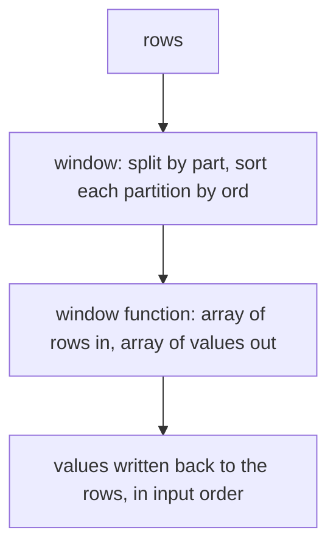

Seven definitions. `window` does what SQL's `OVER (PARTITION BY ... ORDER BY ...)` does. The other six are window functions: each takes one sorted partition and computes one value per row of it. They are passed to `window` as its last argument.



A partition is the set of rows that share a value, such as all rows of one site. A window function sees one partition at a time, as an array of rows already in order.

## window/4
<!-- code: e6b8ced2 -->

Adds one column to a table, computed per partition in a chosen order, and returns the rows in the order they came in. It is SQL's `SELECT *, f(...) OVER (PARTITION BY part ORDER BY ord) AS col`.

### The example

Four rows: request counts `x` per site and day, not in day order. One count is missing.

| day | site | x |
|---|---|---|
| 2 | N | 5 |
| 1 | N | 3 |
| 1 | S | 9 |
| 3 | N | null |

The call: per site, in day order, the running sum of x, in a new column `sum`.

```jq run
[{day: 2, site: "N", x: 5}, {day: 1, site: "N", x: 3}, {day: 1, site: "S", x: 9}, {day: 3, site: "N", x: null}]
| window(.site; .day; "sum"; running_sum(.x))
```

The same four rows in the same order, each with `sum`. Check site N by hand: in day order its x values are 3, 5 and null, so the running sums are 3, 8 and 8. The first row is day 2, so it gets 8. The second row is day 1 and gets 3.

### Reading the call

`window(.site; .day; "sum"; running_sum(.x))` has four arguments, separated by `;`.

| Argument | In the example | Runs on | Meaning |
|---|---|---|---|
| `part` | `.site` | one row | the partition the row belongs to |
| `ord` | `.day` | one row | the value the partition is sorted by |
| `$col` | `"sum"` | nothing: it is a value | the name of the new column |
| `wf` | `running_sum(.x)` | one sorted partition: an array of rows | an array with one value per row |

`part`, `ord` and `wf` are filters: pieces of program that `window` runs later, on an input it chooses. `$col` has a `$` in the definition and is a plain value. Inside `wf` the input is a partition, so `.x` inside `running_sum(.x)` is run by `running_sum` on each row of that partition.

### What happens inside, on the example

Step 1, `to_entries | map({i: .key, r: .value})`: every row `r` with its input position `i`.

```jq run
[{day: 2, site: "N", x: 5}, {day: 1, site: "N", x: 3}, {day: 1, site: "S", x: 9}, {day: 3, site: "N", x: null}]
| to_entries | map({i: .key, r: .value})
```

Step 2, `group_by(.r | .site)`: the partitions. N has positions 0, 1 and 3, and S has position 2. In the code a `[]` follows, which hands the partitions on one at a time, so steps 3 to 5 run once per partition.

```jq run
[{day: 2, site: "N", x: 5}, {day: 1, site: "N", x: 3}, {day: 1, site: "S", x: 9}, {day: 3, site: "N", x: null}]
| to_entries | map({i: .key, r: .value}) | group_by(.r | .site)
```

Step 3, on the N partition, `sort_by(.r | .day)`: the partition in day order. The positions are now 1, 0, 3.

```jq run
[{i: 0, r: {day: 2, site: "N", x: 5}}, {i: 1, r: {day: 1, site: "N", x: 3}}, {i: 3, r: {day: 3, site: "N", x: null}}]
| sort_by(.r | .day)
```

Step 4, `(map(.r) | wf) as $v`: the positions are set aside and the window function runs on the rows alone. It returns one value per row.

```jq run
[{day: 1, site: "N", x: 3}, {day: 2, site: "N", x: 5}, {day: 3, site: "N", x: null}] | running_sum(.x)
```

Step 5, `to_entries[] | {i: .value.i, v: $v[.key]}`: each value is paired with the input position of its row. This emits three values for N, one per row:

```jq run
[3, 8, 8] as $v
| [{i: 1, r: {day: 1, site: "N", x: 3}}, {i: 0, r: {day: 2, site: "N", x: 5}}, {i: 3, r: {day: 3, site: "N", x: null}}]
| to_entries[] | {i: .value.i, v: $v[.key]}
```

The S partition gives one more, `{i: 2, v: 9}`. The outer `[...]` collects all four into one array.

Step 6, `sort_by(.i) | map(.v) as $vals`: the values in input order.

```jq run
[{i: 1, v: 3}, {i: 0, v: 8}, {i: 3, v: 8}, {i: 2, v: 9}] | sort_by(.i) | map(.v)
```

Step 7, the last line: each original row gets the value at its own position, under the name in `$col`. That is the result at the top.

### Several columns

Each call adds one column, so several windows are written as a chain. The row number in day order, the running sum, and the previous day's x:

```jq run
[{day: 2, site: "N", x: 5}, {day: 1, site: "N", x: 3}, {day: 1, site: "S", x: 9}, {day: 3, site: "N", x: null}]
| window(.site; .day; "n"; row_number) | window(.site; .day; "sum"; running_sum(.x)) | window(.site; .day; "prev"; lag(.x; 1))
```

The first row is day 2 of site N: second in its partition, running sum 3 + 5, previous value 3.

### Edge cases

Two rows with the same `ord` keep their input order, because the sort is stable. Rows with a null `part` form one partition. The running values are per row: two rows that tie on `ord` get different running sums, where SQL's default frame would give both the same.

```jq run
[{site: null, day: 1, x: 1}, {site: null, day: 1, x: 2}] | window(.site; .day; "sum"; running_sum(.x))
```

### The definition

<!-- definition -->

- `. as $rows`: the input table, kept for the last line.
- `to_entries | map({i: .key, r: .value})`: step 1.
- `group_by(.r | part)[]`: step 2, one partition at a time.
- `sort_by(.r | ord)`: step 3. `sort_by` is stable, so ties keep input order.
- `(map(.r) | wf) as $v`: step 4.
- `to_entries[] | {i: .value.i, v: $v[.key]}`: step 5. `.key` is the row's place in the sorted partition and `.value.i` its place in the input.
- `sort_by(.i) | map(.v) as $vals`: step 6.
- `[$rows | to_entries[] | .value + {($col): $vals[.key]}]`: step 7. A window function that returns fewer values than the partition has rows leaves null in the rows it did not cover.

## row_number/0
<!-- code: 11910703 -->

1, 2, 3 and so on for the rows of a partition, in its order. It is SQL's `ROW_NUMBER()`.

### The example

A partition of three rows. Only their number matters, so the rows can be anything.

```jq run
[{day: 1}, {day: 2}, {day: 3}] | row_number
```

Inside `window` the partition is already sorted, so this numbers the rows of each site by day; the chain under `window` above shows it as column `n`.

### The definition

<!-- definition -->

`range(1; length + 1)` emits the whole numbers from 1 up to the number of rows, and the brackets collect them into an array.

## rank_by/1
<!-- code: 0a1d9370 -->

SQL's `RANK()`: rows with the same value share a rank, and the next rank skips. A row's rank is one more than the number of rows before it with a different value.

### The example

Four rows sorted by x, two of them tied at 20.

```jq run
[{x: 10}, {x: 20}, {x: 20}, {x: 30}] | rank_by(.x)
```

The two 20s share rank 2. The 30 is rank 4, not 3: three rows come before it.

Inside `window`, the partition has to be sorted by the same value that is ranked. That is the caller's job, done by passing it as `ord`:

```jq run
[{site: "N", host: "web01", x: 20}, {site: "N", host: "db01", x: 10}, {site: "N", host: "app07", x: 20}, {site: "S", host: "web02", x: 5}]
| window(.site; .x; "rank"; rank_by(.x))
```

### What happens inside, on the example

Step 1, `to_entries`: each row with its position as `key`.

```jq run
[{x: 10}, {x: 20}, {x: 20}, {x: 30}] | to_entries
```

Step 2, `group_by(.value | .x)`: the rows of each value together, each still carrying its position, in input order.

```jq run
[{x: 10}, {x: 20}, {x: 20}, {x: 30}] | to_entries | group_by(.value | .x)
```

Step 3, on each group, `to_entries[] | {i: .value.key, r: (.value.key + 1 - .key)}`. The inner `to_entries` numbers the group's members 0, 1, 2 and so on, and that number is how many earlier rows share the value. So the rank is position plus one, minus that number. On the group of 20s this emits two values:

```jq run
[{key: 1, value: {x: 20}}, {key: 2, value: {x: 20}}]
| to_entries[] | {i: .value.key, r: (.value.key + 1 - .key)}
```

Position 1 gives 1 + 1 - 0 = 2, and position 2 gives 2 + 1 - 1 = 2.

Step 4, `sort_by(.i) | map(.r)`: the ranks back in row order, which is the result at the top.

### The definition

<!-- definition -->

- `[to_entries | group_by(.value | f)[] | to_entries[] | {...}]`: steps 1 to 3, collected into one array of `{i, r}`.
- `sort_by(.i) | map(.r)`: step 4.
- Grouping once gives every row its count of earlier equal rows. The cost follows the sort inside `group_by`, not the square of the partition.

## lag/2, lead/2
<!-- code: 3538b087 -->

The value from the row `$k` places before the current one (`lag`) or after it (`lead`). They are SQL's `LAG(x, k)` and `LEAD(x, k)`. Where there is no such row the value is null.

### The example

Three rows in order.

```jq run
[{x: 1}, {x: 2}, {x: 3}] | lag(.x; 1), lead(.x; 2)
```

Two arrays, one per call. `lag(.x; 1)` gives each row the x of the row before it, and the first row has none. `lead(.x; 2)` gives each row the x two rows on, which exists only for the first row.

### Reading the call

The first argument, `.x`, is a filter run on the row that is `$k` places away. The second, `$k`, is a value: the distance in rows.

### The definition

<!-- definition -->

- `. as $a`: the partition under a name, so rows can be read by position.
- `[range(length) as $i | ...]`: one value per position `$i`, from 0.
- `lag`: `if $i - $k >= 0 then ($a[$i - $k] | f) else null end`. The test is written out because in jq a negative position counts from the end of the array, so `$a[-1]` would be the last row and not null.
- `lead`: the same with `$i + $k < $n`.

## running_sum/1
<!-- code: 935016c5 -->

The sum of a value from the start of the partition up to each row. It is SQL's `SUM(x) OVER (... ROWS BETWEEN UNBOUNDED PRECEDING AND CURRENT ROW)`, and a spreadsheet's running total column.

### The example

Four rows, two of them with no x.

```jq run
[{x: null}, {x: 2}, {x: null}, {x: 5}] | running_sum(.x)
```

One value per row. The first is null: nothing has been summed yet, and that is not the same as a sum of 0. The second is 2. The third row has no x and repeats the 2. The fourth is 2 + 5.

### What happens inside, on the example

There is one stage. `foreach .[] as $r (null; update; .)` starts with a state of null, runs `update` once per row, and emits the state after each row, so its outputs are the running sums themselves. The update is `($r | f) as $v | if $v == null then . else (. // 0) + $v end`:

| row | `$v` | state before | state after |
|---|---|---|---|
| 1 | null | null | null: a null value leaves the state as it is |
| 2 | 2 | null | `(null // 0) + 2` = 2 |
| 3 | null | 2 | 2 |
| 4 | 5 | 2 | `(2 // 0) + 5` = 7 |

`//` gives its right-hand side when the left is null, so `(. // 0)` reads the state as 0 only at the first value.

### The definition

<!-- definition -->

- `foreach .[] as $r (null; ...; .)`: the loop described above. The final `.` says to emit the state itself.
- `[...]` collects the emitted states into one array, one per row.

## moving_mean/2
<!-- code: 53cece1f -->

The mean of a value over the current row and the `$n - 1` rows before it. It is SQL's `AVG(x) OVER (... ROWS BETWEEN n-1 PRECEDING AND CURRENT ROW)`. Nulls in the window are skipped.

### The example

Four rows, one with no x, and a window of 2 rows.

```jq run
[{x: 2}, {x: 4}, {x: null}, {x: 8}] | moving_mean(.x; 2)
```

One value per row. The first row has no row before it, so its mean is of 2 alone. The second is (2 + 4) / 2 = 3. The third window holds 4 and a null, and the mean of what is left is 4. The fourth holds a null and 8.

### What happens inside, on the example

Step 1: for each position `$i`, the slice `$a[max($i - $n + 1, 0):($i + 1)]` is the window of rows. The four windows:

```jq run
[{x: 2}, {x: 4}, {x: null}, {x: 8}] | . as $a | [range(length) as $i | $a[([$i - 2 + 1, 0] | max):($i + 1)]]
```

Step 2, `[...[] | f]`: the x of each row in each window.

```jq run
[{x: 2}, {x: 4}, {x: null}, {x: 8}] | . as $a | [range(length) as $i | [$a[([$i - 2 + 1, 0] | max):($i + 1)][] | .x]]
```

Step 3, `mean` of each list. It is the library's own `mean` from the math page, so the nulls are skipped, and a window with no values at all gives null.

### The definition

<!-- definition -->

- `[$i - $n + 1, 0] | max`: the window's first position, never below 0, which is why the first rows have shorter windows.
- `$a[first:($i + 1)]`: a slice; the end position is not included, so `$i + 1` makes the current row the last one.
- `[...[] | f] | mean`: steps 2 and 3.
- Each row slices its own window, so the cost is rows times `$n`.
