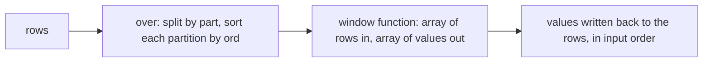

Seven definitions. `over` does what SQL's `OVER (PARTITION BY … ORDER BY …)` does; the other six compute one value per row of a sorted partition and are passed to `over` as its last argument.



## over/4
<!-- code: 9196c758 -->

- `to_entries | map({i: .key, r: .value})` tags every row with its input position `i`.
- `group_by(.r | part)[]` takes one partition at a time; `sort_by(.r | ord)` orders it (stable, so ties keep input order).
- `(map(.r) | wf) as $v` calls the window function on the partition's rows and gets one value per row.
- `to_entries[] | {i: .value.i, v: $v[.key]}` pairs each value with the input position of its row.
- After all partitions: `sort_by(.i) | map(.v)` is the list of values in input order, and the last line adds field `$col` to each original row.

The rows come back in the order they went in, whatever the partitions and their order were.

```jq run
[{day: 2, site: "N", x: 5}, {day: 1, site: "N", x: 3}, {day: 1, site: "S", x: 9}, {day: 3, site: "N", x: null}]
| over(.site; .day; "n"; row_number) | over(.site; .day; "sum"; running_sum(.x)) | over(.site; .day; "prev"; lag(.x; 1))
```

The first row is day 2 of site N: second in its partition, running sum 3 + 5, previous value 3.

## row_number/0
<!-- code: 11910703 -->

`[range(1; length + 1)]`: 1, 2, 3, … for the partition's rows.

```jq run
["a", "b", "c"] | row_number
```

## rank_by/1
<!-- code: cf17659e -->

SQL's `RANK`: tied values share a rank and the next rank skips. For row `$i`, the rank is one more than the number of earlier rows whose `f` differs from this row's. That is right when the partition is sorted by `f`, which is the caller's job (`over(…; .x; …; rank_by(.x))`).

```jq run
[{x: 10}, {x: 20}, {x: 20}, {x: 30}] | rank_by(.x)
```

**Review finding 7.** `rank_by` looks back over all earlier rows for every row, so its time grows with the square of the partition: one partition of 2,000 rows took 0.75 s, 4,000 took 2.7 s and 8,000 took 11.4 s (jq 1.8.2). A single pass that remembers the previous value and its rank would be linear.

## lag/2, lead/2
<!-- code: 3538b087 -->

The value of `f` on the row `$k` places before (`lag`) or after (`lead`) the current one, or null when there is no such row. Both index into the partition `$a` by position.

```jq run
[{x: 1}, {x: 2}, {x: 3}] | {lag: lag(.x; 1), lead: lead(.x; 2)}
```

## running_sum/1
<!-- code: 935016c5 -->

`foreach .[] as $r (null; …; .)` carries the sum and emits it after every row. A null value leaves the sum as it is; `(. // 0) + $v` starts the sum at the first non-null value, so the result is null until then, not 0.

```jq run
[{x: null}, {x: 2}, {x: null}, {x: 5}] | running_sum(.x)
```

## moving_mean/2
<!-- code: 53cece1f -->

For row `$i`, the mean of `f` over rows `max($i - $n + 1, 0)` to `$i`: the current row and up to `$n - 1` before it. `mean` is the library's own, so nulls in the window are skipped. Each row slices its own window, so the cost is rows times `$n`.

```jq run
[{x: 2}, {x: 4}, {x: null}, {x: 8}] | moving_mean(.x; 2)
```

The windows are [2], [2, 4], [4, null] and [null, 8].
