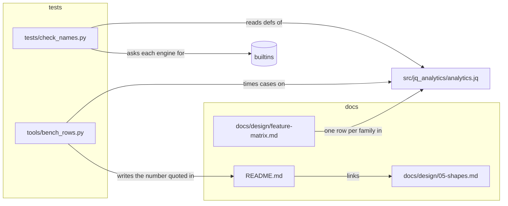
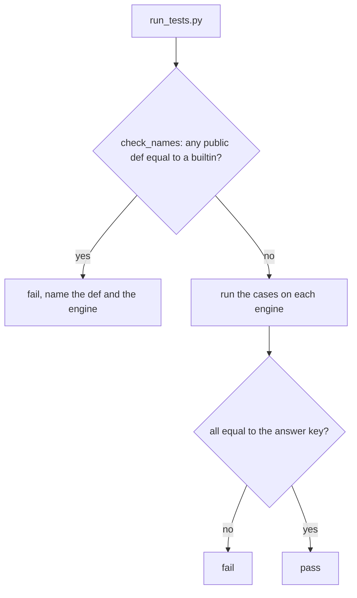

# 05 Shapes model

## Requirements

### Scope

The library's functions each assume a shape of data, and so far only one of them, the table, is written down. This sprint writes down all of them as the repository's first design document, states the library's goal in the README, and adds two small guards. It adds no library function.

### Glossary

- **Shape:** the form of data a function takes or returns: which fields a row must carry, or which object holds the rows.
- **Source:** a form data arrives in that is not a shape yet: an event log, a nested document, an object keyed by id, YAML.
- **Converter:** a function that turns a source or a shape into another shape.
- **Split key:** the field a caller may partition the input by so that each part can be computed separately and the answers combined.

### Mental model and invariants

- The library takes JSON or YAML as it arrives and does everyday analytic work on it, short of fitting a model. It also reshapes data into what the next tool reads.
- Every function takes rows: an array of objects. Trees, graphs and intervals are rows too, one per node, edge or span.
- An event log is a source, not a shape. Depending on the question it becomes a table, several tables, intervals, a tree, a graph or a star.
- Fields are read through expressions, never fixed names.
- Invariant: no public name of the library is a builtin of any tested engine.

### Decisions

- 2026-11-18: converters live in `analytics.jq`, one file, as the zone tables do.
- 2026-11-18: an object keyed by id becomes rows sorted by key on every engine. gojq does not keep key order, and an order that differs by engine cannot be tested once.
- 2026-11-18: names are kept (`unnest`, `flatten_fields`, and the rest); the rule is no clash with an engine builtin.
- 2026-11-18: the calendar table (spec 20) carries both ISO and US weeks.
- 2026-11-18: the line past which the README points to DuckDB is about 200,000 rows, provisional; this sprint measures it.
- 2026-11-18: intervals are a shape of their own.

### Configuration

None. No key, no secret.

### Requirements

- **R1. Shapes document.** WHEN a reader opens `docs/design/05-shapes.md`, THE document SHALL define each shape (table, several tables, intervals, tree, graph, star) with one example row, name the sources that are not shapes, list which function family takes which shape, show the conversions between shapes in a diagram, trace one case through three shapes, and say what stays out.
- **R2. Goal in the README.** THE README SHALL open with the goal in one paragraph and carry a shapes section that links the design document.
- **R3. Split keys.** FOR EACH function family THE README SHALL state how a caller may partition the input safely: by any rows, by group key, or by entity key in time order.
- **R4. Hand-off line.** THE README SHALL state, from a measurement at 200,000 rows in this repository's test setup, the size past which a heavy step belongs in DuckDB.
- **R5. Name guard.** WHEN the tests run, THEY SHALL fail if a public `def` of `analytics.jq` has the name of a builtin of any engine under test that can list its builtins.
- **R6. Feature matrix.** THE repository SHALL hold `docs/design/feature-matrix.md` with one row per function family and its state.

### Non-functional

- The 54 existing cases still pass on every engine.
- Every example in the new documents is made up.

### Out of scope

- Any new library function: converters are spec 10, intervals spec 15, the calendar spec 20.
- Partitioned parallel runs: the caller's job; the README only says which split is safe.

## Design

### End-to-end walkthrough

A reader has a nested JSON export and a question. The README's goal paragraph tells them the library fits. The shapes section tells them their export is a source, names the shape their question needs, and links the design document, where the diagram shows which conversion gets them there and which family answers the question. If their data is large, the split-key table tells them how to partition, and the hand-off line tells them when to use DuckDB instead.

### Components and boundaries



### APIs and interfaces

| Surface | Signature | Output | Called by |
|---|---|---|---|
| `tests/check_names.py` | `python tests/check_names.py [<jq binary> ...]` | exit 0, or exit 1 listing each clashing name and engine | `tests/run_tests.py`, a person |
| `tools/bench_rows.py` | `python tools/bench_rows.py <rows> [<case> ...]` | JSON: per case, seconds in the Python `jq` package and in DuckDB | a person, before a release |

### Dataflow

`tests/make_incidents.py`'s generator (fixed seed, row count set by the tool) → a generated table of N rows in a temporary file → each benchmark case's jq program and its DuckDB query → seconds per case → the README's hand-off sentence, written by hand from the printed numbers with the date and versions.

### Change map

| Path | Change |
|---|---|
| `docs/design/05-shapes.md` | new |
| `docs/design/feature-matrix.md` | new |
| `docs/specs/05-shapes-model/spec.md` | new |
| `README.md` | goal paragraph, shapes section, split-key table, hand-off line |
| `tests/check_names.py` | new |
| `tests/run_tests.py` | runs the name check first |
| `tools/bench_rows.py` | new |

### Workflow



### Algorithms

Name guard:

```text
defs      = every name after "def " at line start in analytics.jq that does not begin with "_"
for each engine binary that answers `-n 'builtins'`:
    builtins = names before "/" in that list
    clash   += defs ∩ builtins, tagged with the engine
the Python jq package is checked the same way through jq.compile("builtins")
fail if clash is not empty
```

An engine that cannot list builtins (jaq) is skipped and named in the output, so the gap is visible.

Split keys, the rule the README table is derived from:

```text
a function whose answer for a group reads only that group's rows  → split by group key
a function whose answer is a sum or count over rows               → split anywhere, add the parts
a function that orders an entity's rows in time                   → split by entity key, keep order
a function that reads two tables                                  → split both by the join key
a function over a tree or a graph                                 → split by connected component
```

### State and data lifecycle

Stateless. The benchmark's generated table is temporary and never committed.

### Failure and recovery

A missing engine is reported and skipped, as in `run_tests.py`. A name clash stops the run before any case.

### Verification

- `uv run --no-project --python 3.13 --with jq==1.13.0 --with duckdb==2.0.0 python -I tests/run_tests.py <engines>` exits 0 with 54 cases and the name check.
- The name check fails when a `def length: 0;` is added to a copy of the library (shown once, not committed).
- `python tools/bench_rows.py 200000` prints times; the README quotes them with date and versions.
- Every Mermaid block in the new documents renders on GitHub.
- A search of the repository for private terms finds nothing.

### Security

None beyond the repository's rule that examples are made up.

## Tasks

- [x] 1. Foundation
  - [x] 1.1 `docs/design/05-shapes.md`: shapes, sources, families, conversions diagram, traced case, what stays out (R1)
  - [x] 1.2 `docs/design/feature-matrix.md` (R6)
- [x] 2. Core
  - [x] 2.1 `tests/check_names.py`, called from `run_tests.py`; shown failing on a planted clash (R5)
  - [x] 2.2 `tools/bench_rows.py`, which sets the generator's row count itself (R4)
  - [x] 2.3 Measure at 200,000 rows; record the numbers (R4)
- [x] 3. Docs
  - [x] 3.1 README: goal, shapes section, split-key table, hand-off line (R2, R3, R4)
- [x] 4. Close
  - [x] 4.1 Full test run on five engines; private-term search; version 0.1.2

## Log

- 2026-11-18: spec written and activated; the six decisions above were answered the same day.
- 2026-11-18: 1.1 done. The traced case (hours open by region) was run on jq 1.7.1, jq 1.8.2, gojq and jaq and gives east 20, west 2; the first draft's tables were wrong about `state_blocks`' output fields and were corrected from the run.
- 2026-11-18: 2.1 done. The name check runs before the cases; 67 public names, no clash on jq 1.7.1, jq 1.8.2, gojq 0.12.20 and the Python jq 1.13.0 package; jaq cannot list builtins and is reported as skipped. A planted `def length: 0;` in a scratch copy was reported on all four.
- 2026-11-18: 2.2 and 2.3 done. `python tools/bench_rows.py 200000`: jq 7.77 to 20.03 s per question, peak 668 to 1,025 MB; DuckDB 0.12 to 0.17 s on six questions and 148.91 s on the as-of question (jq 15.11 s); all seven answers equal. The generator was left unchanged: the tool sets its row count.
- 2026-11-18: 1.2 and 3.1 done. The matrix count showed two gaps, listed there: `lead` has no case, and `tz_offset` is tested only through `local_time`. Moved to spec 10's tasks.
- 2026-11-18: 4.1 done and the spec closed as SHIPPED. 54 of 54 cases on five engines with the name check; the README's 33 examples regenerate the same on four engines; a search of the repository for private terms found none; version 0.1.2. Committed locally; the tag and the push wait for the maintainer's go.

## As built

Everything in the change map, except that `tests/make_incidents.py` was left unchanged: `tools/bench_rows.py` sets the generator's row count. The split-key table is in both the design document and the README. The measurement gave 7.8 to 20.0 s per question at 200,000 rows, so the README states "past about 200,000 rows" as a judgement about waiting time, and records that DuckDB was slower than the library on the as-of question (149 s against 15 s).

Not done here, by scope: no test runs a function on partitions and compares with the whole, so the split table is reasoned, not measured.
