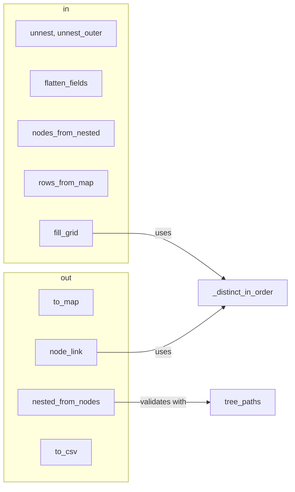

# 10 Shape converters

## Requirements

### Scope

Data that arrives nested, keyed by id or with gaps in time becomes rows the library's functions take, and a result leaves in the form the next tool reads. Ten functions, in `analytics.jq`. Two test gaps found in spec 05 are closed on the way.

### Glossary

As in [docs/design/05-shapes.md](../../design/05-shapes.md): shape, source, converter.

### Mental model and invariants

- A converter changes form, never values: no cast, no rounding, no reordering beyond what its comment states.
- A converter refuses input that is not its source, with an error naming the row or the key. It never guesses.
- Output order is stated and the same on every engine.

### Decisions

- 2026-11-18: one file; names kept; an object keyed by id becomes rows sorted by key (see spec 05).

### Requirements

- **R1. `unnest(f; $as)`, `unnest_outer(f; $as)`.** One row per array element. `unnest` drops a row whose array is empty or null, as SQL `UNNEST`; `unnest_outer` keeps it once with a null. A non-array value is an error naming the row's position.
- **R2. `flatten_fields($sep)`.** Nested objects become columns named by path. Arrays stay values. Two paths with the same flattened name are an error.
- **R3. `nodes_from_nested(id; children)`.** A nested tree becomes node rows with `parent`, in depth-first order, usable by `tree_paths` as they are.
- **R4. `rows_from_map($as)`.** An object keyed by id becomes rows sorted by key; a non-object value becomes `{key, value}`.
- **R5. `fill_grid($keys; $time; $step; $fill)`.** Every key combination at every step from the earliest to the latest time; missing rows get `$fill`. A time off the grid is an error. Empty input gives empty output.
- **R6. `to_map(key)`.** Rows become an object keyed by `key`; a duplicate key is an error.
- **R7. `nested_from_nodes(id; parent; $as)`.** Node rows become a nested tree; a missing parent or a cycle is the error `tree_paths` gives. Converting a nested tree to nodes and back gives the original.
- **R8. `node_link(from; to)`.** Edge rows become `{nodes, links}` with `source` and `target`, nodes in first appearance.
- **R9. `to_csv($cols)`.** A header line and one CSV line per row.
- **R10. Test gaps.** `lead` has a case with a DuckDB answer; `tz_offset` has a case of its own.
- **R11. README.** Each converter has a reference entry with an example generated by running it; YAML input is documented.

### Non-functional

Every case passes on jq 1.7.1, jq 1.8.2, gojq, jaq and the Python jq package. No public name clashes with a builtin.

### Out of scope

Parquet, Excel, schema validation; `unnest` with element position; a shape check function.

## Design

### End-to-end walkthrough

A nested export of requests with a `tags` array: `flatten_fields(".")` turns `user.dept.code` into a column, `unnest(.tags; "tag")` gives one row per tag, `group_agg` counts per tag, and `to_csv(["tag", "n"])` with `jq -r` writes the file a spreadsheet opens.

### Components and boundaries



All ten are pure jq with no state. Only `nested_from_nodes` calls another public function.

### APIs and interfaces

| Function | Input | Output | Errors |
|---|---|---|---|
| `unnest(f; $as)` | rows; `f` an array or null | rows + `$as` | `unnest: row N holds a <type>, not an array` |
| `unnest_outer(f; $as)` | same | same, empty kept with null | same |
| `flatten_fields($sep)` | rows | rows with path-named columns | `flatten_fields: two fields flatten to the same name: [...]` |
| `nodes_from_nested(id; children)` | one root or an array of roots | node rows with `parent` | none |
| `rows_from_map($as)` | object | rows sorted by key | none |
| `fill_grid($keys; $time; $step; $fill)` | rows, epoch-second times | rows, gaps filled | `fill_grid: T is not on the S-second grid from T0` |
| `to_map(key)` | rows | object | `to_map: duplicate key "k"` |
| `nested_from_nodes(id; parent; $as)` | node rows | array of nested roots | `tree_paths`' errors |
| `node_link(from; to)` | edge rows | `{nodes, links}` | none |
| `to_csv($cols)` | rows | a stream of strings | `@csv`'s error on a nested cell |

### Dataflow

Input JSON → converter → rows (or object, or strings). Nothing is stored.

### Change map

| Path | Change |
|---|---|
| `src/jq_analytics/analytics.jq` | section "shapes in and out": 10 public functions, 5 helpers |
| `tests/cases.json` | 20 cases: 18 for the converters, `lead`, `tz_offset` |
| `tests/fixtures/` | 14 small made-up fixtures |
| `tests/sql/` | `unnest.sql`, `unnest_outer.sql`, `fill_grid.sql`, `lead.sql` |
| `README.md` | reference entries, YAML note, counts, measured costs |
| `tools/bench_converters.py` | new |
| `tools/reference_examples.py` | the new examples |
| `docs/design/05-shapes.md`, `feature-matrix.md` | "planned" marks removed for these ten |

### Algorithms

```text
unnest(f; as):       for each row r at position i: a = r|f
                       null → no rows (outer: one row, as = null)
                       array → one row r + {as: x} per x in a (outer: [null] when empty)
                       else → error naming i
flatten_fields(sep): for each row: walk nested objects depth-first, collecting (path joined by sep, value);
                       an array, a scalar or an empty object ends the walk; duplicate names → error
nodes_from_nested:   emit(node, parent_id): node without children + {parent: parent_id};
                       then emit(child, node.id) for each child
fill_grid:           t0, t1 = min, max of time; any (t - t0) % step != 0 → error
                       index rows by (keys..., t); combos = distinct key tuples in first appearance
                       for combo in combos, t in t0..t1 by step: the indexed rows, or one filled row
nested_from_nodes:   tree_paths (errors on orphan, cycle); group rows by parent;
                       build(n) = n + {as: [build(c) for c in children of n]}; roots = rows with null parent
```

### Failure and recovery

Each error is raised before any output and names the row or key. There is no partial result.

### Verification

Per function: the answer key and the hand check.

| Case | Answer from |
|---|---|
| `unnest`, `unnest_outer` | DuckDB `UNNEST` and `LEFT JOIN LATERAL` |
| `fill_grid` | DuckDB: distinct sites × `generate_series`, left join. Hand: 2 sites × 3 hours = 6 rows, 3 filled |
| `lead` | DuckDB `lead() OVER` |
| `flatten_fields`, `nodes_from_nested`, `rows_from_map`, `to_map`, `nested_from_nodes`, `node_link`, `to_csv`, `tz_offset` | literals worked by hand |
| `nested_round_trip` | the property: nodes and back equals the original |
| five `_error` cases | the message text |

Command: `uv run --no-project --python 3.13 --with jq==1.13.0 --with duckdb==2.0.0 python -I tests/run_tests.py <engines>`.

## Tasks

- [x] 1. Core
  - [x] 1.1 The ten functions in `analytics.jq` (R1 to R9)
  - [x] 1.2 Cases, fixtures and SQL answers, including `lead` and `tz_offset` (R1 to R10)
- [x] 2. Docs
  - [x] 2.1 README reference entries with generated examples; YAML input; function and case counts (R11)
  - [x] 2.2 Design document and feature matrix: these ten no longer "planned"
- [x] 3. Close
  - [x] 3.1 Measure the converters at 200,000 rows
  - [x] 3.2 Full run, private-term search, version 0.2.0

## Log

- 2026-11-18: spec written after tasks 1.1 and 1.2 were already done from the prototype, in the same sitting; it should have come first. 74 cases (54 + 20) pass on jq 1.7.1, jq 1.8.2, gojq 0.12.20, jaq 3.1.2 and the Python jq 1.13.0 package, with no name clash.
- 2026-11-18: against the prototype, three changes: `fill_grid` returns `[]` for empty input (it failed on `min` of nothing); `nodes_from_nested`'s inner recursive `def` became a top-level helper; `rows_from_map`'s fixture gained a non-object value.
- 2026-11-18: 2.1 and 2.2 done. README section "Shapes in and out" with five examples generated on four engines; 76 functions, 74 cases.
- 2026-11-18: 3.1 done with `tools/bench_converters.py 200000` (Python jq 1.13.0, parsing included). First run: `node_link` 46.6 s, because the first-appearance dedupe appended to an array inside its reduce; it now stores positions and sorts once, 2.6 s. `flatten_fields` 12.6 s (its duplicate check now goes through `from_entries`; the cost is the per-field walk). `unnest` 2.1, `unnest_outer` 2.3, `to_map` 0.9, `rows_from_map` 2.1, `to_csv` 0.8, `fill_grid` 0.4 s for 15,873 rows in, `nested_from_nodes` 39.1 s.
- 2026-11-18: found while measuring, not fixed here: `tree_paths` (shipped in 0.1.0) walks every node's ancestry and slows sharply with depth: 1,000, 2,000 and 4,000 nodes took 0.5, 2.9 and 16.4 s in a tree dozens of levels deep, against 0.08, 0.19 and 0.46 s in a shallow one. Recorded in the README's limits and the feature matrix; a rewrite that builds paths from the roots down is a task for the graph sprint.
- 2026-11-18: 3.2 done, closed as SHIPPED. 74 of 74 on five engines; examples regenerate the same on four; no private term; version 0.2.0. Committed locally; tag and push wait for the maintainer's go.

## As built

The ten functions and five helpers as in the change map, plus `tools/bench_converters.py`. Against the design: `fill_grid` returns `[]` on empty input; the dedupe helper was rewritten after the measurement. Not done: no test at scale in the suite (the benchmark is a tool, run by hand), and `tree_paths`' cost on deep trees stands.
