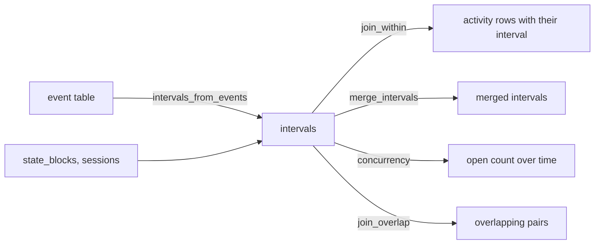
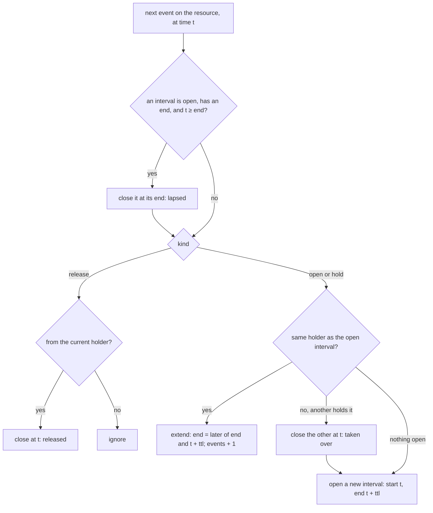

# 15 Intervals

## Requirements

### Scope

Many questions about logs are really about validity: who held this address at that moment, which session was this request part of, how many were open at once. The answer needs intervals, and logs give events. This sprint adds the function that builds intervals from events, the join that finds the interval covering a moment, and the two interval operations that follow from the shape: merging and concurrency.

It also corrects the documentation. The README's as-of examples suggest `join_asof` with a short age limit for "who had this address"; that is the wrong tool, and the README will say so.

### Glossary

- **Resource:** the thing that is held: an address, a seat, a lock, a session id.
- **Holder:** who holds it: a device, a user. A resource has at most one holder at a time.
- **Hold event:** evidence that the holder has the resource at this time: a grant, a renewal, a start, a keep-alive.
- **Release event:** the holder gives it up: a release, a stop, an expiry notice.
- **Time to live (ttl):** how long a hold event stays valid without another one, in seconds; null when holds do not expire.
- **Interval:** one stay of one holder on one resource, `[start, end)`: closed at its start, open at its end, like `join_overlap`'s intervals.

### Mental model and invariants

- An interval is opened by a hold event and extended by further hold events from the same holder. It ends in exactly one of four ways: **released** (a release event from its holder), **taken over** (a hold event from another holder while it is still valid), **lapsed** (its time to live ran out before the next event on the resource), or it is still **open** at the end of the data.
- Intervals of one resource never overlap.
- Nothing is dropped silently: an interval still open at the end of the data is returned and marked. An interval whose first event may not be its real beginning is marked too.
- A moment belongs to at most one interval of a resource.

### Decisions

- 2026-11-18: names `intervals_from_events` and `join_within`.
- 2026-11-18: `join_asof` stays for "latest value at or before T" (prices, configuration versions); the README states when it is the wrong tool.
- 2026-11-18: an interval with no closing event ends at its last hold plus the time to live, marked `open`; with a null time to live its end is null.

### Requirements

- **R1. `intervals_from_events(resource; holder; time; kind; ttl)`.** Builds intervals as the model says. `kind` gives `"open"`, `"hold"`, `"release"` or null for each event; null events are ignored. `"open"` and `"hold"` act the same, except that an interval whose first event is `"open"` has `start_seen: true`. Output, one row per interval: `{resource, holder, start, end, last, events, start_seen, ended_by}` (`last` is the time of its last hold event), grouped by resource in order of first appearance, in time order within a resource.
- **R2. Ties and stray events.** At the same time on one resource, events apply in the order open, hold, release. A release from a holder that does not hold the resource is ignored. A release when nothing is held is ignored.
- **R3. Errors.** A null time on an event with a kind, or a kind that is not one of the three, is an error naming the event.
- **R4. `join_within($intervals; lkey; rkey; ltime; rstart; rend)`.** Left outer: each left row with the interval of the same key whose `[rstart, rend)` contains `ltime`; a null `rend` means still open. No match, or a null key or time: the left row alone. When several intervals of a key contain the time, the one that started last.
- **R5. `merge_intervals(key; start; end)`.** Per key, intervals that overlap or touch become one: `{key, start, end, merged}`. A null end is open-ended and absorbs everything after its start.
- **R6. `concurrency(start; end)`.** How many intervals are open over time: one row `{t, open}` per moment the count changes, in time order. An interval counts from its start up to, not including, its end.
- **R7. README.** Reference entries with generated examples; the joins section says when to use `join_asof`, `join_within` and `join_overlap`; the traced example "which user had this address" is rewritten on made-up events with leases and sessions.
- **R8. Evidence on real data.** On real lease and session logs (kept outside this repository), the intervals this function builds equal a reference implementation's row for row.

### Non-functional

- Linear in events per resource after sorting: no appending to an array inside a `reduce`.
- Every case passes on the five engines; no name clashes with a builtin.

### Out of scope

- Address translation, IPv6 specifics, and name-resolution logs.
- Estimating a time to live from the data: the caller passes it, per event if it varies.
- Calendars and business hours (spec 20).

## Design

### End-to-end walkthrough

Made-up address-lease events, one resource `A`, time to live 100 s:

| t | holder | kind | what happens | intervals so far |
|---|---|---|---|---|
| 0 | m1 | hold | opens m1 until 100 | m1 [0, 100) |
| 60 | m1 | hold | same holder: extends to 160 | m1 [0, 160) |
| 120 | m1 | release | closes m1 at 120 | **m1 [0, 120) released** |
| 200 | m2 | hold | opens m2 until 300 | m2 [200, 300) |
| 350 | m3 | hold | 350 ≥ 300, so m2 had lapsed; opens m3 until 450 | **m2 [200, 300) lapsed**, m3 [350, 450) |
| 400 | m4 | hold | m3 still valid: taken over at 400; opens m4 until 500 | **m3 [350, 400) taken over**, m4 [400, 500) |
| end | | | m4 is still open | **m4 [400, 500) open** |

Resource `B`: a hold by m5 at 10 with no time to live, then a release by m9 at 500. m9 does not hold B, so the release is ignored: **m5 [10, null) open**.

Then `join_within` answers "who held it at T":

| resource | T | holder | why |
|---|---|---|---|
| A | 100 | m1 | inside [0, 120) |
| A | 130 | none | released at 120 |
| A | 250 | m2 | inside [200, 300) |
| A | 320 | none | m2 lapsed at 300 |
| A | 420 | m4 | m3 was taken over at 400 |
| B | 1000 | m5 | open-ended |
| C | 5 | none | no intervals for C |

An as-of join with a 30-second limit would answer only (A, 420), and an as-of join with no limit would answer m1 at 130 and m2 at 320, both wrong. That is the case this sprint exists for.

### Components and boundaries



All four are pure jq. `join_within` reuses the join family's merge rule: a field present on both sides with different values is an error, never a silent overwrite.

### APIs and interfaces

| Function | Input | Output | Errors |
|---|---|---|---|
| `intervals_from_events(resource; holder; time; kind; ttl)` | event rows | interval rows `{resource, holder, start, end, last, events, start_seen, ended_by}` | `intervals_from_events: event N has kind K; expected "open", "hold", "release" or null`; `…: event N has a kind but no time` |
| `join_within($intervals; lkey; rkey; ltime; rstart; rend)` | rows, intervals | left rows, merged with their interval when one contains the time | the join family's field-clash error |
| `merge_intervals(key; start; fin)` | intervals | `{key, start, end, merged}` | `merge_intervals: an interval ends before it starts` |
| `concurrency(start; fin)` | intervals | `{t, open}` rows | same check |

### Dataflow

Events → grouped by resource → sorted by time, holds before releases → one pass per resource carrying the current interval → closed intervals emitted as they close → the open one emitted at the end.

### Change map

| Path | Change |
|---|---|
| `src/jq_analytics/analytics.jq` | section "intervals": 4 public functions and helpers |
| `tests/cases.json`, `tests/fixtures/`, `tests/sql/` | cases for each ending, ties, strays, errors; `join_within`, `merge_intervals`, `concurrency` with DuckDB answers |
| `README.md` | reference entries; "which join when"; the traced example rewritten |
| `tools/reference_examples.py` | the new examples |
| `docs/design/05-shapes.md`, `feature-matrix.md` | intervals no longer "planned" |

### Workflow



### Algorithms

```text
intervals_from_events(resource; holder; time; kind; ttl):
  check every event: kind in {open, hold, release, null}; time not null when kind is not null
  for each resource, in first appearance:
    events = its events with a kind, sorted by (time, 0 for open, 1 for hold, 2 for release), stable
    cur = none
    for e in events, then one end marker:
      if cur and cur.end != null and (end marker or e.time >= cur.end):
          emit cur with ended_by = "lapsed" unless this is the end marker and ... (see below); cur = none
      at the end marker: emit cur with ended_by = "open" if cur; stop
      if e.kind == release:
          if cur and cur.holder == e.holder: emit cur with end = e.time, ended_by = "released"; cur = none
      else:
          if cur and cur.holder == e.holder:
              cur.events += 1; cur.end = null if e.ttl is null else max(cur.end, e.time + e.ttl)
          else:
              if cur: emit cur with end = e.time, ended_by = "taken_over"
              cur = {resource, holder, start: e.time, end: (null or e.time + e.ttl), events: 1, start_seen: e.kind == "open"}
```

At the end marker an interval is always reported `open`, even if its end has passed the last event of the resource: the data cannot tell a lapse from the end of the window, and the end is there for the caller to compare with their own cut-off.

```text
join_within($intervals; lkey; rkey; ltime; rstart; rend):
  index intervals by key, each list sorted by start, with the list of starts
  for each left row with key k and time t:
      j = the last position whose start <= t        (binary search)
      walk back from j to the first interval whose end is null or > t   (usually j itself)
      merge the left row with it, or return the left row alone

merge_intervals(key; start; end):
  per key, sort by start; walk, keeping one current interval;
  the next one joins it when its start <= current end (or the current end is null), else it starts a new one

concurrency(start; end):
  one +1 at each start and one -1 at each non-null end; sort by time; sum the changes at each distinct time;
  emit {t, open} after each
```

### State and data lifecycle

Stateless.

### Failure and recovery

Errors are raised before any output and name the event's position.

### Verification

| What | Answer from |
|---|---|
| the walkthrough above, both tables | literals worked by hand in this spec |
| ties, stray releases, null time to live, `start_seen` | literals |
| property: intervals of one resource never overlap | a check in the case itself, on a generated event log |
| `join_within` | DuckDB range join on the same intervals |
| `merge_intervals` | DuckDB gaps-and-islands query |
| `concurrency` | DuckDB running sum over +1 and -1 |
| R8 | outside this repository: real lease and session logs, compared row for row with a reference implementation |

The builder has no DuckDB answer key: writing its rules (extension, takeover, lapse) as SQL would be a second implementation as error-prone as the first. Its answers are worked by hand here, checked by the non-overlap property, and compared with an independent reference on real data.

Command: `uv run --no-project --python 3.13 --with jq==1.13.0 --with duckdb==2.0.0 python -I tests/run_tests.py <engines>`.

## Tasks

- [x] 1. Core
  - [x] 1.1 `intervals_from_events` with its error checks (R1, R2, R3)
  - [x] 1.2 `join_within` (R4)
  - [x] 1.3 `merge_intervals`, `concurrency` (R5, R6)
- [x] 2. Tests
  - [x] 2.1 Cases: the walkthrough, ties and strays, errors, the non-overlap property (R1 to R3)
  - [x] 2.2 Cases with DuckDB answers for `join_within`, `merge_intervals`, `concurrency` (R4 to R6)
  - [x] 2.3 Real-data comparison with the reference, recorded outside this repository (R8)
- [x] 3. Docs
  - [x] 3.1 README: reference entries, "which join when", the traced example rewritten (R7)
  - [x] 3.2 Design document and feature matrix
- [x] 4. Close
  - [x] 4.1 Measure at 200,000 events
  - [x] 4.2 Full run, private-term search, version 0.3.0

## Log

- 2026-11-18: spec written and activated before any code.
- 2026-11-18: 1.1 to 1.3, 2.1 and 2.2 done. 85 cases (74 + 11) pass on jq 1.7.1, jq 1.8.2, gojq 0.12.20, jaq 3.1.2 and the Python jq 1.13.0 package. The generated-log case finds no overlap among intervals of a resource, every hold counted in exactly one interval, and all four endings present. `join_within`, `merge_intervals` and `concurrency` equal their DuckDB answers.
- 2026-11-18: `end` is a jq keyword and cannot name a parameter (jq and gojq refuse it; jaq accepts it): `merge_intervals` and `concurrency` take `fin`. `join_within` keeps a running latest end per key so that a moment no interval contains stops the backward search at once instead of walking the key's whole history.
- 2026-11-18: output gained `last`, the time of the interval's last hold. Comparing with session logs that have no closing event showed the need: with no time to live such an interval's end is null, and the last evidence is the only thing a caller has to go on.
- 2026-11-18: 2.3 done, recorded outside this repository. On three real lease logs (26,563, 1,249 and 161 intervals) the function's output equals the reference implementation's row for row. On a real session log of 260 sessions, 259 give one interval with the same start; ends agree on 92 of 94 closed sessions and the last evidence on 164 of 165 open ones; each of the four differences was looked at and is a rule difference, not a defect (a session with only a closing record, one with two closing records, two whose records all share one second).
- 2026-11-18: that comparison changed one rule: events at the same time now apply in the order open, hold, release (was: holds, then releases). Seventeen real sessions logged their start and a keep-alive in the same second, and the keep-alive sorted first, so `start_seen` was false. Case `intervals_same_second_order` pins it.
- 2026-11-18: 3.1 done. README section "Intervals": which join when, the four functions with generated examples, and the traced example (address and time to device to user) on made-up lease, session and hit logs, checked by hand. The older several-tables example now answers through `intervals_from_events` and `join_within` in place of an as-of join with an age limit. 43 examples regenerate the same on four engines.
- 2026-11-18: 3.2 and 4.1 done. `tools/bench_intervals.py 200000` (Python jq 1.13.0, parsing included): `intervals_from_events` 8.41 s for 200,000 events over about 4,000 addresses (180,077 intervals); `join_within` 3.98 s for 50,000 lookups; `merge_intervals` 5.10 s; `concurrency` 4.65 s.
- 2026-11-18: 4.2 done, closed as SHIPPED. 86 of 86 on five engines; 43 README examples regenerate the same on four; no private term; version 0.3.0. Committed locally; tag and push wait for the maintainer's go.

## As built

Four public functions and three helpers. Against the first design: the output carries `last`; same-time events apply in the order open, hold, release; the parameter of `merge_intervals` and `concurrency` is `fin` because `end` is a keyword; `join_within` keeps a running latest end per key to stop a hopeless search early. Both changes of rule came from comparing with real logs.

Not done: reassignment of a resource without a lapse did not occur in the real logs compared, so the takeover path is covered by the made-up cases and the generated log only. Clock differences between two logs joined by `join_within` are the caller's to allow for.
