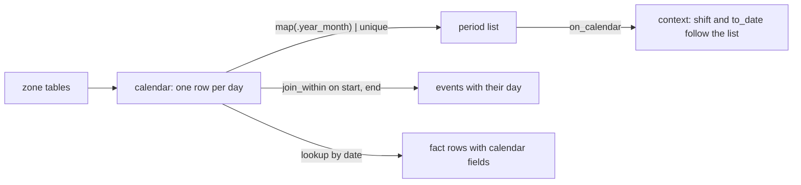

# 20 Calendar

## Requirements

### Scope

Periods exist whether or not the data has rows in them. Today the library's "previous month" is the previous month that has rows, and a month with no sales is skipped. This sprint adds a calendar table, one row per day, and lets a report step through calendar periods instead of through the values the data happens to hold.

### Glossary

- **Calendar table:** one row per day between two dates, with the day's year, quarter, month, weeks and weekday, and the moments the day starts and ends in a named time zone.
- **ISO week:** weeks start on Monday; week 1 is the week with the year's first Thursday; a day near New Year can belong to the neighbouring ISO year.
- **US week:** weeks start on Sunday; week 1 is the week that contains 1 January (a spreadsheet's `WEEKNUM(date, 1)`).
- **Period list:** every value of a period field in calendar order, such as every month of 2026, present in the data or not.

### Mental model and invariants

- A day belongs to a zone: it starts and ends at local midnight, so a day is 23 or 25 hours long when the clocks change. A day is an interval, `[start, end)`, and `join_within` puts an event in its day.
- A period with no rows is still a period: stepping back one month from March reaches February even when February is empty, and the measure there is whatever the measure gives on no rows.
- `shift` and `to_date` keep their meaning. What changes is the list they step through, and only where the caller says so.

### Decisions

- 2026-11-18: the calendar carries both ISO and US weeks, as separate columns.
- 2026-11-18: no fiscal calendars and no holidays.

### Requirements

- **R1. `calendar($from; $to; $zone)` and `calendar($from; $to)`.** One row per day from `$from` to `$to` inclusive, both `"YYYY-MM-DD"`: `{date, year, quarter, month, day, weekday (0 = Sunday), day_of_year, iso_year, iso_week, us_week, year_month ("2026-03"), year_quarter ("2026-Q1"), iso_year_week ("2026-W09"), start, end}`. `start` and `end` are the epoch seconds of local midnight in `$zone` (a zone name or `tz($name)`), UTC when no zone is given.
- **R2. Errors.** A date not in `YYYY-MM-DD` form or not a real date, `$from` after `$to`, or a zone not in the zone tables, is an error naming the value.
- **R3. `on_calendar($dim; $values)`.** Inside a cell, a context change that makes `shift` and `to_date` on `$dim` step through `$values`, in the order given, instead of through the values present in the data. A cell whose own value is not in `$values` has no context after a `shift`.
- **R4. README.** Reference entries with generated examples: a week around New Year, a day with a clock change, events placed in days with `join_within`, and "previous month" over a month with no rows, with and without `on_calendar`.

### Non-functional

Every case passes on the five engines; no public name clashes with a builtin; a year of days takes well under a second.

### Out of scope

Fiscal years, 4-4-5 calendars, holidays, business hours, and filling a report with rows for periods that have no data (left-join the report to the period list).

## Design

### End-to-end walkthrough

Sales by month for one region: January 30, March 40, nothing in February. A report asks for each month's revenue and the previous month's.

| month | revenue | previous, by `shift` alone | previous, with `on_calendar` |
|---|---|---|---|
| 2026-01 | 30 | none: no earlier value | null: December has no rows |
| 2026-03 | 40 | 30: January is the previous value that has rows | null: February has no rows |

The second column is today's behaviour, and it reports a two-month change as if it were month over month. The third steps through `["2025-12", "2026-01", "2026-02", "2026-03"]`, taken from `calendar("2025-12-01"; "2026-03-31") | map(.year_month) | unique`.

### Components and boundaries



### APIs and interfaces

| Function | Input | Output | Errors |
|---|---|---|---|
| `calendar($from; $to; $zone)` | none (`-n`, or any input, ignored) | day rows | `calendar: "x" is not a date (YYYY-MM-DD)`; `calendar: from "a" is after to "b"`; the zone lookup's error |
| `calendar($from; $to)` | same | same, in UTC | same |
| `on_calendar($dim; $values)` | a context, inside `calc` or `share` | a context | none |

### Algorithms

```text
calendar(from; to; zone):
  d0, d1 = each date read as midnight UTC, in epoch seconds; the date string printed back must equal the input (rejects 2026-02-30)
  for each day i from 0 to (d1 - d0) / 86400:
      m = d0 + 86400 * i ; (year, month, day, weekday, day_of_year) = that moment broken down in UTC
      iso week:  dow = weekday with Monday 1 .. Sunday 7 ; w = floor((day_of_year - dow + 10) / 7)
                 w < 1            -> last week of the previous year, iso_year = year - 1
                 w > weeks(year)  -> week 1, iso_year = year + 1
                 weeks(y) = 53 when p(y) = 4 or p(y - 1) = 3, else 52, with p(y) = (y + y/4 - y/100 + y/400) mod 7
      us week:   jan1 = weekday of 1 January = (weekday - (day_of_year - 1)) mod 7 ; us_week = floor((day_of_year + jan1 - 1) / 7) + 1
      start = local_midnight(m) ; end = local_midnight(m + 86400)

local_midnight(m):   the moment whose local clock in the zone reads the date of m at 00:00
  e = m - offset(m) ; e = m - offset(e)      (the second step corrects a guess that fell on the other side of a clock change)

on_calendar(dim; values):  context.members[dim] = values
```

`shift` finds the cell's value in `members[dim]` and moves by position; `to_date` selects every member up to the cell's value. Both already read `members`, so replacing the list is the whole change. `to_date` compares values, so the list must sort the way it is ordered: `"2026-03"` does, `"Mar"` does not.

### Failure and recovery

Errors before any output. A zone with a clock change exactly at midnight would make a local midnight that does not exist; none of the zones in the tables does this in 1970 to 2100.

### Verification

| Case | Answer from |
|---|---|
| every day of 2026 in one zone with clock changes: all fields, `start`, `end` | DuckDB date functions and `AT TIME ZONE` |
| days around New Year 2020/21 and 2024/25 (a 53-week ISO year, ISO year different from the calendar year) | DuckDB `isoyear`, `weekofyear`; US week from `strftime('%U')` adjusted for a year that starts on Sunday |
| the two clock-change days are 23 and 25 hours long | literal |
| errors: not a date, an impossible date, from after to, unknown zone | message text |
| previous month and year to date over a month with no rows, with `on_calendar` | DuckDB: the month series left-joined to the data |
| the same without `on_calendar` is unchanged | the existing case `context_sales_time` |

## Tasks

- [x] 1. Core
  - [x] 1.1 `calendar` in both forms with its errors (R1, R2)
  - [x] 1.2 `on_calendar` (R3)
- [x] 2. Tests
  - [x] 2.1 Calendar cases with DuckDB answers and the error cases
  - [x] 2.2 `on_calendar` cases with DuckDB answers
- [x] 3. Docs
  - [x] 3.1 README entries and examples; the "not a calendar" note revised (R4)
  - [x] 3.2 Design document and feature matrix
- [x] 4. Close
  - [x] 4.1 Full run, private-detail scan, version 0.4.0, push and tag

## Log

- 2026-11-18: spec written and activated before any code.
- 2026-11-18: 1.1, 1.2, 2.1 and 2.2 done. 95 cases (86 + 9) pass on jq 1.7.1, jq 1.8.2, gojq 0.12.20, jaq 3.1.2 and the Python jq 1.13.0 package. Every field of every day of 2026 equals DuckDB's, with local starts and ends in a zone with clock changes; so do the days around New Year 2020/21 (a 53-week ISO year), 2022/23 (a year starting on Sunday) and 2024/25.
- 2026-11-18: 3.1, 3.2 and 4.1 done, closed as SHIPPED. README entries with three generated examples (a New Year week, a 23-hour day with events placed in days, previous month with and without `on_calendar`); 95 of 95 on five engines; version 0.4.0.

## As built

`calendar` in both forms and `on_calendar`, as designed. `on_calendar` is one line: `shift` and `to_date` already read the context's list of members, so replacing that list was the whole change. Not done: no comparison with a DAX engine for calendar steps (the answer key is DuckDB); a report still has no rows for empty periods.
