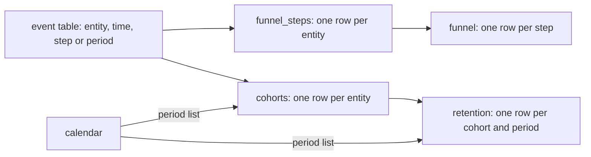

# 25 Event paths: funnels, cohorts, retention

## Requirements

### Scope

Two questions asked of every event table with an entity in it. How far do entities get through an ordered series of steps, and where do they drop off? And of the entities first seen in a period, how many come back in each later period? Four functions answer them.

### Glossary

- **Funnel:** an ordered list of steps. An entity reaches step n when it has events for steps 1 to n in time order.
- **Depth:** the furthest step an entity reaches.
- **Window:** an optional limit: every step must happen within so many seconds of the entity's first step.
- **Cohort:** the entities whose first event falls in the same period.
- **Retention:** for a cohort and a later period, the share of the cohort with at least one event in that period.

### Mental model and invariants

- A funnel only narrows: the count at step n + 1 is never above the count at step n.
- An entity counts once per step, however many matching events it has.
- With a window, an entity is credited with the deepest chain any of its first-step events can start: an early first step that times out does not hide a later one that completes.
- A cohort is fixed by an entity's first period and never changes. A retention table is complete: a cohort with nobody active in a later period has a row there with zero, not a missing row.
- Periods are stepped through a list the caller gives, in order, so an empty period still counts as a period (the list usually comes from `calendar`).

### Decisions

- 2026-11-18: periods come from a caller-supplied ordered list, as `on_calendar` takes one.
- 2026-11-18: events at the same time satisfy consecutive steps (time order is `<=`).

### Requirements

- **R1. `funnel_steps(entity; time; step; $steps; $within)`.** One row per entity that reaches step 1: the entity's key fields, `depth` (1 to the number of steps) and `times`, the time of each step it reached. `$within` is a number of seconds or null for no limit.
- **R2. `funnel(entity; time; step; $steps; $within)`.** One row per step, in order: `{step, entities, from_previous, from_first}`: how many entities reached it, and that count divided by the previous step's and by the first step's; both null where the divisor is zero, and `from_previous` null on the first step.
- **R3. `cohorts(entity; period; $periods)`.** One row per entity: its key fields and `cohort`, the earliest period in `$periods` order in which it has an event.
- **R4. `retention(entity; period; $periods)`.** One row per cohort and period from the cohort's own period to the last in `$periods`: `{cohort, period, offset, entities, cohort_size, rate}`. `offset` is how many periods after the cohort's (0 for its own). Cohorts with no entities have no rows.
- **R5. Errors.** A step list that is empty or repeats a step; an event whose period is not in `$periods`; a null time on an event whose step is in the list.
- **R6. README.** Reference entries with generated examples and one hand check each.

### Non-functional

Every case passes on the five engines; no public name clashes with a builtin; measured at 200,000 events.

### Out of scope

Funnels where a step may repeat or where steps may happen in any order; sessions inside funnels (cut events with `sessions` first and use the session as the entity); survival curves and churn models.

## Design

### End-to-end walkthrough

Made-up shop events and the funnel view → cart → pay, window one hour (3,600 s):

| entity | events (time, step) | depth | why |
|---|---|---|---|
| u1 | 0 view, 100 cart, 200 pay | 3 | in order, within the hour |
| u2 | 0 view, 50 pay, 60 cart | 2 | pay came before cart: cart at 60 counts, no pay after it |
| u3 | 0 view, 5000 cart | 1 | cart is outside the hour |
| u4 | 0 view, 4000 view, 4100 cart, 4200 pay | 3 | the first view times out; the second one completes |
| u5 | 10 cart, 20 pay | none | never viewed: not in the funnel |

| step | entities | from_previous | from_first |
|---|---|---|---|
| view | 4 | null | 1 |
| cart | 3 | 0.75 | 0.75 |
| pay | 2 | 0.6667 | 0.5 |

Retention over months `["2026-01", "2026-02", "2026-03"]`, with events: a in January, February and March; b in January and March; c in February only.

| cohort | period | offset | entities | cohort_size | rate |
|---|---|---|---|---|---|
| 2026-01 | 2026-01 | 0 | 2 | 2 | 1 |
| 2026-01 | 2026-02 | 1 | 1 | 2 | 0.5 |
| 2026-01 | 2026-03 | 2 | 2 | 2 | 1 |
| 2026-02 | 2026-02 | 0 | 1 | 1 | 1 |
| 2026-02 | 2026-03 | 1 | 0 | 1 | 0 |

### Components and boundaries



### APIs and interfaces

| Function | Output | Errors |
|---|---|---|
| `funnel_steps(entity; time; step; $steps; $within)` | `{key…, depth, times}` per entity | `funnel: the step list is empty`; `funnel: step "x" is listed twice`; `funnel: an event of step "x" has no time` |
| `funnel(entity; time; step; $steps; $within)` | `{step, entities, from_previous, from_first}` per step | the same |
| `cohorts(entity; period; $periods)` | `{key…, cohort}` per entity | `cohorts: period "x" is not in the period list` |
| `retention(entity; period; $periods)` | `{cohort, period, offset, entities, cohort_size, rate}` | the same |

### Algorithms

```text
funnel_steps: for each entity (first appearance), its events whose step is in the list, sorted by time
  best = none
  for each event s of step 1, in time order:
      chain = [s.time]; limit = s.time + within (or no limit)
      for each later step k: t = the earliest event of step k with time >= chain's last time and <= limit
                             none -> stop; else append t
      keep chain if longer than best; stop early when it is complete
  emit {key, depth: length(best), times: best} when best exists

  The earliest matching event is always the best choice for a fixed first event: taking a later one
  can only remove options for the steps after it.

funnel: count entities with depth >= n for each step n; divide

cohorts: position of each period in the list; per entity, the period with the smallest position
retention: per cohort, the set of its entities; for each period from the cohort's position to the end:
           entities = how many of the cohort's entities have an event in that period
```

### Verification

| Case | Answer from |
|---|---|
| the two walkthrough tables | literals worked by hand in this spec |
| a generated event log, three steps, with and without a window: counts per step | DuckDB: an entity reaches step 2 when some view and cart exist with `t1 <= t2 <= t1 + W`, step 3 when a pay exists after that cart within the same limit: a declarative statement of the rule, not the greedy procedure |
| the same log: per-entity depth | the same query, per entity |
| cohorts and retention on a generated log over 6 periods | DuckDB: first period by `min`, then a cross join of cohorts and later periods with a count of active members |
| property: the funnel only narrows; every cohort's offset 0 rate is 1 | checked in the case |
| errors | message text |

## Tasks

- [x] 1. Core
  - [x] 1.1 `funnel_steps`, `funnel` (R1, R2, R5)
  - [x] 1.2 `cohorts`, `retention` (R3, R4, R5)
- [x] 2. Tests
  - [x] 2.1 Walkthrough literals, errors, properties
  - [x] 2.2 Generated logs against DuckDB
- [x] 3. Docs
  - [x] 3.1 README entries and examples (R6)
  - [x] 3.2 Design document and feature matrix
- [x] 4. Close
  - [x] 4.1 Measure at 200,000 events
  - [x] 4.2 Full run, private-detail scan, version 0.5.0, push and tag

## Log

- 2026-11-18: spec written and activated before any code.
- 2026-11-18: 1.1, 1.2, 2.1 and 2.2 done. 106 cases (95 + 11) pass on jq 1.7.1, jq 1.8.2, gojq 0.12.20, jaq 3.1.2 and the Python jq 1.13.0 package. On a generated log of 400 entities, counts per step and every entity's depth equal DuckDB's declarative query with a 600-second window and with none; the funnel narrows at four window sizes; the retention table over seven periods (one of them empty) and each entity's cohort equal DuckDB's.
- 2026-11-18: 3.1, 3.2, 4.1 and 4.2 done, closed as SHIPPED. README section with two generated examples, each checked by hand. `tools/bench_event_paths.py 200000` (Python jq 1.13.0, parsing included): `funnel` 5.68 s with a window and 5.60 s without, `retention` 2.99 s, `cohorts` 2.22 s. 106 of 106 on five engines; version 0.5.0.

## As built

Four public functions and four helpers, as designed. Not done: funnels whose steps may repeat or come in any order, and sessions inside funnels, as the spec's out of scope says.
