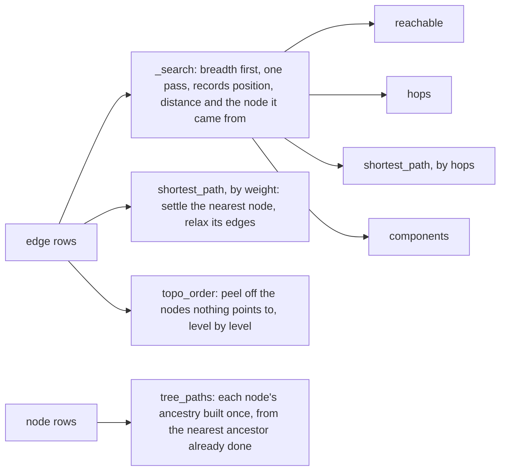

# 30 Graph paths

## Requirements

### Scope

The library can say what is reachable in a graph and which nodes hang together. It cannot say how far, by which route, or in what order things must happen. This sprint adds distance in hops, a shortest path (by hops or by a weight), and dependency order. It also repairs the speed of the tree and graph functions that exist: measured before this sprint, they slow down with the square of the input.

### Measured before

Python `jq` 1.13.0, parsing included, on a random tree of n edges:

| n | `reachable` | `components` | `tree_paths`, shallow | `tree_paths`, dozens of levels deep |
|---|---|---|---|---|
| 1,000 | | | 0.08 s | 0.5 s |
| 2,000 | | | 0.19 s | 2.9 s |
| 4,000 | | | 0.46 s | 16.4 s |
| 10,000 | 0.76 s | 1.46 s | | |
| 20,000 | 2.49 s | 4.79 s | | |
| 40,000 | 9.14 s | 17.8 s | | |

Doubling the graph multiplies the time of `reachable` and `components` by about 3.6. The cause is the same in both: an array that grows by one inside a `reduce`, copied each time. `tree_paths` walks every node's whole ancestry and checks each step against the path so far.

### Glossary

- **Hops:** the number of edges on the shortest route from the start to a node.
- **Weight:** a non-negative cost on an edge; the cost of a path is the sum of its edges' weights.
- **Dependency order:** an order of the nodes in which every edge's `from` comes before its `to`.
- **Level:** in a dependency order, 0 for a node nothing points to, otherwise one more than the highest level among the nodes that point to it. Nodes of one level do not depend on each other.

### Mental model and invariants

- A graph is a table of edges, directed from `from` to `to`, as for `reachable`.
- Answers do not depend on the engine or on the order of the input rows: where several shortest paths or several orders exist, the function picks by a stated rule.
- The repaired functions give exactly the answers they gave before.

### Decisions

- 2026-11-18: no priority queue. The weighted search picks the nearest unsettled node by scanning, which is simple and fast enough for the few thousand nodes jq is the right tool for; the README says so.

### Requirements

- **R1. `hops(from; to; $start)`.** One row per node that can be reached from `$start`, the start included at 0: `{node, hops}`, nearest first; within one distance, in the order the search meets them.
- **R2. `shortest_path(from; to; $start; $goal)`.** The route with the fewest edges, as `{path: [nodes from start to goal], cost: hops}`; null when there is none; `{path: [$start], cost: 0}` when start and goal are the same. Among routes of equal length, the one found first by a breadth-first search that follows edges in input order.
- **R3. `shortest_path(from; to; weight; $start; $goal)`.** The route with the lowest total weight, same output with `cost` the total. A negative or null weight is an error. Among routes of equal cost, the one whose last step was found first.
- **R4. `topo_order(from; to)`.** One row per node: `{node, level}`, sorted by level, then by node. A cycle is an error naming one node on it.
- **R5. Speed.** `reachable`, `components`, `tree_paths` (and so `tree_rollup` and `nested_from_nodes`) take time in step with their input: doubling the input roughly doubles the time. Their answers and error messages are unchanged.
- **R6. README.** Reference entries with generated examples; the limits section restated from new measurements.

### Non-functional

Every case passes on the five engines; no public name clashes with a builtin.

### Out of scope

All-pairs distances, negative weights, k shortest paths, centrality, community detection, a priority queue.

## Design

### End-to-end walkthrough

Made-up build steps, an edge meaning "must come before":

```text
fetch -> compile -> test -> package
fetch -> lint    -> package
docs  -> package
```

`topo_order(.from; .to)`:

| node | level | why |
|---|---|---|
| docs | 0 | nothing points to it |
| fetch | 0 | nothing points to it |
| compile | 1 | after fetch |
| lint | 1 | after fetch |
| test | 2 | after compile |
| package | 3 | after test (2), lint (1) and docs (0): one more than the highest |

`hops(.from; .to; "fetch")`: fetch 0, compile 1, lint 1, test 2, package 2 (through lint). `shortest_path(.from; .to; "fetch"; "package")` is `{path: ["fetch", "lint", "package"], cost: 2}`.

With weights (minutes): fetch→compile 1, compile→test 1, test→package 1, fetch→lint 5, lint→package 5, docs→package 2. The cheapest route from fetch to package is through compile and test, cost 3, although it has more hops than the route through lint, cost 10.

### Components and boundaries



### APIs and interfaces

| Function | Output | Errors |
|---|---|---|
| `hops(from; to; $start)` | `{node, hops}` rows | none |
| `shortest_path(from; to; $start; $goal)` | `{path, cost}` or null | none |
| `shortest_path(from; to; weight; $start; $goal)` | `{path, cost}` or null | `shortest_path: an edge has weight W; weights must be numbers >= 0` |
| `topo_order(from; to)` | `{node, level}` rows | `topo_order: cycle through N` |

### Algorithms

```text
_search(adjacency; start): breadth first
  seen[start] = {pos 0, hops 0, via none}; frontier = [start]
  for each frontier, level by level:
      for each node of the frontier, for each neighbour in input order, when not seen:
          seen[neighbour] = {pos: next position, hops: level + 1, via: node}
          next[position] = neighbour            (an object keyed by position, not a growing array)
      frontier = the values of next, by position
  result = the entries of seen sorted by position      (one sort at the end)

shortest_path by hops: follow `via` back from the goal to the start, reverse

shortest_path by weight (Dijkstra without a queue):
  dist[start] = 0; repeat: u = the unsettled node with the lowest dist (ties: found first); stop at goal or when none
      settle u; for each edge u -> v with weight w: if dist[u] + w < dist[v]: dist[v] = dist[u] + w, via[v] = u

topo_order: indegree of every node; level 0 = the nodes with indegree 0, sorted
  for each level: for each of its nodes, for each node it points to: indegree - 1; at 0 it joins the next level
  nodes left with indegree > 0 when a level comes up empty: a cycle; name the smallest

tree_paths: parent of every node in one map; done = {}
  for each node not done: walk up, collecting ids, until a root or a node already done
      (a parent that is not a node, or an id met twice on this walk: the same errors as before)
      then give each collected id its ancestry, top down, starting from the done node's ancestry
```

### Verification

| Case | Answer from |
|---|---|
| the walkthrough: `topo_order`, `hops`, both `shortest_path` forms | literals worked by hand in this spec |
| `hops` on the existing edge fixture | DuckDB recursive query, minimum depth per node |
| weighted `shortest_path` cost on a generated graph, for several goals | DuckDB recursive query keeping the minimum cost per node |
| `topo_order` on a generated acyclic graph | property: every edge's `from` has a lower level than its `to`; each level is one more than the highest among predecessors (DuckDB recursive longest path) |
| cycle, negative weight | message text |
| R5: answers unchanged | every existing case of `reachable`, `components`, `tree_paths`, `tree_rollup`, `nested_from_nodes` still passes |
| R5: speed | the table above, measured again |

## Tasks

- [x] 1. Core
  - [x] 1.1 `_search` replaces `_bfs`; `reachable` and `components` rebuilt on it; `hops`; `shortest_path` by hops (R1, R2, R5)
  - [x] 1.2 `shortest_path` by weight; `topo_order` (R3, R4)
  - [x] 1.3 `tree_paths` rewritten (R5)
- [x] 2. Tests
  - [x] 2.1 Walkthrough literals and errors
  - [x] 2.2 DuckDB answers and the ordering properties
- [x] 3. Docs
  - [x] 3.1 README entries, examples, limits restated from new measurements (R6)
  - [x] 3.2 Design document and feature matrix
- [x] 4. Close
  - [x] 4.1 Measure again; `tools/bench_graphs.py`
  - [x] 4.2 Full run, private-detail scan, version 0.6.0, push and tag

## Log

- 2026-11-18: spec written and activated before any code. The "measured before" numbers for `reachable` and `components` were taken for this spec; those for `tree_paths` come from spec 10's log.
- 2026-11-18: 1.1 to 1.3, 2.1 and 2.2 done. 115 cases (106 + 9) pass on jq 1.7.1, jq 1.8.2, gojq 0.12.20, jaq 3.1.2 and the Python jq 1.13.0 package. Every earlier case of `reachable`, `components`, `tree_paths`, `tree_rollup` and `nested_from_nodes` passes unchanged on the rewritten code. On a generated acyclic graph the lowest cost and fewest hops to every node and every node's level equal DuckDB's enumeration of all paths; each returned path is checked to be a real path whose weights sum to its cost.
- 2026-11-18: 4.1 done early, `tools/bench_graphs.py` (Python jq 1.13.0, parsing included):

  | edges | `reachable` | `components` | `tree_paths`, deep | `tree_paths`, shallow | `topo_order` |
  |---|---|---|---|---|---|
  | 10,000 | 0.34 s | 0.54 s | 0.41 s | 0.38 s | 0.39 s |
  | 20,000 | 0.65 s | 1.10 s | 0.86 s | 0.77 s | 0.78 s |
  | 40,000 | 1.33 s | 2.21 s | 1.93 s | 1.53 s | 1.55 s |
  | 200,000 | 6.93 s | 11.63 s | 20.1 s | 7.71 s | 8.12 s |

  Doubling the input now doubles the time. At 40,000 edges `reachable` went from 9.14 s to 1.33 s and `components` from 17.8 s to 2.21 s; a deep tree of 4,000 nodes took 16.4 s before, and 40,000 now take 1.93 s. The weighted `shortest_path` was timed on 4,000 edges only (0.2 to 0.6 s); how far the goal is varies between the generated graphs, so that number says little.
- 2026-11-18: 3.1, 3.2 and 4.2 done, closed as SHIPPED. README entries for `hops`, `shortest_path` and `topo_order` with one generated example; the limits section restated from the new measurements; 115 of 115 on five engines; version 0.6.0.

## As built

`hops`, two forms of `shortest_path`, `topo_order`; `_search` in place of `_bfs`; `tree_paths`, `reachable` and `components` rewritten with unchanged answers. Adjacency lists are now built by grouping rather than by appending per edge. Not done: the weighted search has no priority queue and no measurement worth quoting beyond 4,000 edges.
