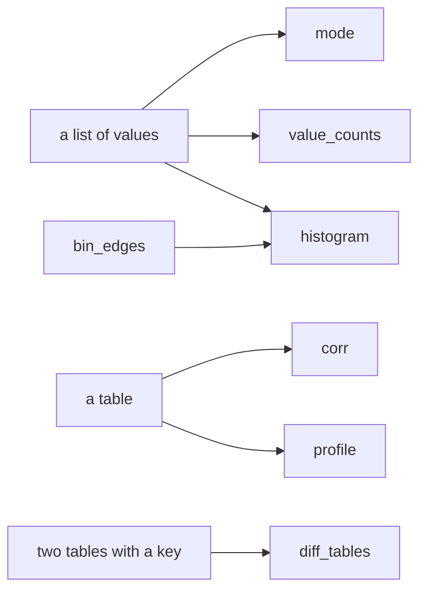

# 35 Profiles: what is in a table, and what changed

## Requirements

### Scope

The first questions asked of any table: which values are common, how a number is spread, whether two numbers move together, what each column holds, and what differs between yesterday's export and today's. Seven small functions.

### Glossary

- **Mode:** the most frequent value.
- **Bin:** a range of numbers; a histogram counts the values in each.
- **Profile:** one row per column of a table: how many values, how many missing, how many distinct, of what types, the smallest and the largest.
- **Diff:** the rows added, removed and changed between two versions of a table that share a key.

### Mental model and invariants

- Nulls are skipped by the statistics, as everywhere in the library, and counted by the profile, which exists to show them.
- Nothing depends on the engine: where there is a choice (two values equally frequent, the order of columns), the rule is stated and uses jq's sort order.
- A histogram never drops a value silently: a value outside the edges is an error.
- A diff never guesses: a key that appears twice on either side is an error.

### Requirements

- **R1. `mode`.** Over a list: the most frequent non-null value; among equally frequent values the smallest in jq's sort order; null when there is none.
- **R2. `value_counts`.** Over a list: one row per distinct non-null value, `{value, count, share}`, most frequent first, ties by value; `share` is of the non-null values.
- **R3. `bin_edges($lo; $hi; $n)`** gives `$n + 1` equally spaced edges from `$lo` to `$hi`. **`histogram($edges)`**, over a list of numbers: one row per bin, `{from, to, count}`; a bin holds `from <= v < to`, and the last bin also holds `v == to`. Nulls are skipped. A value below the first edge or above the last, edges that are not increasing, or fewer than two edges: an error.
- **R4. `corr(x; y)`.** Over rows: Pearson's correlation of the pairs where both are non-null; null with fewer than two pairs or when either side does not vary.
- **R5. `profile`.** Over a table: one row per column, columns in name order: `{column, rows, present, nulls, empty, distinct, types, min, max}`. `present` counts rows that have the field, `nulls` those where it is null or absent, `empty` those where it is `""`, `distinct` the distinct non-null values, `types` an object of jq type name to count, `min` and `max` the smallest and largest non-null value when all non-null values are numbers or all are strings, else null.
- **R6. `diff_tables($old; key)`.** Over the new table: one row per key that was added, removed or changed, sorted by key: `{key, change, fields, old, new}`. `change` is `"added"`, `"removed"` or `"changed"`; `fields` lists, in name order, the fields whose values differ (a field present on one side only counts); unchanged rows are left out. A key that appears twice in either table, or a null key, is an error.
- **R7. README.** Reference entries with generated examples.

### Non-functional

Every case passes on the five engines; no public name clashes with a builtin; measured at 200,000 rows.

### Out of scope

Approximate quantiles and sketches, rank correlation, outlier detection, schema inference beyond jq's own types, fuzzy row matching (spec 40).

## Design

### End-to-end walkthrough

A made-up export of hosts, yesterday and today:

```text
yesterday                                today
host   site   ram  os                    host   site   ram  os
web01  North  16   linux                 web01  North  32   linux      ram changed
db01   South  64   linux                 db01   South  64   linux      unchanged
old01  North  8    ""                    new01  ""     16   null       old01 removed, new01 added
```

`diff_tables($yesterday; .host)` on today's rows:

| key | change | fields |
|---|---|---|
| new01 | added | |
| old01 | removed | |
| web01 | changed | ram |

`profile` of today's rows:

| column | rows | present | nulls | empty | distinct | types | min | max |
|---|---|---|---|---|---|---|---|---|
| host | 3 | 3 | 0 | 0 | 3 | string 3 | db01 | web01 |
| os | 3 | 3 | 1 | 0 | 1 | null 1, string 2 | linux | linux |
| ram | 3 | 3 | 0 | 0 | 3 | number 3 | 16 | 64 |
| site | 3 | 3 | 0 | 1 | 3 | string 3 | "" | South |

`[16, 32, 64, 64, 8] | histogram(bin_edges(0; 64; 4))`: bins of width 16: [0,16) holds 8; [16,32) holds 16; [32,48) holds 32; [48,64] holds both 64s, because the last bin includes its upper edge. Counts 1, 1, 1, 2.

### Components and boundaries



All pure jq, no shared helpers beyond the library's null rule.

### APIs and interfaces

| Function | Input | Output | Errors |
|---|---|---|---|
| `mode` | list | a value or null | none |
| `value_counts` | list | `{value, count, share}` rows | none |
| `bin_edges($lo; $hi; $n)` | none | list of `$n + 1` numbers | `bin_edges: need hi > lo and n >= 1` |
| `histogram($edges)` | list of numbers | `{from, to, count}` rows | `histogram: edges must be at least two increasing numbers`; `histogram: value V is outside the edges` |
| `corr(x; y)` | rows | number or null | none |
| `profile` | table | one row per column | none |
| `diff_tables($old; key)` | new table | `{key, change, fields, old, new}` rows | `diff_tables: key K appears twice in the old/new table`; `diff_tables: a row has a null key` |

### Algorithms

```text
mode:          group equal values; the largest group; among equals the smallest value
histogram:     for each value, the bin is found by binary search over the edges; the last edge belongs to the last bin
corr:          over pairs with both present: n, mean of x, mean of y;
               sum((x - mx)(y - my)) / sqrt(sum((x - mx)^2) * sum((y - my)^2)); null when a sum of squares is 0
profile:       columns = the sorted union of field names; one pass per column over the rows
diff_tables:   index both tables by key; for the sorted union of keys:
               only in new -> added; only in old -> removed; in both and unequal -> changed, with the fields that differ
```

### Verification

| Case | Answer from |
|---|---|
| the walkthrough: diff, profile, histogram | literals worked by hand in this spec |
| `mode`, `value_counts`, `corr`, `histogram` on generated numbers and labels | DuckDB `mode` (on data without ties), `count` by value, `corr`, and a `CASE` over the same edges |
| `corr` when one side is constant, with one pair, with nulls | literals |
| `diff_tables` on two generated versions of a table | DuckDB `FULL JOIN` on the key with `IS DISTINCT FROM` per field |
| `profile` on a generated table | DuckDB counts, `count(DISTINCT …)`, `min`, `max` per column |
| errors | message text |

## Tasks

- [x] 1. Core
  - [x] 1.1 `mode`, `value_counts`, `bin_edges`, `histogram`, `corr` (R1 to R4)
  - [x] 1.2 `profile`, `diff_tables` (R5, R6)
- [x] 2. Tests
  - [x] 2.1 Walkthrough literals, edge cases, errors
  - [x] 2.2 Generated data against DuckDB
- [x] 3. Docs
  - [x] 3.1 README entries and examples (R7)
  - [x] 3.2 Design document and feature matrix
- [x] 4. Close
  - [x] 4.1 Measure at 200,000 rows
  - [x] 4.2 Full run, private-detail scan, version 0.7.0, push and tag

## Log

- 2026-11-18: spec written and activated before any code.
- 2026-11-18: 1.1, 1.2, 2.1 and 2.2 done. 129 cases (115 + 14) pass on jq 1.7.1, jq 1.8.2, gojq 0.12.20, jaq 3.1.2 and the Python jq 1.13.0 package, on the first run. On generated data the mode, the value counts and shares, the correlation, the binned counts, the per-column profile and the diff of two versions equal DuckDB's.
- 2026-11-18: 3.1, 3.2, 4.1 and 4.2 done, closed as SHIPPED. `tools/bench_profiles.py 200000` (Python jq 1.13.0, parsing included): `mode` 1.48 s, `value_counts` 1.63 s, `histogram` 2.83 s, `corr` 2.03 s, `profile` 7.84 s, `diff_tables` 4.36 s. Version 0.7.0.

## As built

Seven public functions and one helper, as designed. The diff's error for a null key names the table, a detail the spec's table did not have.
