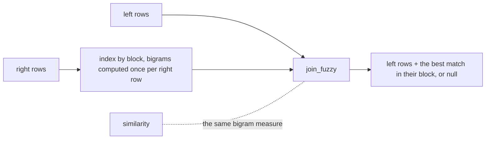

# 40 Approximate key matching

## Requirements

### Scope

Keys that should match and do not: `Radiology North` and `Radiology  north`, `web-01` and `web01`, a name with a typo. The plan for this sprint said it would start with a measurement and that "leave it to DuckDB" was an acceptable result. This spec records the measurement and the decision it led to: a small, bounded part ships, and edit distance does not.

### Measured first

20,000 pairs of made-up names about 16 characters long:

| What | Where | Seconds | Pairs a second |
|---|---|---|---|
| edit distance (Levenshtein) | Python `jq` 1.13.0 package | 22.1 | about 900 |
| edit distance | jq 1.8.2, gojq, jaq command line | 6.3 to 10.4 | 1,900 to 3,200 |
| edit distance | DuckDB 2.0.0 `levenshtein` | 0.008 | about 2,500,000 |
| Dice coefficient over character bigrams | Python `jq` package | 1.8 | about 11,000 |

The jq edit distances equalled DuckDB's, so the cost is speed, not correctness: jq is roughly 800 to 2,800 times slower here.

### Decision (2026-11-18)

- **Edit distance does not ship.** At a thousand pairs a second, a join that compares even 300 rows against 300 takes a minute and a half. Offering it as a library function would invite exactly that. For edit distance, Jaro-Winkler or anything over a few thousand comparisons, the README says to use DuckDB and shows the query.
- **Cleaning keys stays the first answer.** Most keys that fail to match differ by case, spacing or punctuation. A cleaned key expression in an ordinary join already handles them at no extra cost; the README says so before anything else.
- **A bigram similarity and a blocked join ship**, because they are ten times cheaper, need no new machinery, and cover the case of small tables where no other engine is at hand. The join refuses to run without a blocking key, so its cost is bounded by the size of the blocks.

### Glossary

- **Bigram:** two neighbouring characters of a string; `north` has `no`, `or`, `rt`, `th`.
- **Dice coefficient:** twice the number of bigrams two strings share, divided by the bigrams of both; 1 for the same set, 0 for none in common.
- **Blocking key:** a cheap exact key (a site, a first letter, a postcode) that two rows must share before they are compared at all.

### Mental model and invariants

- Similarity compares what it is given: it does no cleaning. The caller lowercases and trims in the expression.
- Similarity is symmetric, 1 for equal strings, and null when either side is null.
- The fuzzy join compares rows only within a block, picks at most one match per left row, the most similar, and keeps every left row.

### Requirements

- **R1. `similarity(a; b)`.** The Dice coefficient over the distinct character bigrams of the two strings: a number from 0 to 1. Equal strings give 1, including strings too short to have a bigram; unequal strings with no bigram on one side give 0; null on either side gives null.
- **R2. `join_fuzzy($right; lblock; rblock; lstr; rstr; $min; $as)`.** Left outer: each left row with field `$as` holding `{similarity, row}` for the right row of the same block whose `rstr` is most similar to the left row's `lstr`, when that similarity is at least `$min`; null otherwise. Among equally similar right rows, the first in input order. A null block or a null string never matches.
- **R3. README.** A section that puts the three answers in order: clean the key; then `join_fuzzy` for small blocks, with its measured cost; then DuckDB, with a query, for edit distance or volume.

### Non-functional

Every case passes on the five engines; no public name clashes with a builtin; the cost of `join_fuzzy` is measured and stated per comparison.

### Out of scope

Edit distance, Jaro-Winkler, phonetic codes, token-based similarity, matching without a blocking key, one-to-many fuzzy matches, deduplication of a table against itself (pair the matches and use `components`).

## Design

### End-to-end walkthrough

Made-up departments from two systems, blocked by site:

| left | site | | right | site |
|---|---|---|---|---|
| Radiology North | N | | radiology-north | N |
| Pharmcy | N | | pharmacy | N |
| Billing | S | | Biling Office | S |
| Surgery | S | | (nothing similar) | |

Keys lowercased in the expression, threshold 0.5:

| left | best right in its block | similarity | why |
|---|---|---|---|
| Radiology North | radiology-north | 0.857 | 12 of its 14 bigrams are shared; the hyphen and the space each cost two |
| Pharmcy | pharmacy | 0.769 | bigrams `ph ha ar rm` and `cy` shared: 5 of 6 and 5 of 7 |
| Billing | Biling Office | 0.556 | 5 shared bigrams out of 6 and 12 |
| Surgery | none | null | nothing in block S reaches 0.5 |

### Components and boundaries



### APIs and interfaces

| Function | Input | Output | Errors |
|---|---|---|---|
| `similarity(a; b)` | any input; two string expressions | 0 to 1, or null | `similarity: X is not a string` |
| `join_fuzzy($right; lblock; rblock; lstr; rstr; $min; $as)` | left rows | left rows + `{($as): {similarity, row} or null}` | the same |

### Algorithms

```text
bigrams(s):      the distinct two-character slices of s, sorted
dice(x; y):      both empty -> not used (equal strings are caught first); one empty -> 0
                 else 2 * |x ∩ y| / (|x| + |y|)
similarity(a;b): null if either is null; 1 if equal; else dice(bigrams(a); bigrams(b))

join_fuzzy:      index the right rows by block, each with its string and bigrams, computed once
                 for each left row: its block's right rows; similarity to each; the highest, first on ties;
                 kept when >= min
```

Cost: one comparison per pair of rows that share a block. Blocks of 100 against 100 are 10,000 comparisons.

### Verification

| Case | Answer from |
|---|---|
| the walkthrough | literals worked by hand in this spec, each bigram count written out |
| `similarity` on generated string pairs | an independent implementation in Python, its answers stored with the fixture |
| properties: symmetric; 1 for equal strings; within 0 to 1 | checked in the case |
| `join_fuzzy`: best match per left row on generated blocks | the same Python reference: for each left row the best right row of its block |
| null block, null string, short strings, threshold exactly met | literals |

There is no DuckDB answer key: DuckDB's `jaccard` is over single characters, not bigrams, so it measures something else.

## Tasks

- [x] 0. Measure string comparison speed in jq against DuckDB
- [x] 1. Core
  - [x] 1.1 `similarity`, `join_fuzzy` (R1, R2)
- [x] 2. Tests
  - [x] 2.1 Walkthrough literals, edge cases, properties
  - [x] 2.2 Generated pairs and blocks against the Python reference
- [x] 3. Docs
  - [x] 3.1 README section in the order: clean the key, `join_fuzzy`, DuckDB (R3)
  - [x] 3.2 Design document and feature matrix
- [x] 4. Close
  - [x] 4.1 Measure `join_fuzzy`
  - [x] 4.2 Full run, private-detail scan, version 0.8.0, push and tag

## Log

- 2026-11-18: task 0 done before the spec was written, as the plan required; the numbers are in "Measured first". The decision above follows from them: edit distance stays out, a bigram similarity and a blocked join go in.
- 2026-11-18: 1.1, 2.1 and 2.2 done. 134 cases (129 + 5) pass on jq 1.7.1, jq 1.8.2, gojq 0.12.20, jaq 3.1.2 and the Python jq 1.13.0 package, on the first run. The walkthrough's three similarities came out as worked by hand (0.857, 0.769, 0.556). 300 generated pairs and the best match of 150 left rows among 120 right rows in blocks equal the answers of `tests/make_fuzzy.py`, a Python implementation that shares no code with the library, non-ASCII strings included.
- 2026-11-18: 4.1 done, `tools/bench_fuzzy.py` (Python jq 1.13.0, parsing included): 2,000 rows against 2,000 in 20 blocks, about 200,000 comparisons, 4.55 s (about 44,000 a second); in 200 blocks 0.66 s; 20,000 against 20,000 in 2,000 blocks, about 200,000 comparisons, 6.16 s. The join is faster per comparison than `similarity` alone (about 11,000 a second) because each right row's bigrams are computed once.
- 2026-11-18: 3.1, 3.2 and 4.2 done, closed as SHIPPED. README section "Keys that almost match" in the order clean the key, `join_fuzzy`, a database, with the DuckDB query for edit distance. Version 0.8.0.

## As built

`similarity` and `join_fuzzy` with two helpers, as designed. Edit distance was prototyped only to be measured and is not in the library.
