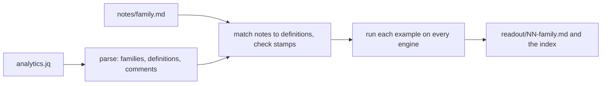

# 45 Code read-out and teaching material

## Requirements

### Scope

The README says what each function does. Nothing yet explains how each one is written, and the code has not been reviewed line by line. This sprint adds a read-out: for every definition in `analytics.jq`, the code as it stands, an explanation of each clause, and a small run with its output. It also closes two measurement gaps left by earlier sprints and outlines a tutorial.

### Glossary

- **Family:** one section of `analytics.jq` (math, joins, windows, …).
- **Note:** the hand-written explanation of one definition, or of a few definitions that belong together.
- **Stamp:** a short hash of the code a note explains, stored in the note. When the code changes, the stamp no longer matches and the build fails until someone re-reads the note.

### Mental model and invariants

- The code in a read-out page is copied from `analytics.jq` at build time; nobody types it.
- The output of every run in a page is produced at build time and must be the same on every engine given.
- Every definition has exactly one note, and every note names definitions that exist. A page cannot be built otherwise.
- A note whose code changed since it was written is an error, not a warning.

### Requirements

- **R1. `tools/readout.py`.** Reads `analytics.jq` (families, definitions with the comment above each) and `docs/readout/notes/<family>.md`, and writes `docs/readout/<NN>-<family>.md` plus an index. Fails on a definition with no note, a note with no definition, a stale stamp, or a run whose output differs between engines. `--stamp` writes the stamp of notes that have none. `--all` also fails when a family has no notes file.
- **R2. Notes for every definition**, helpers included, in all families except the generated time-zone tables. Each note says what the definition takes and returns, then explains the code clause by clause, naming the reason for anything not obvious (why an object is used instead of a growing array, why a key is passed through `tojson`), and has at least one run.
- **R3. Two measurements.** The weighted `shortest_path` at 10,000 and 40,000 edges, with the goal at a stated distance. The calendar steps of `on_calendar` compared with a DAX engine (dax-sql 0.2.2 compiling to DuckDB): previous month and year to date over a month with no rows.
- **R4. Tutorial outline.** `docs/tutorial-outline.md`: chapters in teaching order, each with the question it answers, its made-up data, the functions it introduces and its hand check.

### Non-functional

No private detail in notes or runs; every run uses made-up data. The whole read-out builds in under a minute.

### Out of scope

Writing the tutorial chapters; changing library behaviour (a defect found while writing a note becomes an issue or a task in a later spec, with the note saying what the code does today).

## Design

### End-to-end walkthrough

`docs/readout/notes/joins.md` holds, for the five equality joins:

````markdown
## join_inner/3, join_left/3, join_full/3, join_semi/3, join_anti/3
<!-- code: 3f9a1c20 -->

Each is `join_on` with no extra condition and a fixed kind …

```jq run
[{id: 1, k: "a"}] | join_inner([{k: "a", v: 9}]; .k; .k)
```
````

The build finds those five definitions in the joins family, checks that the hash of their code is `3f9a1c20`, and writes into `docs/readout/30-joins.md`: the heading, the five definitions in a `jq` block with their line numbers in `analytics.jq`, the note, the run and, under it, the output all engines printed. Rename `join_semi` or change its body and the build stops, naming the note.

### Components and boundaries



### APIs and interfaces

| Command | Does |
|---|---|
| `python tools/readout.py <jq> [<jq> …]` | builds every family that has a notes file |
| `… --all` | also fails when a family has no notes file |
| `… --stamp` | writes missing stamps into the notes, then builds |
| `… --list` | prints each family's definitions and which have notes |

A note's heading is `## name/arity`, or several separated by commas. A run is a fenced block opened with `jq run`; it runs with `-n`, so it builds its own input.

### Algorithms

```text
parse:   a family starts at a "# ---- name" line; the time-zone tables are skipped
         a definition starts at a line beginning "def " and ends before the next such line or the
         next comment at column 0; its comment is the unbroken run of "# " lines directly above it
         its key is name/arity, arity = the number of parameters
stamp:   the first 8 hex digits of sha256 over the code of the note's definitions, in file order,
         with trailing spaces removed
build:   for each family with notes: order notes by their first definition's line; emit; any
         definition left over, or any note key not found, stops the build with the full list
```

### Verification

| Case | Answer from |
|---|---|
| a definition without a note, a note without a definition, a stale stamp | the build's exit code and message, shown once each in the log |
| every definition of `analytics.jq` is parsed | the parsed public names equal the list `tests/check_names.py` reads |
| runs | the same values on four command-line engines (object key order aside: gojq sorts keys); the page shows the first engine's output |
| weighted shortest path | `tools/bench_weighted_path.py`, with a heap-based Dijkstra in Python as the reference for the cost and for how many nodes are settled before the goal |
| calendar steps against DAX | test case `on_calendar_dax`: its SQL answer is a DAX query (`tests/sql/on_calendar_dax.dax`) compiled once by dax-sql 0.2.2 and stored, so the suite needs no Node |

## Tasks

- [x] 1. Generator
  - [x] 1.1 `tools/readout.py` with its four failure modes (R1)
- [x] 2. Notes (R2), one family per task, in this order
  - [x] 2.1 joins
  - [x] 2.2 intervals
  - [x] 2.3 math; types
  - [x] 2.4 time zones and calendar; calendar
  - [x] 2.5 grouping; several tables at once; windows; reshape
  - [x] 2.6 state machines over time; event paths
  - [x] 2.7 hierarchies; graphs
  - [x] 2.8 measures in a context
  - [x] 2.9 shapes in and out
  - [x] 2.10 distributions, profiles, diffs; approximate matching
- [x] 3. Measurements (R3)
  - [x] 3.1 Weighted `shortest_path` at 10,000 and 40,000 edges
  - [x] 3.2 Calendar steps against a DAX engine
- [x] 4. Tutorial outline (R4)
- [x] 5. Close: `--all` build, full test run, private-detail scan, push

## Log

- 2026-11-18: spec written and activated before any code.
- 2026-11-18: 1.1 and 2.1 done. `tools/readout.py` parses 128 definitions in 18 families. The joins page covers its 13 definitions in 8 notes; every run gives the same values on jq 1.7.1, jq 1.8.2, gojq 0.12.20 and jaq 3.1.2. Runs are compared by value, not by text, because gojq prints object keys sorted. A wrong stamp and a renamed note heading each stopped the build with the note's name.
- 2026-11-18: 2.2 done; the intervals page covers 6 definitions, and the traced example's four intervals came out as worked by hand. Review finding 1, from writing the note: `merge_intervals` and `concurrency` do not reject a null start (the first treats it as the earliest start, the second emits a row with a null time). Not changed here; it goes to the next spec that touches intervals.
- 2026-11-18: 2.3 done; math (18 definitions) and types (2). Hand checks of the variance and quantile runs agree. The run comparison now also treats `3.0` and `3` as equal, because jaq prints whole floats with a decimal point. Review findings: 2, the comment above `quantile_disc` names a file outside this repository; 3, `parse_ts` accepts an impossible date such as 30 February on jq 1.7.1, jq 1.8.2 and gojq (it becomes 2 March) and refuses it on jaq; 4, `cast` adds a schema column missing from a row as null, which nothing states or tests.
- 2026-11-18: 2.4 done; time zones (4 definitions) and calendar (8). The week numbers around New Year 2021 and the 23-hour day of 8 March 2026 agree with the hand check. No new findings; the calendar's date guard is the one `parse_ts` lacks (finding 3).
- 2026-11-18: 2.5 done; grouping (2 definitions), several tables at once (3), windows (7), reshape (2). Review findings: 5, the comments of `group_agg` and `intervals_from_events` sit above their helpers; 6, `split_by` names tables by the tag as text, so tags `1` and `"1"` collide and the first table's rows are lost without an error; 7, `rank_by` is quadratic in the partition (jq 1.8.2: 0.8 s at 2,000 rows, 2.8 s at 4,000, 11.9 s at 8,000); 8, `pivot` appends inside a `reduce` and is quadratic in the values of one cell (0.5 s at 20,000, 1.6 s at 40,000, 5.8 s at 80,000), which the comment above `_groups` says the file avoids.
- 2026-11-18: 2.6 done; state machines over time (5 definitions) and event paths (8). The block, session, funnel and retention runs equal the hand-worked tables. Review findings: 9, `state_blocks`, `transitions` and `sessions` do not check for a null time, and `sessions` then fails with jq's own subtraction error; 10, `retention` scans every entity once per period, so 40,000 entities take 0.8 s over 30 periods and 5.4 s over 365 (jq 1.8.2).
- 2026-11-18: 2.7 done; hierarchies (2 definitions) and graphs (8). The tree, search, path and level runs equal the hand-worked answers of spec 30's walkthrough. Review finding 11: `tree_paths` does not detect an id that appears on two rows; the last row's parent is used for both, so a root can come back with an ancestry.
- 2026-11-18: 2.8 done; measures in a context (13 definitions). Totals, shares, the previous month with and without a calendar and the running totals equal the hand check on five rows. Review finding 12: `shift` on a field that has no member list (not a level of the report, no `on_calendar`) gives a null cell on jq and gojq and the error `cannot index null` on jaq; it should be one named error.
- 2026-11-18: 2.9 done; shapes in and out (15 definitions). Review findings: 13, `rows_from_map` builds each row as the key field plus the value, so a value with a field of that name overwrites the key; 14, `fill_grid` does not check for a null time and fails with jq's own subtraction error (the same gap as finding 9); 15, `nested_from_nodes` appends each row to its parent's array inside a `reduce` and is quadratic in the children of one parent (a root with 20,000 children 0.9 s, 40,000 2.9 s, 80,000 11.5 s; three children per node, 80,000 nodes, 1.4 s).
- 2026-11-18: 2.10 done; distributions, profiles, diffs (8 definitions) and approximate matching (4). No new findings. Task 2 is complete: `tools/readout.py --all` builds 18 pages covering 128 of 128 definitions, with 94 runs that give the same values on four engines. Fifteen review findings in all; five of them give a wrong or lost value without an error or differ between engines (3, 6, 11, 12, 13), four are about speed (7, 8, 10, 15), three are missing null checks (1, 9, 14), one is undocumented behaviour (4) and two are comments (2, 5).
- 2026-11-18: 3.1 done, `tools/bench_weighted_path.py` (Python jq 1.13.0, parsing included; a random directed graph with one node per four edges, weights 1 to 19):

  | edges | nodes | goal settled 100th | goal settled last | goal that does not exist |
  |---|---|---|---|---|
  | 10,000 | 2,500 | 0.13 s | 3.29 s | 3.31 s |
  | 20,000 | 5,000 | 0.22 s | 12.3 s | 13.0 s |
  | 40,000 | 10,000 | 0.41 s | 51.5 s | 50.6 s |

  Doubling the graph multiplies the far-goal time by four: the search is quadratic in the nodes it settles, as its comment says. Every cost equals the reference's. This closes the gap spec 30 left ("no measurement worth quoting beyond 4,000 edges"); the README's two statements about it now carry these numbers. A priority queue is still not built.
- 2026-11-18: 3.2 done. The DAX query `SUMMARIZECOLUMNS(Sales[Region], 'Date'[Month], "revenue", [Revenue], "prior", CALCULATE([Revenue], PREVIOUSMONTH('Date'[Date])), "to_date", TOTALYTD([Revenue], 'Date'[Date]))`, compiled to DuckDB SQL by dax-sql 0.2.2 and run on the `sales_gap` fixture, gives the same revenue, previous calendar month and running total as `on_calendar` for every region and month that has sales: east March has no prior (February is empty), east April's prior is 45. The compiled SQL is stored as the answer of the new case `on_calendar_dax`; 135 cases pass on five engines. Two differences, both by design and now stated in the README: DAX also returns the months without sales (three rows here) where the jq report has none, and `TOTALYTD` restarts each year where `to_date` runs over the whole period list; the fixture lies within one year, so the second is not exercised. This closes the gap spec 20 left ("no comparison with a DAX engine").

- 2026-11-18: 4 done. `docs/tutorial-outline.md`: thirteen chapters in teaching order, one made-up service-desk scenario throughout, each chapter with its question, its rows, the functions it introduces and a hand check; the answer is shown before the program. All but thirteen public functions are placed in a chapter; the thirteen are variants left to the reference.
- 2026-11-18: 5 done, closed as SHIPPED. `tools/readout.py --all` builds 18 pages; 135 cases pass on five engines; every README example agrees on four engines. Version 0.8.1: no change to `analytics.jq`.

## As built

`tools/readout.py`, notes for all 128 definitions in 18 families, 18 generated pages with 94 runs, two measurements and a tutorial outline, as specified. Differences from the spec: the weighted shortest-path measurement got its own tool with a reference implementation instead of an extension of `tools/bench_graphs.py`; run outputs are compared by value, not by text, because gojq sorts object keys and jaq prints whole floats with a decimal point; the DAX comparison is a stored compiled answer, so the suite needs no Node.

Not done here, by the spec's own rule: none of the fifteen review findings is fixed. They are listed in this log and each is described in its note. Five give a wrong or lost value without an error or differ between engines (3 `parse_ts` and impossible dates, 6 `split_by` and tags with the same text, 11 `tree_paths` and a repeated id, 12 `shift` on a field that is not a level, 13 `rows_from_map` and a clashing field); four are quadratic costs (7 `rank_by`, 8 `pivot`, 10 `retention`, 15 `nested_from_nodes`); three are missing null checks (1, 9, 14); one is undocumented behaviour (4 `cast`); two are comments (2, 5). They are the input to the next spec.
