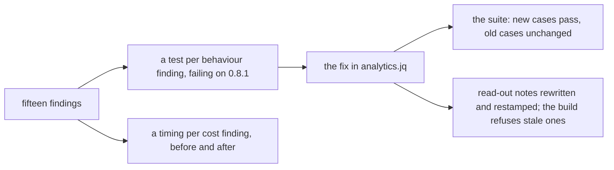

# 55 Hardening: the fifteen review findings

## Requirements

### Scope

Writing the code read-out (spec 45) produced fifteen findings and fixed none. This sprint fixes them. No new function is added.

### Glossary

- **Wrong-value finding:** an input for which a function returns a wrong or incomplete answer without an error, or returns different things on different engines.
- **Missing check:** an input the function cannot handle, which today ends in the engine's own error with no function or row named.
- **Quadratic cost:** time that grows with the square of some part of the input.

### Mental model and invariants

- The README's rule 4 holds without exception after this sprint: nothing is silently dropped, overwritten or turned into another value. Where a function cannot give a right answer it raises an error that names itself and the offending value.
- A fix changes an answer only where the old answer was wrong or was an engine's own error. Every case that passed before still passes.
- A speed fix changes no answer at all.

### Requirements

Wrong values, first:

- **R1. `parse_ts` refuses a date that does not exist** (finding 3). `"2026-02-30 00:00:00"` is an error on every engine, by printing the parsed moment back and comparing it with the input, as `calendar` does.
- **R2. `split_by` refuses two tags that give the same table name** (finding 6): tags `1` and `"1"`, or null and `"null"`. The error names both tags.
- **R3. `tree_paths` refuses an id that appears on two rows** (finding 11), and so do `tree_rollup` and `nested_from_nodes`, which call it.
- **R4. `shift` refuses a field that has no member list** (finding 12): not a level of the report and no `on_calendar`. The same error on every engine.
- **R5. `rows_from_map` refuses a value that already has the key field** (finding 13).

Missing checks:

- **R6.** `merge_intervals` and `concurrency` refuse a null start (finding 1).
- **R7.** `state_blocks`, `transitions` and `sessions` refuse a null time (finding 9); `fill_grid` refuses a null time (finding 14). Each error names the function.

Costs:

- **R8.** `rank_by` takes time in step with the partition (finding 7).
- **R9.** `pivot` takes time in step with its rows, whatever the size of one cell (finding 8).
- **R10.** `retention` no longer scans every entity once per period (finding 10).
- **R11.** `nested_from_nodes` takes time in step with its rows, whatever the number of children of one parent (finding 15).

Documentation:

- **R12.** `cast` adding a schema column that a row lacks, as null, is stated in its comment and the README and has a test (finding 4).
- **R13.** The comment above `quantile_disc` no longer names a file outside the repository (finding 2); the comments of `group_agg`, `intervals_from_events` and `state_blocks` sit above those functions (finding 5).
- **R14.** The read-out notes of every changed definition are rewritten and restamped, and the findings they recorded are marked as fixed in this version.

### Non-functional

Every case passes on the five engines. `parse_ts` at 200,000 rows is measured before and after, because R1 adds work to its fast path; the cost is reported, and accepted if it is a fraction of the function's time.

### Out of scope

A priority queue for the weighted `shortest_path` (a known limit, not a finding); any new function.

## Design

### End-to-end walkthrough

Before and after, on the inputs the read-out used:

| Call | Before | After |
|---|---|---|
| `"2026-02-30 00:00:00" \| parse_ts` | 1772409600 (2 March) on jq and gojq; an error on jaq | `parse_ts: not a timestamp: "2026-02-30 00:00:00"` everywhere |
| `[{t: 1}, {t: "1"}] \| split_by(.t)` | `{"1": [{"t": "1"}]}`: one row lost | `split_by: tags 1 and "1" give the same table name "1"` |
| `[{id: 1, p: null}, {id: 1, p: 2}, {id: 2, p: null}] \| tree_paths(.id; .p)` | both rows of id 1 get ancestry `[2, 1]` | `tree_paths: id 1 appears twice` |
| a report with level `r`, `shift("m"; 1)` | a null cell on jq and gojq; `cannot index null` on jaq | `shift: "m" is not a level of this report; add it to a level or use on_calendar` |
| `{"a": {"id": "zzz"}} \| rows_from_map("id")` | `[{"id": "zzz"}]`: the key lost | `rows_from_map: the value of key "a" already has a field "id"` |
| `[{k: 1, s: null, e: 3}] \| merge_intervals(.k; .s; .e)` | a merged row with a null start | `merge_intervals: an interval has no start` |
| `[{e: 1, t: null}, {e: 1, t: 5}] \| sessions(.e; .t; 10)` | `number (5) and null (null) cannot be subtracted` | `sessions: an event has no time` |

### Components and boundaries



### APIs and interfaces

No signature changes. New errors:

| Function | Error |
|---|---|
| `parse_ts` | `parse_ts: not a timestamp: V` (the existing message, now also for impossible dates) |
| `split_by` | `split_by: tags A and B give the same table name N` |
| `tree_paths` | `tree_paths: id I appears twice` |
| `shift` | `shift: D is not a level of this report; add it to a level or use on_calendar` |
| `rows_from_map` | `rows_from_map: the value of key K already has a field A` |
| `merge_intervals`, `concurrency` | `F: an interval has no start` |
| `state_blocks`, `transitions`, `sessions`, `fill_grid` | `F: an event has no time` (`fill_grid: a row has no time`) |

### Algorithms

```text
parse_ts:           after parsing the date and time part as UTC to e, print e back as YYYY-MM-DDTHH:MM:SSZ;
                    unequal to what was parsed -> the not-a-timestamp error
split_by:           name = tag as text; group the groups by name; a name with two groups -> error
tree_paths:         while building the id -> parent lookup, an id already present -> error
shift:              members[dim] null -> error, before looking the value up
rows_from_map:      a value that is an object and has the key field -> error
rank_by:            one pass carrying the previous value and its rank: equal to the previous -> the same rank,
                    else position + 1
pivot:              inside a row group, group the rows by column name once (group_by keeps input order),
                    instead of appending each value to its column's array
retention:          group the entities by cohort position once; each cohort's entities are then one lookup
nested_from_nodes:  children by parent from group_by(parent), not by appending inside a reduce
```

### Verification

| Finding | Evidence |
|---|---|
| 1, 3, 6, 9, 11, 12, 13, 14 | a new case each that fails on 0.8.1 (run recorded before any fix) and passes after |
| 4 | a new case that already passes: it pins the behaviour now stated |
| 7, 8, 10, 15 | no answer changes, so no case can fail before: the existing cases of each function must pass unchanged, and `tools/bench_hardening.py` times each at three sizes before and after |
| 2, 5 | the read-out build: the notes that recorded them are rewritten |
| `parse_ts` cost | `tools/bench_hardening.py`: 200,000 timestamps before and after |

## Tasks

- [x] 1. Tests first
  - [x] 1.1 New cases and their fixture; run on 0.8.1 and record which fail
  - [x] 1.2 `tools/bench_hardening.py`; timings on 0.8.1
- [x] 2. Wrong values (R1 to R5)
- [x] 3. Missing checks (R6, R7)
- [x] 4. Costs (R8 to R11)
- [x] 5. Documentation (R12 to R14)
- [x] 6. Close: full run, timings after, private-detail scan, version, push and tag

## Log

- 2026-11-18: spec written and activated before any code.

- 2026-11-18: 1.1 done. Fifteen new cases on one fixture (`tests/fixtures/hardening.json`). On the unchanged 0.8.1 library, 13 fail on jq 1.7.1, jq 1.8.2, gojq and the Python package, and 12 on jaq, which already refused an impossible date; the two that pass pin behaviour that stays (real dates still parse; `cast` adds a missing column as null). All 135 earlier cases pass.
- 2026-11-18: 1.2 done. `tools/bench_hardening.py` on 0.8.1, Python jq 1.13.0 package, workloads generated inside jq: `rank_by` over one partition 2.28, 9.21, 37.4 s at 2,000, 4,000, 8,000 rows; `pivot` with one cell 1.79, 6.33, 24.3 s at 20,000, 40,000, 80,000 values; `nested_from_nodes` under one root 3.17, 9.45, 44.2 s at 20,000, 40,000, 80,000 nodes; `retention` over 365 periods 8.97 and 18.6 s at 20,000 and 40,000 entities; `parse_ts` 3.86 s for 200,000 timestamps.
- 2026-11-18: 2, 3 and 4 done in one change to `analytics.jq`. All 150 cases pass on the five engines on the first run. The same workloads afterwards:

  | Workload | Size | Before | After |
  |---|---|---|---|
  | `rank_by`, one partition | 2,000 / 4,000 / 8,000 rows | 2.28 / 9.21 / 37.4 s | 0.07 / 0.12 / 0.22 s |
  | `pivot`, one cell | 20,000 / 40,000 / 80,000 values | 1.79 / 6.33 / 24.3 s | 0.21 / 0.38 / 0.76 s |
  | `nested_from_nodes`, one root | 20,000 / 40,000 / 80,000 nodes | 3.17 / 9.45 / 44.2 s | 0.92 / 1.76 / 3.67 s |
  | `retention`, 365 periods | 20,000 / 40,000 entities | 8.97 / 18.6 s | 0.79 / 1.31 s |
  | `parse_ts` | 200,000 timestamps | 3.86 s | 5.00 s |

  Each of the four now doubles when its input doubles. `parse_ts` is 1.1 s slower per 200,000 timestamps, about 30 percent: the price of printing every parsed moment back. Accepted, since a wrong date is worse than a slower parse; the non-functional requirement was reworded to say so.
- 2026-11-18: 5 done. Comments moved and corrected; the notes of the 16 changed definitions rewritten and restamped, two new helpers (`_ts_exact`, `_time_check`) given notes, each of the fifteen findings marked "fixed in 0.9.0" or "settled in 0.9.0" where it was recorded. `tools/readout.py --all` builds 18 pages covering 130 of 130 definitions. The stamp check did its job: the build named every stale note after the library changed.
- 2026-11-18: 6 done, closed as SHIPPED. Version 0.9.0, because functions that used to return a value now raise an error on inputs they cannot answer.

## As built

All fourteen requirements as specified, in one change to the library plus two helpers. `rank_by` keeps its old answer for every input, sorted or not: a row's rank is its position plus one minus the earlier rows sharing its value, which grouping gives directly. Not done: a priority queue for the weighted `shortest_path`, out of scope here.
