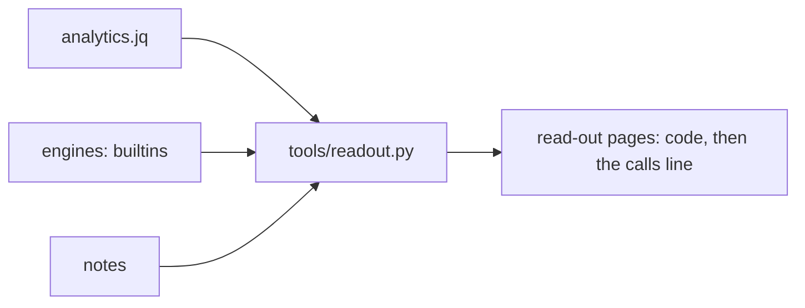

# 57 Names: whose function is it, and what does it act on

## Requirements

### Scope

A reader of the code read-out met `map_values(f)` inside the explanation of `shape` and could not tell whether it was a function of this library or of jq. The same reader found some public names too general to guess what they act on. This sprint makes the three kinds of name tellable apart everywhere, and renames the public names that do not say what they act on. No function's behaviour changes.

### Glossary

- **Built-in:** a function jq itself provides (`map_values`, `group_by`); an engine lists them with `builtins`.
- **Internal helper:** a function of this library whose name starts with `_`; not part of what users call.
- **Public function:** every other function of this library; each has an entry in the README's Reference.
- **Namespace:** jq's `import "analytics" as a;`, after which the library's functions are called `a::name`.

### Mental model and invariants

- One underscore marks internal. Nothing else marks it.
- Public names carry no library prefix: jq's `import ... as` already gives one to whoever wants it.
- A prefix marks a family (`join_*`, `tz_*`, `tree_*`); a suffix marks a variant (`*_nonnull`, `*_cont`, `*_disc`).
- No public name equals a built-in of a tested engine (`tests/check_names.py`, since sprint 55).

### Requirements

- **R1. Renames.** Seven public names change; the old names are removed, not kept as aliases (the library is before 1.0, and an alias would keep the unclear name alive).

| Before | Now | Why |
|---|---|---|
| `cast` | `cast_columns` | says what is cast |
| `keep` | `keep_tables` | it acts on a set of tables, not on rows |
| `over` | `window` | the SQL word `OVER` is a clause, not a name; the thing is a window |
| `calc` | `measure_with` | pairs with `measure`: the same measure, with a changed context |
| `share` | `share_of` | reads as a sentence: `share_of(revenue; without_filter("product"))` |
| `without` | `without_filter` | pairs with `with_filter` |
| `keep_only` | `only_filters` | pairs with `with_filter`; no longer looks like `keep_tables` |

- **R2. Error texts** that carry a renamed name carry the new one (`cast_columns: ...`).
- **R3. Read-out marks whose function each call is.** Under every definition's code the generated page lists the names the code calls, in two groups: built into jq, and from this library. The list is computed from the code and from the engines' `builtins`, so no page can miss one.
- **R4. README** gains a section "Names": the three kinds, the prefix and suffix conventions, the namespace import, the table of renames.

### Non-functional

All cases pass on the five engines; every README and read-out example is rerun; the namespace import is run on the five engines.

### Out of scope

A library prefix on every public name. Aliases for the old names. Renaming `shape`, `mode`, `runs`, `hops` and other short names that do say what they return. The input-type check and the other decisions waiting for sprint 60.

## Design

### End-to-end walkthrough

The reader's case, after the sprint. The read-out section of `shape` shows its code and, under it:

```text
Built into jq: `add`, `keys`, `length`, `map`, `map_values`, `unique`.
```

and the section of `group_agg` shows:

```text
Built into jq: `map`, `type`. From this library: `_groups`.
```

So `map_values` is jq's, `_groups` is the library's and internal.

A report cell before and after R1:

```text
before: {share_of_region: share(revenue; without("product")), all: calc(revenue; keep_only([]))}
after:  {share_of_region: share_of(revenue; without_filter("product")), all: measure_with(revenue; only_filters([]))}
```

### Components and boundaries



### Algorithms

```text
calls line of one definition:
  text   = the definition's code without comments and without string text
           (what stands inside \( ... ) of a string is kept: it is program)
  words  = identifiers in text that are not fields (.x), variables ($x), object keys (x:)
           or shorthand keys ({x, y}), minus the definition's own name and parameters
  jq     = words that some engine lists in `builtins` and the library does not define
  ours   = words the library defines
```

### Verification

| What | Checked by |
|---|---|
| renames change no behaviour | the 150 cases, on five engines, with the new names |
| no old name left in a call | a search of library, tests, tools, README, design docs and notes for the old names followed by `(` or in backticks |
| every example still runs | `tools/reference_examples.py` and `tools/readout.py --all` on four engines |
| the calls line | read for `shape`, `group_agg`, `_groups` and three long definitions against their code |
| namespace import | `a::mean` beside a user's own `mean`, on five engines |

## Tasks

- [x] 1. Renames in library, error texts, tests, tools, README, design docs, notes (R1, R2)
- [x] 2. The calls line in `tools/readout.py`; pages rebuilt (R3)
- [x] 3. README section "Names" (R4)
- [x] 4. Close: full run, private-detail scan, version 0.10.0, push and tag

## Log

- 2026-11-18: opened on the owner's review comment on `shape` and his go-ahead for the renames and the marking. Sprint 60 (input-type check) still waits for the end of his review; this sprint does not touch behaviour.
- 2026-11-18: tasks 1 to 4 done, closed as SHIPPED. 150 cases pass on jq 1.7.1, jq 1.8.2, gojq 0.12.20, jaq 3.1.2 and the Python jq 1.13.0 package with the new names; `tests/check_names.py` finds no clash; every README example and every read-out run gives the same output on four engines. A search for the seven old names as calls or in backticks finds none outside the README's table of renames. The read-out's 18 pages carry 122 calls lines; read against the code for `shape`, `group_agg`, `_groups`, `tz_offset`, `join_asof` and `join_within`. `import "analytics" as a` with a user's own `mean` beside `a::mean` gives both answers on the five engines. Version 0.10.0.
- 2026-11-18: after the close, on the owner's word that the hierarchy of a read-out page was hard to follow: each page now opens with a table of its functions (name, public or internal, what it is for), each function starts with a rule and a line saying whose it is and how it is called, and each sub-heading names its function (`### shape: the example`). Generator only; version 0.10.1.

## As built

As designed. The three notes whose definitions changed name were re-stamped; their prose changed only in the names. Closed specs before this one keep the old names: they record what was built then.
