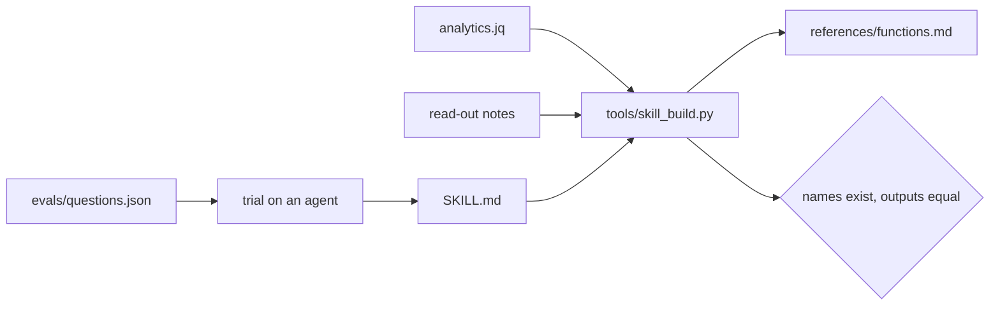

# 58 A skill for agents that use the library

## Requirements

### Scope

An agent that is handed `analytics.jq` knows jq but not this library. Given the code it rewrites functions inline; given a list of 100 functions it cannot tell which answers its question. This sprint writes the skill that sits between: how to get from a question to the right functions, and the rules a program must keep.

### What lives where

Decided with the sprint, because a skill can be put in several places.

| Place | Holds | Why there |
|---|---|---|
| this repository, `skills/jq-analytics/` | everything about the library that is true for any user: when to use it, loading, rules, routing table, method, worked cases, error meanings, the generated function index, the trial questions | it must change in the same commit as the library, and it ships with it |
| a user's own skill collection | which tool their agents pick among several (this library, a database, a notebook flow), a pointer to this skill, how it is installed for their agents | that is a choice about their tools, not a fact about this library |
| a user's environment notes | where the library is installed on their hosts | private to them |

The repository's skill names no host, product or organisation beyond jq engines and DuckDB.

### Glossary

- **Skill:** a `SKILL.md` with a name and a description that an agent loads when the description matches its task, plus reference files it opens when needed.
- **Routing table:** question, the shape of one row, the functions that answer it.
- **Trial:** an agent with only the skill and the library answers the questions in `evals/questions.json`.

### Mental model and invariants

- The body of the skill is what an agent needs on every use; the function index is a reference file, generated.
- Nothing in the skill can go stale silently: names are checked against the library and outputs are rerun.
- The skill says what jq knowledge does not: it does not teach jq.

### Requirements

- **R1. `SKILL.md`**: when to use the library and when to hand off; loading; the five rules; the routing table covering every family; a working method; worked cases with input, program, output and a hand check; what the error messages mean.
- **R2. `references/functions.md`**, generated: every public function, how it is called, what it is for.
- **R3. `tools/skill_build.py`**: writes R2; fails when `SKILL.md` names something that is neither a public function nor a jq built-in, or shows an output the engines do not give.
- **R4. `evals/questions.json`**: ten questions with known answers, each naming what it tests.
- **R5. One trial** of the skill on an agent, recorded in the log with its score and what was changed afterwards.

### Non-functional

No private or environment detail. The check runs on the four command-line engines.

### Out of scope

Packaging for a particular agent product; an automatic trial runner; the user's own tool-choice guidance.

## Design

### End-to-end walkthrough

An agent is asked "which device held this address at 6000?". The description matches ("who held this at that time"), so it loads `SKILL.md`. The routing table sends it to `intervals_from_events`, then `join_within`. The worked case shows the two-step program and the trap: the intervals carry the fields `resource` and `holder`, and a lease that lapsed before the moment gives null. The agent adapts the case, runs it on three rows, checks one by hand as the method says, and answers "nobody".

### Components and boundaries

### Verification

| What | Checked by |
|---|---|
| names in the skill exist | `tools/skill_build.py`, every name in backticks |
| worked cases print what the skill says | the same tool, four engines |
| expected answers of the questions | produced with the library, checked by hand, stated in the file |
| the skill routes an agent correctly | the trial: score out of ten, and each miss traced to a line of the skill |

## Tasks

- [x] 1. `tools/skill_build.py` and the generated index (R2, R3)
- [x] 2. `SKILL.md` (R1)
- [x] 3. Trial questions (R4)
- [x] 4. One trial on an agent; fix what it shows (R5)
- [x] 5. Close: README pointer, full run, private-detail scan, version, push and tag

## Log

- 2026-11-18: opened on the owner's word: the skill "can't be the code and it also can't be just a list of functions". Tasks 1 to 3 done: the index lists the 97 public functions outside the time-zone block, 100 call forms (three have two arities); `SKILL.md` names 45 library and jq names, all found; its eight runs print what it says on jq 1.7.1, jq 1.8.2, gojq and jaq.
- 2026-11-18: task 4. Trial: an agent (Claude, a fresh session) given only `SKILL.md`, `references/functions.md` and the questions without their answers, barred from the README, the docs, the tests and the source. Score 10 of 10; 14 runs for ten questions; no jq error. Six needed one run, two needed two, one needed three (`rank_by`). Its limits, in its own report: q10 and parts of q01, q02 and q06 follow the skill's worked cases closely, so they test copying more than understanding. The gaps it named, and what was changed: (1) `rank_by` ranks in the window's order and uses `f` only for ties, so a different order gives a quiet wrong answer: now stated in `SKILL.md` with the top-per-group pattern; (2) the field names of results were found only by running: `references/functions.md` now carries each function's code comment, which names them, and `SKILL.md` lists the commonest; (3) `$within` on the funnel, (4) the direction of graph edges and whether the start is included, (5) the accepted type names of `cast_columns` and kinds of `intervals_from_events`, (6) descending order in a window, (7) `group_agg`'s second argument being any filter, with a last-row-per-group pattern, (8) `parse_ts` on empty text, (9) intervals including their start and not their end: each is now a line in the new section "What the names do not tell you", checked by a run first. The skill was not tried again after these changes.
- 2026-11-18: task 5, closed as SHIPPED. `tools/skill_build.py` passes on four engines (8 runs, 50 names); 150 cases pass on five engines; README lists the skill. Version 0.11.0.
- 2026-11-18, after the close: a second trial, on the skill as changed after the first. A fresh agent under the same bar answered the ten questions (10 of 10, ten runs, one each, no error) and five new ones that do not resemble the worked cases, each with a hand check (5 of 5; six runs, the extra one an experiment). It guessed in three places and hit one trap by reading ahead: a flat join refuses a field both sides have with different values, and the as-of join's own comment does not say so, though both tables nearly always call the time `t`. Written into `SKILL.md`: the clash rule with its error text and the rename, the start order for a dependency graph, that `runs` has no partition or order, a `pivot` call with what its last argument receives, and `round_to` for interpolated numbers. The five new questions are in `evals/questions.json` as q11 to q15. Left for a code sprint, because they change comments the read-out quotes: the thin comments of `join_on`, `join_asof`, `runs` and `diff_tables`.

## As built

As designed, with one addition from the trial: the function index carries each function's code comment, so argument meanings and result fields come from the library itself. Not built: a runner that scores a trial automatically, and a second set of questions that do not resemble the worked cases.
