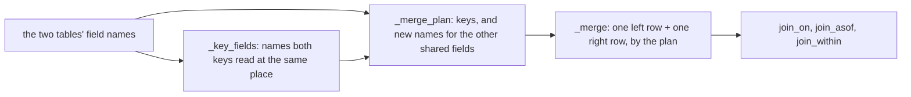

# 59 A field name on both sides of a join

## Requirements

### Scope

Until 0.11.0 a flat join stopped with an error when the two tables had a field of the same name with different values. That stops the join on exactly the rows someone comparing two sources wants to see, it makes joins of tables with ordinary field names (`name`, `status`, `t`) fail, and whether it fails depends on the data and not on the tables' fields. This sprint replaces the rule with the one Polars uses: both values are kept, the right one under a suffixed name.

### What other tools do

The same join was run on two rows a side, with `host` as the key and `site` on both sides with one disagreement.

| Tool | What comes out for `site` | How it was checked |
|---|---|---|
| Polars 2.1.0 | `site`, `site_right` | run |
| pandas 3.1.1 | `site_x`, `site_y` | run |
| DuckDB 2.0.0 | `site`, `site_1`; with the key written as an `ON` condition also `host`, `host_1`, with `USING` one `host` | run |
| SQLite 3.49.1 | two columns both named `site` | run |
| Power Query | the right one prefixed with the table name when expanded; `Table.PrefixColumns` by hand before `Table.Join` | its documentation |
| this library, 0.11.0 | an error naming the field | run |

No tool stops. Polars' rule was chosen because the left table's fields never change name.

### Mental model and invariants

- The output's field names follow from the two tables' field names and the keys, never from the values.
- A left field keeps its name. A right field whose name the left table also has is written as name + suffix, in every matched row, whether or not the values agree.
- A field that both keys read directly, at the same place of the key, is equal in every match and appears once.
- Nothing is overwritten silently: a suffixed name that already exists is an error.

### Requirements

- **R1. Default.** `join_on`, the five equality joins, `join_overlap`, `join_asof` and `join_within` keep both values of a shared field name, the right one with `_right`.
- **R2. Key once.** A field read directly by both keys appears once: `.host` and `.host`; the same field of two object keys (`{site, host}`); the same position of two array keys (`[.site, .host]`). A computed key (`.host | ascii_downcase`) is not recognised, and its field comes out twice.
- **R3. Suffix argument.** `join_on` takes a sixth argument, the suffix. `null` asks for the strict rule of 0.11.0: equal values kept once, different values an error naming the field.
- **R4. Taken name.** A suffixed name that is already a field of either table is an error naming it.
- **R5. Full join.** A right row that matched nothing carries its shared fields under the suffixed names, like every other row.
- **R6. Rows of different shapes.** The shared names are found over all rows of each table, so a left row that lacks the field still gets the right one's value under the suffixed name, never under the plain one.

### Non-functional

All cases pass on the five engines. The time of a 200,000-row join is measured before and after.

### Out of scope

A prefix instead of a suffix; a suffix for the left side; recognising computed keys.

## Design

Three internal helpers replace the old two-argument `_merge`.

- **`_key_fields`** runs each key on a made-up row in which every field holds a label with its own name, and collects the labels that come out with the place they sit at. A name whose label sits at the same place on both sides is a key field. A key that cannot run on labels (it computes on the value) fails, the failure is caught, and no field counts as the key. This needs no `path()`, which fails on object and array keys on every engine tried.
- **`_merge_plan`** is made once per join: `{keys: {host: true}, names: {site: "site_right"}}`, or `{strict: true}` for a null suffix. Its cost is one pass over each table's field names.
- **`_merge`** walks the right row's fields: a key field is set only if the row lacks it, a planned name is written under its new name, any other under its own.

Worked case, the tables of the test fixture: left `{id: 1, host: "db01", site: "N"}`, right `{host: "db01", site: "S", owner: "ann"}`, keys `.host` and `.host`. Key fields: `["host"]`. Shared without the key: `["site"]`. Plan: `site` to `site_right`. Output row: `{id: 1, host: "db01", site: "N", site_right: "S", owner: "ann"}`.

This is a change of default behaviour, so the version is 0.12.0.

## Tasks

- [x] 1. `_key_fields`, `_merge_plan`, `_merge/3` in `analytics.jq`; `join_on/6` and `join_on/5`; `join_asof` and `join_within` make a plan. Comments above the joins rewritten.
- [x] 2. Tests: fixture `tests/fixtures/shared_fields.json`, seventeen cases `join_shared_field_*` (default, object key, array key, full join, another suffix, computed key, no key, crossed array keys, strict with equal values, as-of, within, overlap, semi untouched, rows of different shapes; errors: strict with different values, suffixed name taken, empty suffix). The old `join_clash_error` case is removed; the strict error is covered by the new case.
- [x] 3. Read-out notes for joins rewritten (three helper sections with stepped runs, "A field name on both sides" under `join_on`), intervals note corrected; pages rebuilt.
- [x] 4. README (rule paragraph, `join_on` entry, one example), skill (the fact and the error row), feature matrix, version 0.12.0.

## Log

- 2026-11-18. Opened and closed the same day on the owner's word ("ok, follow polars", then "just go ahead and code").
- 166 of 166 cases on jq 1.7.1, jq 1.8.2, gojq 0.12.20, jaq 3.1.2 and the Python package 1.13.0; no public name equals a built-in.
- Time of `join_inner` of 200,000 left rows to 20,000 right rows, one run each, same machine. Before (0.11.0, the left table's `site` dropped first because that version refuses it): jq 1.8.2 1.81 s, gojq 1.30 s, jaq 2.18 s. After, with `site` on both sides: jq 1.8.2 2.42 s, gojq 1.24 s, jaq 2.37 s. The two runs do not merge the same fields, so the difference is an upper bound on what the plan costs.
- Not done: no second measurement on jq 1.7.1 or the Python package; no new trial of the agent skill beyond the checks of `tools/skill_build.py`.
