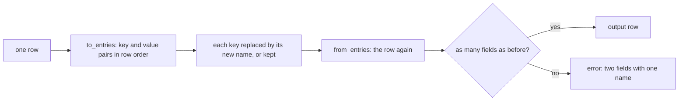

# 61 Renaming fields

Number 60 is kept for the input-type check, which is planned and not yet written as a spec; this sprint was asked for first and does not depend on it.

## Requirements

### Scope

The library had no function that renames a field. Three places in analytic work need one:

- **After a join.** Since sprint 59 a field name on both sides comes out as `site` and `site_right`. The suffix says which side the value came from, not what it is, and a second join onto the result stops when `site_right` is taken.
- **Before two tables are stacked.** One says `host`, the other `hostname`.
- **Before a report.** The columns get the names its reader expects.

Plain jq does it as `map(.new = .old | del(.old))`, which adds a null field to a row that lacks the old one and, on jq and jaq, moves the field to the end of the row.

What other tools have: SQL `AS`; pandas and Polars `rename` with a mapping; Power Query `Table.RenameColumns` and, for a whole table, `Table.PrefixColumns`; Splunk `rename`; Kusto `project-rename`.

### Requirements

- **R1. `rename_fields($names)`.** `$names` is an object of old name to new name. Every row's field with an old name gets the new one, with its value.
- **R2. Place.** The field keeps its place in the row on the engines that keep field order (jq, jaq, the Python package).
- **R3. Ragged rows.** A row without the field is unchanged; no null field is added. An old name no row has is ignored.
- **R4. At once.** Each field is looked up once under its old name, so two fields can swap names in one call.
- **R5. Taken name.** A new name that is already another field of the row is an error naming it.
- **R6. `prefix_fields($prefix)`.** Every field name of every row gets the prefix. An empty prefix changes nothing.
- **R7. Arguments.** `$names` that is not an object of strings, and a prefix that is not a string, are errors that show the form expected.

### Non-functional

All cases pass on the five engines. No public name equals an engine built-in.

### Out of scope

A list of fields that `prefix_fields` leaves alone (write `prefix_fields("reg_") | rename_fields({reg_host: "host"})`); a suffix function; renaming by a function of the name; choosing and dropping columns, which plain jq does shortly (`map({host, site})`, `map(del(.site))`).

## Design

Both functions sit in the reshape family of `analytics.jq`, after `pivot`, and work one row at a time.

- **`rename_fields`** looks each key up in `$names` (`$names[.key] // .key`). The lookup uses only old names, which is what makes a swap work. `from_entries` keeps one value when two entries have the same key, so the count of entries is compared with the count of fields of the result; a difference is the clash of R5.
- **`prefix_fields`** is `with_entries(.key = $prefix + .key)`. Two different names stay different with the same text in front, so no clash is possible and none is checked.

Worked case, the test fixture: rows `{host: "db01", site: "N", site_right: "S"}`, `{host: "web01", site: "N"}` and `{}`, with `rename_fields({site_right: "site_cmdb"})`. Row 1: entries `host`, `site`, `site_right`; keys after the lookup `host`, `site`, `site_cmdb`; three fields in, three out; result `{host: "db01", site: "N", site_cmdb: "S"}`. Rows 2 and 3 hold no listed name and come out as they went in. With `{site_right: "site"}` instead, row 1's keys are `host`, `site`, `site`: three entries, two fields, the error.

## Tasks

- [x] 1. `rename_fields/1` and `prefix_fields/1` in `analytics.jq`.
- [x] 2. Tests: fixture `tests/fixtures/rename_rows.json`, twelve cases (`rename_fields` plain, several names with one missing, swap, place kept, empty table; errors: taken name, value not a string, argument not an object; `prefix_fields` plain, empty prefix, before a join, prefix not a string).
- [x] 3. Read-out notes for both in the reshape page, with stepped runs; pages rebuilt.
- [x] 4. README (two entries, one example), skill (one row of the question table), feature matrix, version 0.13.0.

## Log

- 2026-11-19. Opened and closed the same day on the owner's word ("ok add both now").
- 178 of 178 cases on jq 1.7.1, jq 1.8.2, gojq 0.12.20, jaq 3.1.2 and the Python package 1.13.0; 101 public names, none equal to a built-in.
- The lines added to `analytics.jq` move every later definition down by 21 lines, so the ten read-out pages after reshape were rebuilt with new line numbers and no other change.
- Not done: no timing on a large table; no trial of the agent skill beyond the checks of `tools/skill_build.py`.
