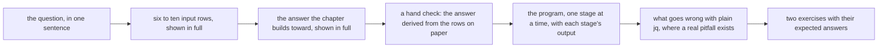

# Tutorial outline

An outline for a tutorial on `analytics.jq`, not the tutorial itself. The library is for learning, for practical answers to the questions people ask about jq, as glue between raw data and heavier analysis, and as a tested vocabulary for code an AI writes; the tutorial serves the first two. Thirteen chapters in teaching order, after the primer. Each row of a chapter says the question it answers, the made-up data it runs on, the functions it introduces, and the hand check the reader can do before running anything.

## Who it is for, and what they leave with

A reader who can write a jq filter with `map` and `select`, has data arriving as JSON or YAML, and has been answering questions about it with ad hoc jq or by pasting into a spreadsheet. After the tutorial they can:

- say which shape their question needs (a table, intervals, a tree, a graph, a star) and get their data into it;
- write the program for it from the library's functions, with nulls, time zones and ties decided by stated rules;
- check the answer by hand on a few rows;
- tell when the data has outgrown jq and what to hand to the next tool.

## Before chapter 1: the primer

Most questions people ask about jq are not analytic: they are about jq's model of evaluation (one value in, one or many out; `select` dropping a value; several values inside `if` or an object) and about the shell (quotes, `--arg`, loops). `docs/primer.md` covers those, from the two surveys in `docs/research/questions-2026-11-19.md`, and the tutorial assumes it. A reader who can already explain why `.[] | length` prints once per row can skip it.

Each chapter below opens on a question people really ask (its source is in the survey page) and ends with the hand-written jq answer it replaces, where that answer exists.

## How every chapter is built

The answer comes before the program. A reader who has derived the answer by hand reads each stage of the program knowing what it has to produce.

Two rules for the writing:

- **One scenario throughout.** A made-up IT service desk: requests with open and resolve times, the groups and sites they belong to, the devices on its network. Each chapter adds a table to it. No real names or values.
- **Every output shown is produced by a run.** The tutorial's code blocks are built like the README's examples and the read-out's runs: a script runs them on four engines and writes the outputs in. Nothing is typed in by hand.

## The chapters

| # | Chapter | The question | Data | Introduces | Hand check |
|---|---|---|---|---|---|
| 1 | Rows of strings | How long did resolved requests take, typically? | 6 requests, every value a string, one unresolved, one with an empty time; the same requests as a CSV file | `from_csv`, `cast_columns`, `parse_ts`, `hours_between`, `mean`, `median`, `count_nonnull`, `round_to` | 5 durations on paper; the mean with and without the unresolved row |
| 2 | Nested documents | The same question when each request arrives as a nested document with a list of comments, or as an object keyed by request number | 3 nested requests; the same as a keyed object | `flatten_fields`, `flatten_paths`, `unflatten_fields`, `unnest`, `unnest_outer`, `rows_from_map`, `drop_empty` | the row count after unnesting, predicted from the comment counts |
| 3 | Whose clock | How many were opened during office hours at the site? | the 6 requests, opened either side of a clock change | `tz`, `local_time`, `format_local` | two timestamps converted by hand, one in winter and one in summer |
| 4 | Groups | Typical duration and its spread, per support group | the same 6, three groups, one group null | `group_agg`, `quantile_disc`, `quantile_cont`, `stddev_samp`, `min_nonnull`, `max_nonnull` | one group's median two ways, to show the two rules differ |
| 5 | Two tables | Which site does each request belong to, and which requests have no site? | requests and 3 sites in one stream with a type field; one request with an unknown site, one site with no requests | `split_by`, `shape`, `lookup`, `join_inner`, `join_left`, `join_anti`, `join_nest`, `join_on` | the row count of each join predicted before running |
| 6 | Order within a group | Each request's place in its group's queue, its rank by duration, and the gap since the previous one | 8 requests in 2 groups | `window`, `row_number`, `rank_by`, `lag`, `lead`, `running_sum`, `moving_mean` | one group's columns written out by hand |
| 7 | Reshaping | One row per group and one column per month; and back | 10 monthly counts | `pivot`, `unpivot`, `fill_grid`, `rename_fields`, `prefix_fields` | the missing month found by eye, then filled |
| 8 | State over time | How long was each request in each status, and how many times was it reopened? | 12 status changes of 3 requests, with one repeated status | `state_blocks`, `transitions`, `sessions`, `runs` | one request's timeline drawn as blocks |
| 9 | Who held it at that moment | Which device had this address when the alert fired? | 9 lease events of 2 addresses, 3 alerts | `intervals_from_events`, `join_within`, `join_overlap`, `merge_intervals`, `concurrency`; why `join_asof` is the wrong tool here | the leases drawn as bars, the alerts as points on them |
| 10 | Trees and graphs | Head count under each manager; what must be patched before what | an 8-person org chart, given nested; 6 dependencies between services | `nodes_from_nested`, `tree_paths`, `tree_rollup`, `nested_from_nodes`, `reachable`, `hops`, `shortest_path`, `topo_order`, `components` | the roll-up added on paper; the dependency levels by inspection |
| 11 | Reports at several levels | Requests by site and month, each cell's share of its site, the previous month, and the year to date | 10 requests, 2 sites, a month with none | `rollup`, `rollup_levels`, `measure`, `measure_with`, `share_of`, `without_filter`, `only_filters`, `with_filter`, `shift`, `to_date`, `calendar`, `on_calendar` | one row of the report by hand, with the empty month |
| 12 | Paths through events | Of the users who opened the form, how many submitted, and how many came back the next month? | 14 events of 5 users | `funnel_steps`, `funnel`, `cohorts`, `retention` | each user's depth by eye; the retention table for one cohort |
| 13 | Looking at a table you did not make, and handing it on | What is in this export, what changed since yesterday, and how do I pass the result to a database or a graph tool? | two versions of a 6-row host list with a mistyped name | `profile`, `value_counts`, `mode`, `bin_edges`, `histogram`, `corr`, `diff_tables`, `diff_docs`, `similarity`, `join_fuzzy`, `to_csv`, `to_tsv`, `to_table`, `to_map`, `node_link` | the changed rows spotted by eye before `diff_tables` names them |

## Why this order

- **1 to 4 are one table and one idea each**: types, nested input, time, grouping. Nothing later works on untyped or nested rows, so those come first; chapter 2 is early because nested JSON is what most readers actually have.
- **5 to 7 add a second table and order**, the things a spreadsheet user already does by hand.
- **8 and 9 are the first chapters where the data changes shape**: events become blocks and intervals. Chapter 9 starts from the tempting wrong answer, an as-of join, because that failure is what makes intervals necessary; it is the only chapter that opens on a wrong attempt.
- **10 follows 9** because it is the second shape change, and a smaller one: the rows are already nodes or edges.
- **11 is late on purpose.** A report at several levels needs grouping, joins and the calendar from the chapters before it, and its idea, a measure evaluated in a context, is the largest in the tutorial.
- **12 and 13 apply what came before** to two common jobs and end on the hand-off: what to export and when to stop using jq.

## What each chapter must not skip

- The first run of any function shows its output on the chapter's rows, not a description of it.
- **What the one input value is.** jq runs a filter once per value; the library's functions take the whole table as that value. Chapter 1 opens on this, before any library function: the same six requests as one array and as six separate values, `length` and `to_entries` run on both, and `.[]`, `[ ... ]` and `--slurp` as the ways between them. Every later chapter says, at a function's first use, what its input value is (a table, a list of values, one group, one row), and shows once what the function does when handed a row instead of a table: since 0.14.0 it stops with a message naming itself.
- Every rule that could have gone another way is stated where it first matters: nulls skipped, ties broken, an interval's end excluded, the engine a result was checked on.
- Costs are given with the size they were measured at, and the chapter says what to do past that size.

## Not in the tutorial

Installing jq; jq's own model and the shell, which are the primer's; fitting models; anything past about 200,000 rows, which the last chapter hands to a database with the query to use.

## Left to the reference

The tutorial places all but fourteen of the library's public functions in a chapter. Those fourteen are variants of ones it teaches and are left to the README's reference: `nonnull`, `sum_nonnull`, `min_by_nonnull`, `max_by_nonnull`, `var_samp`, `var_pop`, `stddev_pop`, `quantiles_disc`, `quantiles_cont`, `tz_offset`, `join_full`, `join_semi` (shown in the primer, section 8), `keep_tables`, `rows_from_arrays`.
